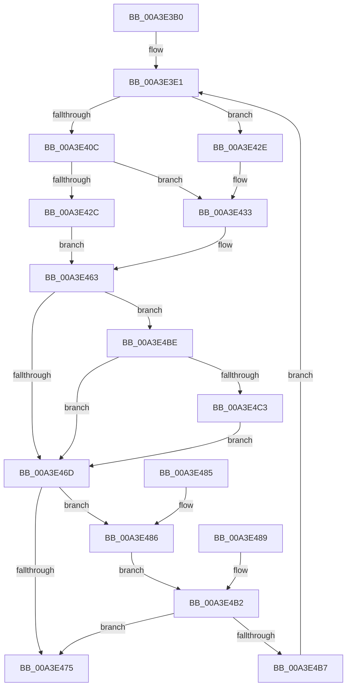

# BiSetRegistryValue

- RVA: `0x00A3E3B0`–`0x00A3E4CA` (길이 `282` bytes)
- VA: `0x0000000140A3E3B0`
- 실행 섹션: `PAGE`
- PDB 이름 있음: `예`; PDB Function 태그: `아니요`
- unwind 정보 RVA: `0x000AE718`
- 디코드: `80`개 명령, `282/282` bytes 표시
- 미해석 바이트: `0` (있으면 어셈블리에 `.byte`로 보존)

> 이 문서는 커널 이미지의 기계어와 PDB 기호를 분석해 생성했습니다. 4번과 5번은 함수 원형과 자료형을 바이너리 사용 방식에서 추정한 C 해석이며 원본 소스 복구 결과는 아닙니다.

## 1. Dependencies

- 직접 호출 지점: **5**; 고유 호출 대상: **5**
- 직접 호출자로 확인된 함수: **9**
- RIP 상대 이미지 참조: **0**

### Outgoing calls
- `0x00A3E3E9` → [RtlInitUnicodeString](../../text/42/RtlInitUnicodeString_function_0042A780.md) (function, `0x0042A780`)
- `0x00A3E3F1` → [BiSanitizeHandle](../../text/4B/BiSanitizeHandle_function_004B0E4C.md) (function, `0x004B0E4C`)
- `0x00A3E41D` → [BiOpenKey](BiOpenKey_function_00A3F60C.md) (function, `0x00A3F60C`)
- `0x00A3E458` → [BiZwSetValueKey](../../text/4B/BiZwSetValueKey_function_004BC668.md) (function, `0x004BC668`)
- `0x00A3E4C3` → [BiCloseKey](../91/BiCloseKey_function_00916A00.md) (function, `0x00916A00`)

### Direct callers
- [BiSetFirmwareModified](../../text/4B/BiSetFirmwareModified_function_004B1DF4.md) at `0x004B1E27`
- [BcdMarkAsSystemStore](../82/BcdMarkAsSystemStore_function_008233B4.md) at `0x00823402`
- [BiMarkTreatAsSystemStore](../82/BiMarkTreatAsSystemStore_function_008234C8.md) at `0x0082355A`
- [BiCreateEfiEntry](../82/BiCreateEfiEntry_function_008268C4.md) at `0x008269AE`
- [BiCreateEfiEntry](../82/BiCreateEfiEntry_function_008268C4.md) at `0x00826A44`
- [BiUpdateBcdObject](../82/BiUpdateBcdObject_function_008270D0.md) at `0x008271B3`
- [BiUpdateBcdObject](../82/BiUpdateBcdObject_function_008270D0.md) at `0x008273A5`
- [BcdSetElementDataWithFlags](BcdSetElementDataWithFlags_function_00A3F080.md) at `0x00A3F1D3`
- [BiAddStoreFromFile](../A4/BiAddStoreFromFile_function_00A40C54.md) at `0x00A40D48`
- [BiSetObjectDescription](../A4/BiSetObjectDescription_function_00A41DE8.md) at `0x00A41E5A`
- [BcdSetBootBcdAsSystemStore](../../init/C6/BcdSetBootBcdAsSystemStore_function_00C6D214.md) at `0x00C6D290`

### Static image references
- 디코드된 RIP-relative 메모리 참조가 없습니다.

## 2. Other-region calls and transfers

- 다른 실행 섹션으로 향하는 call: **3**
  - `0x00A3E3E9` → [RtlInitUnicodeString](../../text/42/RtlInitUnicodeString_function_0042A780.md) (`PAGE` → `.text`)
  - `0x00A3E3F1` → [BiSanitizeHandle](../../text/4B/BiSanitizeHandle_function_004B0E4C.md) (`PAGE` → `.text`)
  - `0x00A3E458` → [BiZwSetValueKey](../../text/4B/BiZwSetValueKey_function_004BC668.md) (`PAGE` → `.text`)
- 별도 외부 분기/꼬리 이동을 확인하지 못했습니다.

## 3. Assembly (complete function range)

```asm
00A3E3B0  48 8B C4                        mov rax, rsp
00A3E3B3  44 89 48 20                     mov dword ptr [rax + 0x20], r9d
00A3E3B7  4C 89 40 18                     mov qword ptr [rax + 0x18], r8
00A3E3BB  48 89 50 10                     mov qword ptr [rax + 0x10], rdx
00A3E3BF  53                              push rbx
00A3E3C0  56                              push rsi
00A3E3C1  57                              push rdi
00A3E3C2  41 54                           push r12
00A3E3C4  41 56                           push r14
00A3E3C6  41 57                           push r15
00A3E3C8  48 83 EC 58                     sub rsp, 0x58
00A3E3CC  45 8B E1                        mov r12d, r9d
00A3E3CF  4D 8B F0                        mov r14, r8
00A3E3D2  4C 8B FA                        mov r15, rdx
00A3E3D5  48 8B F9                        mov rdi, rcx
00A3E3D8  0F 57 C0                        xorps xmm0, xmm0
00A3E3DB  0F 11 40 B8                     movups xmmword ptr [rax - 0x48], xmm0
00A3E3DF  33 F6                           xor esi, esi
00A3E3E1  49 8B D7                        mov rdx, r15
00A3E3E4  48 8D 4C 24 40                  lea rcx, [rsp + 0x40]
00A3E3E9  E8 92 C3 9E FF                  call 0x14042a780
00A3E3EE  48 8B CF                        mov rcx, rdi
00A3E3F1  E8 56 2A A7 FF                  call 0x1404b0e4c
00A3E3F6  48 8B F8                        mov rdi, rax
00A3E3F9  48 89 84 24 90 00 00 00         mov qword ptr [rsp + 0x90], rax
00A3E401  48 83 64 24 38 00               and qword ptr [rsp + 0x38], 0
00A3E407  4D 85 F6                        test r14, r14
00A3E40A  74 22                           je 0x140a3e42e
00A3E40C  4C 8D 4C 24 38                  lea r9, [rsp + 0x38]
00A3E411  41 B8 1F 00 02 00               mov r8d, 0x2001f
00A3E417  49 8B D6                        mov rdx, r14
00A3E41A  48 8B C8                        mov rcx, rax
00A3E41D  E8 EA 11 00 00                  call 0x140a3f60c
00A3E422  8B D8                           mov ebx, eax
00A3E424  89 44 24 30                     mov dword ptr [rsp + 0x30], eax
00A3E428  85 C0                           test eax, eax
00A3E42A  79 07                           jns 0x140a3e433
00A3E42C  EB 35                           jmp 0x140a3e463
00A3E42E  48 89 7C 24 38                  mov qword ptr [rsp + 0x38], rdi
00A3E433  8B 84 24 B8 00 00 00            mov eax, dword ptr [rsp + 0xb8]
00A3E43A  89 44 24 28                     mov dword ptr [rsp + 0x28], eax
00A3E43E  48 8B 84 24 B0 00 00 00         mov rax, qword ptr [rsp + 0xb0]
00A3E446  48 89 44 24 20                  mov qword ptr [rsp + 0x20], rax
00A3E44B  45 8B CC                        mov r9d, r12d
00A3E44E  48 8D 54 24 40                  lea rdx, [rsp + 0x40]
00A3E453  48 8B 4C 24 38                  mov rcx, qword ptr [rsp + 0x38]
00A3E458  E8 0B E2 A7 FF                  call 0x1404bc668
00A3E45D  8B D8                           mov ebx, eax
00A3E45F  89 44 24 30                     mov dword ptr [rsp + 0x30], eax
00A3E463  48 8B 4C 24 38                  mov rcx, qword ptr [rsp + 0x38]
00A3E468  48 3B CF                        cmp rcx, rdi
00A3E46B  75 51                           jne 0x140a3e4be
00A3E46D  81 FB 7D 01 00 C0               cmp ebx, 0xc000017d
00A3E473  74 11                           je 0x140a3e486
00A3E475  8B C3                           mov eax, ebx
00A3E477  48 83 C4 58                     add rsp, 0x58
00A3E47B  41 5F                           pop r15
00A3E47D  41 5E                           pop r14
00A3E47F  41 5C                           pop r12
00A3E481  5F                              pop rdi
00A3E482  5E                              pop rsi
00A3E483  5B                              pop rbx
00A3E484  C3                              ret
00A3E485  CC                              int3
00A3E486  CC                              int3
00A3E487  EB 29                           jmp 0x140a3e4b2
00A3E489  BE 05 00 00 00                  mov esi, 5
00A3E48E  44 8B A4 24 A8 00 00 00         mov r12d, dword ptr [rsp + 0xa8]
00A3E496  4C 8B B4 24 A0 00 00 00         mov r14, qword ptr [rsp + 0xa0]
00A3E49E  4C 8B BC 24 98 00 00 00         mov r15, qword ptr [rsp + 0x98]
00A3E4A6  48 8B BC 24 90 00 00 00         mov rdi, qword ptr [rsp + 0x90]
00A3E4AE  8B 5C 24 30                     mov ebx, dword ptr [rsp + 0x30]
00A3E4B2  83 FE 05                        cmp esi, 5
00A3E4B5  73 BE                           jae 0x140a3e475
00A3E4B7  FF C6                           inc esi
00A3E4B9  E9 23 FF FF FF                  jmp 0x140a3e3e1
00A3E4BE  48 85 C9                        test rcx, rcx
00A3E4C1  74 AA                           je 0x140a3e46d
00A3E4C3  E8 38 85 ED FF                  call 0x140916a00
00A3E4C8  EB A3                           jmp 0x140a3e46d
```

## 4. C-style interpretation (structured pseudocode)

```c
__int64 __fastcall BiSetRegistryValue(__int64 a1, __int64 a2, __int64 a3, int a4, __int64 a5, unsigned int a6)
{
    __int64 result;
    __int64 v_rsi;
    __int64 v_rsp;
    unsigned __int64 v_stack_m48;
    unsigned __int64 v_stack_m50;
    unsigned int v_stack_m58;
    unsigned int v_stack_m60;
    unsigned __int64 v_stack_m68;
    unsigned int v_stack_p30;
    unsigned __int64 v_stack_p8;
    unsigned __int64 v_stack_p90;
    unsigned __int64 v_stack_p98;
    unsigned __int64 v_stack_pA0;
    unsigned int v_stack_pA8;

    *(unsigned int *)(v_rsp + 32) = a4;
    *(unsigned __int64 *)(v_rsp + 24) = a3;
    *(unsigned __int64 *)(v_rsp + 16) = a2;
    v_rsp = (v_rsp) - (88);
    *(unsigned __int64 *)(v_rsp - 72) = v_xmm0;
    v_rsi = 0;
loc_00A3E3E1:
    result = RtlInitUnicodeString(v_stack_m48, a2, a3, a4);
    result = BiSanitizeHandle(a1, a2, a3, a4);
    v_stack_p8 = result;
    if (a3 == 0) goto loc_00A3E42E;
    result = BiOpenKey(result, a3, (unsigned int)(0x2001FULL), v_stack_m50);
    v_stack_m58 = (unsigned int)(result);
    if (!sign_flag) goto loc_00A3E433;
    goto loc_00A3E463;
loc_00A3E42E:
    v_stack_m50 = result;
loc_00A3E433:
    v_stack_m60 = (unsigned int)((unsigned int)(a6));
    v_stack_m68 = a5;
    result = BiZwSetValueKey(v_stack_m50, v_stack_m48, (unsigned int)(0x2001FULL), (unsigned int)((unsigned int)((unsigned int)(a4))));
    v_stack_m58 = (unsigned int)(result);
loc_00A3E463:
    if (v_stack_m50 != result) goto loc_00A3E4BE;
loc_00A3E46D:
    if (((unsigned int)((unsigned int)((unsigned int)(result)))) == 0xC000017DULL) goto loc_00A3E486;
loc_00A3E475:
    v_rsp = (v_rsp) + (88);
    return (unsigned int)((unsigned int)((unsigned int)((unsigned int)(result))));
loc_00A3E486:
    goto loc_00A3E4B2;
loc_00A3E4B2:
    if (0 >= 5) goto loc_00A3E475;
    v_rsi = (unsigned int)((v_rsi) + 1);
    goto loc_00A3E3E1;
loc_00A3E4BE:
    if (v_stack_m50 == 0) goto loc_00A3E46D;
    result = BiCloseKey(v_stack_m50, v_stack_m48, (unsigned int)(0x2001FULL), (unsigned int)((unsigned int)((unsigned int)(a4))));
    goto loc_00A3E46D;
}
```

## 5. (Beta) C Style

```c
int64_t BiSetRegistryValue(int64_t Arg1, int64_t Arg2, int64_t Arg3, int32_t Arg4, int64_t Arg5, uint32_t Arg6)
{
    int64_t result;
    int64_t local_rsi;
    int64_t local_rsp;
    uint64_t v_stack_m48;
    uint64_t v_stack_m50;
    uint32_t v_stack_m58;
    uint32_t v_stack_m60;
    uint64_t v_stack_m68;
    uint32_t v_stack_p30;
    uint64_t v_stack_p8;
    uint64_t v_stack_p90;
    uint64_t v_stack_p98;
    uint64_t v_stack_pA0;
    uint32_t v_stack_pA8;

    *(uint32_t *)(local_rsp + 0x20) = Arg4;
    *(uint64_t *)(local_rsp + 0x18) = Arg3;
    *(uint64_t *)(local_rsp + 0x10) = Arg2;
    local_rsp = (local_rsp) - (88);
    *(uint64_t *)(local_rsp - 0x48) = v_xmm0;
    local_rsi = 0;
loc_00A3E3E1:
    result = RtlInitUnicodeString(v_stack_m48, Arg2, Arg3, Arg4);
    result = BiSanitizeHandle(Arg1, Arg2, Arg3, Arg4);
    v_stack_p8 = result;
    if (Arg3 == 0) goto loc_00A3E42E;
    result = BiOpenKey(result, Arg3, (uint32_t)(0x2001FULL), v_stack_m50);
    v_stack_m58 = (uint32_t)(result);
    if (!sign_flag) goto loc_00A3E433;
    goto loc_00A3E463;
loc_00A3E42E:
    v_stack_m50 = result;
loc_00A3E433:
    v_stack_m60 = (uint32_t)((uint32_t)(Arg6));
    v_stack_m68 = Arg5;
    result = BiZwSetValueKey(v_stack_m50, v_stack_m48, (uint32_t)(0x2001FULL), (uint32_t)((uint32_t)((uint32_t)(Arg4))));
    v_stack_m58 = (uint32_t)(result);
loc_00A3E463:
    if (v_stack_m50 != result) goto loc_00A3E4BE;
loc_00A3E46D:
    if (((uint32_t)((uint32_t)((uint32_t)(result)))) == 0xC000017DULL) goto loc_00A3E486;
loc_00A3E475:
    local_rsp = (local_rsp) + (88);
    return (uint32_t)((uint32_t)((uint32_t)((uint32_t)(result))));
loc_00A3E486:
    goto loc_00A3E4B2;
loc_00A3E4B2:
    if (0 >= 5) goto loc_00A3E475;
    local_rsi = (uint32_t)((local_rsi) + 1);
    goto loc_00A3E3E1;
loc_00A3E4BE:
    if (v_stack_m50 == 0) goto loc_00A3E46D;
    result = BiCloseKey(v_stack_m50, v_stack_m48, (uint32_t)(0x2001FULL), (uint32_t)((uint32_t)((uint32_t)(Arg4))));
    goto loc_00A3E46D;
}
```

## 6. Execution-region graph

[열기: 2D/3D 그래프와 함수 탐색 컨트롤 패널](../../../control-panel.html?section=page&rva=0x00A3E3B0&view=graph)

- 2D 그래프는 위에서 아래로 흐르고, 3D 그래프는 빈 공간을 드래그해 회전합니다. Shift+드래그는 이동, 휠은 확대·축소, 함수 노드 선택은 대상 보고서 이동입니다.

### Static fallback


