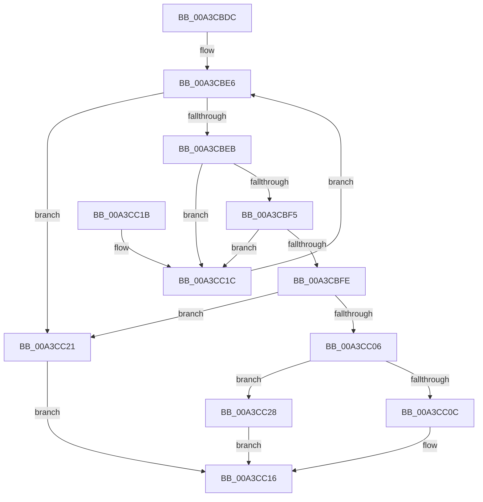

# BiTranslateBootEntryId

- RVA: `0x00A3CBDC`–`0x00A3CC40` (길이 `100` bytes)
- VA: `0x0000000140A3CBDC`
- 실행 섹션: `PAGE`
- PDB 이름 있음: `예`; PDB Function 태그: `아니요`
- unwind 정보 RVA: `0x00076838`
- 디코드: `30`개 명령, `100/100` bytes 표시
- 미해석 바이트: `0` (있으면 어셈블리에 `.byte`로 보존)

> 이 문서는 커널 이미지의 기계어와 PDB 기호를 분석해 생성했습니다. 4번과 5번은 함수 원형과 자료형을 바이너리 사용 방식에서 추정한 C 해석이며 원본 소스 복구 결과는 아닙니다.

## 1. Dependencies

- 직접 호출 지점: **1**; 고유 호출 대상: **1**
- 직접 호출자로 확인된 함수: **2**
- RIP 상대 이미지 참조: **1**

### Outgoing calls
- `0x00A3CC34` → [BiLogMessage](BiLogMessage_function_00A3D3A8.md) (function, `0x00A3D3A8`)

### Direct callers
- [BiTranslateBootOrder](BiTranslateBootOrder_function_00A3CB4C.md) at `0x00A3CB92`
- [BiBindEfiBootManager](BiBindEfiBootManager_function_00A3DCB0.md) at `0x00A3DEF9`

### Static image references
- `0x00A3CC28` → RVA `0x00B0C520` (` ?? ::NNGAKEGL::`string'`; read)

## 2. Other-region calls and transfers

- 다른 실행 섹션으로 향하는 call: **0**
- 별도 외부 분기/꼬리 이동을 확인하지 못했습니다.

## 3. Assembly (complete function range)

```asm
00A3CBDC  48 83 EC 28                     sub rsp, 0x28
00A3CBE0  4C 8B 09                        mov r9, qword ptr [rcx]
00A3CBE3  4D 8B D8                        mov r11, r8
00A3CBE6  4C 3B C9                        cmp r9, rcx
00A3CBE9  74 36                           je 0x140a3cc21
00A3CBEB  45 8B 51 30                     mov r10d, dword ptr [r9 + 0x30]
00A3CBEF  41 F6 C2 03                     test r10b, 3
00A3CBF3  74 27                           je 0x140a3cc1c
00A3CBF5  45 8B 41 20                     mov r8d, dword ptr [r9 + 0x20]
00A3CBF9  44 3B C2                        cmp r8d, edx
00A3CBFC  75 1E                           jne 0x140a3cc1c
00A3CBFE  33 C0                           xor eax, eax
00A3CC00  41 F6 C2 04                     test r10b, 4
00A3CC04  74 1B                           je 0x140a3cc21
00A3CC06  41 F6 C2 10                     test r10b, 0x10
00A3CC0A  75 1C                           jne 0x140a3cc28
00A3CC0C  41 0F 10 41 10                  movups xmm0, xmmword ptr [r9 + 0x10]
00A3CC11  F3 41 0F 7F 03                  movdqu xmmword ptr [r11], xmm0
00A3CC16  48 83 C4 28                     add rsp, 0x28
00A3CC1A  C3                              ret
00A3CC1B  CC                              int3
00A3CC1C  4D 8B 09                        mov r9, qword ptr [r9]
00A3CC1F  EB C5                           jmp 0x140a3cbe6
00A3CC21  B8 25 02 00 C0                  mov eax, 0xc0000225
00A3CC26  EB EE                           jmp 0x140a3cc16
00A3CC28  48 8D 15 F1 F8 0C 00            lea rdx, [rip + 0xcf8f1]
00A3CC2F  B9 03 00 00 00                  mov ecx, 3
00A3CC34  E8 6F 07 00 00                  call 0x140a3d3a8
00A3CC39  B8 24 00 00 C0                  mov eax, 0xc0000024
00A3CC3E  EB D6                           jmp 0x140a3cc16
```

## 4. C-style interpretation (structured pseudocode)

```c
__int64 __fastcall BiTranslateBootEntryId(__int64 a1, int a2, __int64 a3)
{
    __int64 result;
    __int64 v_rsp;

    v_rsp = (v_rsp) - (40);
loc_00A3CBE6:
    if ((*(unsigned __int64 *)(a1)) == a1) goto loc_00A3CC21;
    if ((((unsigned __int8)((unsigned int)(*(unsigned int *)(*(unsigned __int64 *)(a1) + 48)))) & (3)) == 0) goto loc_00A3CC1C;
    if (((unsigned int)((unsigned int)(*(unsigned int *)(*(unsigned __int64 *)(a1) + 32)))) != a2) goto loc_00A3CC1C;
    result = 0;
    if ((((unsigned __int8)((unsigned int)(*(unsigned int *)(*(unsigned __int64 *)(a1) + 48)))) & (4)) == 0) goto loc_00A3CC21;
    if ((((unsigned __int8)((unsigned int)(*(unsigned int *)(*(unsigned __int64 *)(a1) + 48)))) & (16)) != 0) goto loc_00A3CC28;
    *(unsigned __int64 *)(a3) = v_xmm0;
loc_00A3CC16:
    v_rsp = (v_rsp) + (40);
    return result;
loc_00A3CC1C:
    goto loc_00A3CBE6;
loc_00A3CC21:
    goto loc_00A3CC16;
loc_00A3CC28:
    result = BiLogMessage(3, v_rip + 850161, (unsigned int)(*(unsigned int *)(*(unsigned __int64 *)(a1) + 32)), *(unsigned __int64 *)(*(unsigned __int64 *)(a1)));
    goto loc_00A3CC16;
}
```

## 5. (Beta) C Style

```c
int64_t BiTranslateBootEntryId(void *Arg1, int32_t Arg2, void *Arg3)
{
    uint8_t *arg1 = (uint8_t *)Arg1;
    uint8_t *arg3 = (uint8_t *)Arg3;

    int64_t result;
    int64_t local_rsp;

    local_rsp = (local_rsp) - (40);
loc_00A3CBE6:
    if ((*(uint64_t *)(arg1)) == Arg1) goto loc_00A3CC21;
    if ((((uint8_t)((uint32_t)(*(uint32_t *)(*(uint64_t *)(arg1) + 0x30)))) & (3)) == 0) goto loc_00A3CC1C;
    if (((uint32_t)((uint32_t)(*(uint32_t *)(*(uint64_t *)(arg1) + 0x20)))) != Arg2) goto loc_00A3CC1C;
    result = 0;
    if ((((uint8_t)((uint32_t)(*(uint32_t *)(*(uint64_t *)(arg1) + 0x30)))) & (4)) == 0) goto loc_00A3CC21;
    if ((((uint8_t)((uint32_t)(*(uint32_t *)(*(uint64_t *)(arg1) + 0x30)))) & (16)) != 0) goto loc_00A3CC28;
    *(uint64_t *)(arg3) = v_xmm0;
loc_00A3CC16:
    local_rsp = (local_rsp) + (40);
    return result;
loc_00A3CC1C:
    goto loc_00A3CBE6;
loc_00A3CC21:
    goto loc_00A3CC16;
loc_00A3CC28:
    result = BiLogMessage(3, v_rip + 850161, (uint32_t)(*(uint32_t *)(*(uint64_t *)(arg1) + 0x20)), *(uint64_t *)(*(uint64_t *)(arg1)));
    goto loc_00A3CC16;
}
```

### 관측된 메모리 오프셋

구조체 형식이 확인되지 않은 접근은 인자 기준의 오프셋으로만 기록했습니다.

| 기준 인자 | 오프셋 표현 | 폭 (bit) | 접근 |
|---|---:|---:|---|
| `Arg1` | `+ 0x0` | `64` | `R` |
| `Arg3` | `+ 0x0` | `128` | `W` |

## 6. Execution-region graph

[열기: 2D/3D 그래프와 함수 탐색 컨트롤 패널](../../../control-panel.html?section=page&rva=0x00A3CBDC&view=graph)

- 2D 그래프는 위에서 아래로 흐르고, 3D 그래프는 빈 공간을 드래그해 회전합니다. Shift+드래그는 이동, 휠은 확대·축소, 함수 노드 선택은 대상 보고서 이동입니다.

### Static fallback


