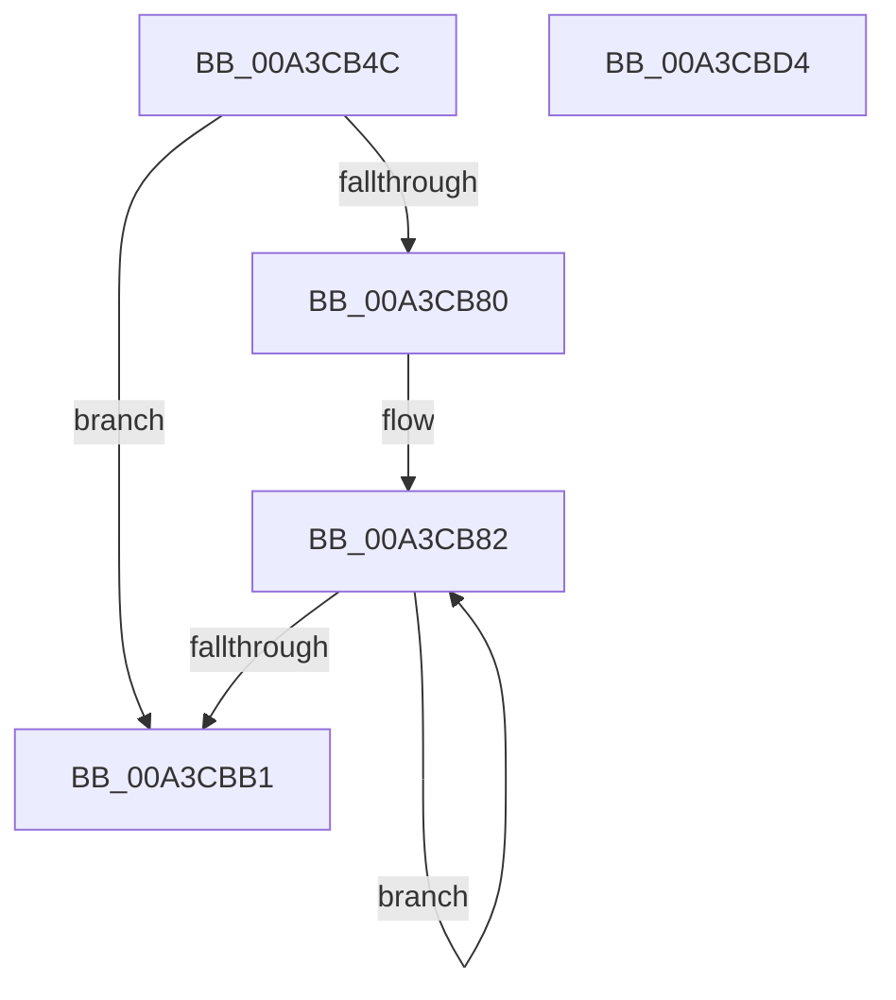

# BiTranslateBootOrder

- RVA: `0x00A3CB4C`–`0x00A3CBD5` (길이 `137` bytes)
- VA: `0x0000000140A3CB4C`
- 실행 섹션: `PAGE`
- PDB 이름 있음: `예`; PDB Function 태그: `아니요`
- unwind 정보 RVA: `0x0005FEF8`
- 디코드: `45`개 명령, `137/137` bytes 표시
- 미해석 바이트: `0` (있으면 어셈블리에 `.byte`로 보존)

> 이 문서는 커널 이미지의 기계어와 PDB 기호를 분석해 생성했습니다. 4번과 5번은 함수 원형과 자료형을 바이너리 사용 방식에서 추정한 C 해석이며 원본 소스 복구 결과는 아닙니다.

## 1. Dependencies

- 직접 호출 지점: **1**; 고유 호출 대상: **1**
- 직접 호출자로 확인된 함수: **1**
- RIP 상대 이미지 참조: **0**

### Outgoing calls
- `0x00A3CB92` → [BiTranslateBootEntryId](BiTranslateBootEntryId_function_00A3CBDC.md) (function, `0x00A3CBDC`)

### Direct callers
- [BiBindEfiBootManager](BiBindEfiBootManager_function_00A3DCB0.md) at `0x00A3DDDA`

### Static image references
- 디코드된 RIP-relative 메모리 참조가 없습니다.

## 2. Other-region calls and transfers

- 다른 실행 섹션으로 향하는 call: **0**
- 별도 외부 분기/꼬리 이동을 확인하지 못했습니다.

## 3. Assembly (complete function range)

```asm
00A3CB4C  48 8B C4                        mov rax, rsp
00A3CB4F  48 89 58 08                     mov qword ptr [rax + 8], rbx
00A3CB53  48 89 68 10                     mov qword ptr [rax + 0x10], rbp
00A3CB57  48 89 70 18                     mov qword ptr [rax + 0x18], rsi
00A3CB5B  48 89 78 20                     mov qword ptr [rax + 0x20], rdi
00A3CB5F  41 54                           push r12
00A3CB61  41 56                           push r14
00A3CB63  41 57                           push r15
00A3CB65  48 83 EC 20                     sub rsp, 0x20
00A3CB69  41 8B 01                        mov eax, dword ptr [r9]
00A3CB6C  33 DB                           xor ebx, ebx
00A3CB6E  33 FF                           xor edi, edi
00A3CB70  49 8B F1                        mov rsi, r9
00A3CB73  4D 8B F8                        mov r15, r8
00A3CB76  4C 8B F2                        mov r14, rdx
00A3CB79  4C 8B E1                        mov r12, rcx
00A3CB7C  85 C0                           test eax, eax
00A3CB7E  74 31                           je 0x140a3cbb1
00A3CB80  8B E8                           mov ebp, eax
00A3CB82  41 8B 16                        mov edx, dword ptr [r14]
00A3CB85  49 8B CC                        mov rcx, r12
00A3CB88  44 8B C3                        mov r8d, ebx
00A3CB8B  49 C1 E0 04                     shl r8, 4
00A3CB8F  4D 03 C7                        add r8, r15
00A3CB92  E8 45 00 00 00                  call 0x140a3cbdc
00A3CB97  85 C0                           test eax, eax
00A3CB99  4D 8D 76 04                     lea r14, [r14 + 4]
00A3CB9D  B9 0D 00 00 80                  mov ecx, 0x8000000d
00A3CBA2  0F 48 F9                        cmovs edi, ecx
00A3CBA5  8D 4B 01                        lea ecx, [rbx + 1]
00A3CBA8  0F 49 D9                        cmovns ebx, ecx
00A3CBAB  48 83 ED 01                     sub rbp, 1
00A3CBAF  75 D1                           jne 0x140a3cb82
00A3CBB1  48 8B 6C 24 48                  mov rbp, qword ptr [rsp + 0x48]
00A3CBB6  8B C7                           mov eax, edi
00A3CBB8  48 8B 7C 24 58                  mov rdi, qword ptr [rsp + 0x58]
00A3CBBD  89 1E                           mov dword ptr [rsi], ebx
00A3CBBF  48 8B 5C 24 40                  mov rbx, qword ptr [rsp + 0x40]
00A3CBC4  48 8B 74 24 50                  mov rsi, qword ptr [rsp + 0x50]
00A3CBC9  48 83 C4 20                     add rsp, 0x20
00A3CBCD  41 5F                           pop r15
00A3CBCF  41 5E                           pop r14
00A3CBD1  41 5C                           pop r12
00A3CBD3  C3                              ret
00A3CBD4  CC                              int3
```

## 4. C-style interpretation (structured pseudocode)

```c
__int64 __fastcall BiTranslateBootOrder(__int64 a1, __int64 a2, __int64 a3, __int64 a4)
{
    __int64 result;
    __int64 v_rbp;
    __int64 v_rbx;
    __int64 v_rdi;
    __int64 v_rsp;
    unsigned __int64 v_stack_p10;
    unsigned __int64 v_stack_p18;
    unsigned __int64 v_stack_p20;
    unsigned __int64 v_stack_p8;

    *(unsigned __int64 *)(v_rsp + 8) = v_rbx;
    *(unsigned __int64 *)(v_rsp + 16) = v_rbp;
    *(unsigned __int64 *)(v_rsp + 24) = v_rsi;
    *(unsigned __int64 *)(v_rsp + 32) = v_rdi;
    v_rsp = (v_rsp) - (32);
    v_rbx = 0;
    v_rdi = 0;
    if ((unsigned int)((unsigned int)(*(unsigned int *)(a4))) == 0) goto loc_00A3CBB1;
loc_00A3CB82:
    a3 = (0) << (4);
    a3 = (a3) + (a3);
    result = BiTranslateBootEntryId(a1, (unsigned int)(*(unsigned int *)(a2)), a3, a4);
    if (sign_flag) { v_rdi = (unsigned int)((unsigned int)(0x8000000DULL)); }
    if (!sign_flag) { v_rbx = (unsigned int)(v_rbx + 1); }
    v_rbp = ((unsigned int)((unsigned int)((unsigned int)(*(unsigned int *)(a4))))) - (1);
    if (condition_is_not_equal) goto loc_00A3CB82;
loc_00A3CBB1:
    *(unsigned int *)(a4) = (unsigned int)(v_rbx);
    v_rsp = (v_rsp) + (32);
    return (unsigned int)((unsigned int)(v_rdi));
}
```

## 5. (Beta) C Style

```c
int64_t BiTranslateBootOrder(int64_t Arg1, void *Arg2, int64_t Arg3, void *Arg4)
{
    uint8_t *arg2 = (uint8_t *)Arg2;
    uint8_t *arg4 = (uint8_t *)Arg4;

    int64_t result;
    int64_t local_rbp;
    int64_t local_rbx;
    int64_t local_rdi;
    int64_t local_rsp;
    uint64_t v_stack_p10;
    uint64_t v_stack_p18;
    uint64_t v_stack_p20;
    uint64_t v_stack_p8;

    *(uint64_t *)(local_rsp + 0x8) = local_rbx;
    *(uint64_t *)(local_rsp + 0x10) = local_rbp;
    *(uint64_t *)(local_rsp + 0x18) = local_rsi;
    *(uint64_t *)(local_rsp + 0x20) = local_rdi;
    local_rsp = (local_rsp) - (32);
    local_rbx = 0;
    local_rdi = 0;
    if ((uint32_t)((uint32_t)(*(uint32_t *)(arg4))) == 0) goto loc_00A3CBB1;
loc_00A3CB82:
    Arg3 = (0) << (4);
    Arg3 = (Arg3) + (Arg3);
    result = BiTranslateBootEntryId(Arg1, (uint32_t)(*(uint32_t *)(arg2)), Arg3, Arg4);
    if (sign_flag) { local_rdi = (uint32_t)((uint32_t)(0x8000000DULL)); }
    if (!sign_flag) { local_rbx = (uint32_t)(local_rbx + 1); }
    local_rbp = ((uint32_t)((uint32_t)((uint32_t)(*(uint32_t *)(arg4))))) - (1);
    if (condition_is_not_equal) goto loc_00A3CB82;
loc_00A3CBB1:
    *(uint32_t *)(arg4) = (uint32_t)(local_rbx);
    local_rsp = (local_rsp) + (32);
    return (uint32_t)((uint32_t)(local_rdi));
}
```

### 관측된 메모리 오프셋

구조체 형식이 확인되지 않은 접근은 인자 기준의 오프셋으로만 기록했습니다.

| 기준 인자 | 오프셋 표현 | 폭 (bit) | 접근 |
|---|---:|---:|---|
| `Arg2` | `+ 0x0` | `32` | `R` |
| `Arg2` | `+ 0x4` | `64` | `R` |
| `Arg4` | `+ 0x0` | `32` | `R` |
| `Arg4` | `+ 0x0` | `32` | `W` |

## 6. Execution-region graph

[열기: 2D/3D 그래프와 함수 탐색 컨트롤 패널](../../../control-panel.html?section=page&rva=0x00A3CB4C&view=graph)

- 2D 그래프는 위에서 아래로 흐르고, 3D 그래프는 빈 공간을 드래그해 회전합니다. Shift+드래그는 이동, 휠은 확대·축소, 함수 노드 선택은 대상 보고서 이동입니다.

### Static fallback


