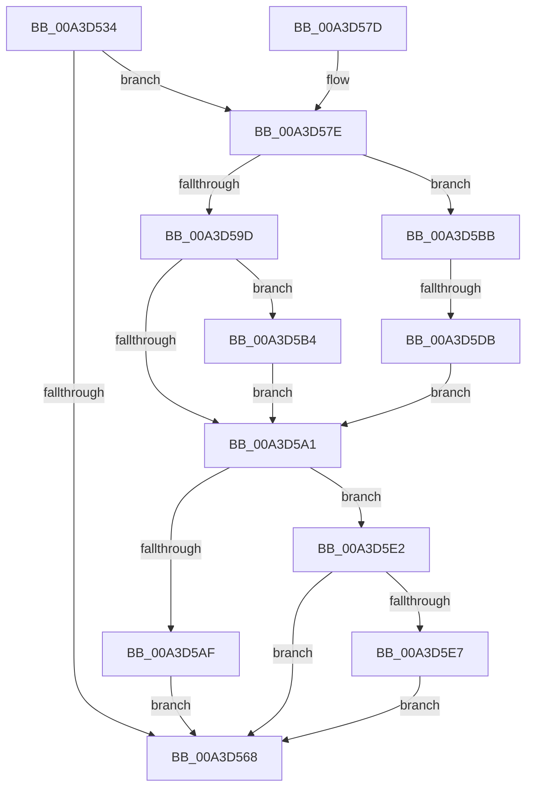

# BiTranslateFilePath

- RVA: `0x00A3D534`–`0x00A3D5F9` (길이 `197` bytes)
- VA: `0x0000000140A3D534`
- 실행 섹션: `PAGE`
- PDB 이름 있음: `예`; PDB Function 태그: `예`
- unwind 정보 RVA: `0x000AE5B4`
- 디코드: `61`개 명령, `197/197` bytes 표시
- 미해석 바이트: `0` (있으면 어셈블리에 `.byte`로 보존)

> 이 문서는 커널 이미지의 기계어와 PDB 기호를 분석해 생성했습니다. 4번과 5번은 함수 원형과 자료형을 바이너리 사용 방식에서 추정한 C 해석이며 원본 소스 복구 결과는 아닙니다.

## 1. Dependencies

- 직접 호출 지점: **5**; 고유 호출 대상: **5**
- 직접 호출자로 확인된 함수: **3**
- RIP 상대 이미지 참조: **0**

### Outgoing calls
- `0x00A3D55D` → [BiAcquirePrivilege](BiAcquirePrivilege_function_00A3D658.md) (function, `0x00A3D658`)
- `0x00A3D58F` → [ZwTranslateFilePath](../../text/6B/ZwTranslateFilePath_function_006B0BD0.md) (function, `0x006B0BD0`)
- `0x00A3D5A6` → [BiReleasePrivilege](BiReleasePrivilege_function_00A3D600.md) (function, `0x00A3D600`)
- `0x00A3D5CA` → [ExAllocatePool2](../../poolcode/B8/ExAllocatePool2_function_00B820F0.md) (function, `0x00B820F0`)
- `0x00A3D5EF` → [ExFreePoolWithTag](../../poolcode/B8/ExFreePoolWithTag_function_00B82870.md) (function, `0x00B82870`)

### Direct callers
- [BiCreateBootEntry](../82/BiCreateBootEntry_function_00826510.md) at `0x008266CD`
- [BiCreateMergedBootEntry](BiCreateMergedBootEntry_function_00A3CE7C.md) at `0x00A3D00C`
- [BiGetDeviceFromEfiPath](BiGetDeviceFromEfiPath_function_00A3D3BC.md) at `0x00A3D465`

### Static image references
- 디코드된 RIP-relative 메모리 참조가 없습니다.

## 2. Other-region calls and transfers

- 다른 실행 섹션으로 향하는 call: **3**
  - `0x00A3D58F` → [ZwTranslateFilePath](../../text/6B/ZwTranslateFilePath_function_006B0BD0.md) (`PAGE` → `.text`)
  - `0x00A3D5CA` → [ExAllocatePool2](../../poolcode/B8/ExAllocatePool2_function_00B820F0.md) (`PAGE` → `POOLCODE`)
  - `0x00A3D5EF` → [ExFreePoolWithTag](../../poolcode/B8/ExFreePoolWithTag_function_00B82870.md) (`PAGE` → `POOLCODE`)
- call이 아닌 외부 분기/꼬리 이동: **1**
  - `0x00A3D5D5` → [sub_00B3A4FE](../B3/Unknown_function_00B3A4FE.md) (`tail-transfer`)

## 3. Assembly (complete function range)

```asm
00A3D534  48 8B C4                        mov rax, rsp
00A3D537  48 89 58 08                     mov qword ptr [rax + 8], rbx
00A3D53B  48 89 68 10                     mov qword ptr [rax + 0x10], rbp
00A3D53F  56                              push rsi
00A3D540  57                              push rdi
00A3D541  41 56                           push r14
00A3D543  48 83 EC 30                     sub rsp, 0x30
00A3D547  48 83 60 D8 00                  and qword ptr [rax - 0x28], 0
00A3D54C  8B F2                           mov esi, edx
00A3D54E  48 8B E9                        mov rbp, rcx
00A3D551  48 8D 50 D8                     lea rdx, [rax - 0x28]
00A3D555  33 FF                           xor edi, edi
00A3D557  4D 8B F0                        mov r14, r8
00A3D55A  8D 4F 16                        lea ecx, [rdi + 0x16]
00A3D55D  E8 F6 00 00 00                  call 0x140a3d658
00A3D562  8B D8                           mov ebx, eax
00A3D564  85 C0                           test eax, eax
00A3D566  79 16                           jns 0x140a3d57e
00A3D568  48 8B 6C 24 58                  mov rbp, qword ptr [rsp + 0x58]
00A3D56D  8B C3                           mov eax, ebx
00A3D56F  48 8B 5C 24 50                  mov rbx, qword ptr [rsp + 0x50]
00A3D574  48 83 C4 30                     add rsp, 0x30
00A3D578  41 5E                           pop r14
00A3D57A  5F                              pop rdi
00A3D57B  5E                              pop rsi
00A3D57C  C3                              ret
00A3D57D  CC                              int3
00A3D57E  21 7C 24 68                     and dword ptr [rsp + 0x68], edi
00A3D582  4C 8D 4C 24 68                  lea r9, [rsp + 0x68]
00A3D587  45 33 C0                        xor r8d, r8d
00A3D58A  8B D6                           mov edx, esi
00A3D58C  48 8B CD                        mov rcx, rbp
00A3D58F  E8 3C 36 C7 FF                  call 0x1406b0bd0
00A3D594  8B D8                           mov ebx, eax
00A3D596  3D 23 00 00 C0                  cmp eax, 0xc0000023
00A3D59B  74 1E                           je 0x140a3d5bb
00A3D59D  85 C0                           test eax, eax
00A3D59F  79 13                           jns 0x140a3d5b4
00A3D5A1  48 8D 4C 24 20                  lea rcx, [rsp + 0x20]
00A3D5A6  E8 55 00 00 00                  call 0x140a3d600
00A3D5AB  85 DB                           test ebx, ebx
00A3D5AD  78 33                           js 0x140a3d5e2
00A3D5AF  49 89 3E                        mov qword ptr [r14], rdi
00A3D5B2  EB B4                           jmp 0x140a3d568
00A3D5B4  BB 0D 00 00 C0                  mov ebx, 0xc000000d
00A3D5B9  EB E6                           jmp 0x140a3d5a1
00A3D5BB  8B 54 24 68                     mov edx, dword ptr [rsp + 0x68]
00A3D5BF  B9 02 01 00 00                  mov ecx, 0x102
00A3D5C4  41 B8 42 43 44 4B               mov r8d, 0x4b444342
00A3D5CA  E8 21 4B 14 00                  call 0x140b820f0
00A3D5CF  48 8B F8                        mov rdi, rax
00A3D5D2  48 85 C0                        test rax, rax
00A3D5D5  0F 85 23 CF 0F 00               jne 0x140b3a4fe
00A3D5DB  BB 9A 00 00 C0                  mov ebx, 0xc000009a
00A3D5E0  EB BF                           jmp 0x140a3d5a1
00A3D5E2  48 85 FF                        test rdi, rdi
00A3D5E5  74 81                           je 0x140a3d568
00A3D5E7  BA 42 43 44 4B                  mov edx, 0x4b444342
00A3D5EC  48 8B CF                        mov rcx, rdi
00A3D5EF  E8 7C 52 14 00                  call 0x140b82870
00A3D5F4  E9 6F FF FF FF                  jmp 0x140a3d568
```

## 4. C-style interpretation (structured pseudocode)

```c
__int64 __fastcall BiTranslateFilePath(__int64 a1, int a2, __int64 a3)
{
    __int64 result;
    __int64 v_rdi;
    __int64 v_rsp;
    unsigned __int64 v_stack_p10;
    unsigned __int64 v_stack_p20;
    unsigned int v_stack_p68;
    unsigned __int64 v_stack_p8;

    *(unsigned __int64 *)(v_rsp + 8) = v_rbx;
    *(unsigned __int64 *)(v_rsp + 16) = v_rbp;
    v_rsp = (v_rsp) - (48);
    v_rdi = 0;
    result = BiAcquirePrivilege(v_rdi + 22, v_rsp - 40, a3, a4);
    if (!sign_flag) goto loc_00A3D57E;
loc_00A3D568:
    v_rsp = (v_rsp) + (48);
    return (unsigned int)((unsigned int)((unsigned int)((unsigned int)(result))));
loc_00A3D57E:
    a3 = 0;
    result = ZwTranslateFilePath(v_stack_p10, (unsigned int)((unsigned int)((unsigned int)(a2))), a3, v_stack_p68);
    if (((unsigned int)(result)) == 0xC0000023ULL) goto loc_00A3D5BB;
    if (!sign_flag) goto loc_00A3D5B4;
loc_00A3D5A1:
    result = BiReleasePrivilege(v_stack_p20, (unsigned int)((unsigned int)((unsigned int)(a2))), a3, v_stack_p68);
    if (sign_flag) goto loc_00A3D5E2;
    *(unsigned __int64 *)(a3) = 0;
    goto loc_00A3D568;
loc_00A3D5B4:
    goto loc_00A3D5A1;
loc_00A3D5BB:
    result = ExAllocatePool2(258, (unsigned int)(v_stack_p68), (unsigned int)(0x4B444342ULL), v_stack_p68);
    goto loc_00A3D5A1;
loc_00A3D5E2:
    if (result == 0) goto loc_00A3D568;
    result = ExFreePoolWithTag(result, (unsigned int)(0x4B444342ULL), (unsigned int)(0x4B444342ULL), v_stack_p68);
    goto loc_00A3D568;
}
```

## 5. (Beta) C Style

```c
int64_t BiTranslateFilePath(int64_t Arg1, int32_t Arg2, void *Arg3)
{
    uint8_t *arg3 = (uint8_t *)Arg3;

    int64_t result;
    int64_t local_rdi;
    int64_t local_rsp;
    uint64_t v_stack_p10;
    uint64_t v_stack_p20;
    uint32_t v_stack_p68;
    uint64_t v_stack_p8;

    *(uint64_t *)(local_rsp + 0x8) = local_rbx;
    *(uint64_t *)(local_rsp + 0x10) = local_rbp;
    local_rsp = (local_rsp) - (48);
    local_rdi = 0;
    result = BiAcquirePrivilege(local_rdi + 22, local_rsp - 40, Arg3, a4);
    if (!sign_flag) goto loc_00A3D57E;
loc_00A3D568:
    local_rsp = (local_rsp) + (48);
    return (uint32_t)((uint32_t)((uint32_t)((uint32_t)(result))));
loc_00A3D57E:
    Arg3 = 0;
    result = ZwTranslateFilePath(v_stack_p10, (uint32_t)((uint32_t)((uint32_t)(Arg2))), Arg3, v_stack_p68);
    if (((uint32_t)(result)) == 0xC0000023ULL) goto loc_00A3D5BB;
    if (!sign_flag) goto loc_00A3D5B4;
loc_00A3D5A1:
    result = BiReleasePrivilege(v_stack_p20, (uint32_t)((uint32_t)((uint32_t)(Arg2))), Arg3, v_stack_p68);
    if (sign_flag) goto loc_00A3D5E2;
    *(uint64_t *)(arg3) = 0;
    goto loc_00A3D568;
loc_00A3D5B4:
    goto loc_00A3D5A1;
loc_00A3D5BB:
    result = ExAllocatePool2(258, (uint32_t)(v_stack_p68), (uint32_t)(0x4B444342ULL), v_stack_p68);
    goto loc_00A3D5A1;
loc_00A3D5E2:
    if (result == 0) goto loc_00A3D568;
    result = ExFreePoolWithTag(result, (uint32_t)(0x4B444342ULL), (uint32_t)(0x4B444342ULL), v_stack_p68);
    goto loc_00A3D568;
}
```

### 관측된 메모리 오프셋

구조체 형식이 확인되지 않은 접근은 인자 기준의 오프셋으로만 기록했습니다.

| 기준 인자 | 오프셋 표현 | 폭 (bit) | 접근 |
|---|---:|---:|---|
| `Arg3` | `+ 0x0` | `64` | `W` |

## 6. Execution-region graph

[열기: 2D/3D 그래프와 함수 탐색 컨트롤 패널](../../../control-panel.html?section=page&rva=0x00A3D534&view=graph)

- 2D 그래프는 위에서 아래로 흐르고, 3D 그래프는 빈 공간을 드래그해 회전합니다. Shift+드래그는 이동, 휠은 확대·축소, 함수 노드 선택은 대상 보고서 이동입니다.

### Static fallback


