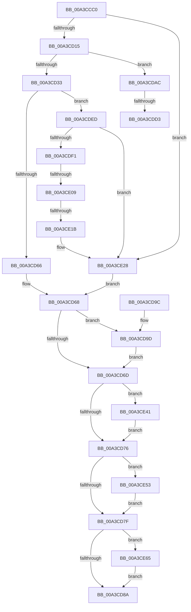

# BiUpdateEfiEntry

- RVA: `0x00A3CCC0`–`0x00A3CE73` (길이 `435` bytes)
- VA: `0x0000000140A3CCC0`
- 실행 섹션: `PAGE`
- PDB 이름 있음: `예`; PDB Function 태그: `예`
- unwind 정보 RVA: `0x000AE508`
- 디코드: `120`개 명령, `435/435` bytes 표시
- 미해석 바이트: `0` (있으면 어셈블리에 `.byte`로 보존)

> 이 문서는 커널 이미지의 기계어와 PDB 기호를 분석해 생성했습니다. 4번과 5번은 함수 원형과 자료형을 바이너리 사용 방식에서 추정한 C 해석이며 원본 소스 복구 결과는 아닙니다.

## 1. Dependencies

- 직접 호출 지점: **14**; 고유 호출 대상: **9**
- 직접 호출자로 확인된 함수: **2**
- RIP 상대 이미지 참조: **2**

### Outgoing calls
- `0x00A3CD06` → [BcdOpenObject](../91/BcdOpenObject_function_00916704.md) (function, `0x00916704`)
- `0x00A3CD26` → [BiGetElement](BiGetElement_function_00A3E2B4.md) (function, `0x00A3E2B4`)
- `0x00A3CD54` → [BiCreateMergedBootEntry](BiCreateMergedBootEntry_function_00A3CE7C.md) (function, `0x00A3CE7C`)
- `0x00A3CDA5` → [ExFreePoolWithTag](../../poolcode/B8/ExFreePoolWithTag_function_00B82870.md) (function, `0x00B82870`)
- `0x00A3CDBD` → [BiGetElement](BiGetElement_function_00A3E2B4.md) (function, `0x00A3E2B4`)
- `0x00A3CDC6` → [BiSpacesUpdatePhysicalDevicePath](../../text/69/BiSpacesUpdatePhysicalDevicePath_function_0069E6F8.md) (function, `0x0069E6F8`)
- `0x00A3CDE2` → [BiLogMessage](BiLogMessage_function_00A3D3A8.md) (function, `0x00A3D3A8`)
- `0x00A3CDFC` → [BiAreBootEntriesEqual](../AC/BiAreBootEntriesEqual_function_00ACF1D0.md) (function, `0x00ACF1D0`)
- `0x00A3CE0C` → [BiModifyBootEntry](../82/BiModifyBootEntry_function_00826E80.md) (function, `0x00826E80`)
- `0x00A3CE23` → [ExFreePoolWithTag](../../poolcode/B8/ExFreePoolWithTag_function_00B82870.md) (function, `0x00B82870`)
- `0x00A3CE37` → [BiLogMessage](BiLogMessage_function_00A3D3A8.md) (function, `0x00A3D3A8`)
- `0x00A3CE49` → [ExFreePoolWithTag](../../poolcode/B8/ExFreePoolWithTag_function_00B82870.md) (function, `0x00B82870`)
- `0x00A3CE5B` → [ExFreePoolWithTag](../../poolcode/B8/ExFreePoolWithTag_function_00B82870.md) (function, `0x00B82870`)
- `0x00A3CE69` → [BcdCloseObject](BcdCloseObject_function_00A3FB08.md) (function, `0x00A3FB08`)

### Direct callers
- [BiCreateEfiEntry](../82/BiCreateEfiEntry_function_008268C4.md) at `0x008269C3`
- [BiExportBcdObjects](../82/BiExportBcdObjects_function_00826B30.md) at `0x00826BF8`

### Static image references
- `0x00A3CDD6` → RVA `0x00B0C460` (` ?? ::NNGAKEGL::`string'`; read)
- `0x00A3CE2B` → RVA `0x00B0C4C0` (` ?? ::NNGAKEGL::`string'`; read)

## 2. Other-region calls and transfers

- 다른 실행 섹션으로 향하는 call: **5**
  - `0x00A3CDA5` → [ExFreePoolWithTag](../../poolcode/B8/ExFreePoolWithTag_function_00B82870.md) (`PAGE` → `POOLCODE`)
  - `0x00A3CDC6` → [BiSpacesUpdatePhysicalDevicePath](../../text/69/BiSpacesUpdatePhysicalDevicePath_function_0069E6F8.md) (`PAGE` → `.text`)
  - `0x00A3CE23` → [ExFreePoolWithTag](../../poolcode/B8/ExFreePoolWithTag_function_00B82870.md) (`PAGE` → `POOLCODE`)
  - `0x00A3CE49` → [ExFreePoolWithTag](../../poolcode/B8/ExFreePoolWithTag_function_00B82870.md) (`PAGE` → `POOLCODE`)
  - `0x00A3CE5B` → [ExFreePoolWithTag](../../poolcode/B8/ExFreePoolWithTag_function_00B82870.md) (`PAGE` → `POOLCODE`)
- call이 아닌 외부 분기/꼬리 이동: **4**
  - `0x00A3CDCD` → [sub_00B3A3D0](../B3/Unknown_function_00B3A3D0.md) (`tail-transfer`)
  - `0x00A3CDE8` → [sub_00B3A3D0](../B3/Unknown_function_00B3A3D0.md) (`tail-transfer`)
  - `0x00A3CE03` → [sub_00B3A3D0 + 0x23](../B3/Unknown_function_00B3A3D0.md) (`tail-transfer`)
  - `0x00A3CE15` → [sub_00B3A3D0 + 0x23](../B3/Unknown_function_00B3A3D0.md) (`tail-transfer`)

## 3. Assembly (complete function range)

```asm
00A3CCC0  40 55                           push rbp
00A3CCC2  53                              push rbx
00A3CCC3  56                              push rsi
00A3CCC4  41 54                           push r12
00A3CCC6  41 55                           push r13
00A3CCC8  41 56                           push r14
00A3CCCA  41 57                           push r15
00A3CCCC  48 8B EC                        mov rbp, rsp
00A3CCCF  48 83 EC 60                     sub rsp, 0x60
00A3CCD3  33 F6                           xor esi, esi
00A3CCD5  4C 8D 45 D0                     lea r8, [rbp - 0x30]
00A3CCD9  4C 8B EA                        mov r13, rdx
00A3CCDC  89 75 48                        mov dword ptr [rbp + 0x48], esi
00A3CCDF  48 83 C2 10                     add rdx, 0x10
00A3CCE3  89 75 50                        mov dword ptr [rbp + 0x50], esi
00A3CCE6  89 75 58                        mov dword ptr [rbp + 0x58], esi
00A3CCE9  44 8B E6                        mov r12d, esi
00A3CCEC  48 89 75 E8                     mov qword ptr [rbp - 0x18], rsi
00A3CCF0  44 8B FE                        mov r15d, esi
00A3CCF3  48 89 75 D8                     mov qword ptr [rbp - 0x28], rsi
00A3CCF7  44 8B F6                        mov r14d, esi
00A3CCFA  48 89 75 E0                     mov qword ptr [rbp - 0x20], rsi
00A3CCFE  48 89 75 F0                     mov qword ptr [rbp - 0x10], rsi
00A3CD02  48 89 75 D0                     mov qword ptr [rbp - 0x30], rsi
00A3CD06  E8 F9 99 ED FF                  call 0x140916704
00A3CD0B  8B D8                           mov ebx, eax
00A3CD0D  85 C0                           test eax, eax
00A3CD0F  0F 88 13 01 00 00               js 0x140a3ce28
00A3CD15  48 8B 4D D0                     mov rcx, qword ptr [rbp - 0x30]
00A3CD19  4C 8D 4D 48                     lea r9, [rbp + 0x48]
00A3CD1D  4C 8D 45 E8                     lea r8, [rbp - 0x18]
00A3CD21  BA 04 00 00 12                  mov edx, 0x12000004
00A3CD26  E8 89 15 00 00                  call 0x140a3e2b4
00A3CD2B  41 8B 45 30                     mov eax, dword ptr [r13 + 0x30]
00A3CD2F  A8 08                           test al, 8
00A3CD31  74 79                           je 0x140a3cdac
00A3CD33  49 8B 45 28                     mov rax, qword ptr [r13 + 0x28]
00A3CD37  48 8D 4D F0                     lea rcx, [rbp - 0x10]
00A3CD3B  4C 8B 65 E8                     mov r12, qword ptr [rbp - 0x18]
00A3CD3F  4D 8B CE                        mov r9, r14
00A3CD42  48 89 4C 24 20                  mov qword ptr [rsp + 0x20], rcx
00A3CD47  4D 8B C7                        mov r8, r15
00A3CD4A  48 8B C8                        mov rcx, rax
00A3CD4D  48 89 45 48                     mov qword ptr [rbp + 0x48], rax
00A3CD51  49 8B D4                        mov rdx, r12
00A3CD54  E8 23 01 00 00                  call 0x140a3ce7c
00A3CD59  8B D8                           mov ebx, eax
00A3CD5B  3D 3A 00 00 C0                  cmp eax, 0xc000003a
00A3CD60  0F 85 87 00 00 00               jne 0x140a3cded
00A3CD66  8B DE                           mov ebx, esi
00A3CD68  4D 85 E4                        test r12, r12
00A3CD6B  75 30                           jne 0x140a3cd9d
00A3CD6D  4D 85 FF                        test r15, r15
00A3CD70  0F 85 CB 00 00 00               jne 0x140a3ce41
00A3CD76  4D 85 F6                        test r14, r14
00A3CD79  0F 85 D4 00 00 00               jne 0x140a3ce53
00A3CD7F  48 83 7D D0 00                  cmp qword ptr [rbp - 0x30], 0
00A3CD84  0F 85 DB 00 00 00               jne 0x140a3ce65
00A3CD8A  8B C3                           mov eax, ebx
00A3CD8C  48 83 C4 60                     add rsp, 0x60
00A3CD90  41 5F                           pop r15
00A3CD92  41 5E                           pop r14
00A3CD94  41 5D                           pop r13
00A3CD96  41 5C                           pop r12
00A3CD98  5E                              pop rsi
00A3CD99  5B                              pop rbx
00A3CD9A  5D                              pop rbp
00A3CD9B  C3                              ret
00A3CD9C  CC                              int3
00A3CD9D  BA 42 43 44 4B                  mov edx, 0x4b444342
00A3CDA2  49 8B CC                        mov rcx, r12
00A3CDA5  E8 C6 5A 14 00                  call 0x140b82870
00A3CDAA  EB C1                           jmp 0x140a3cd6d
00A3CDAC  48 8B 4D D0                     mov rcx, qword ptr [rbp - 0x30]
00A3CDB0  4C 8D 4D 50                     lea r9, [rbp + 0x50]
00A3CDB4  4C 8D 45 D8                     lea r8, [rbp - 0x28]
00A3CDB8  BA 01 00 00 11                  mov edx, 0x11000001
00A3CDBD  E8 F2 14 00 00                  call 0x140a3e2b4
00A3CDC2  48 8D 4D D8                     lea rcx, [rbp - 0x28]
00A3CDC6  E8 2D 19 C6 FF                  call 0x14069e6f8
00A3CDCB  85 C0                           test eax, eax
00A3CDCD  0F 89 FD D5 0F 00               jns 0x140b3a3d0
00A3CDD3  44 8B C0                        mov r8d, eax
00A3CDD6  48 8D 15 83 F6 0C 00            lea rdx, [rip + 0xcf683]
00A3CDDD  B9 03 00 00 00                  mov ecx, 3
00A3CDE2  E8 C1 05 00 00                  call 0x140a3d3a8
00A3CDE7  90                              nop
00A3CDE8  E9 E3 D5 0F 00                  jmp 0x140b3a3d0
00A3CDED  85 C0                           test eax, eax
00A3CDEF  78 37                           js 0x140a3ce28
00A3CDF1  48 8B 75 F0                     mov rsi, qword ptr [rbp - 0x10]
00A3CDF5  48 8B 4D 48                     mov rcx, qword ptr [rbp + 0x48]
00A3CDF9  48 8B D6                        mov rdx, rsi
00A3CDFC  E8 CF 23 09 00                  call 0x140acf1d0
00A3CE01  84 C0                           test al, al
00A3CE03  0F 85 EA D5 0F 00               jne 0x140b3a3f3
00A3CE09  48 8B CE                        mov rcx, rsi
00A3CE0C  E8 6F A0 DE FF                  call 0x140826e80
00A3CE11  8B D8                           mov ebx, eax
00A3CE13  85 C0                           test eax, eax
00A3CE15  0F 89 D8 D5 0F 00               jns 0x140b3a3f3
00A3CE1B  BA 42 43 44 4B                  mov edx, 0x4b444342
00A3CE20  48 8B CE                        mov rcx, rsi
00A3CE23  E8 48 5A 14 00                  call 0x140b82870
00A3CE28  44 8B C3                        mov r8d, ebx
00A3CE2B  48 8D 15 8E F6 0C 00            lea rdx, [rip + 0xcf68e]
00A3CE32  B9 04 00 00 00                  mov ecx, 4
00A3CE37  E8 6C 05 00 00                  call 0x140a3d3a8
00A3CE3C  E9 27 FF FF FF                  jmp 0x140a3cd68
00A3CE41  BA 42 43 44 4B                  mov edx, 0x4b444342
00A3CE46  49 8B CF                        mov rcx, r15
00A3CE49  E8 22 5A 14 00                  call 0x140b82870
00A3CE4E  E9 23 FF FF FF                  jmp 0x140a3cd76
00A3CE53  BA 42 43 44 4B                  mov edx, 0x4b444342
00A3CE58  49 8B CE                        mov rcx, r14
00A3CE5B  E8 10 5A 14 00                  call 0x140b82870
00A3CE60  E9 1A FF FF FF                  jmp 0x140a3cd7f
00A3CE65  48 8B 4D D0                     mov rcx, qword ptr [rbp - 0x30]
00A3CE69  E8 9A 2C 00 00                  call 0x140a3fb08
00A3CE6E  E9 17 FF FF FF                  jmp 0x140a3cd8a
```

## 4. C-style interpretation (structured pseudocode)

```c
__int64 __fastcall BiUpdateEfiEntry(__int64 a1, __int64 a2)
{
    __int64 result;
    __int64 v_rsi;
    __int64 v_rsp;
    unsigned __int64 v_stack_m48;
    unsigned __int64 v_stack_m50;
    unsigned __int64 v_stack_m58;
    unsigned __int64 v_stack_m60;
    unsigned __int64 v_stack_m68;
    unsigned __int64 v_stack_m78;
    unsigned int v_stack_p10;
    unsigned int v_stack_p18;
    unsigned int v_stack_p20;

    v_rsp = (v_rsp) - (96);
    v_rsi = 0;
    v_stack_p10 = 0;
    a2 = (a2) + (16);
    v_stack_p18 = 0;
    v_stack_p20 = 0;
    v_stack_m50 = 0;
    v_stack_m60 = 0;
    v_stack_m58 = 0;
    v_stack_m48 = 0;
    v_stack_m68 = 0;
    result = BcdOpenObject(a1, a2, v_stack_m68, a4);
    if (sign_flag) goto loc_00A3CE28;
    result = BiGetElement(v_stack_m68, (unsigned int)(0x12000004ULL), v_stack_m50, v_stack_p10);
    if ((((unsigned __int8)((unsigned int)(*(unsigned int *)(a2 + 48)))) & (8)) == 0) goto loc_00A3CDAC;
    v_stack_m78 = v_stack_m48;
    v_stack_p10 = *(unsigned __int64 *)(a2 + 40);
    result = BiCreateMergedBootEntry(*(unsigned __int64 *)(a2 + 40), v_stack_m50, 0, 0);
    if (((unsigned int)(result)) != 0xC000003AULL) goto loc_00A3CDED;
loc_00A3CD68:
    if (v_stack_m50 != 0) goto loc_00A3CD9D;
loc_00A3CD6D:
    if (0 != 0) goto loc_00A3CE41;
loc_00A3CD76:
    if (0 != 0) goto loc_00A3CE53;
loc_00A3CD7F:
    if (v_stack_m68 != 0) goto loc_00A3CE65;
loc_00A3CD8A:
    v_rsp = (v_rsp) + (96);
    return 0;
loc_00A3CD9D:
    result = ExFreePoolWithTag(v_stack_m50, (unsigned int)(0x4B444342ULL), 0, 0);
    goto loc_00A3CD6D;
loc_00A3CDAC:
    result = BiGetElement(v_stack_m68, (unsigned int)(0x11000001ULL), v_stack_m60, v_stack_p18);
    result = BiSpacesUpdatePhysicalDevicePath(v_stack_m60, (unsigned int)(0x11000001ULL), v_stack_m60, v_stack_p18);
    result = BiLogMessage(3, v_rip + 849539, (unsigned int)((unsigned int)(result)), v_stack_p18);
loc_00A3CDED:
    if (sign_flag) goto loc_00A3CE28;
    result = BiAreBootEntriesEqual(v_stack_p10, v_stack_m48, (unsigned int)((unsigned int)(result)), v_stack_p18);
    result = BiModifyBootEntry(v_stack_m48, v_stack_m48, (unsigned int)((unsigned int)(result)), v_stack_p18);
    result = ExFreePoolWithTag(v_stack_m48, (unsigned int)(0x4B444342ULL), (unsigned int)((unsigned int)(result)), v_stack_p18);
loc_00A3CE28:
    result = BiLogMessage(4, v_rip + 849550, (unsigned int)((unsigned int)((unsigned int)((unsigned int)(result)))), v_stack_p18);
    goto loc_00A3CD68;
loc_00A3CE41:
    result = ExFreePoolWithTag(0, (unsigned int)(0x4B444342ULL), (unsigned int)((unsigned int)((unsigned int)((unsigned int)(result)))), v_stack_p18);
    goto loc_00A3CD76;
loc_00A3CE53:
    result = ExFreePoolWithTag(0, (unsigned int)(0x4B444342ULL), (unsigned int)((unsigned int)((unsigned int)((unsigned int)(result)))), v_stack_p18);
    goto loc_00A3CD7F;
loc_00A3CE65:
    result = BcdCloseObject(v_stack_m68, (unsigned int)(0x4B444342ULL), (unsigned int)((unsigned int)((unsigned int)((unsigned int)(result)))), v_stack_p18);
    goto loc_00A3CD8A;
}
```

## 5. (Beta) C Style

```c
int64_t BiUpdateEfiEntry(int64_t Arg1, void *Arg2)
{
    uint8_t *arg2 = (uint8_t *)Arg2;

    int64_t result;
    int64_t local_rsi;
    int64_t local_rsp;
    uint64_t v_stack_m48;
    uint64_t v_stack_m50;
    uint64_t v_stack_m58;
    uint64_t v_stack_m60;
    uint64_t v_stack_m68;
    uint64_t v_stack_m78;
    uint32_t v_stack_p10;
    uint32_t v_stack_p18;
    uint32_t v_stack_p20;

    local_rsp = (local_rsp) - (96);
    local_rsi = 0;
    v_stack_p10 = 0;
    Arg2 = (Arg2) + (16);
    v_stack_p18 = 0;
    v_stack_p20 = 0;
    v_stack_m50 = 0;
    v_stack_m60 = 0;
    v_stack_m58 = 0;
    v_stack_m48 = 0;
    v_stack_m68 = 0;
    result = BcdOpenObject(Arg1, Arg2, v_stack_m68, a4);
    if (sign_flag) goto loc_00A3CE28;
    result = BiGetElement(v_stack_m68, (uint32_t)(0x12000004ULL), v_stack_m50, v_stack_p10);
    if ((((uint8_t)((uint32_t)(*(uint32_t *)(arg2 + 0x30)))) & (8)) == 0) goto loc_00A3CDAC;
    v_stack_m78 = v_stack_m48;
    v_stack_p10 = *(uint64_t *)(arg2 + 0x28);
    result = BiCreateMergedBootEntry(*(uint64_t *)(arg2 + 0x28), v_stack_m50, 0, 0);
    if (((uint32_t)(result)) != 0xC000003AULL) goto loc_00A3CDED;
loc_00A3CD68:
    if (v_stack_m50 != 0) goto loc_00A3CD9D;
loc_00A3CD6D:
    if (0 != 0) goto loc_00A3CE41;
loc_00A3CD76:
    if (0 != 0) goto loc_00A3CE53;
loc_00A3CD7F:
    if (v_stack_m68 != 0) goto loc_00A3CE65;
loc_00A3CD8A:
    local_rsp = (local_rsp) + (96);
    return 0;
loc_00A3CD9D:
    result = ExFreePoolWithTag(v_stack_m50, (uint32_t)(0x4B444342ULL), 0, 0);
    goto loc_00A3CD6D;
loc_00A3CDAC:
    result = BiGetElement(v_stack_m68, (uint32_t)(0x11000001ULL), v_stack_m60, v_stack_p18);
    result = BiSpacesUpdatePhysicalDevicePath(v_stack_m60, (uint32_t)(0x11000001ULL), v_stack_m60, v_stack_p18);
    result = BiLogMessage(3, v_rip + 849539, (uint32_t)((uint32_t)(result)), v_stack_p18);
loc_00A3CDED:
    if (sign_flag) goto loc_00A3CE28;
    result = BiAreBootEntriesEqual(v_stack_p10, v_stack_m48, (uint32_t)((uint32_t)(result)), v_stack_p18);
    result = BiModifyBootEntry(v_stack_m48, v_stack_m48, (uint32_t)((uint32_t)(result)), v_stack_p18);
    result = ExFreePoolWithTag(v_stack_m48, (uint32_t)(0x4B444342ULL), (uint32_t)((uint32_t)(result)), v_stack_p18);
loc_00A3CE28:
    result = BiLogMessage(4, v_rip + 849550, (uint32_t)((uint32_t)((uint32_t)((uint32_t)(result)))), v_stack_p18);
    goto loc_00A3CD68;
loc_00A3CE41:
    result = ExFreePoolWithTag(0, (uint32_t)(0x4B444342ULL), (uint32_t)((uint32_t)((uint32_t)((uint32_t)(result)))), v_stack_p18);
    goto loc_00A3CD76;
loc_00A3CE53:
    result = ExFreePoolWithTag(0, (uint32_t)(0x4B444342ULL), (uint32_t)((uint32_t)((uint32_t)((uint32_t)(result)))), v_stack_p18);
    goto loc_00A3CD7F;
loc_00A3CE65:
    result = BcdCloseObject(v_stack_m68, (uint32_t)(0x4B444342ULL), (uint32_t)((uint32_t)((uint32_t)((uint32_t)(result)))), v_stack_p18);
    goto loc_00A3CD8A;
}
```

### 관측된 메모리 오프셋

구조체 형식이 확인되지 않은 접근은 인자 기준의 오프셋으로만 기록했습니다.

| 기준 인자 | 오프셋 표현 | 폭 (bit) | 접근 |
|---|---:|---:|---|
| `Arg2` | `+ 0x28` | `64` | `R` |
| `Arg2` | `+ 0x30` | `32` | `R` |

## 6. Execution-region graph

[열기: 2D/3D 그래프와 함수 탐색 컨트롤 패널](../../../control-panel.html?section=page&rva=0x00A3CCC0&view=graph)

- 2D 그래프는 위에서 아래로 흐르고, 3D 그래프는 빈 공간을 드래그해 회전합니다. Shift+드래그는 이동, 휠은 확대·축소, 함수 노드 선택은 대상 보고서 이동입니다.

### Static fallback


