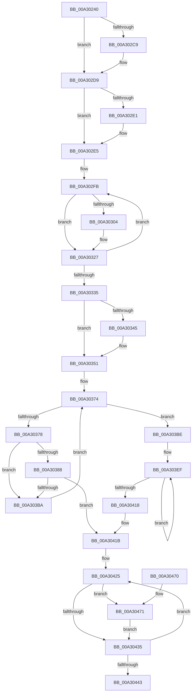

# CmFcManagerQueryFeatureConfigurationSectionInformation

- RVA: `0x00A30240`–`0x00A3047B` (길이 `571` bytes)
- VA: `0x0000000140A30240`
- 실행 섹션: `PAGE`
- PDB 이름 있음: `예`; PDB Function 태그: `아니요`
- unwind 정보 RVA: `0x000ACDB8`
- 디코드: `153`개 명령, `571/571` bytes 표시
- 미해석 바이트: `0` (있으면 어셈블리에 `.byte`로 보존)

> 이 문서는 커널 이미지의 기계어와 PDB 기호를 분석해 생성했습니다. 4번과 5번은 함수 원형과 자료형을 바이너리 사용 방식에서 추정한 C 해석이며 원본 소스 복구 결과는 아닙니다.

## 1. Dependencies

- 직접 호출 지점: **12**; 고유 호출 대상: **11**
- 직접 호출자로 확인된 함수: **1**
- RIP 상대 이미지 참조: **6**

### Outgoing calls
- `0x00A3028A` → [memset](../../text/6C/memset_function_006C6C40.md) (function, `0x006C6C40`)
- `0x00A302AF` → [KeAbPreAcquire](../../text/21/KeAbPreAcquire_function_00210230.md) (function, `0x00210230`)
- `0x00A302D4` → [ExfAcquirePushLockSharedEx](../../text/21/ExfAcquirePushLockSharedEx_function_0021044C.md) (function, `0x0021044C`)
- `0x00A30322` → [CmFcpCopySectionState](CmFcpCopySectionState_function_00A30484.md) (function, `0x00A30484`)
- `0x00A3034C` → [ExfReleasePushLockShared](../../text/26/ExfReleasePushLockShared_function_00263440.md) (function, `0x00263440`)
- `0x00A30358` → [KeAbPostRelease](../../text/2E/KeAbPostRelease_function_002E1600.md) (function, `0x002E1600`)
- `0x00A3035D` → [KeLeaveCriticalRegion](../../text/25/KeLeaveCriticalRegion_function_0025D8B0.md) (function, `0x0025D8B0`)
- `0x00A303AF` → [ObOpenObjectByPointer](../8B/ObOpenObjectByPointer_function_008B7420.md) (function, `0x008B7420`)
- `0x00A303C8` → [memset](../../text/6C/memset_function_006C6C40.md) (function, `0x006C6C40`)
- `0x00A30428` → [CmFcpCleanupSectionState](CmFcpCleanupSectionState_function_00A304B4.md) (function, `0x00A304B4`)
- `0x00A30450` → [_security_check_cookie](../../text/6A/_security_check_cookie_function_006AC640.md) (function, `0x006AC640`)
- `0x00A30474` → [ObCloseHandle](../8A/ObCloseHandle_function_008A1870.md) (function, `0x008A1870`)

### Direct callers
- [CmQueryFeatureConfigurationSections](CmQueryFeatureConfigurationSections_function_00A300C4.md) at `0x00A3015D`

### Static image references
- `0x00A30257` → RVA `0x00E0A740` (`.data`; read)
- `0x00A30298` → RVA `0x00EF72E8` (`.data`; read)
- `0x00A302E5` → RVA `0x00EF72F8` (`.data`; read)
- `0x00A302EC` → RVA `0x00EF7308` (`.data`; read)
- `0x00A30306` → RVA `0x00EF72E0` (`.data`; read)
- `0x00A3039E` → RVA `0x00FC6BD8` (`ALMOSTRO`; read)

## 2. Other-region calls and transfers

- 다른 실행 섹션으로 향하는 call: **8**
  - `0x00A3028A` → [memset](../../text/6C/memset_function_006C6C40.md) (`PAGE` → `.text`)
  - `0x00A302AF` → [KeAbPreAcquire](../../text/21/KeAbPreAcquire_function_00210230.md) (`PAGE` → `.text`)
  - `0x00A302D4` → [ExfAcquirePushLockSharedEx](../../text/21/ExfAcquirePushLockSharedEx_function_0021044C.md) (`PAGE` → `.text`)
  - `0x00A3034C` → [ExfReleasePushLockShared](../../text/26/ExfReleasePushLockShared_function_00263440.md) (`PAGE` → `.text`)
  - `0x00A30358` → [KeAbPostRelease](../../text/2E/KeAbPostRelease_function_002E1600.md) (`PAGE` → `.text`)
  - `0x00A3035D` → [KeLeaveCriticalRegion](../../text/25/KeLeaveCriticalRegion_function_0025D8B0.md) (`PAGE` → `.text`)
  - `0x00A303C8` → [memset](../../text/6C/memset_function_006C6C40.md) (`PAGE` → `.text`)
  - `0x00A30450` → [_security_check_cookie](../../text/6A/_security_check_cookie_function_006AC640.md) (`PAGE` → `.text`)
- 별도 외부 분기/꼬리 이동을 확인하지 못했습니다.

## 3. Assembly (complete function range)

```asm
00A30240  48 89 5C 24 08                  mov qword ptr [rsp + 8], rbx
00A30245  55                              push rbp
00A30246  56                              push rsi
00A30247  57                              push rdi
00A30248  41 54                           push r12
00A3024A  41 55                           push r13
00A3024C  41 56                           push r14
00A3024E  41 57                           push r15
00A30250  48 81 EC E0 00 00 00            sub rsp, 0xe0
00A30257  48 8B 05 E2 A4 3D 00            mov rax, qword ptr [rip + 0x3da4e2]
00A3025E  48 33 C4                        xor rax, rsp
00A30261  48 89 84 24 D0 00 00 00         mov qword ptr [rsp + 0xd0], rax
00A30269  0F 57 C0                        xorps xmm0, xmm0
00A3026C  48 8D 4C 24 70                  lea rcx, [rsp + 0x70]
00A30271  48 8B EA                        mov rbp, rdx
00A30274  4D 8B F0                        mov r14, r8
00A30277  33 D2                           xor edx, edx
00A30279  45 8A F9                        mov r15b, r9b
00A3027C  0F 11 44 24 48                  movups xmmword ptr [rsp + 0x48], xmm0
00A30281  0F 11 44 24 58                  movups xmmword ptr [rsp + 0x58], xmm0
00A30286  44 8D 42 60                     lea r8d, [rdx + 0x60]
00A3028A  E8 B1 69 C9 FF                  call 0x1406c6c40
00A3028F  65 48 8B 04 25 88 01 00 00      mov rax, qword ptr gs:[0x188]
00A30298  48 8D 3D 49 70 4C 00            lea rdi, [rip + 0x4c7049]
00A3029F  45 33 C0                        xor r8d, r8d
00A302A2  33 D2                           xor edx, edx
00A302A4  48 8B CF                        mov rcx, rdi
00A302A7  66 FF 88 E4 01 00 00            dec word ptr [rax + 0x1e4]
00A302AE  90                              nop
00A302AF  E8 7C FF 7D FF                  call 0x140210230
00A302B4  48 8B D8                        mov rbx, rax
00A302B7  B9 11 00 00 00                  mov ecx, 0x11
00A302BC  33 C0                           xor eax, eax
00A302BE  F0 48 0F B1 0D 21 70 4C 00      lock cmpxchg qword ptr [rip + 0x4c7021], rcx
00A302C7  74 10                           je 0x140a302d9
00A302C9  4C 8B CF                        mov r9, rdi
00A302CC  4C 8B C3                        mov r8, rbx
00A302CF  33 D2                           xor edx, edx
00A302D1  48 8B CF                        mov rcx, rdi
00A302D4  E8 73 01 7E FF                  call 0x14021044c
00A302D9  45 33 ED                        xor r13d, r13d
00A302DC  48 85 DB                        test rbx, rbx
00A302DF  74 04                           je 0x140a302e5
00A302E1  C6 43 0A 01                     mov byte ptr [rbx + 0xa], 1
00A302E5  4C 8B 25 0C 70 4C 00            mov r12, qword ptr [rip + 0x4c700c]
00A302EC  48 8D 35 15 70 4C 00            lea rsi, [rip + 0x4c7015]
00A302F3  41 8B FD                        mov edi, r13d
00A302F6  BB 04 00 00 00                  mov ebx, 4
00A302FB  48 8B 06                        mov rax, qword ptr [rsi]
00A302FE  48 39 45 00                     cmp qword ptr [rbp], rax
00A30302  73 23                           jae 0x140a30327
00A30304  8B C7                           mov eax, edi
00A30306  48 8D 15 D3 6F 4C 00            lea rdx, [rip + 0x4c6fd3]
00A3030D  48 8D 0C 40                     lea rcx, [rax + rax*2]
00A30311  48 8D 14 CA                     lea rdx, [rdx + rcx*8]
00A30315  48 8D 44 24 70                  lea rax, [rsp + 0x70]
00A3031A  48 83 C2 28                     add rdx, 0x28
00A3031E  48 8D 0C C8                     lea rcx, [rax + rcx*8]
00A30322  E8 5D 01 00 00                  call 0x140a30484
00A30327  FF C7                           inc edi
00A30329  48 83 C5 08                     add rbp, 8
00A3032D  48 83 C6 18                     add rsi, 0x18
00A30331  3B FB                           cmp edi, ebx
00A30333  72 C6                           jb 0x140a302fb
00A30335  B8 11 00 00 00                  mov eax, 0x11
00A3033A  F0 4C 0F B1 2D A5 6F 4C 00      lock cmpxchg qword ptr [rip + 0x4c6fa5], r13
00A30343  74 0C                           je 0x140a30351
00A30345  48 8D 0D 9C 6F 4C 00            lea rcx, [rip + 0x4c6f9c]
00A3034C  E8 EF 30 83 FF                  call 0x140263440
00A30351  48 8D 0D 90 6F 4C 00            lea rcx, [rip + 0x4c6f90]
00A30358  E8 A3 12 8B FF                  call 0x1402e1600
00A3035D  E8 4E D5 82 FF                  call 0x14025d8b0
00A30362  41 8A C7                        mov al, r15b
00A30365  41 8B FD                        mov edi, r13d
00A30368  F6 D8                           neg al
00A3036A  1B F6                           sbb esi, esi
00A3036C  F7 D6                           not esi
00A3036E  81 E6 00 02 00 00               and esi, 0x200
00A30374  3B FB                           cmp edi, ebx
00A30376  73 46                           jae 0x140a303be
00A30378  8B D7                           mov edx, edi
00A3037A  48 8D 04 52                     lea rax, [rdx + rdx*2]
00A3037E  48 8B 4C C4 78                  mov rcx, qword ptr [rsp + rax*8 + 0x78]
00A30383  48 85 C9                        test rcx, rcx
00A30386  74 32                           je 0x140a303ba
00A30388  48 8D 44 24 48                  lea rax, [rsp + 0x48]
00A3038D  44 8B CB                        mov r9d, ebx
00A30390  48 8D 04 D0                     lea rax, [rax + rdx*8]
00A30394  45 33 C0                        xor r8d, r8d
00A30397  48 89 44 24 30                  mov qword ptr [rsp + 0x30], rax
00A3039C  8B D6                           mov edx, esi
00A3039E  48 8B 05 33 68 59 00            mov rax, qword ptr [rip + 0x596833]
00A303A5  44 88 7C 24 28                  mov byte ptr [rsp + 0x28], r15b
00A303AA  48 89 44 24 20                  mov qword ptr [rsp + 0x20], rax
00A303AF  E8 6C 70 E8 FF                  call 0x1408b7420
00A303B4  8B E8                           mov ebp, eax
00A303B6  85 C0                           test eax, eax
00A303B8  78 61                           js 0x140a3041b
00A303BA  FF C7                           inc edi
00A303BC  EB B6                           jmp 0x140a30374
00A303BE  33 D2                           xor edx, edx
00A303C0  49 8D 4E 08                     lea rcx, [r14 + 8]
00A303C4  44 8D 42 60                     lea r8d, [rdx + 0x60]
00A303C8  E8 73 68 C9 FF                  call 0x1406c6c40
00A303CD  4C 8D 44 24 70                  lea r8, [rsp + 0x70]
00A303D2  4D 89 26                        mov qword ptr [r14], r12
00A303D5  4D 2B C6                        sub r8, r14
00A303D8  4C 8D 8C 24 80 00 00 00         lea r9, [rsp + 0x80]
00A303E0  4D 2B CE                        sub r9, r14
00A303E3  48 8D 54 24 48                  lea rdx, [rsp + 0x48]
00A303E8  49 8D 4E 18                     lea rcx, [r14 + 0x18]
00A303EC  4C 8B D3                        mov r10, rbx
00A303EF  49 8B 44 08 E8                  mov rax, qword ptr [r8 + rcx - 0x18]
00A303F4  48 89 41 F0                     mov qword ptr [rcx - 0x10], rax
00A303F8  49 8B 44 09 E8                  mov rax, qword ptr [r9 + rcx - 0x18]
00A303FD  48 89 01                        mov qword ptr [rcx], rax
00A30400  48 8D 49 18                     lea rcx, [rcx + 0x18]
00A30404  48 8B 02                        mov rax, qword ptr [rdx]
00A30407  48 89 41 E0                     mov qword ptr [rcx - 0x20], rax
00A3040B  4C 89 2A                        mov qword ptr [rdx], r13
00A3040E  48 8D 52 08                     lea rdx, [rdx + 8]
00A30412  49 83 EA 01                     sub r10, 1
00A30416  75 D7                           jne 0x140a303ef
00A30418  41 8B ED                        mov ebp, r13d
00A3041B  48 8D 7C 24 48                  lea rdi, [rsp + 0x48]
00A30420  48 8D 74 24 70                  lea rsi, [rsp + 0x70]
00A30425  48 8B CE                        mov rcx, rsi
00A30428  E8 87 00 00 00                  call 0x140a304b4
00A3042D  48 8B 0F                        mov rcx, qword ptr [rdi]
00A30430  48 85 C9                        test rcx, rcx
00A30433  75 3C                           jne 0x140a30471
00A30435  48 83 C6 18                     add rsi, 0x18
00A30439  48 83 C7 08                     add rdi, 8
00A3043D  48 83 EB 01                     sub rbx, 1
00A30441  75 E2                           jne 0x140a30425
00A30443  8B C5                           mov eax, ebp
00A30445  48 8B 8C 24 D0 00 00 00         mov rcx, qword ptr [rsp + 0xd0]
00A3044D  48 33 CC                        xor rcx, rsp
00A30450  E8 EB C1 C7 FF                  call 0x1406ac640
00A30455  48 8B 9C 24 20 01 00 00         mov rbx, qword ptr [rsp + 0x120]
00A3045D  48 81 C4 E0 00 00 00            add rsp, 0xe0
00A30464  41 5F                           pop r15
00A30466  41 5E                           pop r14
00A30468  41 5D                           pop r13
00A3046A  41 5C                           pop r12
00A3046C  5F                              pop rdi
00A3046D  5E                              pop rsi
00A3046E  5D                              pop rbp
00A3046F  C3                              ret
00A30470  CC                              int3
00A30471  41 8A D7                        mov dl, r15b
00A30474  E8 F7 13 E7 FF                  call 0x1408a1870
00A30479  EB BA                           jmp 0x140a30435
```

## 4. C-style interpretation (structured pseudocode)

```c
__int64 __fastcall CmFcManagerQueryFeatureConfigurationSectionInformation(__int64 a1, __int64 a2, __int64 a3, unsigned __int8 a4)
{
    __int64 result;
    __int64 v_r10;
    __int64 v_r13;
    __int64 v_rbp;
    __int64 v_rbx;
    __int64 v_rdi;
    __int64 v_rsi;
    __int64 v_rsp;
    unsigned __int64 v_stack_m48;
    unsigned __int64 v_stack_m98;
    unsigned __int64 v_stack_mA8;
    unsigned __int64 v_stack_mC0;
    unsigned __int64 v_stack_mD0;
    unsigned __int64 v_stack_mE8;
    unsigned __int8 v_stack_mF0;
    unsigned __int64 v_stack_mF8;
    unsigned __int64 v_stack_p8;

    v_stack_p8 = v_rbx;
    v_rsp = (v_rsp) - (224);
    result = (*(unsigned __int64 *)(v_rip + 4039906)) ^ (v_rsp);
    v_stack_m48 = result;
    a2 = 0;
    v_stack_mD0 = v_xmm0;
    v_stack_mC0 = v_xmm0;
    result = memset(v_stack_mA8, a2, a2 + 96, a4);
    a3 = 0;
    a2 = 0;
    result = KeAbPreAcquire(v_rip + 5009481, a2, a3, a4);
    result = 0;
    if (!(condition_is_equal)) {
        a4 = v_rip + 5009481;
        a3 = 0;
        a2 = 0;
        a1 = v_rip + 5009481;
        result = ExfAcquirePushLockSharedEx(a1, a2, a3, a4);
    }
    v_r13 = 0;
    if (result != 0) {
        *(unsigned __int8 *)(result + 10) = 1;
    }
loc_00A302FB:
    result = *(unsigned __int64 *)(v_rip + 5009429);
    if ((*(unsigned __int64 *)(a2)) < (*(unsigned __int64 *)(v_rip + 5009429))) {
        result = 0;
        a2 = v_rip + 5009363;
        a1 = result + result * 2;
        a2 = a2 + a1 * 8;
        result = v_stack_mA8;
        a2 = (a2) + (40);
        a1 = result + a1 * 8;
        result = CmFcpCopySectionState(a1, a2, a3, a4);
    }
    v_rdi = (unsigned int)((0) + 1);
    v_rbp = (a2) + (8);
    v_rsi = (v_rip + 5009429) + (24);
    if (((unsigned int)(v_rdi)) < 4) goto loc_00A302FB;
    result = 17;
    if (((unsigned int)(v_rdi)) != 4) {
        a1 = v_rip + 5009308;
        result = ExfReleasePushLockShared(a1, a2, a3, a4);
    }
    result = KeAbPostRelease(v_rip + 5009296, a2, a3, a4);
    result = KeLeaveCriticalRegion(v_rip + 5009296, a2, a3, a4);
    result = (unsigned __int8)(-(a4));
    v_rsi = (unsigned int)(~(v_rsi));
    v_rsi = (unsigned int)((v_rsi) & (512));
loc_00A30374:
    if (0 >= 4) goto loc_00A303BE;
    if (*(unsigned __int64 *)(v_rsp + 0 + 0 * 2 * 8 + 120) == 0) goto loc_00A303BA;
    a3 = 0;
    v_stack_mE8 = v_stack_mD0 + 0 * 8;
    v_stack_mF0 = a4;
    v_stack_mF8 = *(unsigned __int64 *)(v_rip + 5859379);
    result = ObOpenObjectByPointer(*(unsigned __int64 *)(v_rsp + 0 + 0 * 2 * 8 + 120), (unsigned int)((unsigned int)(v_rsi)), a3, 4);
    if (sign_flag) goto loc_00A3041B;
loc_00A303BA:
    v_rdi = (unsigned int)((0) + 1);
    goto loc_00A30374;
loc_00A303BE:
    a2 = 0;
    result = memset(a3 + 8, a2, a2 + 96, 4);
    *(unsigned __int64 *)(a3) = *(unsigned __int64 *)(v_rip + 5009420);
    a3 = (v_stack_mA8) - (0);
    a4 = (v_stack_m98) - (a3);
loc_00A303EF:
    *(unsigned __int64 *)(a3 + 24 - 16) = *(unsigned __int64 *)(a3 + a3 + 24 * 1 - 24);
    *(unsigned __int64 *)(a3 + 24) = *(unsigned __int64 *)(a4 + a3 + 24 * 1 - 24);
    *(unsigned __int64 *)(a3 + 24 + 24 - 32) = *(unsigned __int64 *)(v_stack_mD0);
    *(unsigned __int64 *)(v_stack_mD0) = 0;
    v_r10 = (4) - (1);
    if (condition_is_not_equal) goto loc_00A303EF;
loc_00A3041B:
loc_00A30425:
    result = CmFcpCleanupSectionState(v_stack_mA8, v_stack_mD0 + 8, a3, a4);
    if (*(unsigned __int64 *)(v_stack_mD0) != 0) goto loc_00A30471;
loc_00A30435:
    v_rsi = (v_stack_mA8) + (24);
    v_rdi = (v_stack_mD0) + (8);
    v_rbx = (4) - (1);
    if (condition_is_not_equal) goto loc_00A30425;
    a1 = (v_stack_m48) ^ (v_rsp);
    result = _security_check_cookie(a1, v_stack_mD0 + 8, a3, a4);
    v_rsp = (v_rsp) + (224);
    return result;
loc_00A30471:
    result = ObCloseHandle(a1, a4, a3, a4);
    goto loc_00A30435;
}
```

## 5. (Beta) C Style

```c
int64_t CmFcManagerQueryFeatureConfigurationSectionInformation(int64_t Arg1, void *Arg2, void *Arg3, uint8_t Arg4)
{
    uint8_t *arg2 = (uint8_t *)Arg2;
    uint8_t *arg3 = (uint8_t *)Arg3;

    int64_t result;
    int64_t local_r10;
    int64_t local_r13;
    int64_t local_rbp;
    int64_t local_rbx;
    int64_t local_rdi;
    int64_t local_rsi;
    int64_t local_rsp;
    uint64_t v_stack_m48;
    uint64_t v_stack_m98;
    uint64_t v_stack_mA8;
    uint64_t v_stack_mC0;
    uint64_t v_stack_mD0;
    uint64_t v_stack_mE8;
    uint8_t v_stack_mF0;
    uint64_t v_stack_mF8;
    uint64_t v_stack_p8;

    v_stack_p8 = local_rbx;
    local_rsp = (local_rsp) - (224);
    result = (*(uint64_t *)(v_rip + 0x3DA4E2)) ^ (local_rsp);
    v_stack_m48 = result;
    Arg2 = 0;
    v_stack_mD0 = v_xmm0;
    v_stack_mC0 = v_xmm0;
    result = memset(v_stack_mA8, Arg2, Arg2 + 96, Arg4);
    Arg3 = 0;
    Arg2 = 0;
    result = KeAbPreAcquire(v_rip + 5009481, Arg2, Arg3, Arg4);
    result = 0;
    if (!(condition_is_equal)) {
        Arg4 = v_rip + 5009481;
        Arg3 = 0;
        Arg2 = 0;
        Arg1 = v_rip + 5009481;
        result = ExfAcquirePushLockSharedEx(Arg1, Arg2, Arg3, Arg4);
    }
    local_r13 = 0;
    if (result != 0) {
        *(uint8_t *)(result + 0xA) = 1;
    }
loc_00A302FB:
    result = *(uint64_t *)(v_rip + 0x4C7015);
    if ((*(uint64_t *)(arg2)) < (*(uint64_t *)(v_rip + 0x4C7015))) {
        result = 0;
        Arg2 = v_rip + 5009363;
        Arg1 = result + result * 2;
        Arg2 = Arg2 + Arg1 * 8;
        result = v_stack_mA8;
        Arg2 = (Arg2) + (40);
        Arg1 = result + Arg1 * 8;
        result = CmFcpCopySectionState(Arg1, Arg2, Arg3, Arg4);
    }
    local_rdi = (uint32_t)((0) + 1);
    local_rbp = (Arg2) + (8);
    local_rsi = (v_rip + 5009429) + (24);
    if (((uint32_t)(local_rdi)) < 4) goto loc_00A302FB;
    result = 17;
    if (((uint32_t)(local_rdi)) != 4) {
        Arg1 = v_rip + 5009308;
        result = ExfReleasePushLockShared(Arg1, Arg2, Arg3, Arg4);
    }
    result = KeAbPostRelease(v_rip + 5009296, Arg2, Arg3, Arg4);
    result = KeLeaveCriticalRegion(v_rip + 5009296, Arg2, Arg3, Arg4);
    result = (uint8_t)(-(Arg4));
    local_rsi = (uint32_t)(~(local_rsi));
    local_rsi = (uint32_t)((local_rsi) & (512));
loc_00A30374:
    if (0 >= 4) goto loc_00A303BE;
    if (*(uint64_t *)(local_rsp + 0x0 + 0x0 * 2 * 8 + 0x78) == 0) goto loc_00A303BA;
    Arg3 = 0;
    v_stack_mE8 = v_stack_mD0 + 0 * 8;
    v_stack_mF0 = Arg4;
    v_stack_mF8 = *(uint64_t *)(v_rip + 0x596833);
    result = ObOpenObjectByPointer(*(uint64_t *)(local_rsp + 0x0 + 0x0 * 2 * 8 + 0x78), (uint32_t)((uint32_t)(local_rsi)), Arg3, 4);
    if (sign_flag) goto loc_00A3041B;
loc_00A303BA:
    local_rdi = (uint32_t)((0) + 1);
    goto loc_00A30374;
loc_00A303BE:
    Arg2 = 0;
    result = memset(Arg3 + 8, Arg2, Arg2 + 96, 4);
    *(uint64_t *)(arg3) = *(uint64_t *)(v_rip + 0x4C700C);
    Arg3 = (v_stack_mA8) - (0);
    Arg4 = (v_stack_m98) - (Arg3);
loc_00A303EF:
    *(uint64_t *)(arg3 + 0x18 - 0x10) = *(uint64_t *)(arg3 + arg3 + 0x18 * 1 - 0x18);
    *(uint64_t *)(arg3 + 0x18) = *(uint64_t *)(Arg4 + arg3 + 0x18 * 1 - 0x18);
    *(uint64_t *)(arg3 + 0x18 + 0x18 - 0x20) = *(uint64_t *)(v_stack_mD0);
    *(uint64_t *)(v_stack_mD0) = 0;
    local_r10 = (4) - (1);
    if (condition_is_not_equal) goto loc_00A303EF;
loc_00A3041B:
loc_00A30425:
    result = CmFcpCleanupSectionState(v_stack_mA8, v_stack_mD0 + 8, Arg3, Arg4);
    if (*(uint64_t *)(v_stack_mD0) != 0) goto loc_00A30471;
loc_00A30435:
    local_rsi = (v_stack_mA8) + (24);
    local_rdi = (v_stack_mD0) + (8);
    local_rbx = (4) - (1);
    if (condition_is_not_equal) goto loc_00A30425;
    Arg1 = (v_stack_m48) ^ (local_rsp);
    result = _security_check_cookie(Arg1, v_stack_mD0 + 8, Arg3, Arg4);
    local_rsp = (local_rsp) + (224);
    return result;
loc_00A30471:
    result = ObCloseHandle(Arg1, Arg4, Arg3, Arg4);
    goto loc_00A30435;
}
```

### 관측된 메모리 오프셋

구조체 형식이 확인되지 않은 접근은 인자 기준의 오프셋으로만 기록했습니다.

| 기준 인자 | 오프셋 표현 | 폭 (bit) | 접근 |
|---|---:|---:|---|
| `Arg2` | `+ 0x0` | `64` | `R` |
| `Arg3` | `- 0x20` | `64` | `W` |
| `Arg3` | `- 0x10` | `64` | `W` |
| `Arg3` | `+ 0x0` | `64` | `W` |
| `Arg3` | `+ 0x8` | `64` | `R` |
| `Arg3` | `+ 0x18` | `64` | `R` |

## 6. Execution-region graph

[열기: 2D/3D 그래프와 함수 탐색 컨트롤 패널](../../../control-panel.html?section=page&rva=0x00A30240&view=graph)

- 2D 그래프는 위에서 아래로 흐르고, 3D 그래프는 빈 공간을 드래그해 회전합니다. Shift+드래그는 이동, 휠은 확대·축소, 함수 노드 선택은 대상 보고서 이동입니다.

### Static fallback


