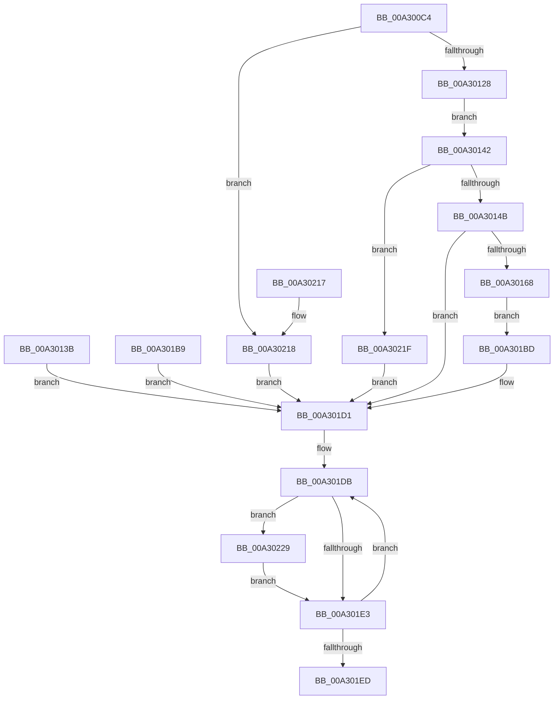

# CmQueryFeatureConfigurationSections

- RVA: `0x00A300C4`–`0x00A30237` (길이 `371` bytes)
- VA: `0x0000000140A300C4`
- 실행 섹션: `PAGE`
- PDB 이름 있음: `예`; PDB Function 태그: `아니요`
- unwind 정보 RVA: `0x000ACD58`
- 디코드: `93`개 명령, `371/371` bytes 표시
- 미해석 바이트: `0` (있으면 어셈블리에 `.byte`로 보존)

> 이 문서는 커널 이미지의 기계어와 PDB 기호를 분석해 생성했습니다. 4번과 5번은 함수 원형과 자료형을 바이너리 사용 방식에서 추정한 C 해석이며 원본 소스 복구 결과는 아닙니다.

## 1. Dependencies

- 직접 호출 지점: **5**; 고유 호출 대상: **4**
- 직접 호출자로 확인된 함수: **1**
- RIP 상대 이미지 참조: **1**

### Outgoing calls
- `0x00A3011A` → [memset](../../text/6C/memset_function_006C6C40.md) (function, `0x006C6C40`)
- `0x00A3015D` → [CmFcManagerQueryFeatureConfigurationSectionInformation](CmFcManagerQueryFeatureConfigurationSectionInformation_function_00A30240.md) (function, `0x00A30240`)
- `0x00A301CA` → [memset](../../text/6C/memset_function_006C6C40.md) (function, `0x006C6C40`)
- `0x00A301FA` → [_security_check_cookie](../../text/6A/_security_check_cookie_function_006AC640.md) (function, `0x006AC640`)
- `0x00A30230` → [ObCloseHandle](../8A/ObCloseHandle_function_008A1870.md) (function, `0x008A1870`)

### Direct callers
- [ExpQuerySystemInformation](../A5/ExpQuerySystemInformation_function_00A57858.md) at `0x00A5B0E4`

### Static image references
- `0x00A300D8` → RVA `0x00E0A740` (`.data`; read)

## 2. Other-region calls and transfers

- 다른 실행 섹션으로 향하는 call: **3**
  - `0x00A3011A` → [memset](../../text/6C/memset_function_006C6C40.md) (`PAGE` → `.text`)
  - `0x00A301CA` → [memset](../../text/6C/memset_function_006C6C40.md) (`PAGE` → `.text`)
  - `0x00A301FA` → [_security_check_cookie](../../text/6A/_security_check_cookie_function_006AC640.md) (`PAGE` → `.text`)
- 별도 외부 분기/꼬리 이동을 확인하지 못했습니다.

## 3. Assembly (complete function range)

```asm
00A300C4  48 89 5C 24 10                  mov qword ptr [rsp + 0x10], rbx
00A300C9  56                              push rsi
00A300CA  57                              push rdi
00A300CB  41 54                           push r12
00A300CD  41 56                           push r14
00A300CF  41 57                           push r15
00A300D1  48 81 EC E0 00 00 00            sub rsp, 0xe0
00A300D8  48 8B 05 61 A6 3D 00            mov rax, qword ptr [rip + 0x3da661]
00A300DF  48 33 C4                        xor rax, rsp
00A300E2  48 89 84 24 D0 00 00 00         mov qword ptr [rsp + 0xd0], rax
00A300EA  45 8B F9                        mov r15d, r9d
00A300ED  49 8B F8                        mov rdi, r8
00A300F0  8B DA                           mov ebx, edx
00A300F2  48 8B F1                        mov rsi, rcx
00A300F5  4C 8B B4 24 30 01 00 00         mov r14, qword ptr [rsp + 0x130]
00A300FD  0F 57 C0                        xorps xmm0, xmm0
00A30100  0F 11 44 24 38                  movups xmmword ptr [rsp + 0x38], xmm0
00A30105  0F 11 44 24 48                  movups xmmword ptr [rsp + 0x48], xmm0
00A3010A  41 BC 68 00 00 00               mov r12d, 0x68
00A30110  45 8B C4                        mov r8d, r12d
00A30113  33 D2                           xor edx, edx
00A30115  48 8D 4C 24 60                  lea rcx, [rsp + 0x60]
00A3011A  E8 21 6B C9 FF                  call 0x1406c6c40
00A3011F  83 FB 20                        cmp ebx, 0x20
00A30122  0F 85 F0 00 00 00               jne 0x140a30218
00A30128  0F 10 06                        movups xmm0, xmmword ptr [rsi]
00A3012B  0F 11 44 24 38                  movups xmmword ptr [rsp + 0x38], xmm0
00A30130  0F 10 4E 10                     movups xmm1, xmmword ptr [rsi + 0x10]
00A30134  0F 11 4C 24 48                  movups xmmword ptr [rsp + 0x48], xmm1
00A30139  EB 07                           jmp 0x140a30142
00A3013B  8B D8                           mov ebx, eax
00A3013D  E9 8F 00 00 00                  jmp 0x140a301d1
00A30142  45 3B FC                        cmp r15d, r12d
00A30145  0F 85 D4 00 00 00               jne 0x140a3021f
00A3014B  44 8A 8C 24 38 01 00 00         mov r9b, byte ptr [rsp + 0x138]
00A30153  4C 8D 44 24 60                  lea r8, [rsp + 0x60]
00A30158  48 8D 54 24 38                  lea rdx, [rsp + 0x38]
00A3015D  E8 DE 00 00 00                  call 0x140a30240
00A30162  8B D8                           mov ebx, eax
00A30164  85 C0                           test eax, eax
00A30166  78 69                           js 0x140a301d1
00A30168  0F 28 44 24 60                  movaps xmm0, xmmword ptr [rsp + 0x60]
00A3016D  0F 11 07                        movups xmmword ptr [rdi], xmm0
00A30170  0F 28 4C 24 70                  movaps xmm1, xmmword ptr [rsp + 0x70]
00A30175  0F 11 4F 10                     movups xmmword ptr [rdi + 0x10], xmm1
00A30179  0F 28 84 24 80 00 00 00         movaps xmm0, xmmword ptr [rsp + 0x80]
00A30181  0F 11 47 20                     movups xmmword ptr [rdi + 0x20], xmm0
00A30185  0F 28 8C 24 90 00 00 00         movaps xmm1, xmmword ptr [rsp + 0x90]
00A3018D  0F 11 4F 30                     movups xmmword ptr [rdi + 0x30], xmm1
00A30191  0F 28 84 24 A0 00 00 00         movaps xmm0, xmmword ptr [rsp + 0xa0]
00A30199  0F 11 47 40                     movups xmmword ptr [rdi + 0x40], xmm0
00A3019D  0F 28 8C 24 B0 00 00 00         movaps xmm1, xmmword ptr [rsp + 0xb0]
00A301A5  0F 11 4F 50                     movups xmmword ptr [rdi + 0x50], xmm1
00A301A9  F2 0F 10 84 24 C0 00 00 00      movsd xmm0, qword ptr [rsp + 0xc0]
00A301B2  F2 0F 11 47 60                  movsd qword ptr [rdi + 0x60], xmm0
00A301B7  EB 04                           jmp 0x140a301bd
00A301B9  8B D8                           mov ebx, eax
00A301BB  EB 14                           jmp 0x140a301d1
00A301BD  45 89 26                        mov dword ptr [r14], r12d
00A301C0  4D 8B C4                        mov r8, r12
00A301C3  33 D2                           xor edx, edx
00A301C5  48 8D 4C 24 60                  lea rcx, [rsp + 0x60]
00A301CA  E8 71 6A C9 FF                  call 0x1406c6c40
00A301CF  33 DB                           xor ebx, ebx
00A301D1  48 8D 7C 24 70                  lea rdi, [rsp + 0x70]
00A301D6  BE 04 00 00 00                  mov esi, 4
00A301DB  48 8B 0F                        mov rcx, qword ptr [rdi]
00A301DE  48 85 C9                        test rcx, rcx
00A301E1  75 46                           jne 0x140a30229
00A301E3  48 83 C7 18                     add rdi, 0x18
00A301E7  48 83 EE 01                     sub rsi, 1
00A301EB  75 EE                           jne 0x140a301db
00A301ED  8B C3                           mov eax, ebx
00A301EF  48 8B 8C 24 D0 00 00 00         mov rcx, qword ptr [rsp + 0xd0]
00A301F7  48 33 CC                        xor rcx, rsp
00A301FA  E8 41 C4 C7 FF                  call 0x1406ac640
00A301FF  48 8B 9C 24 18 01 00 00         mov rbx, qword ptr [rsp + 0x118]
00A30207  48 81 C4 E0 00 00 00            add rsp, 0xe0
00A3020E  41 5F                           pop r15
00A30210  41 5E                           pop r14
00A30212  41 5C                           pop r12
00A30214  5F                              pop rdi
00A30215  5E                              pop rsi
00A30216  C3                              ret
00A30217  CC                              int3
00A30218  BB 04 00 00 C0                  mov ebx, 0xc0000004
00A3021D  EB B2                           jmp 0x140a301d1
00A3021F  BB 04 00 00 C0                  mov ebx, 0xc0000004
00A30224  45 89 26                        mov dword ptr [r14], r12d
00A30227  EB A8                           jmp 0x140a301d1
00A30229  8A 94 24 38 01 00 00            mov dl, byte ptr [rsp + 0x138]
00A30230  E8 3B 16 E7 FF                  call 0x1408a1870
00A30235  EB AC                           jmp 0x140a301e3
```

## 4. C-style interpretation (structured pseudocode)

```c
__int64 __fastcall CmQueryFeatureConfigurationSections(__int64 a1, int a2, __int64 a3, int a4, __int64 a5, unsigned __int8 a6)
{
    __int64 result;
    __int64 v_rbx;
    __int64 v_rdi;
    __int64 v_rsi;
    __int64 v_rsp;
    unsigned __int64 v_stack_m38;
    unsigned __int64 v_stack_m48;
    unsigned __int64 v_stack_m58;
    unsigned __int64 v_stack_m68;
    unsigned __int64 v_stack_m78;
    unsigned __int64 v_stack_m88;
    unsigned __int64 v_stack_m98;
    unsigned __int64 v_stack_mA8;
    unsigned __int64 v_stack_mC0;
    unsigned __int64 v_stack_mD0;
    unsigned __int64 v_stack_p10;

    v_stack_p10 = v_rbx;
    v_rsp = (v_rsp) - (224);
    result = (*(unsigned __int64 *)(v_rip + 4040289)) ^ (v_rsp);
    v_stack_m38 = result;
    v_stack_mD0 = v_xmm0;
    v_stack_mC0 = v_xmm0;
    a2 = 0;
    result = memset(v_stack_mA8, a2, 104, a4);
    if (((unsigned int)((unsigned int)(a2))) != 32) goto loc_00A30218;
    v_stack_mD0 = v_xmm0;
    v_stack_mC0 = v_xmm1;
    goto loc_00A30142;
loc_00A30142:
    if (((unsigned int)((unsigned int)(a4))) != 104) goto loc_00A3021F;
    result = CmFcManagerQueryFeatureConfigurationSectionInformation(v_stack_mA8, v_stack_mD0, v_stack_mA8, a6);
    if (sign_flag) goto loc_00A301D1;
    *(unsigned __int64 *)(a3) = v_xmm0;
    *(unsigned __int64 *)(a3 + 16) = v_xmm1;
    *(unsigned __int64 *)(a3 + 32) = v_xmm0;
    *(unsigned __int64 *)(a3 + 48) = v_xmm1;
    *(unsigned __int64 *)(a3 + 64) = v_xmm0;
    *(unsigned __int64 *)(a3 + 80) = v_xmm1;
    *(unsigned __int64 *)(a3 + 96) = v_xmm0;
    goto loc_00A301BD;
loc_00A301BD:
    *(unsigned int *)(a5) = 104;
    a2 = 0;
    result = memset(v_stack_mA8, a2, 104, a6);
    v_rbx = 0;
loc_00A301D1:
loc_00A301DB:
    if (*(unsigned __int64 *)(v_stack_m98) != 0) goto loc_00A30229;
loc_00A301E3:
    v_rdi = (v_stack_m98) + (24);
    v_rsi = (4) - (1);
    if (condition_is_not_equal) goto loc_00A301DB;
    a1 = (v_stack_m38) ^ (v_rsp);
    result = _security_check_cookie(a1, a2, 104, a6);
    v_rsp = (v_rsp) + (224);
    return result;
loc_00A30218:
    goto loc_00A301D1;
loc_00A3021F:
    *(unsigned int *)(a5) = 104;
    goto loc_00A301D1;
loc_00A30229:
    result = ObCloseHandle(a1, a6, 104, a6);
    goto loc_00A301E3;
}
```

## 5. (Beta) C Style

```c
int64_t CmQueryFeatureConfigurationSections(void *Arg1, int32_t Arg2, void *Arg3, int32_t Arg4, void *Arg5, uint8_t Arg6)
{
    uint8_t *arg1 = (uint8_t *)Arg1;
    uint8_t *arg3 = (uint8_t *)Arg3;
    uint8_t *arg5 = (uint8_t *)Arg5;

    int64_t result;
    int64_t local_rbx;
    int64_t local_rdi;
    int64_t local_rsi;
    int64_t local_rsp;
    uint64_t v_stack_m38;
    uint64_t v_stack_m48;
    uint64_t v_stack_m58;
    uint64_t v_stack_m68;
    uint64_t v_stack_m78;
    uint64_t v_stack_m88;
    uint64_t v_stack_m98;
    uint64_t v_stack_mA8;
    uint64_t v_stack_mC0;
    uint64_t v_stack_mD0;
    uint64_t v_stack_p10;

    v_stack_p10 = local_rbx;
    local_rsp = (local_rsp) - (224);
    result = (*(uint64_t *)(v_rip + 0x3DA661)) ^ (local_rsp);
    v_stack_m38 = result;
    v_stack_mD0 = v_xmm0;
    v_stack_mC0 = v_xmm0;
    Arg2 = 0;
    result = memset(v_stack_mA8, Arg2, 104, Arg4);
    if (((uint32_t)((uint32_t)(Arg2))) != 32) goto loc_00A30218;
    v_stack_mD0 = v_xmm0;
    v_stack_mC0 = v_xmm1;
    goto loc_00A30142;
loc_00A30142:
    if (((uint32_t)((uint32_t)(Arg4))) != 104) goto loc_00A3021F;
    result = CmFcManagerQueryFeatureConfigurationSectionInformation(v_stack_mA8, v_stack_mD0, v_stack_mA8, Arg6);
    if (sign_flag) goto loc_00A301D1;
    *(uint64_t *)(arg3) = v_xmm0;
    *(uint64_t *)(arg3 + 0x10) = v_xmm1;
    *(uint64_t *)(arg3 + 0x20) = v_xmm0;
    *(uint64_t *)(arg3 + 0x30) = v_xmm1;
    *(uint64_t *)(arg3 + 0x40) = v_xmm0;
    *(uint64_t *)(arg3 + 0x50) = v_xmm1;
    *(uint64_t *)(arg3 + 0x60) = v_xmm0;
    goto loc_00A301BD;
loc_00A301BD:
    *(uint32_t *)(arg5) = 104;
    Arg2 = 0;
    result = memset(v_stack_mA8, Arg2, 104, Arg6);
    local_rbx = 0;
loc_00A301D1:
loc_00A301DB:
    if (*(uint64_t *)(v_stack_m98) != 0) goto loc_00A30229;
loc_00A301E3:
    local_rdi = (v_stack_m98) + (24);
    local_rsi = (4) - (1);
    if (condition_is_not_equal) goto loc_00A301DB;
    Arg1 = (v_stack_m38) ^ (local_rsp);
    result = _security_check_cookie(Arg1, Arg2, 104, Arg6);
    local_rsp = (local_rsp) + (224);
    return result;
loc_00A30218:
    goto loc_00A301D1;
loc_00A3021F:
    *(uint32_t *)(arg5) = 104;
    goto loc_00A301D1;
loc_00A30229:
    result = ObCloseHandle(Arg1, Arg6, 104, Arg6);
    goto loc_00A301E3;
}
```

### 관측된 메모리 오프셋

구조체 형식이 확인되지 않은 접근은 인자 기준의 오프셋으로만 기록했습니다.

| 기준 인자 | 오프셋 표현 | 폭 (bit) | 접근 |
|---|---:|---:|---|
| `Arg1` | `+ 0x0` | `128` | `R` |
| `Arg1` | `+ 0x10` | `128` | `R` |
| `Arg3` | `+ 0x0` | `128` | `R` |
| `Arg3` | `+ 0x10` | `128` | `R` |
| `Arg3` | `+ 0x20` | `128` | `R` |
| `Arg3` | `+ 0x30` | `128` | `R` |
| `Arg3` | `+ 0x40` | `128` | `R` |
| `Arg3` | `+ 0x50` | `128` | `R` |
| `Arg3` | `+ 0x60` | `64` | `W` |
| `Arg5` | `+ 0x0` | `32` | `W` |

## 6. Execution-region graph

[열기: 2D/3D 그래프와 함수 탐색 컨트롤 패널](../../../control-panel.html?section=page&rva=0x00A300C4&view=graph)

- 2D 그래프는 위에서 아래로 흐르고, 3D 그래프는 빈 공간을 드래그해 회전합니다. Shift+드래그는 이동, 휠은 확대·축소, 함수 노드 선택은 대상 보고서 이동입니다.

### Static fallback


