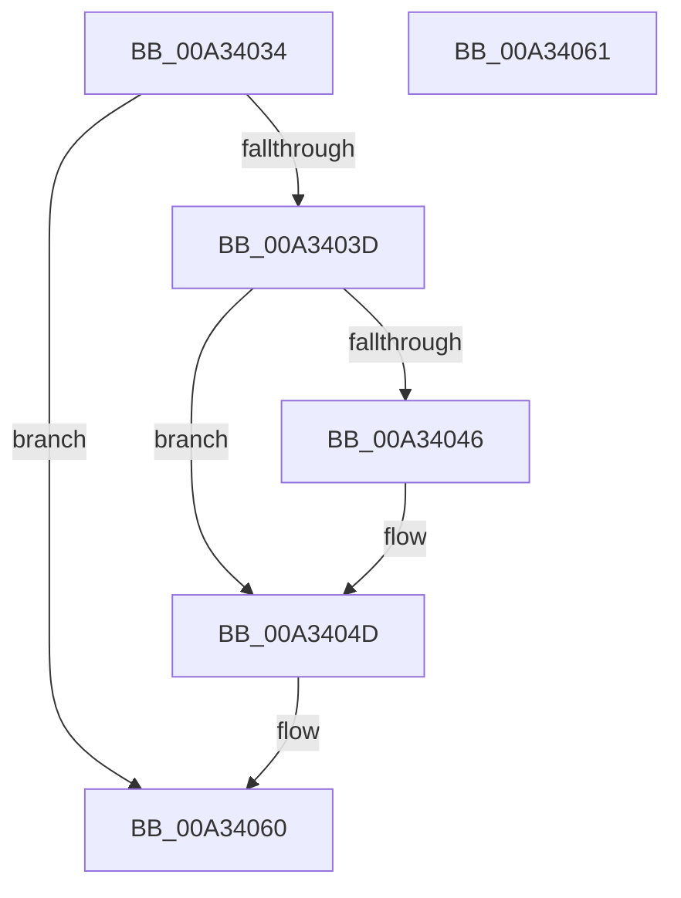

# CmpAddToDelayedDeref

- RVA: `0x00A34034`–`0x00A34062` (길이 `46` bytes)
- VA: `0x0000000140A34034`
- 실행 섹션: `PAGE`
- PDB 이름 있음: `예`; PDB Function 태그: `아니요`
- unwind 정보 RVA: `0x000DB714`
- 디코드: `15`개 명령, `46/46` bytes 표시
- 미해석 바이트: `0` (있으면 어셈블리에 `.byte`로 보존)

> 이 문서는 커널 이미지의 기계어와 PDB 기호를 분석해 생성했습니다. 4번과 5번은 함수 원형과 자료형을 바이너리 사용 방식에서 추정한 C 해석이며 원본 소스 복구 결과는 아닙니다.

## 1. Dependencies

- 직접 호출 지점: **0**; 고유 호출 대상: **0**
- 직접 호출자로 확인된 함수: **2**
- RIP 상대 이미지 참조: **0**

### Outgoing calls
- 직접 디코드된 call 명령이 없습니다.

### Direct callers
- [CmpPostNotify](../86/CmpPostNotify_function_008645D8.md) at `0x00864865`
- [CmpPostNotify](../86/CmpPostNotify_function_008645D8.md) at `0x008648B9`
- [CmpCancelSubordinatePost](CmpCancelSubordinatePost_function_00A33FE8.md) at `0x00A34021`

### Static image references
- 디코드된 RIP-relative 메모리 참조가 없습니다.

## 2. Other-region calls and transfers

- 다른 실행 섹션으로 향하는 call: **0**
- 별도 외부 분기/꼬리 이동을 확인하지 못했습니다.

## 3. Assembly (complete function range)

```asm
00A34034  48 8B 41 30                     mov rax, qword ptr [rcx + 0x30]
00A34038  48 85 C0                        test rax, rax
00A3403B  74 23                           je 0x140a34060
00A3403D  4C 8B 42 08                     mov r8, qword ptr [rdx + 8]
00A34041  49 39 10                        cmp qword ptr [r8], rdx
00A34044  74 07                           je 0x140a3404d
00A34046  B9 03 00 00 00                  mov ecx, 3
00A3404B  CD 29                           int 0x29
00A3404D  48 89 10                        mov qword ptr [rax], rdx
00A34050  4C 89 40 08                     mov qword ptr [rax + 8], r8
00A34054  49 89 00                        mov qword ptr [r8], rax
00A34057  48 89 42 08                     mov qword ptr [rdx + 8], rax
00A3405B  48 83 61 30 00                  and qword ptr [rcx + 0x30], 0
00A34060  C3                              ret
00A34061  CC                              int3
```

## 4. C-style interpretation (structured pseudocode)

```c
__int64 __fastcall CmpAddToDelayedDeref(__int64 a1, __int64 a2)
{
    if (*(unsigned __int64 *)(a1 + 48) == 0) goto loc_00A34060;
    if ((*(unsigned __int64 *)(*(unsigned __int64 *)(a2 + 8))) != a2) {
        a1 = 3;
    }
    *(unsigned __int64 *)(*(unsigned __int64 *)(a1 + 48)) = a2;
    *(unsigned __int64 *)(*(unsigned __int64 *)(a1 + 48) + 8) = *(unsigned __int64 *)(a2 + 8);
    *(unsigned __int64 *)(*(unsigned __int64 *)(a2 + 8)) = *(unsigned __int64 *)(a1 + 48);
    *(unsigned __int64 *)(a2 + 8) = *(unsigned __int64 *)(a1 + 48);
loc_00A34060:
    return *(unsigned __int64 *)(a1 + 48);
}
```

## 5. (Beta) C Style

```c
int64_t CmpAddToDelayedDeref(void *Arg1, void *Arg2)
{
    uint8_t *arg1 = (uint8_t *)Arg1;
    uint8_t *arg2 = (uint8_t *)Arg2;

    if (*(uint64_t *)(arg1 + 0x30) == 0) goto loc_00A34060;
    if ((*(uint64_t *)(*(uint64_t *)(arg2 + 0x8))) != Arg2) {
        Arg1 = 3;
    }
    *(void **)(*(uint64_t *)(arg1 + 0x30)) = Arg2;
    *(uint64_t *)(*(uint64_t *)(arg1 + 0x30) + 0x8) = *(uint64_t *)(arg2 + 0x8);
    *(uint64_t *)(*(uint64_t *)(arg2 + 0x8)) = *(uint64_t *)(arg1 + 0x30);
    *(uint64_t *)(arg2 + 0x8) = *(uint64_t *)(arg1 + 0x30);
loc_00A34060:
    return *(uint64_t *)(arg1 + 0x30);
}
```

### 관측된 메모리 오프셋

구조체 형식이 확인되지 않은 접근은 인자 기준의 오프셋으로만 기록했습니다.

| 기준 인자 | 오프셋 표현 | 폭 (bit) | 접근 |
|---|---:|---:|---|
| `Arg1` | `+ 0x30` | `64` | `R` |
| `Arg2` | `+ 0x8` | `64` | `R` |
| `Arg2` | `+ 0x8` | `64` | `W` |

## 6. Execution-region graph

[열기: 2D/3D 그래프와 함수 탐색 컨트롤 패널](../../../control-panel.html?section=page&rva=0x00A34034&view=graph)

- 2D 그래프는 위에서 아래로 흐르고, 3D 그래프는 빈 공간을 드래그해 회전합니다. Shift+드래그는 이동, 휠은 확대·축소, 함수 노드 선택은 대상 보고서 이동입니다.

### Static fallback


