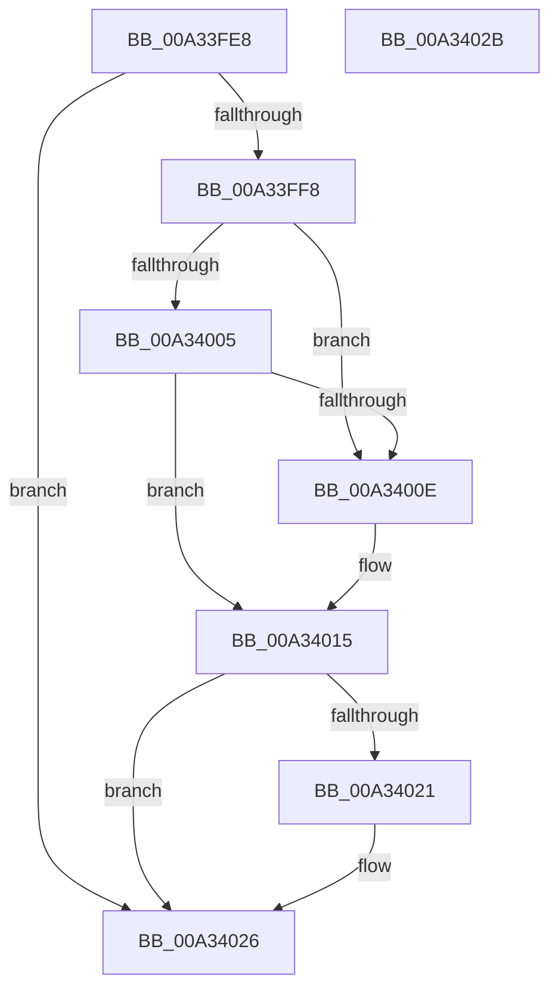

# CmpCancelSubordinatePost

- RVA: `0x00A33FE8`–`0x00A3402C` (길이 `68` bytes)
- VA: `0x0000000140A33FE8`
- 실행 섹션: `PAGE`
- PDB 이름 있음: `예`; PDB Function 태그: `아니요`
- unwind 정보 RVA: `0x0005C788`
- 디코드: `22`개 명령, `68/68` bytes 표시
- 미해석 바이트: `0` (있으면 어셈블리에 `.byte`로 보존)

> 이 문서는 커널 이미지의 기계어와 PDB 기호를 분석해 생성했습니다. 4번과 5번은 함수 원형과 자료형을 바이너리 사용 방식에서 추정한 C 해석이며 원본 소스 복구 결과는 아닙니다.

## 1. Dependencies

- 직접 호출 지점: **1**; 고유 호출 대상: **1**
- 직접 호출자로 확인된 함수: **2**
- RIP 상대 이미지 참조: **0**

### Outgoing calls
- `0x00A34021` → [CmpAddToDelayedDeref](CmpAddToDelayedDeref_function_00A34034.md) (function, `0x00A34034`)

### Direct callers
- [CmpPostNotify](../86/CmpPostNotify_function_008645D8.md) at `0x008648B1`
- [CmNotifyRunDown](../90/CmNotifyRunDown_function_00906984.md) at `0x00906C72`

### Static image references
- 디코드된 RIP-relative 메모리 참조가 없습니다.

## 2. Other-region calls and transfers

- 다른 실행 섹션으로 향하는 call: **0**
- 별도 외부 분기/꼬리 이동을 확인하지 못했습니다.

## 3. Assembly (complete function range)

```asm
00A33FE8  48 83 EC 28                     sub rsp, 0x28
00A33FEC  48 83 C1 20                     add rcx, 0x20
00A33FF0  48 8B 01                        mov rax, qword ptr [rcx]
00A33FF3  48 3B C1                        cmp rax, rcx
00A33FF6  74 2E                           je 0x140a34026
00A33FF8  48 8D 48 E0                     lea rcx, [rax - 0x20]
00A33FFC  4C 8B 01                        mov r8, qword ptr [rcx]
00A33FFF  49 39 48 08                     cmp qword ptr [r8 + 8], rcx
00A34003  75 09                           jne 0x140a3400e
00A34005  48 8B 41 08                     mov rax, qword ptr [rcx + 8]
00A34009  48 39 08                        cmp qword ptr [rax], rcx
00A3400C  74 07                           je 0x140a34015
00A3400E  B9 03 00 00 00                  mov ecx, 3
00A34013  CD 29                           int 0x29
00A34015  4C 89 00                        mov qword ptr [rax], r8
00A34018  49 89 40 08                     mov qword ptr [r8 + 8], rax
00A3401C  48 85 D2                        test rdx, rdx
00A3401F  74 05                           je 0x140a34026
00A34021  E8 0E 00 00 00                  call 0x140a34034
00A34026  48 83 C4 28                     add rsp, 0x28
00A3402A  C3                              ret
00A3402B  CC                              int3
```

## 4. C-style interpretation (structured pseudocode)

```c
__int64 __fastcall CmpCancelSubordinatePost(__int64 a1, __int64 a2)
{
    __int64 result;
    __int64 v_rsp;

    v_rsp = (v_rsp) - (40);
    a1 = (a1) + (32);
    if ((*(unsigned __int64 *)(a1)) == a1) goto loc_00A34026;
    if ((*(unsigned __int64 *)(*(unsigned __int64 *)(*(unsigned __int64 *)(a1) - 32) + 8)) != (*(unsigned __int64 *)(a1) - 32)) goto loc_00A3400E;
    if ((*(unsigned __int64 *)(*(unsigned __int64 *)(*(unsigned __int64 *)(a1) - 32 + 8))) != (*(unsigned __int64 *)(a1) - 32)) {
        a1 = 3;
    }
    *(unsigned __int64 *)(*(unsigned __int64 *)(*(unsigned __int64 *)(a1) - 32 + 8)) = *(unsigned __int64 *)(*(unsigned __int64 *)(a1) - 32);
    *(unsigned __int64 *)(*(unsigned __int64 *)(*(unsigned __int64 *)(a1) - 32) + 8) = *(unsigned __int64 *)(*(unsigned __int64 *)(a1) - 32 + 8);
    result = *(unsigned __int64 *)(*(unsigned __int64 *)(a1) - 32 + 8);
    if (a2 != 0) {
        result = CmpAddToDelayedDeref(a1, a2, *(unsigned __int64 *)(*(unsigned __int64 *)(a1) - 32), a4);
    }
    v_rsp = (v_rsp) + (40);
    return result;
}
```

## 5. (Beta) C Style

```c
int64_t CmpCancelSubordinatePost(void *Arg1, int64_t Arg2)
{
    uint8_t *arg1 = (uint8_t *)Arg1;

    int64_t result;
    int64_t local_rsp;

    local_rsp = (local_rsp) - (40);
    Arg1 = (Arg1) + (32);
    if ((*(uint64_t *)(arg1)) == Arg1) goto loc_00A34026;
    if ((*(uint64_t *)(*(uint64_t *)(*(uint64_t *)(arg1) - 0x20) + 0x8)) != (*(uint64_t *)(arg1) - 32)) goto loc_00A3400E;
    if ((*(uint64_t *)(*(uint64_t *)(*(uint64_t *)(arg1) - 0x20 + 0x8))) != (*(uint64_t *)(arg1) - 32)) {
        Arg1 = 3;
    }
    *(uint64_t *)(*(uint64_t *)(*(uint64_t *)(arg1) - 0x20 + 0x8)) = *(uint64_t *)(*(uint64_t *)(arg1) - 0x20);
    *(uint64_t *)(*(uint64_t *)(*(uint64_t *)(arg1) - 0x20) + 0x8) = *(uint64_t *)(*(uint64_t *)(arg1) - 0x20 + 0x8);
    result = *(uint64_t *)(*(uint64_t *)(arg1) - 0x20 + 0x8);
    if (Arg2 != 0) {
        result = CmpAddToDelayedDeref(Arg1, Arg2, *(uint64_t *)(*(uint64_t *)(arg1) - 0x20), a4);
    }
    local_rsp = (local_rsp) + (40);
    return result;
}
```

### 관측된 메모리 오프셋

구조체 형식이 확인되지 않은 접근은 인자 기준의 오프셋으로만 기록했습니다.

| 기준 인자 | 오프셋 표현 | 폭 (bit) | 접근 |
|---|---:|---:|---|
| `Arg1` | `+ 0x0` | `64` | `R` |

## 6. Execution-region graph

[열기: 2D/3D 그래프와 함수 탐색 컨트롤 패널](../../../control-panel.html?section=page&rva=0x00A33FE8&view=graph)

- 2D 그래프는 위에서 아래로 흐르고, 3D 그래프는 빈 공간을 드래그해 회전합니다. Shift+드래그는 이동, 휠은 확대·축소, 함수 노드 선택은 대상 보고서 이동입니다.

### Static fallback


