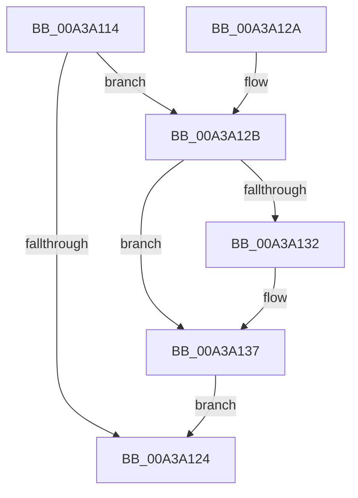

# CmpLightWeightCleanupSetValueKeyUoW

- RVA: `0x00A3A114`–`0x00A3A146` (길이 `50` bytes)
- VA: `0x0000000140A3A114`
- 실행 섹션: `PAGE`
- PDB 이름 있음: `예`; PDB Function 태그: `아니요`
- unwind 정보 RVA: `0x00087C88`
- 디코드: `18`개 명령, `50/50` bytes 표시
- 미해석 바이트: `0` (있으면 어셈블리에 `.byte`로 보존)

> 이 문서는 커널 이미지의 기계어와 PDB 기호를 분석해 생성했습니다. 4번과 5번은 함수 원형과 자료형을 바이너리 사용 방식에서 추정한 C 해석이며 원본 소스 복구 결과는 아닙니다.

## 1. Dependencies

- 직접 호출 지점: **2**; 고유 호출 대상: **2**
- 직접 호출자로 확인된 함수: **3**
- RIP 상대 이미지 참조: **0**

### Outgoing calls
- `0x00A3A132` → [HvFreeCell](../85/HvFreeCell_function_0085A72C.md) (function, `0x0085A72C`)
- `0x00A3A13F` → [CmpFreePoolWithTag](../../text/44/CmpFreePoolWithTag_function_004489E0.md) (function, `0x004489E0`)

### Direct callers
- [CmpCleanupLightWeightUoWData](../9B/CmpCleanupLightWeightUoWData_function_009B0A68.md) at `0x009B0AD8`
- [CmpLightWeightCommitDeleteValueKeyUoW](CmpLightWeightCommitDeleteValueKeyUoW_function_00A39E54.md) at `0x00A39EF8`
- [CmpLightWeightCommitSetValueKeyUoW](CmpLightWeightCommitSetValueKeyUoW_function_00A39FA0.md) at `0x00A3A0A9`

### Static image references
- 디코드된 RIP-relative 메모리 참조가 없습니다.

## 2. Other-region calls and transfers

- 다른 실행 섹션으로 향하는 call: **1**
  - `0x00A3A13F` → [CmpFreePoolWithTag](../../text/44/CmpFreePoolWithTag_function_004489E0.md) (`PAGE` → `.text`)
- 별도 외부 분기/꼬리 이동을 확인하지 못했습니다.

## 3. Assembly (complete function range)

```asm
00A3A114  40 53                           push rbx
00A3A116  48 83 EC 20                     sub rsp, 0x20
00A3A11A  83 C8 FF                        or eax, 0xffffffff
00A3A11D  48 8B DA                        mov rbx, rdx
00A3A120  01 02                           add dword ptr [rdx], eax
00A3A122  74 07                           je 0x140a3a12b
00A3A124  48 83 C4 20                     add rsp, 0x20
00A3A128  5B                              pop rbx
00A3A129  C3                              ret
00A3A12A  CC                              int3
00A3A12B  8B 52 08                        mov edx, dword ptr [rdx + 8]
00A3A12E  3B D0                           cmp edx, eax
00A3A130  74 05                           je 0x140a3a137
00A3A132  E8 F5 05 E2 FF                  call 0x14085a72c
00A3A137  BA 43 4D 55 77                  mov edx, 0x77554d43
00A3A13C  48 8B CB                        mov rcx, rbx
00A3A13F  E8 9C E8 A0 FF                  call 0x1404489e0
00A3A144  EB DE                           jmp 0x140a3a124
```

## 4. C-style interpretation (structured pseudocode)

```c
__int64 __fastcall CmpLightWeightCleanupSetValueKeyUoW(__int64 a1, __int64 a2)
{
    __int64 result;
    __int64 v_rsp;

    v_rsp = (v_rsp) - (32);
    result = (unsigned int)((result) | (0xFFFFFFFFULL));
    if (condition_is_equal) goto loc_00A3A12B;
loc_00A3A124:
    v_rsp = (v_rsp) + (32);
    return result;
loc_00A3A12B:
    if (((unsigned int)((unsigned int)(*(unsigned int *)(a2 + 8)))) != ((unsigned int)(result))) {
        result = HvFreeCell(a1, (unsigned int)(*(unsigned int *)(a2 + 8)), a3, a4);
    }
    result = CmpFreePoolWithTag(a2, (unsigned int)(0x77554D43ULL), a3, a4);
    goto loc_00A3A124;
}
```

## 5. (Beta) C Style

```c
int64_t CmpLightWeightCleanupSetValueKeyUoW(int64_t Arg1, void *Arg2)
{
    uint8_t *arg2 = (uint8_t *)Arg2;

    int64_t result;
    int64_t local_rsp;

    local_rsp = (local_rsp) - (32);
    result = (uint32_t)((result) | (0xFFFFFFFFULL));
    if (condition_is_equal) goto loc_00A3A12B;
loc_00A3A124:
    local_rsp = (local_rsp) + (32);
    return result;
loc_00A3A12B:
    if (((uint32_t)((uint32_t)(*(uint32_t *)(arg2 + 0x8)))) != ((uint32_t)(result))) {
        result = HvFreeCell(Arg1, (uint32_t)(*(uint32_t *)(arg2 + 0x8)), a3, a4);
    }
    result = CmpFreePoolWithTag(Arg2, (uint32_t)(0x77554D43ULL), a3, a4);
    goto loc_00A3A124;
}
```

### 관측된 메모리 오프셋

구조체 형식이 확인되지 않은 접근은 인자 기준의 오프셋으로만 기록했습니다.

| 기준 인자 | 오프셋 표현 | 폭 (bit) | 접근 |
|---|---:|---:|---|
| `Arg2` | `+ 0x0` | `32` | `R/W` |
| `Arg2` | `+ 0x8` | `32` | `R` |

## 6. Execution-region graph

[열기: 2D/3D 그래프와 함수 탐색 컨트롤 패널](../../../control-panel.html?section=page&rva=0x00A3A114&view=graph)

- 2D 그래프는 위에서 아래로 흐르고, 3D 그래프는 빈 공간을 드래그해 회전합니다. Shift+드래그는 이동, 휠은 확대·축소, 함수 노드 선택은 대상 보고서 이동입니다.

### Static fallback


