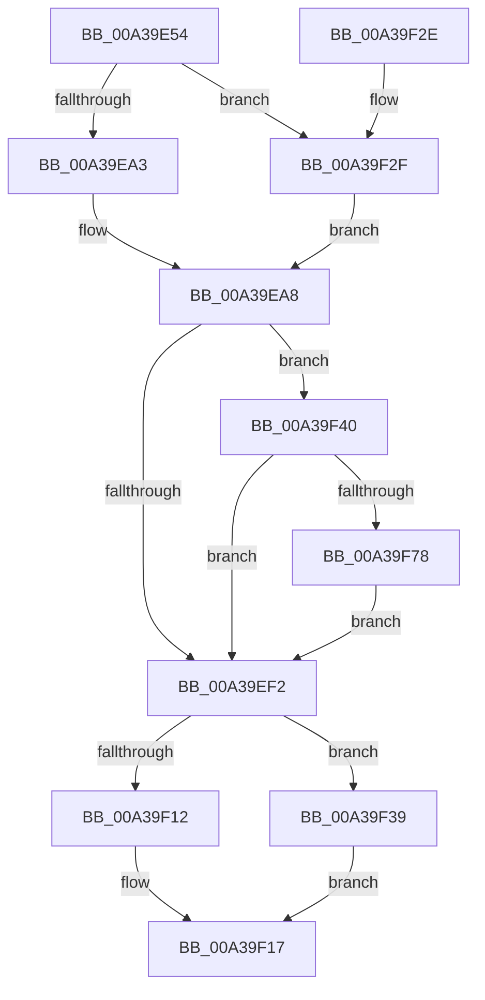

# CmpLightWeightCommitDeleteValueKeyUoW

- RVA: `0x00A39E54`–`0x00A39F98` (길이 `324` bytes)
- VA: `0x0000000140A39E54`
- 실행 섹션: `PAGE`
- PDB 이름 있음: `예`; PDB Function 태그: `아니요`
- unwind 정보 RVA: `0x000ADFB8`
- 디코드: `85`개 명령, `324/324` bytes 표시
- 미해석 바이트: `0` (있으면 어셈블리에 `.byte`로 보존)

> 이 문서는 커널 이미지의 기계어와 PDB 기호를 분석해 생성했습니다. 4번과 5번은 함수 원형과 자료형을 바이너리 사용 방식에서 추정한 C 해석이며 원본 소스 복구 결과는 아닙니다.

## 1. Dependencies

- 직접 호출 지점: **8**; 고유 호출 대상: **8**
- 직접 호출자로 확인된 함수: **1**
- RIP 상대 이미지 참조: **0**

### Outgoing calls
- `0x00A39EA3` → [HvpGetCellFlat](../85/HvpGetCellFlat_function_00854C60.md) (function, `0x00854C60`)
- `0x00A39EB5` → [CmpFreeValue](../84/CmpFreeValue_function_0084AF98.md) (function, `0x0084AF98`)
- `0x00A39EC3` → [CmpFreePoolWithTag](../../text/44/CmpFreePoolWithTag_function_004489E0.md) (function, `0x004489E0`)
- `0x00A39EF8` → [CmpLightWeightCleanupSetValueKeyUoW](CmpLightWeightCleanupSetValueKeyUoW_function_00A3A114.md) (function, `0x00A3A114`)
- `0x00A39F12` → [HvpReleaseCellPaged](../85/HvpReleaseCellPaged_function_00855F40.md) (function, `0x00855F40`)
- `0x00A39F2F` → [HvpGetCellPaged](../85/HvpGetCellPaged_function_00854CB0.md) (function, `0x00854CB0`)
- `0x00A39F39` → [HvpReleaseCellFlat](../85/HvpReleaseCellFlat_function_0085CC20.md) (function, `0x0085CC20`)
- `0x00A39F57` → [CmpCleanUpKcbCachedSymlink](../84/CmpCleanUpKcbCachedSymlink_function_0084DF6C.md) (function, `0x0084DF6C`)

### Direct callers
- [sub_00B2DAE6](../B2/Unknown_function_00B2DAE6.md) at `0x00B2DB39`

### Static image references
- 디코드된 RIP-relative 메모리 참조가 없습니다.

## 2. Other-region calls and transfers

- 다른 실행 섹션으로 향하는 call: **1**
  - `0x00A39EC3` → [CmpFreePoolWithTag](../../text/44/CmpFreePoolWithTag_function_004489E0.md) (`PAGE` → `.text`)
- 별도 외부 분기/꼬리 이동을 확인하지 못했습니다.

## 3. Assembly (complete function range)

```asm
00A39E54  48 8B C4                        mov rax, rsp
00A39E57  48 89 58 10                     mov qword ptr [rax + 0x10], rbx
00A39E5B  48 89 68 18                     mov qword ptr [rax + 0x18], rbp
00A39E5F  56                              push rsi
00A39E60  57                              push rdi
00A39E61  41 54                           push r12
00A39E63  41 56                           push r14
00A39E65  41 57                           push r15
00A39E67  48 83 EC 20                     sub rsp, 0x20
00A39E6B  83 48 08 FF                     or dword ptr [rax + 8], 0xffffffff
00A39E6F  45 33 E4                        xor r12d, r12d
00A39E72  48 8B 69 68                     mov rbp, qword ptr [rcx + 0x68]
00A39E76  4D 8B F8                        mov r15, r8
00A39E79  44 89 60 0C                     mov dword ptr [rax + 0xc], r12d
00A39E7D  4C 8D 44 24 50                  lea r8, [rsp + 0x50]
00A39E82  48 8B 41 30                     mov rax, qword ptr [rcx + 0x30]
00A39E86  4C 8B F2                        mov r14, rdx
00A39E89  48 8B F9                        mov rdi, rcx
00A39E8C  48 8B 58 20                     mov rbx, qword ptr [rax + 0x20]
00A39E90  8B 50 28                        mov edx, dword ptr [rax + 0x28]
00A39E93  48 8B CB                        mov rcx, rbx
00A39E96  F6 83 8C 00 00 00 01            test byte ptr [rbx + 0x8c], 1
00A39E9D  0F 84 8C 00 00 00               je 0x140a39f2f
00A39EA3  E8 B8 AD E1 FF                  call 0x140854c60
00A39EA8  48 8B 57 70                     mov rdx, qword ptr [rdi + 0x70]
00A39EAC  48 8B CB                        mov rcx, rbx
00A39EAF  48 8B F0                        mov rsi, rax
00A39EB2  8B 52 04                        mov edx, dword ptr [rdx + 4]
00A39EB5  E8 DE 10 E1 FF                  call 0x14084af98
00A39EBA  48 8B 4F 70                     mov rcx, qword ptr [rdi + 0x70]
00A39EBE  BA 43 4D 55 77                  mov edx, 0x77554d43
00A39EC3  E8 18 EB A0 FF                  call 0x1404489e0
00A39EC8  4C 89 67 70                     mov qword ptr [rdi + 0x70], r12
00A39ECC  49 8B 06                        mov rax, qword ptr [r14]
00A39ECF  48 89 46 04                     mov qword ptr [rsi + 4], rax
00A39ED3  49 8B 06                        mov rax, qword ptr [r14]
00A39ED6  48 8B 4F 30                     mov rcx, qword ptr [rdi + 0x30]
00A39EDA  48 89 81 A8 00 00 00            mov qword ptr [rcx + 0xa8], rax
00A39EE1  48 8B 47 30                     mov rax, qword ptr [rdi + 0x30]
00A39EE5  48 FF 80 30 01 00 00            inc qword ptr [rax + 0x130]
00A39EEC  83 7D 00 01                     cmp dword ptr [rbp], 1
00A39EF0  74 4E                           je 0x140a39f40
00A39EF2  48 8B D5                        mov rdx, rbp
00A39EF5  48 8B CB                        mov rcx, rbx
00A39EF8  E8 17 02 00 00                  call 0x140a3a114
00A39EFD  4C 89 67 68                     mov qword ptr [rdi + 0x68], r12
00A39F01  48 8D 54 24 50                  lea rdx, [rsp + 0x50]
00A39F06  F6 83 8C 00 00 00 01            test byte ptr [rbx + 0x8c], 1
00A39F0D  48 8B CB                        mov rcx, rbx
00A39F10  75 27                           jne 0x140a39f39
00A39F12  E8 29 C0 E1 FF                  call 0x140855f40
00A39F17  48 8B 5C 24 58                  mov rbx, qword ptr [rsp + 0x58]
00A39F1C  48 8B 6C 24 60                  mov rbp, qword ptr [rsp + 0x60]
00A39F21  48 83 C4 20                     add rsp, 0x20
00A39F25  41 5F                           pop r15
00A39F27  41 5E                           pop r14
00A39F29  41 5C                           pop r12
00A39F2B  5F                              pop rdi
00A39F2C  5E                              pop rsi
00A39F2D  C3                              ret
00A39F2E  CC                              int3
00A39F2F  E8 7C AD E1 FF                  call 0x140854cb0
00A39F34  E9 6F FF FF FF                  jmp 0x140a39ea8
00A39F39  E8 E2 2C E2 FF                  call 0x14085cc20
00A39F3E  EB D7                           jmp 0x140a39f17
00A39F40  48 8B 4D 04                     mov rcx, qword ptr [rbp + 4]
00A39F44  49 8B D7                        mov rdx, r15
00A39F47  48 8B 46 24                     mov rax, qword ptr [rsi + 0x24]
00A39F4B  48 89 4E 24                     mov qword ptr [rsi + 0x24], rcx
00A39F4F  48 89 45 04                     mov qword ptr [rbp + 4], rax
00A39F53  48 8B 4F 30                     mov rcx, qword ptr [rdi + 0x30]
00A39F57  E8 10 40 E1 FF                  call 0x14084df6c
00A39F5C  48 8B 4F 30                     mov rcx, qword ptr [rdi + 0x30]
00A39F60  44 8B 46 28                     mov r8d, dword ptr [rsi + 0x28]
00A39F64  8B 46 24                        mov eax, dword ptr [rsi + 0x24]
00A39F67  89 41 60                        mov dword ptr [rcx + 0x60], eax
00A39F6A  44 89 41 64                     mov dword ptr [rcx + 0x64], r8d
00A39F6E  44 39 66 24                     cmp dword ptr [rsi + 0x24], r12d
00A39F72  0F 85 7A FF FF FF               jne 0x140a39ef2
00A39F78  4C 89 66 3C                     mov qword ptr [rsi + 0x3c], r12
00A39F7C  48 8B 47 30                     mov rax, qword ptr [rdi + 0x30]
00A39F80  66 44 89 A0 B2 00 00 00         mov word ptr [rax + 0xb2], r12w
00A39F88  48 8B 47 30                     mov rax, qword ptr [rdi + 0x30]
00A39F8C  44 89 A0 B4 00 00 00            mov dword ptr [rax + 0xb4], r12d
00A39F93  E9 5A FF FF FF                  jmp 0x140a39ef2
```

## 4. C-style interpretation (structured pseudocode)

```c
__int64 __fastcall CmpLightWeightCommitDeleteValueKeyUoW(__int64 a1, __int64 a2, __int64 a3)
{
    __int64 result;
    __int64 v_r12;
    __int64 v_rsp;
    unsigned __int64 v_stack_p10;
    unsigned __int64 v_stack_p18;
    unsigned __int64 v_stack_p8;

    *(unsigned __int64 *)(v_rsp + 16) = v_rbx;
    *(unsigned __int64 *)(v_rsp + 24) = v_rbp;
    v_rsp = (v_rsp) - (32);
    v_r12 = 0;
    *(unsigned int *)(v_rsp + 12) = 0;
    if (((*(unsigned __int8 *)(*(unsigned __int64 *)(*(unsigned __int64 *)(a1 + 48) + 32) + 140)) & (1)) == 0) goto loc_00A39F2F;
    result = HvpGetCellFlat(*(unsigned __int64 *)(*(unsigned __int64 *)(a1 + 48) + 32), (unsigned int)(*(unsigned int *)(*(unsigned __int64 *)(a1 + 48) + 40)), v_stack_p8, a4);
loc_00A39EA8:
    result = CmpFreeValue(*(unsigned __int64 *)(*(unsigned __int64 *)(a1 + 48) + 32), (unsigned int)(*(unsigned int *)(*(unsigned __int64 *)(a1 + 112) + 4)), v_stack_p8, a4);
    result = CmpFreePoolWithTag(*(unsigned __int64 *)(a1 + 112), (unsigned int)(0x77554D43ULL), v_stack_p8, a4);
    *(unsigned __int64 *)(a1 + 112) = 0;
    *(unsigned __int64 *)(result + 4) = *(unsigned __int64 *)(a2);
    *(unsigned __int64 *)(*(unsigned __int64 *)(a1 + 48) + 168) = *(unsigned __int64 *)(a2);
    if ((*(unsigned int *)(*(unsigned __int64 *)(a1 + 104))) == 1) goto loc_00A39F40;
loc_00A39EF2:
    result = CmpLightWeightCleanupSetValueKeyUoW(*(unsigned __int64 *)(*(unsigned __int64 *)(a1 + 48) + 32), *(unsigned __int64 *)(a1 + 104), v_stack_p8, a4);
    *(unsigned __int64 *)(a1 + 104) = 0;
    if (((*(unsigned __int8 *)(*(unsigned __int64 *)(*(unsigned __int64 *)(a1 + 48) + 32) + 140)) & (1)) != 0) goto loc_00A39F39;
    result = HvpReleaseCellPaged(*(unsigned __int64 *)(*(unsigned __int64 *)(a1 + 48) + 32), v_stack_p8, v_stack_p8, a4);
loc_00A39F17:
    v_rsp = (v_rsp) + (32);
    return result;
loc_00A39F2F:
    result = HvpGetCellPaged(*(unsigned __int64 *)(*(unsigned __int64 *)(a1 + 48) + 32), v_stack_p8, v_stack_p8, a4);
    goto loc_00A39EA8;
loc_00A39F39:
    result = HvpReleaseCellFlat(*(unsigned __int64 *)(*(unsigned __int64 *)(a1 + 48) + 32), v_stack_p8, v_stack_p8, a4);
    goto loc_00A39F17;
loc_00A39F40:
    *(unsigned __int64 *)(result + 36) = *(unsigned __int64 *)(v_stack_p18 + 4);
    *(unsigned __int64 *)(v_stack_p18 + 4) = *(unsigned __int64 *)(result + 36);
    result = CmpCleanUpKcbCachedSymlink(*(unsigned __int64 *)(a1 + 48), a3, v_stack_p8, a4);
    *(unsigned int *)(*(unsigned __int64 *)(a1 + 48) + 96) = (unsigned int)((unsigned int)(*(unsigned int *)(result + 36)));
    *(unsigned int *)(*(unsigned __int64 *)(a1 + 48) + 100) = (unsigned int)((unsigned int)(*(unsigned int *)(result + 40)));
    if ((*(unsigned int *)(result + 36)) != 0) goto loc_00A39EF2;
    *(unsigned __int64 *)(result + 60) = 0;
    *(unsigned __int16 *)(*(unsigned __int64 *)(a1 + 48) + 178) = 0;
    *(unsigned int *)(*(unsigned __int64 *)(a1 + 48) + 180) = 0;
    goto loc_00A39EF2;
}
```

## 5. (Beta) C Style

```c
int64_t CmpLightWeightCommitDeleteValueKeyUoW(void *Arg1, void *Arg2, int64_t Arg3)
{
    uint8_t *arg1 = (uint8_t *)Arg1;
    uint8_t *arg2 = (uint8_t *)Arg2;

    int64_t result;
    int64_t local_r12;
    int64_t local_rsp;
    uint64_t v_stack_p10;
    uint64_t v_stack_p18;
    uint64_t v_stack_p8;

    *(uint64_t *)(local_rsp + 0x10) = local_rbx;
    *(uint64_t *)(local_rsp + 0x18) = local_rbp;
    local_rsp = (local_rsp) - (32);
    local_r12 = 0;
    *(uint32_t *)(local_rsp + 0xC) = 0;
    if (((*(uint8_t *)(*(uint64_t *)(*(uint64_t *)(arg1 + 0x30) + 0x20) + 0x8C)) & (1)) == 0) goto loc_00A39F2F;
    result = HvpGetCellFlat(*(uint64_t *)(*(uint64_t *)(arg1 + 0x30) + 0x20), (uint32_t)(*(uint32_t *)(*(uint64_t *)(arg1 + 0x30) + 0x28)), v_stack_p8, a4);
loc_00A39EA8:
    result = CmpFreeValue(*(uint64_t *)(*(uint64_t *)(arg1 + 0x30) + 0x20), (uint32_t)(*(uint32_t *)(*(uint64_t *)(arg1 + 0x70) + 0x4)), v_stack_p8, a4);
    result = CmpFreePoolWithTag(*(uint64_t *)(arg1 + 0x70), (uint32_t)(0x77554D43ULL), v_stack_p8, a4);
    *(uint64_t *)(arg1 + 0x70) = 0;
    *(uint64_t *)(result + 0x4) = *(uint64_t *)(arg2);
    *(uint64_t *)(*(uint64_t *)(arg1 + 0x30) + 0xA8) = *(uint64_t *)(arg2);
    if ((*(uint32_t *)(*(uint64_t *)(arg1 + 0x68))) == 1) goto loc_00A39F40;
loc_00A39EF2:
    result = CmpLightWeightCleanupSetValueKeyUoW(*(uint64_t *)(*(uint64_t *)(arg1 + 0x30) + 0x20), *(uint64_t *)(arg1 + 0x68), v_stack_p8, a4);
    *(uint64_t *)(arg1 + 0x68) = 0;
    if (((*(uint8_t *)(*(uint64_t *)(*(uint64_t *)(arg1 + 0x30) + 0x20) + 0x8C)) & (1)) != 0) goto loc_00A39F39;
    result = HvpReleaseCellPaged(*(uint64_t *)(*(uint64_t *)(arg1 + 0x30) + 0x20), v_stack_p8, v_stack_p8, a4);
loc_00A39F17:
    local_rsp = (local_rsp) + (32);
    return result;
loc_00A39F2F:
    result = HvpGetCellPaged(*(uint64_t *)(*(uint64_t *)(arg1 + 0x30) + 0x20), v_stack_p8, v_stack_p8, a4);
    goto loc_00A39EA8;
loc_00A39F39:
    result = HvpReleaseCellFlat(*(uint64_t *)(*(uint64_t *)(arg1 + 0x30) + 0x20), v_stack_p8, v_stack_p8, a4);
    goto loc_00A39F17;
loc_00A39F40:
    *(uint64_t *)(result + 0x24) = *(uint64_t *)(v_stack_p18 + 0x4);
    *(uint64_t *)(v_stack_p18 + 0x4) = *(uint64_t *)(result + 0x24);
    result = CmpCleanUpKcbCachedSymlink(*(uint64_t *)(arg1 + 0x30), Arg3, v_stack_p8, a4);
    *(uint32_t *)(*(uint64_t *)(arg1 + 0x30) + 0x60) = (uint32_t)((uint32_t)(*(uint32_t *)(result + 0x24)));
    *(uint32_t *)(*(uint64_t *)(arg1 + 0x30) + 0x64) = (uint32_t)((uint32_t)(*(uint32_t *)(result + 0x28)));
    if ((*(uint32_t *)(result + 0x24)) != 0) goto loc_00A39EF2;
    *(uint64_t *)(result + 0x3C) = 0;
    *(uint16_t *)(*(uint64_t *)(arg1 + 0x30) + 0xB2) = 0;
    *(uint32_t *)(*(uint64_t *)(arg1 + 0x30) + 0xB4) = 0;
    goto loc_00A39EF2;
}
```

### 관측된 메모리 오프셋

구조체 형식이 확인되지 않은 접근은 인자 기준의 오프셋으로만 기록했습니다.

| 기준 인자 | 오프셋 표현 | 폭 (bit) | 접근 |
|---|---:|---:|---|
| `Arg1` | `+ 0x30` | `64` | `R` |
| `Arg1` | `+ 0x68` | `64` | `R` |
| `Arg1` | `+ 0x68` | `64` | `W` |
| `Arg1` | `+ 0x70` | `64` | `R` |
| `Arg1` | `+ 0x70` | `64` | `W` |
| `Arg2` | `+ 0x0` | `64` | `R` |

## 6. Execution-region graph

[열기: 2D/3D 그래프와 함수 탐색 컨트롤 패널](../../../control-panel.html?section=page&rva=0x00A39E54&view=graph)

- 2D 그래프는 위에서 아래로 흐르고, 3D 그래프는 빈 공간을 드래그해 회전합니다. Shift+드래그는 이동, 휠은 확대·축소, 함수 노드 선택은 대상 보고서 이동입니다.

### Static fallback


