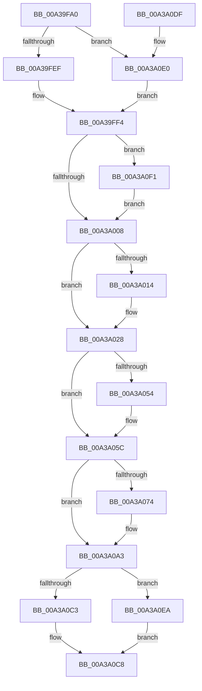

# CmpLightWeightCommitSetValueKeyUoW

- RVA: `0x00A39FA0`–`0x00A3A10C` (길이 `364` bytes)
- VA: `0x0000000140A39FA0`
- 실행 섹션: `PAGE`
- PDB 이름 있음: `예`; PDB Function 태그: `아니요`
- unwind 정보 RVA: `0x000ADFD4`
- 디코드: `98`개 명령, `364/364` bytes 표시
- 미해석 바이트: `0` (있으면 어셈블리에 `.byte`로 보존)

> 이 문서는 커널 이미지의 기계어와 PDB 기호를 분석해 생성했습니다. 4번과 5번은 함수 원형과 자료형을 바이너리 사용 방식에서 추정한 C 해석이며 원본 소스 복구 결과는 아닙니다.

## 1. Dependencies

- 직접 호출 지점: **8**; 고유 호출 대상: **8**
- 직접 호출자로 확인된 함수: **1**
- RIP 상대 이미지 참조: **0**

### Outgoing calls
- `0x00A39FEF` → [HvpGetCellFlat](../85/HvpGetCellFlat_function_00854C60.md) (function, `0x00854C60`)
- `0x00A3A057` → [CmpFreeValue](../84/CmpFreeValue_function_0084AF98.md) (function, `0x0084AF98`)
- `0x00A3A065` → [CmpFreePoolWithTag](../../text/44/CmpFreePoolWithTag_function_004489E0.md) (function, `0x004489E0`)
- `0x00A3A08B` → [CmpCleanUpKcbCachedSymlink](../84/CmpCleanUpKcbCachedSymlink_function_0084DF6C.md) (function, `0x0084DF6C`)
- `0x00A3A0A9` → [CmpLightWeightCleanupSetValueKeyUoW](CmpLightWeightCleanupSetValueKeyUoW_function_00A3A114.md) (function, `0x00A3A114`)
- `0x00A3A0C3` → [HvpReleaseCellPaged](../85/HvpReleaseCellPaged_function_00855F40.md) (function, `0x00855F40`)
- `0x00A3A0E0` → [HvpGetCellPaged](../85/HvpGetCellPaged_function_00854CB0.md) (function, `0x00854CB0`)
- `0x00A3A0EA` → [HvpReleaseCellFlat](../85/HvpReleaseCellFlat_function_0085CC20.md) (function, `0x0085CC20`)

### Direct callers
- [CmpProcessLightWeightUOW](../9B/CmpProcessLightWeightUOW_function_009B0EAC.md) at `0x009B0F70`

### Static image references
- 디코드된 RIP-relative 메모리 참조가 없습니다.

## 2. Other-region calls and transfers

- 다른 실행 섹션으로 향하는 call: **1**
  - `0x00A3A065` → [CmpFreePoolWithTag](../../text/44/CmpFreePoolWithTag_function_004489E0.md) (`PAGE` → `.text`)
- 별도 외부 분기/꼬리 이동을 확인하지 못했습니다.

## 3. Assembly (complete function range)

```asm
00A39FA0  48 8B C4                        mov rax, rsp
00A39FA3  48 89 58 10                     mov qword ptr [rax + 0x10], rbx
00A39FA7  48 89 68 18                     mov qword ptr [rax + 0x18], rbp
00A39FAB  56                              push rsi
00A39FAC  57                              push rdi
00A39FAD  41 54                           push r12
00A39FAF  41 56                           push r14
00A39FB1  41 57                           push r15
00A39FB3  48 83 EC 20                     sub rsp, 0x20
00A39FB7  83 48 08 FF                     or dword ptr [rax + 8], 0xffffffff
00A39FBB  45 33 E4                        xor r12d, r12d
00A39FBE  48 8B 69 68                     mov rbp, qword ptr [rcx + 0x68]
00A39FC2  4D 8B F8                        mov r15, r8
00A39FC5  44 89 60 0C                     mov dword ptr [rax + 0xc], r12d
00A39FC9  4C 8D 44 24 50                  lea r8, [rsp + 0x50]
00A39FCE  48 8B 41 30                     mov rax, qword ptr [rcx + 0x30]
00A39FD2  4C 8B F2                        mov r14, rdx
00A39FD5  48 8B D9                        mov rbx, rcx
00A39FD8  48 8B 78 20                     mov rdi, qword ptr [rax + 0x20]
00A39FDC  8B 50 28                        mov edx, dword ptr [rax + 0x28]
00A39FDF  48 8B CF                        mov rcx, rdi
00A39FE2  F6 87 8C 00 00 00 01            test byte ptr [rdi + 0x8c], 1
00A39FE9  0F 84 F1 00 00 00               je 0x140a3a0e0
00A39FEF  E8 6C AC E1 FF                  call 0x140854c60
00A39FF4  48 8B F0                        mov rsi, rax
00A39FF7  48 8B 43 70                     mov rax, qword ptr [rbx + 0x70]
00A39FFB  0F B7 48 08                     movzx ecx, word ptr [rax + 8]
00A39FFF  39 4E 3C                        cmp dword ptr [rsi + 0x3c], ecx
00A3A002  0F 82 E9 00 00 00               jb 0x140a3a0f1
00A3A008  48 8B 43 70                     mov rax, qword ptr [rbx + 0x70]
00A3A00C  8B 48 0C                        mov ecx, dword ptr [rax + 0xc]
00A3A00F  39 4E 40                        cmp dword ptr [rsi + 0x40], ecx
00A3A012  73 14                           jae 0x140a3a028
00A3A014  89 4E 40                        mov dword ptr [rsi + 0x40], ecx
00A3A017  48 8B 43 70                     mov rax, qword ptr [rbx + 0x70]
00A3A01B  48 8B 4B 30                     mov rcx, qword ptr [rbx + 0x30]
00A3A01F  8B 40 0C                        mov eax, dword ptr [rax + 0xc]
00A3A022  89 81 B4 00 00 00               mov dword ptr [rcx + 0xb4], eax
00A3A028  49 8B 06                        mov rax, qword ptr [r14]
00A3A02B  48 89 46 04                     mov qword ptr [rsi + 4], rax
00A3A02F  49 8B 06                        mov rax, qword ptr [r14]
00A3A032  48 8B 4B 30                     mov rcx, qword ptr [rbx + 0x30]
00A3A036  48 89 81 A8 00 00 00            mov qword ptr [rcx + 0xa8], rax
00A3A03D  48 8B 43 30                     mov rax, qword ptr [rbx + 0x30]
00A3A041  48 FF 80 30 01 00 00            inc qword ptr [rax + 0x130]
00A3A048  48 8B 43 70                     mov rax, qword ptr [rbx + 0x70]
00A3A04C  8B 50 04                        mov edx, dword ptr [rax + 4]
00A3A04F  83 FA FF                        cmp edx, -1
00A3A052  74 08                           je 0x140a3a05c
00A3A054  48 8B CF                        mov rcx, rdi
00A3A057  E8 3C 0F E1 FF                  call 0x14084af98
00A3A05C  48 8B 4B 70                     mov rcx, qword ptr [rbx + 0x70]
00A3A060  BA 43 4D 55 77                  mov edx, 0x77554d43
00A3A065  E8 76 E9 A0 FF                  call 0x1404489e0
00A3A06A  4C 89 63 70                     mov qword ptr [rbx + 0x70], r12
00A3A06E  83 7D 00 01                     cmp dword ptr [rbp], 1
00A3A072  75 2F                           jne 0x140a3a0a3
00A3A074  48 8B 4D 04                     mov rcx, qword ptr [rbp + 4]
00A3A078  49 8B D7                        mov rdx, r15
00A3A07B  48 8B 46 24                     mov rax, qword ptr [rsi + 0x24]
00A3A07F  48 89 4E 24                     mov qword ptr [rsi + 0x24], rcx
00A3A083  48 89 45 04                     mov qword ptr [rbp + 4], rax
00A3A087  48 8B 4B 30                     mov rcx, qword ptr [rbx + 0x30]
00A3A08B  E8 DC 3E E1 FF                  call 0x14084df6c
00A3A090  4C 8B 43 30                     mov r8, qword ptr [rbx + 0x30]
00A3A094  44 8B 4E 28                     mov r9d, dword ptr [rsi + 0x28]
00A3A098  8B 46 24                        mov eax, dword ptr [rsi + 0x24]
00A3A09B  41 89 40 60                     mov dword ptr [r8 + 0x60], eax
00A3A09F  45 89 48 64                     mov dword ptr [r8 + 0x64], r9d
00A3A0A3  48 8B D5                        mov rdx, rbp
00A3A0A6  48 8B CF                        mov rcx, rdi
00A3A0A9  E8 66 00 00 00                  call 0x140a3a114
00A3A0AE  4C 89 63 68                     mov qword ptr [rbx + 0x68], r12
00A3A0B2  48 8D 54 24 50                  lea rdx, [rsp + 0x50]
00A3A0B7  F6 87 8C 00 00 00 01            test byte ptr [rdi + 0x8c], 1
00A3A0BE  48 8B CF                        mov rcx, rdi
00A3A0C1  75 27                           jne 0x140a3a0ea
00A3A0C3  E8 78 BE E1 FF                  call 0x140855f40
00A3A0C8  48 8B 5C 24 58                  mov rbx, qword ptr [rsp + 0x58]
00A3A0CD  48 8B 6C 24 60                  mov rbp, qword ptr [rsp + 0x60]
00A3A0D2  48 83 C4 20                     add rsp, 0x20
00A3A0D6  41 5F                           pop r15
00A3A0D8  41 5E                           pop r14
00A3A0DA  41 5C                           pop r12
00A3A0DC  5F                              pop rdi
00A3A0DD  5E                              pop rsi
00A3A0DE  C3                              ret
00A3A0DF  CC                              int3
00A3A0E0  E8 CB AB E1 FF                  call 0x140854cb0
00A3A0E5  E9 0A FF FF FF                  jmp 0x140a39ff4
00A3A0EA  E8 31 2B E2 FF                  call 0x14085cc20
00A3A0EF  EB D7                           jmp 0x140a3a0c8
00A3A0F1  89 4E 3C                        mov dword ptr [rsi + 0x3c], ecx
00A3A0F4  48 8B 43 70                     mov rax, qword ptr [rbx + 0x70]
00A3A0F8  48 8B 4B 30                     mov rcx, qword ptr [rbx + 0x30]
00A3A0FC  0F B7 40 08                     movzx eax, word ptr [rax + 8]
00A3A100  66 89 81 B2 00 00 00            mov word ptr [rcx + 0xb2], ax
00A3A107  E9 FC FE FF FF                  jmp 0x140a3a008
```

## 4. C-style interpretation (structured pseudocode)

```c
__int64 __fastcall CmpLightWeightCommitSetValueKeyUoW(__int64 a1, __int64 a2, __int64 a3)
{
    __int64 result;
    __int64 v_r12;
    __int64 v_rsp;
    unsigned __int64 v_stack_p10;
    unsigned __int64 v_stack_p18;
    unsigned __int64 v_stack_p8;

    *(unsigned __int64 *)(v_rsp + 16) = v_rbx;
    *(unsigned __int64 *)(v_rsp + 24) = v_rbp;
    v_rsp = (v_rsp) - (32);
    v_r12 = 0;
    *(unsigned int *)(v_rsp + 12) = 0;
    if (((*(unsigned __int8 *)(*(unsigned __int64 *)(*(unsigned __int64 *)(a1 + 48) + 32) + 140)) & (1)) == 0) goto loc_00A3A0E0;
    result = HvpGetCellFlat(*(unsigned __int64 *)(*(unsigned __int64 *)(a1 + 48) + 32), (unsigned int)(*(unsigned int *)(*(unsigned __int64 *)(a1 + 48) + 40)), v_stack_p8, a4);
loc_00A39FF4:
    if ((*(unsigned int *)(result + 60)) < ((unsigned int)(*(unsigned __int16 *)(*(unsigned __int64 *)(a1 + 112) + 8)))) goto loc_00A3A0F1;
loc_00A3A008:
    result = *(unsigned __int64 *)(a1 + 112);
    if ((*(unsigned int *)(result + 64)) < ((unsigned int)((unsigned int)(*(unsigned int *)(*(unsigned __int64 *)(a1 + 112) + 12))))) {
        *(unsigned int *)(result + 64) = (unsigned int)((unsigned int)(*(unsigned int *)(*(unsigned __int64 *)(a1 + 112) + 12)));
        result = *(unsigned __int64 *)(a1 + 112);
        a1 = *(unsigned __int64 *)(a1 + 48);
        result = *(unsigned int *)(result + 12);
        *(unsigned int *)(a1 + 180) = (unsigned int)(result);
    }
    *(unsigned __int64 *)(result + 4) = *(unsigned __int64 *)(a2);
    *(unsigned __int64 *)(*(unsigned __int64 *)(a1 + 48) + 168) = *(unsigned __int64 *)(a2);
    result = *(unsigned __int64 *)(a1 + 112);
    if (((unsigned int)((unsigned int)(*(unsigned int *)(*(unsigned __int64 *)(a1 + 112) + 4)))) != -1) {
        a1 = *(unsigned __int64 *)(*(unsigned __int64 *)(a1 + 48) + 32);
        result = CmpFreeValue(a1, (unsigned int)(*(unsigned int *)(*(unsigned __int64 *)(a1 + 112) + 4)), v_stack_p8, a4);
    }
    result = CmpFreePoolWithTag(*(unsigned __int64 *)(a1 + 112), (unsigned int)(0x77554D43ULL), v_stack_p8, a4);
    *(unsigned __int64 *)(a1 + 112) = 0;
    if ((*(unsigned int *)(*(unsigned __int64 *)(a1 + 104))) == 1) {
        a1 = *(unsigned __int64 *)(*(unsigned __int64 *)(a1 + 104) + 4);
        a2 = a3;
        result = *(unsigned __int64 *)(result + 36);
        *(unsigned __int64 *)(result + 36) = a1;
        *(unsigned __int64 *)(*(unsigned __int64 *)(a1 + 104) + 4) = result;
        a1 = *(unsigned __int64 *)(a1 + 48);
        result = CmpCleanUpKcbCachedSymlink(a1, a2, v_stack_p8, a4);
        a3 = *(unsigned __int64 *)(a1 + 48);
        a4 = *(unsigned int *)(result + 40);
        result = *(unsigned int *)(result + 36);
        *(unsigned int *)(a3 + 96) = (unsigned int)(result);
        *(unsigned int *)(a3 + 100) = (unsigned int)(a4);
    }
    result = CmpLightWeightCleanupSetValueKeyUoW(*(unsigned __int64 *)(*(unsigned __int64 *)(a1 + 48) + 32), *(unsigned __int64 *)(a1 + 104), a3, a4);
    *(unsigned __int64 *)(a1 + 104) = 0;
    if (((*(unsigned __int8 *)(*(unsigned __int64 *)(*(unsigned __int64 *)(a1 + 48) + 32) + 140)) & (1)) != 0) goto loc_00A3A0EA;
    result = HvpReleaseCellPaged(*(unsigned __int64 *)(*(unsigned __int64 *)(a1 + 48) + 32), v_stack_p8, a3, a4);
loc_00A3A0C8:
    v_rsp = (v_rsp) + (32);
    return result;
loc_00A3A0E0:
    result = HvpGetCellPaged(*(unsigned __int64 *)(*(unsigned __int64 *)(a1 + 48) + 32), v_stack_p8, a3, a4);
    goto loc_00A39FF4;
loc_00A3A0EA:
    result = HvpReleaseCellFlat(*(unsigned __int64 *)(*(unsigned __int64 *)(a1 + 48) + 32), v_stack_p8, a3, a4);
    goto loc_00A3A0C8;
loc_00A3A0F1:
    *(unsigned int *)(result + 60) = (unsigned int)(*(unsigned __int64 *)(*(unsigned __int64 *)(a1 + 48) + 32));
    *(unsigned __int16 *)(*(unsigned __int64 *)(v_stack_p10 + 48) + 178) = (unsigned __int16)(*(unsigned __int16 *)(*(unsigned __int64 *)(v_stack_p10 + 112) + 8));
    goto loc_00A3A008;
}
```

## 5. (Beta) C Style

```c
int64_t CmpLightWeightCommitSetValueKeyUoW(void *Arg1, void *Arg2, int64_t Arg3)
{
    uint8_t *arg1 = (uint8_t *)Arg1;
    uint8_t *arg2 = (uint8_t *)Arg2;

    int64_t result;
    int64_t local_r12;
    int64_t local_rsp;
    uint64_t v_stack_p10;
    uint64_t v_stack_p18;
    uint64_t v_stack_p8;

    *(uint64_t *)(local_rsp + 0x10) = local_rbx;
    *(uint64_t *)(local_rsp + 0x18) = local_rbp;
    local_rsp = (local_rsp) - (32);
    local_r12 = 0;
    *(uint32_t *)(local_rsp + 0xC) = 0;
    if (((*(uint8_t *)(*(uint64_t *)(*(uint64_t *)(arg1 + 0x30) + 0x20) + 0x8C)) & (1)) == 0) goto loc_00A3A0E0;
    result = HvpGetCellFlat(*(uint64_t *)(*(uint64_t *)(arg1 + 0x30) + 0x20), (uint32_t)(*(uint32_t *)(*(uint64_t *)(arg1 + 0x30) + 0x28)), v_stack_p8, a4);
loc_00A39FF4:
    if ((*(uint32_t *)(result + 0x3C)) < ((uint32_t)(*(uint16_t *)(*(uint64_t *)(arg1 + 0x70) + 0x8)))) goto loc_00A3A0F1;
loc_00A3A008:
    result = *(uint64_t *)(arg1 + 0x70);
    if ((*(uint32_t *)(result + 0x40)) < ((uint32_t)((uint32_t)(*(uint32_t *)(*(uint64_t *)(arg1 + 0x70) + 0xC))))) {
        *(uint32_t *)(result + 0x40) = (uint32_t)((uint32_t)(*(uint32_t *)(*(uint64_t *)(arg1 + 0x70) + 0xC)));
        result = *(uint64_t *)(arg1 + 0x70);
        Arg1 = *(uint64_t *)(arg1 + 0x30);
        result = *(uint32_t *)(result + 0xC);
        *(uint32_t *)(arg1 + 0xB4) = (uint32_t)(result);
    }
    *(uint64_t *)(result + 0x4) = *(uint64_t *)(arg2);
    *(uint64_t *)(*(uint64_t *)(arg1 + 0x30) + 0xA8) = *(uint64_t *)(arg2);
    result = *(uint64_t *)(arg1 + 0x70);
    if (((uint32_t)((uint32_t)(*(uint32_t *)(*(uint64_t *)(arg1 + 0x70) + 0x4)))) != -1) {
        Arg1 = *(uint64_t *)(*(uint64_t *)(arg1 + 0x30) + 0x20);
        result = CmpFreeValue(Arg1, (uint32_t)(*(uint32_t *)(*(uint64_t *)(arg1 + 0x70) + 0x4)), v_stack_p8, a4);
    }
    result = CmpFreePoolWithTag(*(uint64_t *)(arg1 + 0x70), (uint32_t)(0x77554D43ULL), v_stack_p8, a4);
    *(uint64_t *)(arg1 + 0x70) = 0;
    if ((*(uint32_t *)(*(uint64_t *)(arg1 + 0x68))) == 1) {
        Arg1 = *(uint64_t *)(*(uint64_t *)(arg1 + 0x68) + 0x4);
        Arg2 = Arg3;
        result = *(uint64_t *)(result + 0x24);
        *(void **)(result + 0x24) = Arg1;
        *(uint64_t *)(*(uint64_t *)(arg1 + 0x68) + 0x4) = result;
        Arg1 = *(uint64_t *)(arg1 + 0x30);
        result = CmpCleanUpKcbCachedSymlink(Arg1, Arg2, v_stack_p8, a4);
        Arg3 = *(uint64_t *)(arg1 + 0x30);
        a4 = *(uint32_t *)(result + 0x28);
        result = *(uint32_t *)(result + 0x24);
        *(uint32_t *)(Arg3 + 0x60) = (uint32_t)(result);
        *(uint32_t *)(Arg3 + 0x64) = (uint32_t)(a4);
    }
    result = CmpLightWeightCleanupSetValueKeyUoW(*(uint64_t *)(*(uint64_t *)(arg1 + 0x30) + 0x20), *(uint64_t *)(arg1 + 0x68), Arg3, a4);
    *(uint64_t *)(arg1 + 0x68) = 0;
    if (((*(uint8_t *)(*(uint64_t *)(*(uint64_t *)(arg1 + 0x30) + 0x20) + 0x8C)) & (1)) != 0) goto loc_00A3A0EA;
    result = HvpReleaseCellPaged(*(uint64_t *)(*(uint64_t *)(arg1 + 0x30) + 0x20), v_stack_p8, Arg3, a4);
loc_00A3A0C8:
    local_rsp = (local_rsp) + (32);
    return result;
loc_00A3A0E0:
    result = HvpGetCellPaged(*(uint64_t *)(*(uint64_t *)(arg1 + 0x30) + 0x20), v_stack_p8, Arg3, a4);
    goto loc_00A39FF4;
loc_00A3A0EA:
    result = HvpReleaseCellFlat(*(uint64_t *)(*(uint64_t *)(arg1 + 0x30) + 0x20), v_stack_p8, Arg3, a4);
    goto loc_00A3A0C8;
loc_00A3A0F1:
    *(uint32_t *)(result + 0x3C) = (uint32_t)(*(uint64_t *)(*(uint64_t *)(arg1 + 0x30) + 0x20));
    *(uint16_t *)(*(uint64_t *)(v_stack_p10 + 0x30) + 0xB2) = (uint16_t)(*(uint16_t *)(*(uint64_t *)(v_stack_p10 + 0x70) + 0x8));
    goto loc_00A3A008;
}
```

### 관측된 메모리 오프셋

구조체 형식이 확인되지 않은 접근은 인자 기준의 오프셋으로만 기록했습니다.

| 기준 인자 | 오프셋 표현 | 폭 (bit) | 접근 |
|---|---:|---:|---|
| `Arg1` | `+ 0x30` | `64` | `R` |
| `Arg1` | `+ 0x68` | `64` | `R` |
| `Arg1` | `+ 0x68` | `64` | `W` |
| `Arg1` | `+ 0x70` | `64` | `R` |
| `Arg1` | `+ 0x70` | `64` | `W` |
| `Arg2` | `+ 0x0` | `64` | `R` |

## 6. Execution-region graph

[열기: 2D/3D 그래프와 함수 탐색 컨트롤 패널](../../../control-panel.html?section=page&rva=0x00A39FA0&view=graph)

- 2D 그래프는 위에서 아래로 흐르고, 3D 그래프는 빈 공간을 드래그해 회전합니다. Shift+드래그는 이동, 휠은 확대·축소, 함수 노드 선택은 대상 보고서 이동입니다.

### Static fallback


