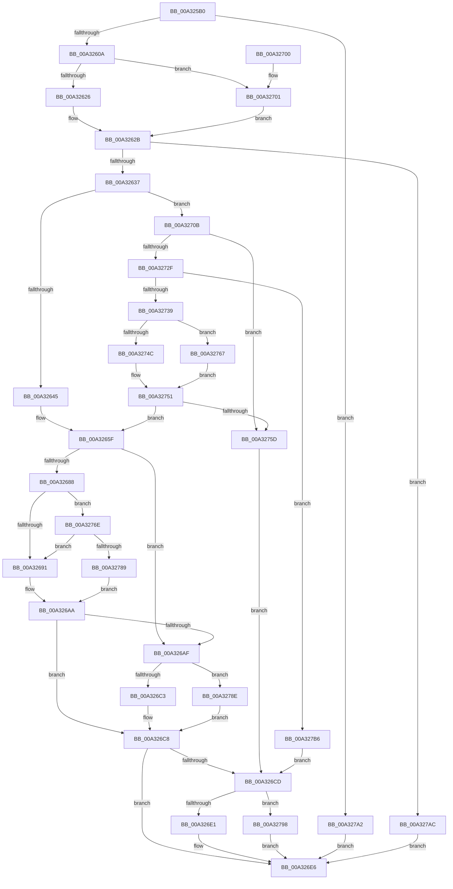

# CmpMarkIndexDirtyInStorageType

- RVA: `0x00A325B0`–`0x00A327C0` (길이 `528` bytes)
- VA: `0x0000000140A325B0`
- 실행 섹션: `PAGE`
- PDB 이름 있음: `예`; PDB Function 태그: `아니요`
- unwind 정보 RVA: `0x000AD33C`
- 디코드: `141`개 명령, `528/528` bytes 표시
- 미해석 바이트: `0` (있으면 어셈블리에 `.byte`로 보존)

> 이 문서는 커널 이미지의 기계어와 PDB 기호를 분석해 생성했습니다. 4번과 5번은 함수 원형과 자료형을 바이너리 사용 방식에서 추정한 C 해석이며 원본 소스 복구 결과는 아닙니다.

## 1. Dependencies

- 직접 호출 지점: **15**; 고유 호출 대상: **9**
- 직접 호출자로 확인된 함수: **1**
- RIP 상대 이미지 참조: **0**

### Outgoing calls
- `0x00A325ED` → [HvpGetCellContextInitialize](../85/HvpGetCellContextInitialize_function_00855F10.md) (function, `0x00855F10`)
- `0x00A325F6` → [HvpGetCellContextInitialize](../85/HvpGetCellContextInitialize_function_00855F10.md) (function, `0x00855F10`)
- `0x00A32626` → [HvpGetCellFlat](../85/HvpGetCellFlat_function_00854C60.md) (function, `0x00854C60`)
- `0x00A3265A` → [HvpGetCellContextMove](../85/HvpGetCellContextMove_function_00859F58.md) (function, `0x00859F58`)
- `0x00A3267D` → [CmpFindSubKeyInLeafWithStatus](../85/CmpFindSubKeyInLeafWithStatus_function_00853A70.md) (function, `0x00853A70`)
- `0x00A3269D` → [HvpMarkCellDirty](../85/HvpMarkCellDirty_function_00858080.md) (function, `0x00858080`)
- `0x00A326C3` → [HvpReleaseCellPaged](../85/HvpReleaseCellPaged_function_00855F40.md) (function, `0x00855F40`)
- `0x00A326E1` → [HvpReleaseCellPaged](../85/HvpReleaseCellPaged_function_00855F40.md) (function, `0x00855F40`)
- `0x00A32701` → [HvpGetCellPaged](../85/HvpGetCellPaged_function_00854CB0.md) (function, `0x00854CB0`)
- `0x00A32720` → [CmpFindSubKeyInRoot](../85/CmpFindSubKeyInRoot_function_0085D890.md) (function, `0x0085D890`)
- `0x00A3274C` → [HvpGetCellFlat](../85/HvpGetCellFlat_function_00854C60.md) (function, `0x00854C60`)
- `0x00A32767` → [HvpGetCellPaged](../85/HvpGetCellPaged_function_00854CB0.md) (function, `0x00854CB0`)
- `0x00A3277A` → [HvpMarkCellDirty](../85/HvpMarkCellDirty_function_00858080.md) (function, `0x00858080`)
- `0x00A3278E` → [HvpReleaseCellFlat](../85/HvpReleaseCellFlat_function_0085CC20.md) (function, `0x0085CC20`)
- `0x00A32798` → [HvpReleaseCellFlat](../85/HvpReleaseCellFlat_function_0085CC20.md) (function, `0x0085CC20`)

### Direct callers
- [CmpMarkIndexDirty](../84/CmpMarkIndexDirty_function_0084C30C.md) at `0x0084C408`

### Static image references
- 디코드된 RIP-relative 메모리 참조가 없습니다.

## 2. Other-region calls and transfers

- 다른 실행 섹션으로 향하는 call: **0**
- 별도 외부 분기/꼬리 이동을 확인하지 못했습니다.

## 3. Assembly (complete function range)

```asm
00A325B0  48 89 5C 24 08                  mov qword ptr [rsp + 8], rbx
00A325B5  44 89 44 24 18                  mov dword ptr [rsp + 0x18], r8d
00A325BA  55                              push rbp
00A325BB  56                              push rsi
00A325BC  57                              push rdi
00A325BD  41 54                           push r12
00A325BF  41 55                           push r13
00A325C1  41 56                           push r14
00A325C3  41 57                           push r15
00A325C5  48 8B EC                        mov rbp, rsp
00A325C8  48 83 EC 50                     sub rsp, 0x50
00A325CC  45 33 ED                        xor r13d, r13d
00A325CF  48 8B F9                        mov rdi, rcx
00A325D2  48 8D 4D F0                     lea rcx, [rbp - 0x10]
00A325D6  44 89 6D 48                     mov dword ptr [rbp + 0x48], r13d
00A325DA  4C 89 6D F0                     mov qword ptr [rbp - 0x10], r13
00A325DE  49 8B D9                        mov rbx, r9
00A325E1  44 89 6D 50                     mov dword ptr [rbp + 0x50], r13d
00A325E5  4C 89 6D E8                     mov qword ptr [rbp - 0x18], r13
00A325E9  44 89 6D E0                     mov dword ptr [rbp - 0x20], r13d
00A325ED  E8 1E 39 E2 FF                  call 0x140855f10
00A325F2  48 8D 4D E8                     lea rcx, [rbp - 0x18]
00A325F6  E8 15 39 E2 FF                  call 0x140855f10
00A325FB  4C 63 65 60                     movsxd r12, dword ptr [rbp + 0x60]
00A325FF  46 39 6C A2 14                  cmp dword ptr [rdx + r12*4 + 0x14], r13d
00A32604  0F 84 98 01 00 00               je 0x140a327a2
00A3260A  F6 87 8C 00 00 00 01            test byte ptr [rdi + 0x8c], 1
00A32611  4C 8D 45 F0                     lea r8, [rbp - 0x10]
00A32615  46 8B 64 A2 1C                  mov r12d, dword ptr [rdx + r12*4 + 0x1c]
00A3261A  48 8B CF                        mov rcx, rdi
00A3261D  41 8B D4                        mov edx, r12d
00A32620  0F 84 DB 00 00 00               je 0x140a32701
00A32626  E8 35 26 E2 FF                  call 0x140854c60
00A3262B  48 8B F0                        mov rsi, rax
00A3262E  48 85 C0                        test rax, rax
00A32631  0F 84 75 01 00 00               je 0x140a327ac
00A32637  B8 72 69 00 00                  mov eax, 0x6972
00A3263C  66 39 06                        cmp word ptr [rsi], ax
00A3263F  0F 84 C6 00 00 00               je 0x140a3270b
00A32645  45 8B FC                        mov r15d, r12d
00A32648  48 8D 55 F0                     lea rdx, [rbp - 0x10]
00A3264C  41 83 CC FF                     or r12d, 0xffffffff
00A32650  48 8D 4D E8                     lea rcx, [rbp - 0x18]
00A32654  4C 8B F6                        mov r14, rsi
00A32657  49 8B F5                        mov rsi, r13
00A3265A  E8 F9 78 E2 FF                  call 0x140859f58
00A3265F  48 8D 45 48                     lea rax, [rbp + 0x48]
00A32663  45 33 C9                        xor r9d, r9d
00A32666  48 89 44 24 28                  mov qword ptr [rsp + 0x28], rax
00A3266B  4C 8B C3                        mov r8, rbx
00A3266E  48 8D 45 E0                     lea rax, [rbp - 0x20]
00A32672  49 8B D6                        mov rdx, r14
00A32675  48 8B CF                        mov rcx, rdi
00A32678  48 89 44 24 20                  mov qword ptr [rsp + 0x20], rax
00A3267D  E8 EE 13 E2 FF                  call 0x140853a70
00A32682  8B D8                           mov ebx, eax
00A32684  85 C0                           test eax, eax
00A32686  78 27                           js 0x140a326af
00A32688  48 85 F6                        test rsi, rsi
00A3268B  0F 85 DD 00 00 00               jne 0x140a3276e
00A32691  45 33 C9                        xor r9d, r9d
00A32694  45 33 C0                        xor r8d, r8d
00A32697  41 8B D7                        mov edx, r15d
00A3269A  48 8B CF                        mov rcx, rdi
00A3269D  E8 DE 59 E2 FF                  call 0x140858080
00A326A2  85 C0                           test eax, eax
00A326A4  8B D8                           mov ebx, eax
00A326A6  41 0F 49 DD                     cmovns ebx, r13d
00A326AA  4D 85 F6                        test r14, r14
00A326AD  74 19                           je 0x140a326c8
00A326AF  F6 87 8C 00 00 00 01            test byte ptr [rdi + 0x8c], 1
00A326B6  48 8D 55 E8                     lea rdx, [rbp - 0x18]
00A326BA  48 8B CF                        mov rcx, rdi
00A326BD  0F 85 CB 00 00 00               jne 0x140a3278e
00A326C3  E8 78 38 E2 FF                  call 0x140855f40
00A326C8  48 85 F6                        test rsi, rsi
00A326CB  74 19                           je 0x140a326e6
00A326CD  F6 87 8C 00 00 00 01            test byte ptr [rdi + 0x8c], 1
00A326D4  48 8D 55 F0                     lea rdx, [rbp - 0x10]
00A326D8  48 8B CF                        mov rcx, rdi
00A326DB  0F 85 B7 00 00 00               jne 0x140a32798
00A326E1  E8 5A 38 E2 FF                  call 0x140855f40
00A326E6  8B C3                           mov eax, ebx
00A326E8  48 8B 9C 24 90 00 00 00         mov rbx, qword ptr [rsp + 0x90]
00A326F0  48 83 C4 50                     add rsp, 0x50
00A326F4  41 5F                           pop r15
00A326F6  41 5E                           pop r14
00A326F8  41 5D                           pop r13
00A326FA  41 5C                           pop r12
00A326FC  5F                              pop rdi
00A326FD  5E                              pop rsi
00A326FE  5D                              pop rbp
00A326FF  C3                              ret
00A32700  CC                              int3
00A32701  E8 AA 25 E2 FF                  call 0x140854cb0
00A32706  E9 20 FF FF FF                  jmp 0x140a3262b
00A3270B  48 8D 45 50                     lea rax, [rbp + 0x50]
00A3270F  45 33 C9                        xor r9d, r9d
00A32712  4C 8B C3                        mov r8, rbx
00A32715  48 89 44 24 20                  mov qword ptr [rsp + 0x20], rax
00A3271A  48 8B D6                        mov rdx, rsi
00A3271D  48 8B CF                        mov rcx, rdi
00A32720  E8 6B B1 E2 FF                  call 0x14085d890
00A32725  89 45 48                        mov dword ptr [rbp + 0x48], eax
00A32728  3D 00 00 00 80                  cmp eax, 0x80000000
00A3272D  74 2E                           je 0x140a3275d
00A3272F  44 8B 7D 50                     mov r15d, dword ptr [rbp + 0x50]
00A32733  41 83 FF FF                     cmp r15d, -1
00A32737  74 7D                           je 0x140a327b6
00A32739  F6 87 8C 00 00 00 01            test byte ptr [rdi + 0x8c], 1
00A32740  4C 8D 45 E8                     lea r8, [rbp - 0x18]
00A32744  41 8B D7                        mov edx, r15d
00A32747  48 8B CF                        mov rcx, rdi
00A3274A  74 1B                           je 0x140a32767
00A3274C  E8 0F 25 E2 FF                  call 0x140854c60
00A32751  4C 8B F0                        mov r14, rax
00A32754  48 85 C0                        test rax, rax
00A32757  0F 85 02 FF FF FF               jne 0x140a3265f
00A3275D  BB 9A 00 00 C0                  mov ebx, 0xc000009a
00A32762  E9 66 FF FF FF                  jmp 0x140a326cd
00A32767  E8 44 25 E2 FF                  call 0x140854cb0
00A3276C  EB E3                           jmp 0x140a32751
00A3276E  45 33 C9                        xor r9d, r9d
00A32771  45 33 C0                        xor r8d, r8d
00A32774  41 8B D4                        mov edx, r12d
00A32777  48 8B CF                        mov rcx, rdi
00A3277A  E8 01 59 E2 FF                  call 0x140858080
00A3277F  8B D8                           mov ebx, eax
00A32781  85 C0                           test eax, eax
00A32783  0F 89 08 FF FF FF               jns 0x140a32691
00A32789  E9 1C FF FF FF                  jmp 0x140a326aa
00A3278E  E8 8D A4 E2 FF                  call 0x14085cc20
00A32793  E9 30 FF FF FF                  jmp 0x140a326c8
00A32798  E8 83 A4 E2 FF                  call 0x14085cc20
00A3279D  E9 44 FF FF FF                  jmp 0x140a326e6
00A327A2  BB 34 00 00 C0                  mov ebx, 0xc0000034
00A327A7  E9 3A FF FF FF                  jmp 0x140a326e6
00A327AC  BB 9A 00 00 C0                  mov ebx, 0xc000009a
00A327B1  E9 30 FF FF FF                  jmp 0x140a326e6
00A327B6  BB 34 00 00 C0                  mov ebx, 0xc0000034
00A327BB  E9 0D FF FF FF                  jmp 0x140a326cd
```

## 4. C-style interpretation (structured pseudocode)

```c
__int64 __fastcall CmpMarkIndexDirtyInStorageType(__int64 a1, __int64 a2, int a3, __int64 a4, unsigned int a5)
{
    __int64 result;
    __int64 v_r12;
    __int64 v_r13;
    __int64 v_rbx;
    __int64 v_rsp;
    unsigned __int64 v_stack_m48;
    unsigned __int64 v_stack_m50;
    unsigned int v_stack_m58;
    unsigned __int64 v_stack_m60;
    unsigned __int64 v_stack_m68;
    unsigned int v_stack_p10;
    unsigned int v_stack_p18;
    unsigned __int64 v_stack_p20;
    unsigned __int64 v_stack_p8;

    v_stack_p8 = v_rbx;
    v_stack_p18 = a3;
    v_rsp = (v_rsp) - (80);
    v_r13 = 0;
    v_stack_p10 = 0;
    v_stack_m48 = 0;
    v_stack_p18 = 0;
    v_stack_m50 = 0;
    v_stack_m58 = 0;
    result = HvpGetCellContextInitialize(v_stack_m48, a2, a3, a4);
    result = HvpGetCellContextInitialize(v_stack_m50, a2, a3, a4);
    if ((*(unsigned int *)(a2 + (int)(a5) * 4 + 20)) == 0) goto loc_00A327A2;
    if (((*(unsigned __int8 *)(a1 + 140)) & (1)) == 0) goto loc_00A32701;
    result = HvpGetCellFlat(a1, (unsigned int)((unsigned int)((unsigned int)(*(unsigned int *)(a2 + (int)(a5) * 4 + 28)))), v_stack_m48, a4);
loc_00A3262B:
    if (result == 0) goto loc_00A327AC;
    if ((*(unsigned __int16 *)(result)) == ((unsigned __int16)((unsigned int)(0x6972ULL)))) goto loc_00A3270B;
    v_r12 = (unsigned int)(((unsigned int)(*(unsigned int *)(a2 + (int)(a5) * 4 + 28))) | (0xFFFFFFFFULL));
    result = HvpGetCellContextMove(v_stack_m50, v_stack_m48, v_stack_m48, a4);
loc_00A3265F:
    a4 = 0;
    v_stack_m60 = v_stack_p10;
    v_stack_m68 = v_stack_m58;
    result = CmpFindSubKeyInLeafWithStatus(a1, result, 0, a4);
    if (sign_flag) goto loc_00A326AF;
    if (0 != 0) goto loc_00A3276E;
loc_00A32691:
    a4 = 0;
    a3 = 0;
    result = HvpMarkCellDirty(a1, (unsigned int)((unsigned int)((unsigned int)((unsigned int)((unsigned int)(*(unsigned int *)(a2 + (int)(a5) * 4 + 28)))))), a3, a4);
    v_rbx = (unsigned int)((unsigned int)(result));
    if (!sign_flag) { v_rbx = 0; }
loc_00A326AA:
    if (result == 0) goto loc_00A326C8;
loc_00A326AF:
    if (((*(unsigned __int8 *)(a1 + 140)) & (1)) != 0) goto loc_00A3278E;
    result = HvpReleaseCellPaged(a1, v_stack_m50, a3, a4);
loc_00A326C8:
    if (0 == 0) goto loc_00A326E6;
loc_00A326CD:
    if (((*(unsigned __int8 *)(a1 + 140)) & (1)) != 0) goto loc_00A32798;
    result = HvpReleaseCellPaged(a1, v_stack_m48, a3, a4);
loc_00A326E6:
    v_rsp = (v_rsp) + (80);
    return (unsigned int)((unsigned int)(v_rbx));
loc_00A32701:
    result = HvpGetCellPaged(a1, v_stack_m48, a3, a4);
    goto loc_00A3262B;
loc_00A3270B:
    a4 = 0;
    v_stack_p20 = v_stack_p18;
    result = CmpFindSubKeyInRoot(a1, 0, v_stack_p8, a4);
    v_stack_p10 = (unsigned int)(result);
    if (((unsigned int)(result)) == 0x80000000ULL) goto loc_00A3275D;
    if (((unsigned int)((unsigned int)(v_stack_p18))) == -1) goto loc_00A327B6;
    if (((*(unsigned __int8 *)(a1 + 140)) & (1)) == 0) goto loc_00A32767;
    result = HvpGetCellFlat(a1, (unsigned int)((unsigned int)((unsigned int)(v_stack_p18))), v_stack_m50, a4);
loc_00A32751:
    if (result != 0) goto loc_00A3265F;
loc_00A3275D:
    goto loc_00A326CD;
loc_00A32767:
    result = HvpGetCellPaged(a1, (unsigned int)((unsigned int)((unsigned int)(v_stack_p18))), v_stack_m50, a4);
    goto loc_00A32751;
loc_00A3276E:
    a4 = 0;
    a3 = 0;
    result = HvpMarkCellDirty(a1, (unsigned int)((unsigned int)(v_r12)), a3, a4);
    if (!sign_flag) goto loc_00A32691;
    goto loc_00A326AA;
loc_00A3278E:
    result = HvpReleaseCellFlat(a1, (unsigned int)((unsigned int)(v_r12)), a3, a4);
    goto loc_00A326C8;
loc_00A32798:
    result = HvpReleaseCellFlat(a1, (unsigned int)((unsigned int)(v_r12)), a3, a4);
    goto loc_00A326E6;
loc_00A327A2:
    goto loc_00A326E6;
loc_00A327AC:
    goto loc_00A326E6;
loc_00A327B6:
    goto loc_00A326CD;
}
```

## 5. (Beta) C Style

```c
int64_t CmpMarkIndexDirtyInStorageType(void *Arg1, int64_t Arg2, int32_t Arg3, int64_t Arg4, uint32_t Arg5)
{
    uint8_t *arg1 = (uint8_t *)Arg1;

    int64_t result;
    int64_t local_r12;
    int64_t local_r13;
    int64_t local_rbx;
    int64_t local_rsp;
    uint64_t v_stack_m48;
    uint64_t v_stack_m50;
    uint32_t v_stack_m58;
    uint64_t v_stack_m60;
    uint64_t v_stack_m68;
    uint32_t v_stack_p10;
    uint32_t v_stack_p18;
    uint64_t v_stack_p20;
    uint64_t v_stack_p8;

    v_stack_p8 = local_rbx;
    v_stack_p18 = Arg3;
    local_rsp = (local_rsp) - (80);
    local_r13 = 0;
    v_stack_p10 = 0;
    v_stack_m48 = 0;
    v_stack_p18 = 0;
    v_stack_m50 = 0;
    v_stack_m58 = 0;
    result = HvpGetCellContextInitialize(v_stack_m48, Arg2, Arg3, Arg4);
    result = HvpGetCellContextInitialize(v_stack_m50, Arg2, Arg3, Arg4);
    if ((*(uint32_t *)(Arg2 + (int32_t)(Arg5) * 4 + 0x14)) == 0) goto loc_00A327A2;
    if (((*(uint8_t *)(arg1 + 0x8C)) & (1)) == 0) goto loc_00A32701;
    result = HvpGetCellFlat(Arg1, (uint32_t)((uint32_t)((uint32_t)(*(uint32_t *)(Arg2 + (int32_t)(Arg5) * 4 + 0x1C)))), v_stack_m48, Arg4);
loc_00A3262B:
    if (result == 0) goto loc_00A327AC;
    if ((*(uint16_t *)(result)) == ((uint16_t)((uint32_t)(0x6972ULL)))) goto loc_00A3270B;
    local_r12 = (uint32_t)(((uint32_t)(*(uint32_t *)(Arg2 + (int32_t)(Arg5) * 4 + 0x1C))) | (0xFFFFFFFFULL));
    result = HvpGetCellContextMove(v_stack_m50, v_stack_m48, v_stack_m48, Arg4);
loc_00A3265F:
    Arg4 = 0;
    v_stack_m60 = v_stack_p10;
    v_stack_m68 = v_stack_m58;
    result = CmpFindSubKeyInLeafWithStatus(Arg1, result, 0, Arg4);
    if (sign_flag) goto loc_00A326AF;
    if (0 != 0) goto loc_00A3276E;
loc_00A32691:
    Arg4 = 0;
    Arg3 = 0;
    result = HvpMarkCellDirty(Arg1, (uint32_t)((uint32_t)((uint32_t)((uint32_t)((uint32_t)(*(uint32_t *)(Arg2 + (int32_t)(Arg5) * 4 + 0x1C)))))), Arg3, Arg4);
    local_rbx = (uint32_t)((uint32_t)(result));
    if (!sign_flag) { local_rbx = 0; }
loc_00A326AA:
    if (result == 0) goto loc_00A326C8;
loc_00A326AF:
    if (((*(uint8_t *)(arg1 + 0x8C)) & (1)) != 0) goto loc_00A3278E;
    result = HvpReleaseCellPaged(Arg1, v_stack_m50, Arg3, Arg4);
loc_00A326C8:
    if (0 == 0) goto loc_00A326E6;
loc_00A326CD:
    if (((*(uint8_t *)(arg1 + 0x8C)) & (1)) != 0) goto loc_00A32798;
    result = HvpReleaseCellPaged(Arg1, v_stack_m48, Arg3, Arg4);
loc_00A326E6:
    local_rsp = (local_rsp) + (80);
    return (uint32_t)((uint32_t)(local_rbx));
loc_00A32701:
    result = HvpGetCellPaged(Arg1, v_stack_m48, Arg3, Arg4);
    goto loc_00A3262B;
loc_00A3270B:
    Arg4 = 0;
    v_stack_p20 = v_stack_p18;
    result = CmpFindSubKeyInRoot(Arg1, 0, v_stack_p8, Arg4);
    v_stack_p10 = (uint32_t)(result);
    if (((uint32_t)(result)) == 0x80000000ULL) goto loc_00A3275D;
    if (((uint32_t)((uint32_t)(v_stack_p18))) == -1) goto loc_00A327B6;
    if (((*(uint8_t *)(arg1 + 0x8C)) & (1)) == 0) goto loc_00A32767;
    result = HvpGetCellFlat(Arg1, (uint32_t)((uint32_t)((uint32_t)(v_stack_p18))), v_stack_m50, Arg4);
loc_00A32751:
    if (result != 0) goto loc_00A3265F;
loc_00A3275D:
    goto loc_00A326CD;
loc_00A32767:
    result = HvpGetCellPaged(Arg1, (uint32_t)((uint32_t)((uint32_t)(v_stack_p18))), v_stack_m50, Arg4);
    goto loc_00A32751;
loc_00A3276E:
    Arg4 = 0;
    Arg3 = 0;
    result = HvpMarkCellDirty(Arg1, (uint32_t)((uint32_t)(local_r12)), Arg3, Arg4);
    if (!sign_flag) goto loc_00A32691;
    goto loc_00A326AA;
loc_00A3278E:
    result = HvpReleaseCellFlat(Arg1, (uint32_t)((uint32_t)(local_r12)), Arg3, Arg4);
    goto loc_00A326C8;
loc_00A32798:
    result = HvpReleaseCellFlat(Arg1, (uint32_t)((uint32_t)(local_r12)), Arg3, Arg4);
    goto loc_00A326E6;
loc_00A327A2:
    goto loc_00A326E6;
loc_00A327AC:
    goto loc_00A326E6;
loc_00A327B6:
    goto loc_00A326CD;
}
```

### 관측된 메모리 오프셋

구조체 형식이 확인되지 않은 접근은 인자 기준의 오프셋으로만 기록했습니다.

| 기준 인자 | 오프셋 표현 | 폭 (bit) | 접근 |
|---|---:|---:|---|
| `Arg1` | `+ 0x8C` | `8` | `R` |

## 6. Execution-region graph

[열기: 2D/3D 그래프와 함수 탐색 컨트롤 패널](../../../control-panel.html?section=page&rva=0x00A325B0&view=graph)

- 2D 그래프는 위에서 아래로 흐르고, 3D 그래프는 빈 공간을 드래그해 회전합니다. Shift+드래그는 이동, 휠은 확대·축소, 함수 노드 선택은 대상 보고서 이동입니다.

### Static fallback


