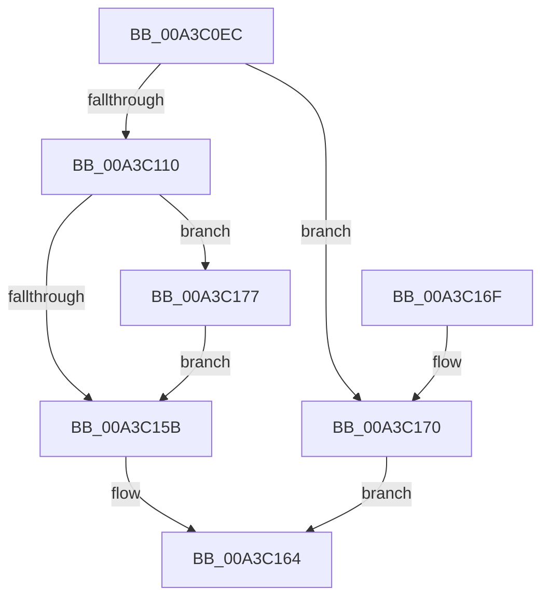

# CmpPopulateKeyFullInformation

- RVA: `0x00A3C0EC`–`0x00A3C18F` (길이 `163` bytes)
- VA: `0x0000000140A3C0EC`
- 실행 섹션: `PAGE`
- PDB 이름 있음: `예`; PDB Function 태그: `아니요`
- unwind 정보 RVA: `0x000AE450`
- 디코드: `49`개 명령, `163/163` bytes 표시
- 미해석 바이트: `0` (있으면 어셈블리에 `.byte`로 보존)

> 이 문서는 커널 이미지의 기계어와 PDB 기호를 분석해 생성했습니다. 4번과 5번은 함수 원형과 자료형을 바이너리 사용 방식에서 추정한 C 해석이며 원본 소스 복구 결과는 아닙니다.

## 1. Dependencies

- 직접 호출 지점: **1**; 고유 호출 대상: **1**
- 직접 호출자로 확인된 함수: **2**
- RIP 상대 이미지 참조: **0**

### Outgoing calls
- `0x00A3C188` → [memcpy](../../text/6C/memcpy_function_006C6840.md) (function, `0x006C6840`)

### Direct callers
- [CmpQueryKeyDataFromKeyNodeStack](../../text/46/CmpQueryKeyDataFromKeyNodeStack_function_0046AC40.md) at `0x0046AFF4`
- [CmpQueryKeyDataFromNode](../84/CmpQueryKeyDataFromNode_function_0084EAE0.md) at `0x0084ED74`

### Static image references
- 디코드된 RIP-relative 메모리 참조가 없습니다.

## 2. Other-region calls and transfers

- 다른 실행 섹션으로 향하는 call: **1**
  - `0x00A3C188` → [memcpy](../../text/6C/memcpy_function_006C6840.md) (`PAGE` → `.text`)
- 별도 외부 분기/꼬리 이동을 확인하지 못했습니다.

## 3. Assembly (complete function range)

```asm
00A3C0EC  48 89 5C 24 08                  mov qword ptr [rsp + 8], rbx
00A3C0F1  57                              push rdi
00A3C0F2  48 83 EC 20                     sub rsp, 0x20
00A3C0F6  48 8B 44 24 58                  mov rax, qword ptr [rsp + 0x58]
00A3C0FB  41 8D 78 2C                     lea edi, [r8 + 0x2c]
00A3C0FF  8B 5C 24 50                     mov ebx, dword ptr [rsp + 0x50]
00A3C103  41 BA 2C 00 00 00               mov r10d, 0x2c
00A3C109  89 38                           mov dword ptr [rax], edi
00A3C10B  41 3B DA                        cmp ebx, r10d
00A3C10E  72 60                           jb 0x140a3c170
00A3C110  48 8B 01                        mov rax, qword ptr [rcx]
00A3C113  49 89 01                        mov qword ptr [r9], rax
00A3C116  8B 41 18                        mov eax, dword ptr [rcx + 0x18]
00A3C119  41 89 41 18                     mov dword ptr [r9 + 0x18], eax
00A3C11D  8B 41 1C                        mov eax, dword ptr [rcx + 0x1c]
00A3C120  41 89 41 1C                     mov dword ptr [r9 + 0x1c], eax
00A3C124  8B 41 24                        mov eax, dword ptr [rcx + 0x24]
00A3C127  41 89 41 24                     mov dword ptr [r9 + 0x24], eax
00A3C12B  8B 41 28                        mov eax, dword ptr [rcx + 0x28]
00A3C12E  41 89 41 28                     mov dword ptr [r9 + 0x28], eax
00A3C132  8B 41 08                        mov eax, dword ptr [rcx + 8]
00A3C135  41 89 41 08                     mov dword ptr [r9 + 8], eax
00A3C139  45 89 41 10                     mov dword ptr [r9 + 0x10], r8d
00A3C13D  8B 41 14                        mov eax, dword ptr [rcx + 0x14]
00A3C140  41 89 41 14                     mov dword ptr [r9 + 0x14], eax
00A3C144  8B 41 20                        mov eax, dword ptr [rcx + 0x20]
00A3C147  41 89 41 20                     mov dword ptr [r9 + 0x20], eax
00A3C14B  83 C8 FF                        or eax, 0xffffffff
00A3C14E  45 85 C0                        test r8d, r8d
00A3C151  44 0F 44 D0                     cmove r10d, eax
00A3C155  45 89 51 0C                     mov dword ptr [r9 + 0xc], r10d
00A3C159  75 1C                           jne 0x140a3c177
00A3C15B  3B DF                           cmp ebx, edi
00A3C15D  1B C0                           sbb eax, eax
00A3C15F  25 05 00 00 80                  and eax, 0x80000005
00A3C164  48 8B 5C 24 30                  mov rbx, qword ptr [rsp + 0x30]
00A3C169  48 83 C4 20                     add rsp, 0x20
00A3C16D  5F                              pop rdi
00A3C16E  C3                              ret
00A3C16F  CC                              int3
00A3C170  B8 23 00 00 C0                  mov eax, 0xc0000023
00A3C175  EB ED                           jmp 0x140a3c164
00A3C177  8D 43 D4                        lea eax, [rbx - 0x2c]
00A3C17A  41 3B C0                        cmp eax, r8d
00A3C17D  49 8D 49 2C                     lea rcx, [r9 + 0x2c]
00A3C181  41 0F 47 C0                     cmova eax, r8d
00A3C185  44 8B C0                        mov r8d, eax
00A3C188  E8 B3 A6 C8 FF                  call 0x1406c6840
00A3C18D  EB CC                           jmp 0x140a3c15b
```

## 4. C-style interpretation (structured pseudocode)

```c
__int64 __fastcall CmpPopulateKeyFullInformation(__int64 a1, __int64 a2, __int64 a3, __int64 a4, unsigned int a5, __int64 a6)
{
    __int64 result;
    __int64 v_r10;
    __int64 v_rsp;
    unsigned __int64 v_stack_p8;

    v_stack_p8 = v_rbx;
    v_rsp = (v_rsp) - (32);
    *(unsigned int *)(a6) = (unsigned int)(a3 + 44);
    if (((unsigned int)((unsigned int)(a5))) < 44) goto loc_00A3C170;
    *(unsigned __int64 *)(a4) = *(unsigned __int64 *)(a1);
    *(unsigned int *)(a4 + 24) = (unsigned int)((unsigned int)(*(unsigned int *)(a1 + 24)));
    *(unsigned int *)(a4 + 28) = (unsigned int)((unsigned int)(*(unsigned int *)(a1 + 28)));
    *(unsigned int *)(a4 + 36) = (unsigned int)((unsigned int)(*(unsigned int *)(a1 + 36)));
    *(unsigned int *)(a4 + 40) = (unsigned int)((unsigned int)(*(unsigned int *)(a1 + 40)));
    *(unsigned int *)(a4 + 8) = (unsigned int)((unsigned int)(*(unsigned int *)(a1 + 8)));
    *(unsigned int *)(a4 + 16) = (unsigned int)(a3);
    *(unsigned int *)(a4 + 20) = (unsigned int)((unsigned int)(*(unsigned int *)(a1 + 20)));
    *(unsigned int *)(a4 + 32) = (unsigned int)((unsigned int)(*(unsigned int *)(a1 + 32)));
    result = (unsigned int)(((unsigned int)(*(unsigned int *)(a1 + 32))) | (0xFFFFFFFFULL));
    v_r10 = 44;
    if ((unsigned int)(a3) == 0) { v_r10 = (unsigned int)(result); }
    *(unsigned int *)(a4 + 12) = (unsigned int)(v_r10);
    if ((unsigned int)(a3) != 0) goto loc_00A3C177;
loc_00A3C15B:
    result = (unsigned int)((result) & (0x80000005ULL));
loc_00A3C164:
    v_rsp = (v_rsp) + (32);
    return result;
loc_00A3C170:
    goto loc_00A3C164;
loc_00A3C177:
    result = v_stack_p8 - 44;
    if (((unsigned int)(v_stack_p8 - 44)) > ((unsigned int)(a3))) { result = (unsigned int)(a3); }
    result = memcpy(a4 + 44, a2, (unsigned int)((unsigned int)(result)), a4);
    goto loc_00A3C15B;
}
```

## 5. (Beta) C Style

```c
int64_t CmpPopulateKeyFullInformation(void *Arg1, int64_t Arg2, void *Arg3, void *Arg4, uint32_t Arg5, void *Arg6)
{
    uint8_t *arg1 = (uint8_t *)Arg1;
    uint8_t *arg3 = (uint8_t *)Arg3;
    uint8_t *arg4 = (uint8_t *)Arg4;
    uint8_t *arg6 = (uint8_t *)Arg6;

    int64_t result;
    int64_t local_r10;
    int64_t local_rsp;
    uint64_t v_stack_p8;

    v_stack_p8 = local_rbx;
    local_rsp = (local_rsp) - (32);
    *(uint32_t *)(arg6) = (uint32_t)(Arg3 + 44);
    if (((uint32_t)((uint32_t)(Arg5))) < 44) goto loc_00A3C170;
    *(uint64_t *)(arg4) = *(uint64_t *)(arg1);
    *(uint32_t *)(arg4 + 0x18) = (uint32_t)((uint32_t)(*(uint32_t *)(arg1 + 0x18)));
    *(uint32_t *)(arg4 + 0x1C) = (uint32_t)((uint32_t)(*(uint32_t *)(arg1 + 0x1C)));
    *(uint32_t *)(arg4 + 0x24) = (uint32_t)((uint32_t)(*(uint32_t *)(arg1 + 0x24)));
    *(uint32_t *)(arg4 + 0x28) = (uint32_t)((uint32_t)(*(uint32_t *)(arg1 + 0x28)));
    *(uint32_t *)(arg4 + 0x8) = (uint32_t)((uint32_t)(*(uint32_t *)(arg1 + 0x8)));
    *(uint32_t *)(arg4 + 0x10) = (uint32_t)(Arg3);
    *(uint32_t *)(arg4 + 0x14) = (uint32_t)((uint32_t)(*(uint32_t *)(arg1 + 0x14)));
    *(uint32_t *)(arg4 + 0x20) = (uint32_t)((uint32_t)(*(uint32_t *)(arg1 + 0x20)));
    result = (uint32_t)(((uint32_t)(*(uint32_t *)(arg1 + 0x20))) | (0xFFFFFFFFULL));
    local_r10 = 44;
    if ((uint32_t)(Arg3) == 0) { local_r10 = (uint32_t)(result); }
    *(uint32_t *)(arg4 + 0xC) = (uint32_t)(local_r10);
    if ((uint32_t)(Arg3) != 0) goto loc_00A3C177;
loc_00A3C15B:
    result = (uint32_t)((result) & (0x80000005ULL));
loc_00A3C164:
    local_rsp = (local_rsp) + (32);
    return result;
loc_00A3C170:
    goto loc_00A3C164;
loc_00A3C177:
    result = v_stack_p8 - 44;
    if (((uint32_t)(v_stack_p8 - 44)) > ((uint32_t)(Arg3))) { result = (uint32_t)(Arg3); }
    result = memcpy(Arg4 + 44, Arg2, (uint32_t)((uint32_t)(result)), Arg4);
    goto loc_00A3C15B;
}
```

### 관측된 메모리 오프셋

구조체 형식이 확인되지 않은 접근은 인자 기준의 오프셋으로만 기록했습니다.

| 기준 인자 | 오프셋 표현 | 폭 (bit) | 접근 |
|---|---:|---:|---|
| `Arg1` | `+ 0x0` | `64` | `R` |
| `Arg1` | `+ 0x8` | `32` | `R` |
| `Arg1` | `+ 0x14` | `32` | `R` |
| `Arg1` | `+ 0x18` | `32` | `R` |
| `Arg1` | `+ 0x1C` | `32` | `R` |
| `Arg1` | `+ 0x20` | `32` | `R` |
| `Arg1` | `+ 0x24` | `32` | `R` |
| `Arg1` | `+ 0x28` | `32` | `R` |
| `Arg3` | `+ 0x2C` | `32` | `R` |
| `Arg4` | `+ 0x0` | `64` | `W` |
| `Arg4` | `+ 0x8` | `32` | `W` |
| `Arg4` | `+ 0xC` | `32` | `W` |
| `Arg4` | `+ 0x10` | `32` | `W` |
| `Arg4` | `+ 0x14` | `32` | `W` |
| `Arg4` | `+ 0x18` | `32` | `W` |
| `Arg4` | `+ 0x1C` | `32` | `W` |
| `Arg4` | `+ 0x20` | `32` | `W` |
| `Arg4` | `+ 0x24` | `32` | `W` |
| `Arg4` | `+ 0x28` | `32` | `W` |
| `Arg4` | `+ 0x2C` | `64` | `R` |
| `Arg6` | `+ 0x0` | `32` | `W` |

## 6. Execution-region graph

[열기: 2D/3D 그래프와 함수 탐색 컨트롤 패널](../../../control-panel.html?section=page&rva=0x00A3C0EC&view=graph)

- 2D 그래프는 위에서 아래로 흐르고, 3D 그래프는 빈 공간을 드래그해 회전합니다. Shift+드래그는 이동, 휠은 확대·축소, 함수 노드 선택은 대상 보고서 이동입니다.

### Static fallback


