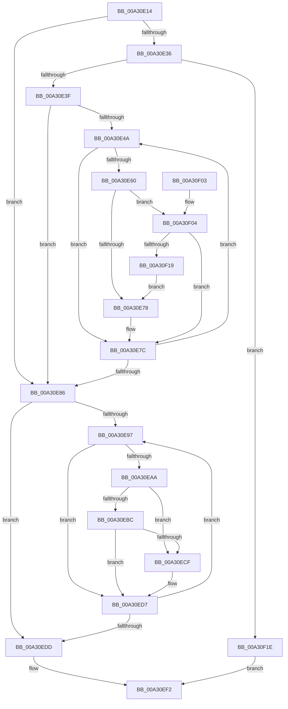

# CmpSortedValueEnumStackAdvanceInternal

- RVA: `0x00A30E14`–`0x00A30F25` (길이 `273` bytes)
- VA: `0x0000000140A30E14`
- 실행 섹션: `PAGE`
- PDB 이름 있음: `예`; PDB Function 태그: `아니요`
- unwind 정보 RVA: `0x000AD0F0`
- 디코드: `83`개 명령, `273/273` bytes 표시
- 미해석 바이트: `0` (있으면 어셈블리에 `.byte`로 보존)

> 이 문서는 커널 이미지의 기계어와 PDB 기호를 분석해 생성했습니다. 4번과 5번은 함수 원형과 자료형을 바이너리 사용 방식에서 추정한 C 해석이며 원본 소스 복구 결과는 아닙니다.

## 1. Dependencies

- 직접 호출 지점: **4**; 고유 호출 대상: **2**
- 직접 호출자로 확인된 함수: **1**
- RIP 상대 이미지 참조: **0**

### Outgoing calls
- `0x00A30E50` → [CmpSortedValueEnumStackGetEntryAtLayerHeight](../8B/CmpSortedValueEnumStackGetEntryAtLayerHeight_function_008B27B8.md) (function, `0x008B27B8`)
- `0x00A30E9D` → [CmpSortedValueEnumStackGetEntryAtLayerHeight](../8B/CmpSortedValueEnumStackGetEntryAtLayerHeight_function_008B27B8.md) (function, `0x008B27B8`)
- `0x00A30EC6` → [CmpSortedValueEnumStackValueCompareFunction](CmpSortedValueEnumStackValueCompareFunction_function_00A30F30.md) (function, `0x00A30F30`)
- `0x00A30F0C` → [CmpSortedValueEnumStackValueCompareFunction](CmpSortedValueEnumStackValueCompareFunction_function_00A30F30.md) (function, `0x00A30F30`)

### Direct callers
- [CmpSortedValueEnumStackAdvance](CmpSortedValueEnumStackAdvance_function_00A30DE4.md) at `0x00A30DF0`

### Static image references
- 디코드된 RIP-relative 메모리 참조가 없습니다.

## 2. Other-region calls and transfers

- 다른 실행 섹션으로 향하는 call: **0**
- 별도 외부 분기/꼬리 이동을 확인하지 못했습니다.

## 3. Assembly (complete function range)

```asm
00A30E14  48 89 5C 24 18                  mov qword ptr [rsp + 0x18], rbx
00A30E19  55                              push rbp
00A30E1A  56                              push rsi
00A30E1B  57                              push rdi
00A30E1C  41 56                           push r14
00A30E1E  41 57                           push r15
00A30E20  48 83 EC 20                     sub rsp, 0x20
00A30E24  45 33 F6                        xor r14d, r14d
00A30E27  48 8B D9                        mov rbx, rcx
00A30E2A  41 BF 01 00 00 00               mov r15d, 1
00A30E30  44 38 71 0A                     cmp byte ptr [rcx + 0xa], r14b
00A30E34  74 50                           je 0x140a30e86
00A30E36  4C 39 31                        cmp qword ptr [rcx], r14
00A30E39  0F 84 DF 00 00 00               je 0x140a30f1e
00A30E3F  41 0F B7 FE                     movzx edi, r14w
00A30E43  66 44 3B 71 08                  cmp r14w, word ptr [rcx + 8]
00A30E48  7F 3C                           jg 0x140a30e86
00A30E4A  0F B7 D7                        movzx edx, di
00A30E4D  48 8B CB                        mov rcx, rbx
00A30E50  E8 63 19 E8 FF                  call 0x1408b27b8
00A30E55  48 8B F0                        mov rsi, rax
00A30E58  8B 40 1C                        mov eax, dword ptr [rax + 0x1c]
00A30E5B  3B 46 18                        cmp eax, dword ptr [rsi + 0x18]
00A30E5E  73 1C                           jae 0x140a30e7c
00A30E60  8B C8                           mov ecx, eax
00A30E62  48 8B 46 08                     mov rax, qword ptr [rsi + 8]
00A30E66  48 8B 14 C8                     mov rdx, qword ptr [rax + rcx*8]
00A30E6A  48 89 54 24 50                  mov qword ptr [rsp + 0x50], rdx
00A30E6F  48 3B 13                        cmp rdx, qword ptr [rbx]
00A30E72  0F 85 8C 00 00 00               jne 0x140a30f04
00A30E78  44 01 7E 1C                     add dword ptr [rsi + 0x1c], r15d
00A30E7C  66 41 03 FF                     add di, r15w
00A30E80  66 3B 7B 08                     cmp di, word ptr [rbx + 8]
00A30E84  7E C4                           jle 0x140a30e4a
00A30E86  0F B7 73 08                     movzx esi, word ptr [rbx + 8]
00A30E8A  49 8B FE                        mov rdi, r14
00A30E8D  4C 89 74 24 58                  mov qword ptr [rsp + 0x58], r14
00A30E92  66 85 F6                        test si, si
00A30E95  78 46                           js 0x140a30edd
00A30E97  0F B7 D6                        movzx edx, si
00A30E9A  48 8B CB                        mov rcx, rbx
00A30E9D  E8 16 19 E8 FF                  call 0x1408b27b8
00A30EA2  8B 48 1C                        mov ecx, dword ptr [rax + 0x1c]
00A30EA5  3B 48 18                        cmp ecx, dword ptr [rax + 0x18]
00A30EA8  73 2D                           jae 0x140a30ed7
00A30EAA  48 8B 40 08                     mov rax, qword ptr [rax + 8]
00A30EAE  48 8B 2C C8                     mov rbp, qword ptr [rax + rcx*8]
00A30EB2  48 89 6C 24 50                  mov qword ptr [rsp + 0x50], rbp
00A30EB7  48 85 FF                        test rdi, rdi
00A30EBA  74 13                           je 0x140a30ecf
00A30EBC  48 8D 54 24 50                  lea rdx, [rsp + 0x50]
00A30EC1  48 8D 4C 24 58                  lea rcx, [rsp + 0x58]
00A30EC6  E8 65 00 00 00                  call 0x140a30f30
00A30ECB  85 C0                           test eax, eax
00A30ECD  7E 08                           jle 0x140a30ed7
00A30ECF  48 8B FD                        mov rdi, rbp
00A30ED2  48 89 6C 24 58                  mov qword ptr [rsp + 0x58], rbp
00A30ED7  66 41 2B F7                     sub si, r15w
00A30EDB  79 BA                           jns 0x140a30e97
00A30EDD  48 89 3B                        mov qword ptr [rbx], rdi
00A30EE0  B8 1A 00 00 80                  mov eax, 0x8000001a
00A30EE5  48 F7 DF                        neg rdi
00A30EE8  44 88 7B 0A                     mov byte ptr [rbx + 0xa], r15b
00A30EEC  1B C9                           sbb ecx, ecx
00A30EEE  F7 D1                           not ecx
00A30EF0  23 C1                           and eax, ecx
00A30EF2  48 8B 5C 24 60                  mov rbx, qword ptr [rsp + 0x60]
00A30EF7  48 83 C4 20                     add rsp, 0x20
00A30EFB  41 5F                           pop r15
00A30EFD  41 5E                           pop r14
00A30EFF  5F                              pop rdi
00A30F00  5E                              pop rsi
00A30F01  5D                              pop rbp
00A30F02  C3                              ret
00A30F03  CC                              int3
00A30F04  48 8B D3                        mov rdx, rbx
00A30F07  48 8D 4C 24 50                  lea rcx, [rsp + 0x50]
00A30F0C  E8 1F 00 00 00                  call 0x140a30f30
00A30F11  85 C0                           test eax, eax
00A30F13  0F 85 63 FF FF FF               jne 0x140a30e7c
00A30F19  E9 5A FF FF FF                  jmp 0x140a30e78
00A30F1E  B8 1A 00 00 80                  mov eax, 0x8000001a
00A30F23  EB CD                           jmp 0x140a30ef2
```

## 4. C-style interpretation (structured pseudocode)

```c
__int64 __fastcall CmpSortedValueEnumStackAdvanceInternal(__int64 a1)
{
    __int64 result;
    __int64 v_r14;
    __int64 v_rdi;
    __int64 v_rsi;
    __int64 v_rsp;
    unsigned __int64 v_stack_p10;
    unsigned __int64 v_stack_p18;
    unsigned __int64 v_stack_p50;
    unsigned __int64 v_stack_p8;

    v_stack_p18 = v_rbx;
    v_rsp = (v_rsp) - (32);
    v_r14 = 0;
    if ((*(unsigned __int8 *)(a1 + 10)) == 0) goto loc_00A30E86;
    if ((*(unsigned __int64 *)(a1)) == 0) goto loc_00A30F1E;
    if (0 > (*(unsigned __int16 *)(a1 + 8))) goto loc_00A30E86;
loc_00A30E4A:
    result = CmpSortedValueEnumStackGetEntryAtLayerHeight(a1, 0, a3, a4);
    if (((unsigned int)((unsigned int)(*(unsigned int *)(result + 28)))) >= (*(unsigned int *)(result + 24))) goto loc_00A30E7C;
    v_stack_p8 = *(unsigned __int64 *)(*(unsigned __int64 *)(result + 8) + (unsigned int)((unsigned int)((unsigned int)(*(unsigned int *)(result + 28)))) * 8);
    if ((*(unsigned __int64 *)(*(unsigned __int64 *)(result + 8) + (unsigned int)((unsigned int)((unsigned int)(*(unsigned int *)(result + 28)))) * 8)) != (*(unsigned __int64 *)(a1))) goto loc_00A30F04;
loc_00A30E78:
loc_00A30E7C:
    v_rdi = (unsigned __int16)((0) + (1));
    if (((unsigned __int16)(v_rdi)) <= (*(unsigned __int16 *)(a1 + 8))) goto loc_00A30E4A;
loc_00A30E86:
    v_stack_p10 = 0;
    if (sign_flag) goto loc_00A30EDD;
loc_00A30E97:
    result = CmpSortedValueEnumStackGetEntryAtLayerHeight(a1, (unsigned __int16)(*(unsigned __int16 *)(a1 + 8)), a3, a4);
    if (((unsigned int)((unsigned int)(*(unsigned int *)(result + 28)))) >= (*(unsigned int *)(result + 24))) goto loc_00A30ED7;
    v_stack_p8 = *(unsigned __int64 *)(*(unsigned __int64 *)(result + 8) + (unsigned int)(*(unsigned int *)(result + 28)) * 8);
    if (0 == 0) goto loc_00A30ECF;
    result = CmpSortedValueEnumStackValueCompareFunction(v_stack_p10, v_stack_p8, a3, a4);
    v_rdi = 0;
    if (!(condition_is_less_or_equal)) {
        v_rdi = *(unsigned __int64 *)(*(unsigned __int64 *)(result + 8) + (unsigned int)(*(unsigned int *)(result + 28)) * 8);
        v_stack_p10 = *(unsigned __int64 *)(*(unsigned __int64 *)(result + 8) + (unsigned int)(*(unsigned int *)(result + 28)) * 8);
    }
    v_rsi = (unsigned __int16)((*(unsigned __int16 *)(a1 + 8)) - (1));
    if (!sign_flag) goto loc_00A30E97;
loc_00A30EDD:
    *(unsigned __int64 *)(a1) = v_rdi;
    v_rdi = -(v_rdi);
    *(unsigned __int8 *)(a1 + 10) = 1;
    a1 = (unsigned int)(~(v_stack_p10));
    result = (unsigned int)(((unsigned int)(0x8000001AULL)) & ((unsigned int)(a1)));
loc_00A30EF2:
    v_rsp = (v_rsp) + (32);
    return result;
loc_00A30F04:
    result = CmpSortedValueEnumStackValueCompareFunction(v_stack_p50, v_stack_p18, a3, a4);
    if ((unsigned int)(result) != 0) goto loc_00A30E7C;
    goto loc_00A30E78;
loc_00A30F1E:
    goto loc_00A30EF2;
}
```

## 5. (Beta) C Style

```c
int64_t CmpSortedValueEnumStackAdvanceInternal(void *Arg1)
{
    uint8_t *arg1 = (uint8_t *)Arg1;

    int64_t result;
    int64_t local_r14;
    int64_t local_rdi;
    int64_t local_rsi;
    int64_t local_rsp;
    uint64_t v_stack_p10;
    uint64_t v_stack_p18;
    uint64_t v_stack_p50;
    uint64_t v_stack_p8;

    v_stack_p18 = local_rbx;
    local_rsp = (local_rsp) - (32);
    local_r14 = 0;
    if ((*(uint8_t *)(arg1 + 0xA)) == 0) goto loc_00A30E86;
    if ((*(uint64_t *)(arg1)) == 0) goto loc_00A30F1E;
    if (0 > (*(uint16_t *)(arg1 + 0x8))) goto loc_00A30E86;
loc_00A30E4A:
    result = CmpSortedValueEnumStackGetEntryAtLayerHeight(Arg1, 0, a3, a4);
    if (((uint32_t)((uint32_t)(*(uint32_t *)(result + 0x1C)))) >= (*(uint32_t *)(result + 0x18))) goto loc_00A30E7C;
    v_stack_p8 = *(uint64_t *)(*(uint64_t *)(result + 0x8) + (uint32_t)((uint32_t)((uint32_t)(*(uint32_t *)(result + 0x1C)))) * 8);
    if ((*(uint64_t *)(*(uint64_t *)(result + 0x8) + (uint32_t)((uint32_t)((uint32_t)(*(uint32_t *)(result + 0x1C)))) * 8)) != (*(uint64_t *)(arg1))) goto loc_00A30F04;
loc_00A30E78:
loc_00A30E7C:
    local_rdi = (uint16_t)((0) + (1));
    if (((uint16_t)(local_rdi)) <= (*(uint16_t *)(arg1 + 0x8))) goto loc_00A30E4A;
loc_00A30E86:
    v_stack_p10 = 0;
    if (sign_flag) goto loc_00A30EDD;
loc_00A30E97:
    result = CmpSortedValueEnumStackGetEntryAtLayerHeight(Arg1, (uint16_t)(*(uint16_t *)(arg1 + 0x8)), a3, a4);
    if (((uint32_t)((uint32_t)(*(uint32_t *)(result + 0x1C)))) >= (*(uint32_t *)(result + 0x18))) goto loc_00A30ED7;
    v_stack_p8 = *(uint64_t *)(*(uint64_t *)(result + 0x8) + (uint32_t)(*(uint32_t *)(result + 0x1C)) * 8);
    if (0 == 0) goto loc_00A30ECF;
    result = CmpSortedValueEnumStackValueCompareFunction(v_stack_p10, v_stack_p8, a3, a4);
    local_rdi = 0;
    if (!(condition_is_less_or_equal)) {
        local_rdi = *(uint64_t *)(*(uint64_t *)(result + 0x8) + (uint32_t)(*(uint32_t *)(result + 0x1C)) * 8);
        v_stack_p10 = *(uint64_t *)(*(uint64_t *)(result + 0x8) + (uint32_t)(*(uint32_t *)(result + 0x1C)) * 8);
    }
    local_rsi = (uint16_t)((*(uint16_t *)(arg1 + 0x8)) - (1));
    if (!sign_flag) goto loc_00A30E97;
loc_00A30EDD:
    *(uint64_t *)(arg1) = local_rdi;
    local_rdi = -(local_rdi);
    *(uint8_t *)(arg1 + 0xA) = 1;
    Arg1 = (uint32_t)(~(v_stack_p10));
    result = (uint32_t)(((uint32_t)(0x8000001AULL)) & ((uint32_t)(Arg1)));
loc_00A30EF2:
    local_rsp = (local_rsp) + (32);
    return result;
loc_00A30F04:
    result = CmpSortedValueEnumStackValueCompareFunction(v_stack_p50, v_stack_p18, a3, a4);
    if ((uint32_t)(result) != 0) goto loc_00A30E7C;
    goto loc_00A30E78;
loc_00A30F1E:
    goto loc_00A30EF2;
}
```

### 관측된 메모리 오프셋

구조체 형식이 확인되지 않은 접근은 인자 기준의 오프셋으로만 기록했습니다.

| 기준 인자 | 오프셋 표현 | 폭 (bit) | 접근 |
|---|---:|---:|---|
| `Arg1` | `+ 0x0` | `64` | `R` |
| `Arg1` | `+ 0x0` | `64` | `W` |
| `Arg1` | `+ 0x8` | `16` | `R` |
| `Arg1` | `+ 0xA` | `8` | `R` |
| `Arg1` | `+ 0xA` | `8` | `W` |

## 6. Execution-region graph

[열기: 2D/3D 그래프와 함수 탐색 컨트롤 패널](../../../control-panel.html?section=page&rva=0x00A30E14&view=graph)

- 2D 그래프는 위에서 아래로 흐르고, 3D 그래프는 빈 공간을 드래그해 회전합니다. Shift+드래그는 이동, 휠은 확대·축소, 함수 노드 선택은 대상 보고서 이동입니다.

### Static fallback


