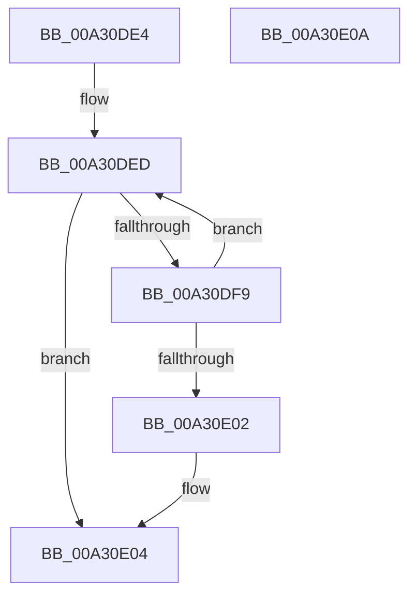

# CmpSortedValueEnumStackAdvance

- RVA: `0x00A30DE4`–`0x00A30E0B` (길이 `39` bytes)
- VA: `0x0000000140A30DE4`
- 실행 섹션: `PAGE`
- PDB 이름 있음: `예`; PDB Function 태그: `아니요`
- unwind 정보 RVA: `0x0005CF00`
- 디코드: `15`개 명령, `39/39` bytes 표시
- 미해석 바이트: `0` (있으면 어셈블리에 `.byte`로 보존)

> 이 문서는 커널 이미지의 기계어와 PDB 기호를 분석해 생성했습니다. 4번과 5번은 함수 원형과 자료형을 바이너리 사용 방식에서 추정한 C 해석이며 원본 소스 복구 결과는 아닙니다.

## 1. Dependencies

- 직접 호출 지점: **1**; 고유 호출 대상: **1**
- 직접 호출자로 확인된 함수: **1**
- RIP 상대 이미지 참조: **0**

### Outgoing calls
- `0x00A30DF0` → [CmpSortedValueEnumStackAdvanceInternal](CmpSortedValueEnumStackAdvanceInternal_function_00A30E14.md) (function, `0x00A30E14`)

### Direct callers
- [CmpGetValueCountForKeyNodeStack](../../text/46/CmpGetValueCountForKeyNodeStack_function_0046B118.md) at `0x0046B280`

### Static image references
- 디코드된 RIP-relative 메모리 참조가 없습니다.

## 2. Other-region calls and transfers

- 다른 실행 섹션으로 향하는 call: **0**
- 별도 외부 분기/꼬리 이동을 확인하지 못했습니다.

## 3. Assembly (complete function range)

```asm
00A30DE4  40 53                           push rbx
00A30DE6  48 83 EC 20                     sub rsp, 0x20
00A30DEA  48 8B D9                        mov rbx, rcx
00A30DED  48 8B CB                        mov rcx, rbx
00A30DF0  E8 1F 00 00 00                  call 0x140a30e14
00A30DF5  85 C0                           test eax, eax
00A30DF7  78 0B                           js 0x140a30e04
00A30DF9  48 8B 03                        mov rax, qword ptr [rbx]
00A30DFC  F6 40 10 02                     test byte ptr [rax + 0x10], 2
00A30E00  75 EB                           jne 0x140a30ded
00A30E02  33 C0                           xor eax, eax
00A30E04  48 83 C4 20                     add rsp, 0x20
00A30E08  5B                              pop rbx
00A30E09  C3                              ret
00A30E0A  CC                              int3
```

## 4. C-style interpretation (structured pseudocode)

```c
__int64 __fastcall CmpSortedValueEnumStackAdvance(__int64 a1)
{
    __int64 result;
    __int64 v_rsp;

    v_rsp = (v_rsp) - (32);
loc_00A30DED:
    result = CmpSortedValueEnumStackAdvanceInternal(a1, a2, a3, a4);
    if (sign_flag) goto loc_00A30E04;
    if (((*(unsigned __int8 *)(*(unsigned __int64 *)(a1) + 16)) & (2)) != 0) goto loc_00A30DED;
    result = 0;
loc_00A30E04:
    v_rsp = (v_rsp) + (32);
    return result;
}
```

## 5. (Beta) C Style

```c
int64_t CmpSortedValueEnumStackAdvance(void *Arg1)
{
    uint8_t *arg1 = (uint8_t *)Arg1;

    int64_t result;
    int64_t local_rsp;

    local_rsp = (local_rsp) - (32);
loc_00A30DED:
    result = CmpSortedValueEnumStackAdvanceInternal(Arg1, a2, a3, a4);
    if (sign_flag) goto loc_00A30E04;
    if (((*(uint8_t *)(*(uint64_t *)(arg1) + 0x10)) & (2)) != 0) goto loc_00A30DED;
    result = 0;
loc_00A30E04:
    local_rsp = (local_rsp) + (32);
    return result;
}
```

### 관측된 메모리 오프셋

구조체 형식이 확인되지 않은 접근은 인자 기준의 오프셋으로만 기록했습니다.

| 기준 인자 | 오프셋 표현 | 폭 (bit) | 접근 |
|---|---:|---:|---|
| `Arg1` | `+ 0x0` | `64` | `R` |

## 6. Execution-region graph

[열기: 2D/3D 그래프와 함수 탐색 컨트롤 패널](../../../control-panel.html?section=page&rva=0x00A30DE4&view=graph)

- 2D 그래프는 위에서 아래로 흐르고, 3D 그래프는 빈 공간을 드래그해 회전합니다. Shift+드래그는 이동, 휠은 확대·축소, 함수 노드 선택은 대상 보고서 이동입니다.

### Static fallback


