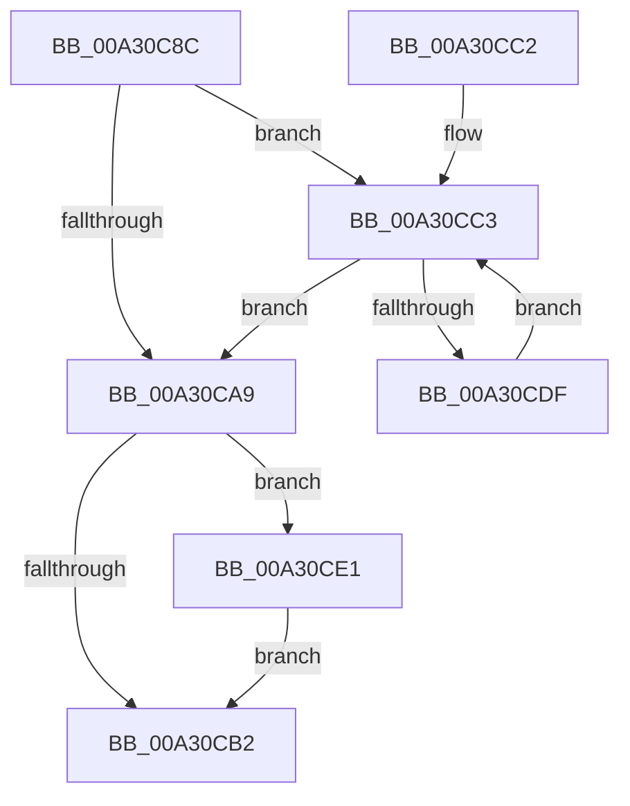

# CmpSortedValueEnumStackCleanup

- RVA: `0x00A30C8C`–`0x00A30CE8` (길이 `92` bytes)
- VA: `0x0000000140A30C8C`
- 실행 섹션: `PAGE`
- PDB 이름 있음: `예`; PDB Function 태그: `아니요`
- unwind 정보 RVA: `0x000AD0CC`
- 디코드: `29`개 명령, `92/92` bytes 표시
- 미해석 바이트: `0` (있으면 어셈블리에 `.byte`로 보존)

> 이 문서는 커널 이미지의 기계어와 PDB 기호를 분석해 생성했습니다. 4번과 5번은 함수 원형과 자료형을 바이너리 사용 방식에서 추정한 C 해석이며 원본 소스 복구 결과는 아닙니다.

## 1. Dependencies

- 직접 호출 지점: **3**; 고유 호출 대상: **3**
- 직접 호출자로 확인된 함수: **1**
- RIP 상대 이미지 참조: **0**

### Outgoing calls
- `0x00A30CC9` → [CmpSortedValueEnumStackGetEntryAtLayerHeight](../8B/CmpSortedValueEnumStackGetEntryAtLayerHeight_function_008B27B8.md) (function, `0x008B27B8`)
- `0x00A30CD1` → [CmpSortedValueEnumStackEntryCleanup](CmpSortedValueEnumStackEntryCleanup_function_00A310A0.md) (function, `0x00A310A0`)
- `0x00A30CE1` → [CmSiFreeMemory](../../text/47/CmSiFreeMemory_function_00475D80.md) (function, `0x00475D80`)

### Direct callers
- [CmpGetValueCountForKeyNodeStack](../../text/46/CmpGetValueCountForKeyNodeStack_function_0046B118.md) at `0x0046B1A1`
- [CmpGetValueCountForKeyNodeStack](../../text/46/CmpGetValueCountForKeyNodeStack_function_0046B118.md) at `0x0046B2C3`

### Static image references
- 디코드된 RIP-relative 메모리 참조가 없습니다.

## 2. Other-region calls and transfers

- 다른 실행 섹션으로 향하는 call: **1**
  - `0x00A30CE1` → [CmSiFreeMemory](../../text/47/CmSiFreeMemory_function_00475D80.md) (`PAGE` → `.text`)
- 별도 외부 분기/꼬리 이동을 확인하지 못했습니다.

## 3. Assembly (complete function range)

```asm
00A30C8C  48 89 5C 24 08                  mov qword ptr [rsp + 8], rbx
00A30C91  48 89 74 24 10                  mov qword ptr [rsp + 0x10], rsi
00A30C96  57                              push rdi
00A30C97  48 83 EC 20                     sub rsp, 0x20
00A30C9B  33 F6                           xor esi, esi
00A30C9D  48 8B D9                        mov rbx, rcx
00A30CA0  0F B7 FE                        movzx edi, si
00A30CA3  66 3B 71 08                     cmp si, word ptr [rcx + 8]
00A30CA7  7E 1A                           jle 0x140a30cc3
00A30CA9  48 8B 4B 50                     mov rcx, qword ptr [rbx + 0x50]
00A30CAD  48 85 C9                        test rcx, rcx
00A30CB0  75 2F                           jne 0x140a30ce1
00A30CB2  48 8B 5C 24 30                  mov rbx, qword ptr [rsp + 0x30]
00A30CB7  48 8B 74 24 38                  mov rsi, qword ptr [rsp + 0x38]
00A30CBC  48 83 C4 20                     add rsp, 0x20
00A30CC0  5F                              pop rdi
00A30CC1  C3                              ret
00A30CC2  CC                              int3
00A30CC3  0F B7 D7                        movzx edx, di
00A30CC6  48 8B CB                        mov rcx, rbx
00A30CC9  E8 EA 1A E8 FF                  call 0x1408b27b8
00A30CCE  48 8B C8                        mov rcx, rax
00A30CD1  E8 CA 03 00 00                  call 0x140a310a0
00A30CD6  66 FF C7                        inc di
00A30CD9  66 3B 7B 08                     cmp di, word ptr [rbx + 8]
00A30CDD  7F CA                           jg 0x140a30ca9
00A30CDF  EB E2                           jmp 0x140a30cc3
00A30CE1  E8 9A 50 A4 FF                  call 0x140475d80
00A30CE6  EB CA                           jmp 0x140a30cb2
```

## 4. C-style interpretation (structured pseudocode)

```c
__int64 __fastcall CmpSortedValueEnumStackCleanup(__int64 a1)
{
    __int64 result;
    __int64 v_rdi;
    __int64 v_rsi;
    __int64 v_rsp;
    unsigned __int64 v_stack_p10;
    unsigned __int64 v_stack_p8;

    v_stack_p8 = v_rbx;
    v_stack_p10 = v_rsi;
    v_rsp = (v_rsp) - (32);
    v_rsi = 0;
    if (0 <= (*(unsigned __int16 *)(a1 + 8))) goto loc_00A30CC3;
loc_00A30CA9:
    if (*(unsigned __int64 *)(a1 + 80) != 0) goto loc_00A30CE1;
loc_00A30CB2:
    v_rsp = (v_rsp) + (32);
    return result;
loc_00A30CC3:
    result = CmpSortedValueEnumStackGetEntryAtLayerHeight(v_stack_p8, 0, a3, a4);
    result = CmpSortedValueEnumStackEntryCleanup(result, 0, a3, a4);
    v_rdi = (unsigned __int16)((0) + 1);
    if (((unsigned __int16)(v_rdi)) > (*(unsigned __int16 *)(v_stack_p8 + 8))) goto loc_00A30CA9;
    goto loc_00A30CC3;
loc_00A30CE1:
    result = CmSiFreeMemory(result, 0, a3, a4);
    goto loc_00A30CB2;
}
```

## 5. (Beta) C Style

```c
int64_t CmpSortedValueEnumStackCleanup(void *Arg1)
{
    uint8_t *arg1 = (uint8_t *)Arg1;

    int64_t result;
    int64_t local_rdi;
    int64_t local_rsi;
    int64_t local_rsp;
    uint64_t v_stack_p10;
    uint64_t v_stack_p8;

    v_stack_p8 = local_rbx;
    v_stack_p10 = local_rsi;
    local_rsp = (local_rsp) - (32);
    local_rsi = 0;
    if (0 <= (*(uint16_t *)(arg1 + 0x8))) goto loc_00A30CC3;
loc_00A30CA9:
    if (*(uint64_t *)(arg1 + 0x50) != 0) goto loc_00A30CE1;
loc_00A30CB2:
    local_rsp = (local_rsp) + (32);
    return result;
loc_00A30CC3:
    result = CmpSortedValueEnumStackGetEntryAtLayerHeight(v_stack_p8, 0, a3, a4);
    result = CmpSortedValueEnumStackEntryCleanup(result, 0, a3, a4);
    local_rdi = (uint16_t)((0) + 1);
    if (((uint16_t)(local_rdi)) > (*(uint16_t *)(v_stack_p8 + 0x8))) goto loc_00A30CA9;
    goto loc_00A30CC3;
loc_00A30CE1:
    result = CmSiFreeMemory(result, 0, a3, a4);
    goto loc_00A30CB2;
}
```

### 관측된 메모리 오프셋

구조체 형식이 확인되지 않은 접근은 인자 기준의 오프셋으로만 기록했습니다.

| 기준 인자 | 오프셋 표현 | 폭 (bit) | 접근 |
|---|---:|---:|---|
| `Arg1` | `+ 0x8` | `16` | `R` |
| `Arg1` | `+ 0x50` | `64` | `R` |

## 6. Execution-region graph

[열기: 2D/3D 그래프와 함수 탐색 컨트롤 패널](../../../control-panel.html?section=page&rva=0x00A30C8C&view=graph)

- 2D 그래프는 위에서 아래로 흐르고, 3D 그래프는 빈 공간을 드래그해 회전합니다. Shift+드래그는 이동, 휠은 확대·축소, 함수 노드 선택은 대상 보고서 이동입니다.

### Static fallback


