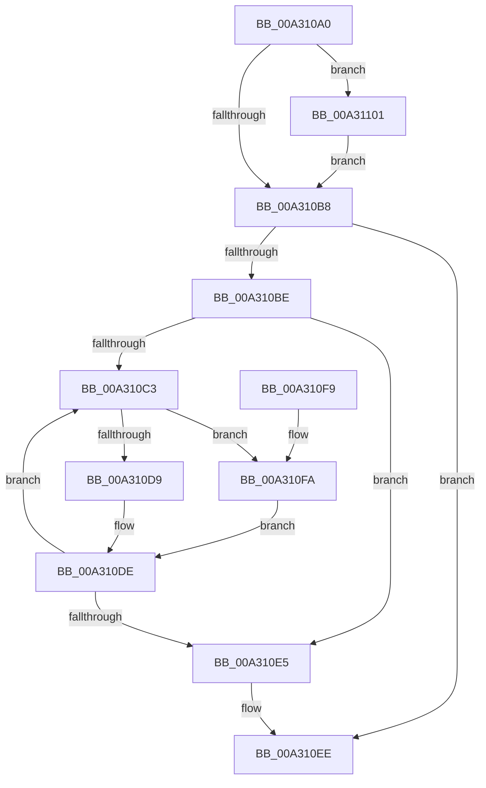

# CmpSortedValueEnumStackEntryCleanup

- RVA: `0x00A310A0`–`0x00A31108` (길이 `104` bytes)
- VA: `0x0000000140A310A0`
- 실행 섹션: `PAGE`
- PDB 이름 있음: `예`; PDB Function 태그: `아니요`
- unwind 정보 RVA: `0x0008A6D8`
- 디코드: `33`개 명령, `104/104` bytes 표시
- 미해석 바이트: `0` (있으면 어셈블리에 `.byte`로 보존)

> 이 문서는 커널 이미지의 기계어와 PDB 기호를 분석해 생성했습니다. 4번과 5번은 함수 원형과 자료형을 바이너리 사용 방식에서 추정한 C 해석이며 원본 소스 복구 결과는 아닙니다.

## 1. Dependencies

- 직접 호출 지점: **4**; 고유 호출 대상: **3**
- 직접 호출자로 확인된 함수: **1**
- RIP 상대 이미지 참조: **0**

### Outgoing calls
- `0x00A310D9` → [HvpReleaseCellPaged](../85/HvpReleaseCellPaged_function_00855F40.md) (function, `0x00855F40`)
- `0x00A310E9` → [CmSiFreeMemory](../../text/47/CmSiFreeMemory_function_00475D80.md) (function, `0x00475D80`)
- `0x00A310FA` → [HvpReleaseCellFlat](../85/HvpReleaseCellFlat_function_0085CC20.md) (function, `0x0085CC20`)
- `0x00A31101` → [CmSiFreeMemory](../../text/47/CmSiFreeMemory_function_00475D80.md) (function, `0x00475D80`)

### Direct callers
- [CmpSortedValueEnumStackCleanup](CmpSortedValueEnumStackCleanup_function_00A30C8C.md) at `0x00A30CD1`

### Static image references
- 디코드된 RIP-relative 메모리 참조가 없습니다.

## 2. Other-region calls and transfers

- 다른 실행 섹션으로 향하는 call: **2**
  - `0x00A310E9` → [CmSiFreeMemory](../../text/47/CmSiFreeMemory_function_00475D80.md) (`PAGE` → `.text`)
  - `0x00A31101` → [CmSiFreeMemory](../../text/47/CmSiFreeMemory_function_00475D80.md) (`PAGE` → `.text`)
- 별도 외부 분기/꼬리 이동을 확인하지 못했습니다.

## 3. Assembly (complete function range)

```asm
00A310A0  48 89 5C 24 08                  mov qword ptr [rsp + 8], rbx
00A310A5  57                              push rdi
00A310A6  48 83 EC 20                     sub rsp, 0x20
00A310AA  48 8B F9                        mov rdi, rcx
00A310AD  33 DB                           xor ebx, ebx
00A310AF  48 8B 49 08                     mov rcx, qword ptr [rcx + 8]
00A310B3  48 85 C9                        test rcx, rcx
00A310B6  75 49                           jne 0x140a31101
00A310B8  48 39 5F 10                     cmp qword ptr [rdi + 0x10], rbx
00A310BC  74 30                           je 0x140a310ee
00A310BE  39 5F 18                        cmp dword ptr [rdi + 0x18], ebx
00A310C1  76 22                           jbe 0x140a310e5
00A310C3  48 8B 47 10                     mov rax, qword ptr [rdi + 0x10]
00A310C7  8B CB                           mov ecx, ebx
00A310C9  48 8D 14 C8                     lea rdx, [rax + rcx*8]
00A310CD  48 8B 0F                        mov rcx, qword ptr [rdi]
00A310D0  F6 81 8C 00 00 00 01            test byte ptr [rcx + 0x8c], 1
00A310D7  75 21                           jne 0x140a310fa
00A310D9  E8 62 4E E2 FF                  call 0x140855f40
00A310DE  FF C3                           inc ebx
00A310E0  3B 5F 18                        cmp ebx, dword ptr [rdi + 0x18]
00A310E3  72 DE                           jb 0x140a310c3
00A310E5  48 8B 4F 10                     mov rcx, qword ptr [rdi + 0x10]
00A310E9  E8 92 4C A4 FF                  call 0x140475d80
00A310EE  48 8B 5C 24 30                  mov rbx, qword ptr [rsp + 0x30]
00A310F3  48 83 C4 20                     add rsp, 0x20
00A310F7  5F                              pop rdi
00A310F8  C3                              ret
00A310F9  CC                              int3
00A310FA  E8 21 BB E2 FF                  call 0x14085cc20
00A310FF  EB DD                           jmp 0x140a310de
00A31101  E8 7A 4C A4 FF                  call 0x140475d80
00A31106  EB B0                           jmp 0x140a310b8
```

## 4. C-style interpretation (structured pseudocode)

```c
__int64 __fastcall CmpSortedValueEnumStackEntryCleanup(__int64 a1)
{
    __int64 result;
    __int64 v_rbx;
    __int64 v_rsp;
    unsigned __int64 v_stack_p8;

    v_stack_p8 = v_rbx;
    v_rsp = (v_rsp) - (32);
    v_rbx = 0;
    if (*(unsigned __int64 *)(a1 + 8) != 0) goto loc_00A31101;
loc_00A310B8:
    if ((*(unsigned __int64 *)(a1 + 16)) == 0) goto loc_00A310EE;
    if ((*(unsigned int *)(a1 + 24)) <= 0) goto loc_00A310E5;
loc_00A310C3:
    if (((*(unsigned __int8 *)(*(unsigned __int64 *)(a1) + 140)) & (1)) != 0) goto loc_00A310FA;
    result = HvpReleaseCellPaged(*(unsigned __int64 *)(a1), *(unsigned __int64 *)(a1 + 16) + 0 * 8, a3, a4);
loc_00A310DE:
    v_rbx = (unsigned int)((v_rbx) + 1);
    if (((unsigned int)(v_rbx)) < (*(unsigned int *)(a1 + 24))) goto loc_00A310C3;
loc_00A310E5:
    result = CmSiFreeMemory(*(unsigned __int64 *)(a1 + 16), *(unsigned __int64 *)(a1 + 16) + 0 * 8, a3, a4);
loc_00A310EE:
    v_rsp = (v_rsp) + (32);
    return result;
loc_00A310FA:
    result = HvpReleaseCellFlat(*(unsigned __int64 *)(a1 + 16), *(unsigned __int64 *)(a1 + 16) + 0 * 8, a3, a4);
    goto loc_00A310DE;
loc_00A31101:
    result = CmSiFreeMemory(*(unsigned __int64 *)(a1 + 16), *(unsigned __int64 *)(a1 + 16) + 0 * 8, a3, a4);
    goto loc_00A310B8;
}
```

## 5. (Beta) C Style

```c
int64_t CmpSortedValueEnumStackEntryCleanup(void *Arg1)
{
    uint8_t *arg1 = (uint8_t *)Arg1;

    int64_t result;
    int64_t local_rbx;
    int64_t local_rsp;
    uint64_t v_stack_p8;

    v_stack_p8 = local_rbx;
    local_rsp = (local_rsp) - (32);
    local_rbx = 0;
    if (*(uint64_t *)(arg1 + 0x8) != 0) goto loc_00A31101;
loc_00A310B8:
    if ((*(uint64_t *)(arg1 + 0x10)) == 0) goto loc_00A310EE;
    if ((*(uint32_t *)(arg1 + 0x18)) <= 0) goto loc_00A310E5;
loc_00A310C3:
    if (((*(uint8_t *)(*(uint64_t *)(arg1) + 0x8C)) & (1)) != 0) goto loc_00A310FA;
    result = HvpReleaseCellPaged(*(uint64_t *)(arg1), *(uint64_t *)(arg1 + 0x10) + 0 * 8, a3, a4);
loc_00A310DE:
    local_rbx = (uint32_t)((local_rbx) + 1);
    if (((uint32_t)(local_rbx)) < (*(uint32_t *)(arg1 + 0x18))) goto loc_00A310C3;
loc_00A310E5:
    result = CmSiFreeMemory(*(uint64_t *)(arg1 + 0x10), *(uint64_t *)(arg1 + 0x10) + 0 * 8, a3, a4);
loc_00A310EE:
    local_rsp = (local_rsp) + (32);
    return result;
loc_00A310FA:
    result = HvpReleaseCellFlat(*(uint64_t *)(arg1 + 0x10), *(uint64_t *)(arg1 + 0x10) + 0 * 8, a3, a4);
    goto loc_00A310DE;
loc_00A31101:
    result = CmSiFreeMemory(*(uint64_t *)(arg1 + 0x10), *(uint64_t *)(arg1 + 0x10) + 0 * 8, a3, a4);
    goto loc_00A310B8;
}
```

### 관측된 메모리 오프셋

구조체 형식이 확인되지 않은 접근은 인자 기준의 오프셋으로만 기록했습니다.

| 기준 인자 | 오프셋 표현 | 폭 (bit) | 접근 |
|---|---:|---:|---|
| `Arg1` | `+ 0x0` | `64` | `R` |
| `Arg1` | `+ 0x8` | `64` | `R` |
| `Arg1` | `+ 0x10` | `64` | `R` |
| `Arg1` | `+ 0x18` | `32` | `R` |

## 6. Execution-region graph

[열기: 2D/3D 그래프와 함수 탐색 컨트롤 패널](../../../control-panel.html?section=page&rva=0x00A310A0&view=graph)

- 2D 그래프는 위에서 아래로 흐르고, 3D 그래프는 빈 공간을 드래그해 회전합니다. Shift+드래그는 이동, 휠은 확대·축소, 함수 노드 선택은 대상 보고서 이동입니다.

### Static fallback


