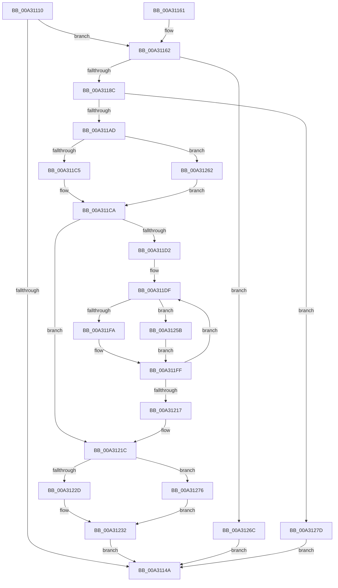

# CmpSortedValueEnumStackEntryStart

- RVA: `0x00A31110`–`0x00A3128F` (길이 `383` bytes)
- VA: `0x0000000140A31110`
- 실행 섹션: `PAGE`
- PDB 이름 있음: `예`; PDB Function 태그: `아니요`
- unwind 정보 RVA: `0x000AD128`
- 디코드: `102`개 명령, `383/383` bytes 표시
- 미해석 바이트: `0` (있으면 어셈블리에 `.byte`로 보존)

> 이 문서는 커널 이미지의 기계어와 PDB 기호를 분석해 생성했습니다. 4번과 5번은 함수 원형과 자료형을 바이너리 사용 방식에서 추정한 C 해석이며 원본 소스 복구 결과는 아닙니다.

## 1. Dependencies

- 직접 호출 지점: **12**; 고유 호출 대상: **8**
- 직접 호출자로 확인된 함수: **1**
- RIP 상대 이미지 참조: **1**

### Outgoing calls
- `0x00A31139` → [HvpGetCellContextInitialize](../85/HvpGetCellContextInitialize_function_00855F10.md) (function, `0x00855F10`)
- `0x00A3117B` → [CmpAllocatePool](../../text/3C/CmpAllocatePool_function_003CD504.md) (function, `0x003CD504`)
- `0x00A31197` → [CmpAllocatePool](../../text/3C/CmpAllocatePool_function_003CD504.md) (function, `0x003CD504`)
- `0x00A311C5` → [HvpGetCellFlat](../85/HvpGetCellFlat_function_00854C60.md) (function, `0x00854C60`)
- `0x00A311E2` → [HvpGetCellContextInitialize](../85/HvpGetCellContextInitialize_function_00855F10.md) (function, `0x00855F10`)
- `0x00A311FA` → [HvpGetCellFlat](../85/HvpGetCellFlat_function_00854C60.md) (function, `0x00854C60`)
- `0x00A3122D` → [HvpReleaseCellPaged](../85/HvpReleaseCellPaged_function_00855F40.md) (function, `0x00855F40`)
- `0x00A31245` → [qsort](../../text/50/qsort_function_005009F0.md) (function, `0x005009F0`)
- `0x00A3125B` → [HvpGetCellPaged](../85/HvpGetCellPaged_function_00854CB0.md) (function, `0x00854CB0`)
- `0x00A31262` → [HvpGetCellPaged](../85/HvpGetCellPaged_function_00854CB0.md) (function, `0x00854CB0`)
- `0x00A31276` → [HvpReleaseCellFlat](../85/HvpReleaseCellFlat_function_0085CC20.md) (function, `0x0085CC20`)
- `0x00A31285` → [CmSiFreeMemory](../../text/47/CmSiFreeMemory_function_00475D80.md) (function, `0x00475D80`)

### Direct callers
- [CmpSortedValueEnumStackStartFromKeyNodeStack](CmpSortedValueEnumStackStartFromKeyNodeStack_function_00A30CF0.md) at `0x00A30D64`

### Static image references
- `0x00A31232` → RVA `0x00A30F30` (`CmpSortedValueEnumStackValueCompareFunction`; read)

## 2. Other-region calls and transfers

- 다른 실행 섹션으로 향하는 call: **4**
  - `0x00A3117B` → [CmpAllocatePool](../../text/3C/CmpAllocatePool_function_003CD504.md) (`PAGE` → `.text`)
  - `0x00A31197` → [CmpAllocatePool](../../text/3C/CmpAllocatePool_function_003CD504.md) (`PAGE` → `.text`)
  - `0x00A31245` → [qsort](../../text/50/qsort_function_005009F0.md) (`PAGE` → `.text`)
  - `0x00A31285` → [CmSiFreeMemory](../../text/47/CmSiFreeMemory_function_00475D80.md) (`PAGE` → `.text`)
- 별도 외부 분기/꼬리 이동을 확인하지 못했습니다.

## 3. Assembly (complete function range)

```asm
00A31110  48 89 5C 24 20                  mov qword ptr [rsp + 0x20], rbx
00A31115  55                              push rbp
00A31116  56                              push rsi
00A31117  57                              push rdi
00A31118  41 54                           push r12
00A3111A  41 55                           push r13
00A3111C  41 56                           push r14
00A3111E  41 57                           push r15
00A31120  48 83 EC 20                     sub rsp, 0x20
00A31124  4C 8B F9                        mov r15, rcx
00A31127  33 DB                           xor ebx, ebx
00A31129  48 8D 4C 24 60                  lea rcx, [rsp + 0x60]
00A3112E  48 89 5C 24 60                  mov qword ptr [rsp + 0x60], rbx
00A31133  49 8B E8                        mov rbp, r8
00A31136  48 8B FA                        mov rdi, rdx
00A31139  E8 D2 4D E2 FF                  call 0x140855f10
00A3113E  49 89 17                        mov qword ptr [r15], rdx
00A31141  45 8B 70 24                     mov r14d, dword ptr [r8 + 0x24]
00A31145  45 85 F6                        test r14d, r14d
00A31148  75 18                           jne 0x140a31162
00A3114A  8B C3                           mov eax, ebx
00A3114C  48 8B 5C 24 78                  mov rbx, qword ptr [rsp + 0x78]
00A31151  48 83 C4 20                     add rsp, 0x20
00A31155  41 5F                           pop r15
00A31157  41 5E                           pop r14
00A31159  41 5D                           pop r13
00A3115B  41 5C                           pop r12
00A3115D  5F                              pop rdi
00A3115E  5E                              pop rsi
00A3115F  5D                              pop rbp
00A31160  C3                              ret
00A31161  CC                              int3
00A31162  4E 8D 24 F5 00 00 00 00         lea r12, [r14*8]
00A3116A  41 BD 43 4D 37 38               mov r13d, 0x38374d43
00A31170  45 8B C5                        mov r8d, r13d
00A31173  49 8B D4                        mov rdx, r12
00A31176  B9 00 01 00 00                  mov ecx, 0x100
00A3117B  E8 84 C3 99 FF                  call 0x1403cd504
00A31180  48 8B F0                        mov rsi, rax
00A31183  48 85 C0                        test rax, rax
00A31186  0F 84 E0 00 00 00               je 0x140a3126c
00A3118C  45 8B C5                        mov r8d, r13d
00A3118F  49 8B D4                        mov rdx, r12
00A31192  B9 00 01 00 00                  mov ecx, 0x100
00A31197  E8 68 C3 99 FF                  call 0x1403cd504
00A3119C  48 89 44 24 70                  mov qword ptr [rsp + 0x70], rax
00A311A1  4C 8B E8                        mov r13, rax
00A311A4  48 85 C0                        test rax, rax
00A311A7  0F 84 D0 00 00 00               je 0x140a3127d
00A311AD  F6 87 8C 00 00 00 01            test byte ptr [rdi + 0x8c], 1
00A311B4  4C 8D 44 24 60                  lea r8, [rsp + 0x60]
00A311B9  8B 55 28                        mov edx, dword ptr [rbp + 0x28]
00A311BC  48 8B CF                        mov rcx, rdi
00A311BF  0F 84 9D 00 00 00               je 0x140a31262
00A311C5  E8 96 3A E2 FF                  call 0x140854c60
00A311CA  4C 8B E0                        mov r12, rax
00A311CD  45 85 F6                        test r14d, r14d
00A311D0  74 4A                           je 0x140a3121c
00A311D2  48 8B 6C 24 70                  mov rbp, qword ptr [rsp + 0x70]
00A311D7  4C 8B EE                        mov r13, rsi
00A311DA  4C 89 74 24 68                  mov qword ptr [rsp + 0x68], r14
00A311DF  48 8B CD                        mov rcx, rbp
00A311E2  E8 29 4D E2 FF                  call 0x140855f10
00A311E7  F6 87 8C 00 00 00 01            test byte ptr [rdi + 0x8c], 1
00A311EE  4C 8B C5                        mov r8, rbp
00A311F1  41 8B 14 24                     mov edx, dword ptr [r12]
00A311F5  48 8B CF                        mov rcx, rdi
00A311F8  74 61                           je 0x140a3125b
00A311FA  E8 61 3A E2 FF                  call 0x140854c60
00A311FF  49 89 45 00                     mov qword ptr [r13], rax
00A31203  48 83 C5 08                     add rbp, 8
00A31207  49 83 C5 08                     add r13, 8
00A3120B  49 83 C4 04                     add r12, 4
00A3120F  48 83 6C 24 68 01               sub qword ptr [rsp + 0x68], 1
00A31215  75 C8                           jne 0x140a311df
00A31217  4C 8B 6C 24 70                  mov r13, qword ptr [rsp + 0x70]
00A3121C  F6 87 8C 00 00 00 01            test byte ptr [rdi + 0x8c], 1
00A31223  48 8D 54 24 60                  lea rdx, [rsp + 0x60]
00A31228  48 8B CF                        mov rcx, rdi
00A3122B  75 49                           jne 0x140a31276
00A3122D  E8 0E 4D E2 FF                  call 0x140855f40
00A31232  4C 8D 0D F7 FC FF FF            lea r9, [rip - 0x309]
00A31239  41 B8 08 00 00 00               mov r8d, 8
00A3123F  49 8B D6                        mov rdx, r14
00A31242  48 8B CE                        mov rcx, rsi
00A31245  E8 A6 F7 AC FF                  call 0x1405009f0
00A3124A  49 89 77 08                     mov qword ptr [r15 + 8], rsi
00A3124E  4D 89 6F 10                     mov qword ptr [r15 + 0x10], r13
00A31252  45 89 77 18                     mov dword ptr [r15 + 0x18], r14d
00A31256  E9 EF FE FF FF                  jmp 0x140a3114a
00A3125B  E8 50 3A E2 FF                  call 0x140854cb0
00A31260  EB 9D                           jmp 0x140a311ff
00A31262  E8 49 3A E2 FF                  call 0x140854cb0
00A31267  E9 5E FF FF FF                  jmp 0x140a311ca
00A3126C  BB 9A 00 00 C0                  mov ebx, 0xc000009a
00A31271  E9 D4 FE FF FF                  jmp 0x140a3114a
00A31276  E8 A5 B9 E2 FF                  call 0x14085cc20
00A3127B  EB B5                           jmp 0x140a31232
00A3127D  48 8B CE                        mov rcx, rsi
00A31280  BB 9A 00 00 C0                  mov ebx, 0xc000009a
00A31285  E8 F6 4A A4 FF                  call 0x140475d80
00A3128A  E9 BB FE FF FF                  jmp 0x140a3114a
```

## 4. C-style interpretation (structured pseudocode)

```c
__int64 __fastcall CmpSortedValueEnumStackEntryStart(__int64 a1, __int64 a2, __int64 a3)
{
    __int64 result;
    __int64 v_r12;
    __int64 v_r13;
    __int64 v_rbp;
    __int64 v_rbx;
    __int64 v_rsp;
    unsigned __int64 v_stack_p20;
    unsigned __int64 v_stack_p60;
    unsigned __int64 v_stack_p68;
    unsigned __int64 v_stack_p70;
    unsigned __int64 v_stack_p8;

    v_stack_p20 = v_rbx;
    v_rsp = (v_rsp) - (32);
    v_rbx = 0;
    v_stack_p8 = 0;
    result = HvpGetCellContextInitialize(v_stack_p8, a2, a3, a4);
    *(unsigned __int64 *)(a1) = a2;
    if ((unsigned int)((unsigned int)(*(unsigned int *)(a3 + 36))) != 0) goto loc_00A31162;
loc_00A3114A:
    v_rsp = (v_rsp) + (32);
    return 0;
loc_00A31162:
    result = CmpAllocatePool(256, (unsigned int)(*(unsigned int *)(a3 + 36)) * 8, (unsigned int)((unsigned int)((unsigned int)(0x38374D43ULL))), a4);
    if (result == 0) goto loc_00A3126C;
    result = CmpAllocatePool(256, (unsigned int)(*(unsigned int *)(a3 + 36)) * 8, (unsigned int)((unsigned int)((unsigned int)(0x38374D43ULL))), a4);
    v_stack_p70 = result;
    if (result == 0) goto loc_00A3127D;
    if (((*(unsigned __int8 *)(a2 + 140)) & (1)) == 0) goto loc_00A31262;
    result = HvpGetCellFlat(a2, (unsigned int)(*(unsigned int *)(a3 + 40)), v_stack_p60, a4);
loc_00A311CA:
    if ((unsigned int)((unsigned int)(*(unsigned int *)(a3 + 36))) == 0) goto loc_00A3121C;
    v_stack_p68 = (unsigned int)(*(unsigned int *)(a3 + 36));
loc_00A311DF:
    result = HvpGetCellContextInitialize(v_stack_p70, (unsigned int)(*(unsigned int *)(a3 + 40)), v_stack_p60, a4);
    if (((*(unsigned __int8 *)(a2 + 140)) & (1)) == 0) goto loc_00A3125B;
    result = HvpGetCellFlat(a2, (unsigned int)(*(unsigned int *)(result)), v_stack_p70, a4);
loc_00A311FF:
    *(unsigned __int64 *)(result) = result;
    v_rbp = (v_stack_p70) + (8);
    v_r13 = (result) + (8);
    v_r12 = (result) + (4);
    if (condition_is_not_equal) goto loc_00A311DF;
loc_00A3121C:
    if (((*(unsigned __int8 *)(a2 + 140)) & (1)) != 0) goto loc_00A31276;
    result = HvpReleaseCellPaged(a2, v_stack_p60, v_stack_p70, a4);
loc_00A31232:
    result = qsort(result, (unsigned int)(*(unsigned int *)(a3 + 36)), 8, v_rip - 777);
    *(unsigned __int64 *)(a1 + 8) = result;
    *(unsigned __int64 *)(a1 + 16) = v_stack_p70;
    *(unsigned int *)(a1 + 24) = (unsigned int)((unsigned int)(*(unsigned int *)(a3 + 36)));
    goto loc_00A3114A;
loc_00A3125B:
    result = HvpGetCellPaged(result, (unsigned int)(*(unsigned int *)(a3 + 36)), 8, v_rip - 777);
    goto loc_00A311FF;
loc_00A31262:
    result = HvpGetCellPaged(result, (unsigned int)(*(unsigned int *)(a3 + 36)), 8, v_rip - 777);
    goto loc_00A311CA;
loc_00A3126C:
    goto loc_00A3114A;
loc_00A31276:
    result = HvpReleaseCellFlat(result, (unsigned int)(*(unsigned int *)(a3 + 36)), 8, v_rip - 777);
    goto loc_00A31232;
loc_00A3127D:
    result = CmSiFreeMemory(result, (unsigned int)(*(unsigned int *)(a3 + 36)), 8, v_rip - 777);
    goto loc_00A3114A;
}
```

## 5. (Beta) C Style

```c
int64_t CmpSortedValueEnumStackEntryStart(void *Arg1, void *Arg2, void *Arg3)
{
    uint8_t *arg1 = (uint8_t *)Arg1;
    uint8_t *arg2 = (uint8_t *)Arg2;
    uint8_t *arg3 = (uint8_t *)Arg3;

    int64_t result;
    int64_t local_r12;
    int64_t local_r13;
    int64_t local_rbp;
    int64_t local_rbx;
    int64_t local_rsp;
    uint64_t v_stack_p20;
    uint64_t v_stack_p60;
    uint64_t v_stack_p68;
    uint64_t v_stack_p70;
    uint64_t v_stack_p8;

    v_stack_p20 = local_rbx;
    local_rsp = (local_rsp) - (32);
    local_rbx = 0;
    v_stack_p8 = 0;
    result = HvpGetCellContextInitialize(v_stack_p8, Arg2, Arg3, a4);
    *(void **)(arg1) = Arg2;
    if ((uint32_t)((uint32_t)(*(uint32_t *)(arg3 + 0x24))) != 0) goto loc_00A31162;
loc_00A3114A:
    local_rsp = (local_rsp) + (32);
    return 0;
loc_00A31162:
    result = CmpAllocatePool(256, (uint32_t)(*(uint32_t *)(arg3 + 0x24)) * 8, (uint32_t)((uint32_t)((uint32_t)(0x38374D43ULL))), a4);
    if (result == 0) goto loc_00A3126C;
    result = CmpAllocatePool(256, (uint32_t)(*(uint32_t *)(arg3 + 0x24)) * 8, (uint32_t)((uint32_t)((uint32_t)(0x38374D43ULL))), a4);
    v_stack_p70 = result;
    if (result == 0) goto loc_00A3127D;
    if (((*(uint8_t *)(arg2 + 0x8C)) & (1)) == 0) goto loc_00A31262;
    result = HvpGetCellFlat(Arg2, (uint32_t)(*(uint32_t *)(arg3 + 0x28)), v_stack_p60, a4);
loc_00A311CA:
    if ((uint32_t)((uint32_t)(*(uint32_t *)(arg3 + 0x24))) == 0) goto loc_00A3121C;
    v_stack_p68 = (uint32_t)(*(uint32_t *)(arg3 + 0x24));
loc_00A311DF:
    result = HvpGetCellContextInitialize(v_stack_p70, (uint32_t)(*(uint32_t *)(arg3 + 0x28)), v_stack_p60, a4);
    if (((*(uint8_t *)(arg2 + 0x8C)) & (1)) == 0) goto loc_00A3125B;
    result = HvpGetCellFlat(Arg2, (uint32_t)(*(uint32_t *)(result)), v_stack_p70, a4);
loc_00A311FF:
    *(uint64_t *)(result) = result;
    local_rbp = (v_stack_p70) + (8);
    local_r13 = (result) + (8);
    local_r12 = (result) + (4);
    if (condition_is_not_equal) goto loc_00A311DF;
loc_00A3121C:
    if (((*(uint8_t *)(arg2 + 0x8C)) & (1)) != 0) goto loc_00A31276;
    result = HvpReleaseCellPaged(Arg2, v_stack_p60, v_stack_p70, a4);
loc_00A31232:
    result = qsort(result, (uint32_t)(*(uint32_t *)(arg3 + 0x24)), 8, v_rip - 777);
    *(uint64_t *)(arg1 + 0x8) = result;
    *(uint64_t *)(arg1 + 0x10) = v_stack_p70;
    *(uint32_t *)(arg1 + 0x18) = (uint32_t)((uint32_t)(*(uint32_t *)(arg3 + 0x24)));
    goto loc_00A3114A;
loc_00A3125B:
    result = HvpGetCellPaged(result, (uint32_t)(*(uint32_t *)(arg3 + 0x24)), 8, v_rip - 777);
    goto loc_00A311FF;
loc_00A31262:
    result = HvpGetCellPaged(result, (uint32_t)(*(uint32_t *)(arg3 + 0x24)), 8, v_rip - 777);
    goto loc_00A311CA;
loc_00A3126C:
    goto loc_00A3114A;
loc_00A31276:
    result = HvpReleaseCellFlat(result, (uint32_t)(*(uint32_t *)(arg3 + 0x24)), 8, v_rip - 777);
    goto loc_00A31232;
loc_00A3127D:
    result = CmSiFreeMemory(result, (uint32_t)(*(uint32_t *)(arg3 + 0x24)), 8, v_rip - 777);
    goto loc_00A3114A;
}
```

### 관측된 메모리 오프셋

구조체 형식이 확인되지 않은 접근은 인자 기준의 오프셋으로만 기록했습니다.

| 기준 인자 | 오프셋 표현 | 폭 (bit) | 접근 |
|---|---:|---:|---|
| `Arg1` | `+ 0x0` | `64` | `W` |
| `Arg1` | `+ 0x8` | `64` | `W` |
| `Arg1` | `+ 0x10` | `64` | `W` |
| `Arg1` | `+ 0x18` | `32` | `W` |
| `Arg2` | `+ 0x8C` | `8` | `R` |
| `Arg3` | `+ 0x28` | `32` | `R` |

## 6. Execution-region graph

[열기: 2D/3D 그래프와 함수 탐색 컨트롤 패널](../../../control-panel.html?section=page&rva=0x00A31110&view=graph)

- 2D 그래프는 위에서 아래로 흐르고, 3D 그래프는 빈 공간을 드래그해 회전합니다. Shift+드래그는 이동, 휠은 확대·축소, 함수 노드 선택은 대상 보고서 이동입니다.

### Static fallback


