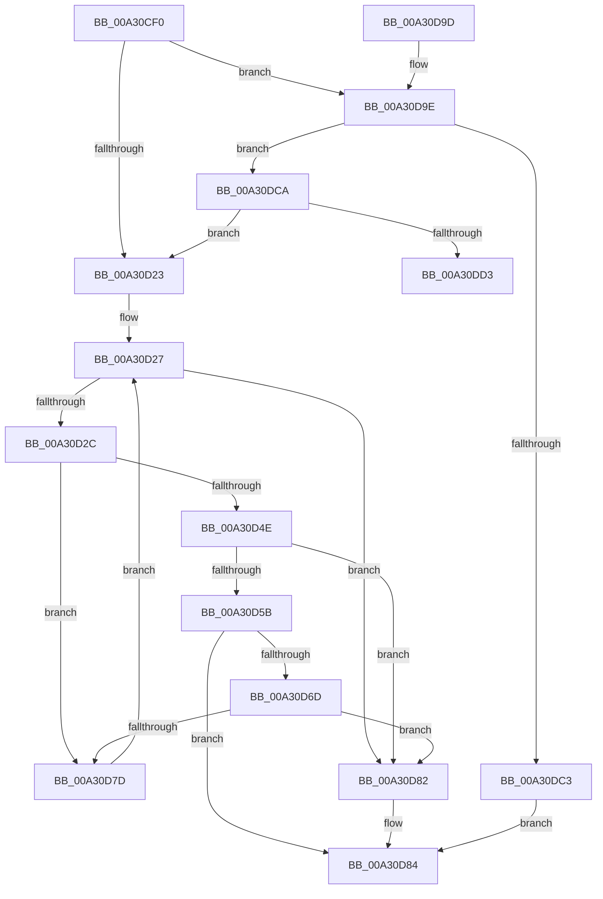

# CmpSortedValueEnumStackStartFromKeyNodeStack

- RVA: `0x00A30CF0`–`0x00A30DDE` (길이 `238` bytes)
- VA: `0x0000000140A30CF0`
- 실행 섹션: `PAGE`
- PDB 이름 있음: `예`; PDB Function 태그: `예`
- unwind 정보 RVA: `0x00093F4C`
- 디코드: `71`개 명령, `238/238` bytes 표시
- 미해석 바이트: `0` (있으면 어셈블리에 `.byte`로 보존)

> 이 문서는 커널 이미지의 기계어와 PDB 기호를 분석해 생성했습니다. 4번과 5번은 함수 원형과 자료형을 바이너리 사용 방식에서 추정한 C 해석이며 원본 소스 복구 결과는 아닙니다.

## 1. Dependencies

- 직접 호출 지점: **6**; 고유 호출 대상: **5**
- 직접 호출자로 확인된 함수: **1**
- RIP 상대 이미지 참조: **0**

### Outgoing calls
- `0x00A30D32` → [CmpKeyNodeStackGetEntryAtLayerHeight](../94/CmpKeyNodeStackGetEntryAtLayerHeight_function_00946ABC.md) (function, `0x00946ABC`)
- `0x00A30D3D` → [CmpSortedValueEnumStackGetEntryAtLayerHeight](../8B/CmpSortedValueEnumStackGetEntryAtLayerHeight_function_008B27B8.md) (function, `0x008B27B8`)
- `0x00A30D51` → [CmpGetEffectiveKeyNodeSemantics](../94/CmpGetEffectiveKeyNodeSemantics_function_00946D18.md) (function, `0x00946D18`)
- `0x00A30D64` → [CmpSortedValueEnumStackEntryStart](CmpSortedValueEnumStackEntryStart_function_00A31110.md) (function, `0x00A31110`)
- `0x00A30D74` → [CmpGetEffectiveKeyNodeSemantics](../94/CmpGetEffectiveKeyNodeSemantics_function_00946D18.md) (function, `0x00946D18`)
- `0x00A30DB5` → [CmpAllocatePool](../../text/3C/CmpAllocatePool_function_003CD504.md) (function, `0x003CD504`)

### Direct callers
- [CmpGetValueCountForKeyNodeStack](../../text/46/CmpGetValueCountForKeyNodeStack_function_0046B118.md) at `0x0046B26D`

### Static image references
- 디코드된 RIP-relative 메모리 참조가 없습니다.

## 2. Other-region calls and transfers

- 다른 실행 섹션으로 향하는 call: **1**
  - `0x00A30DB5` → [CmpAllocatePool](../../text/3C/CmpAllocatePool_function_003CD504.md) (`PAGE` → `.text`)
- call이 아닌 외부 분기/꼬리 이동: **1**
  - `0x00A30DD9` → [sub_00B39AE0](../B3/Unknown_function_00B39AE0.md) (`tail-transfer`)

## 3. Assembly (complete function range)

```asm
00A30CF0  48 89 5C 24 08                  mov qword ptr [rsp + 8], rbx
00A30CF5  48 89 6C 24 10                  mov qword ptr [rsp + 0x10], rbp
00A30CFA  48 89 74 24 18                  mov qword ptr [rsp + 0x18], rsi
00A30CFF  57                              push rdi
00A30D00  41 56                           push r14
00A30D02  41 57                           push r15
00A30D04  48 83 EC 20                     sub rsp, 0x20
00A30D08  0F B7 1A                        movzx ebx, word ptr [rdx]
00A30D0B  41 BF 01 00 00 00               mov r15d, 1
00A30D11  33 ED                           xor ebp, ebp
00A30D13  4C 8B F2                        mov r14, rdx
00A30D16  48 8B F1                        mov rsi, rcx
00A30D19  41 8D 3C 1F                     lea edi, [r15 + rbx]
00A30D1D  66 83 FF 02                     cmp di, 2
00A30D21  7F 7B                           jg 0x140a30d9e
00A30D23  66 89 5E 08                     mov word ptr [rsi + 8], bx
00A30D27  66 85 DB                        test bx, bx
00A30D2A  78 56                           js 0x140a30d82
00A30D2C  0F B7 D3                        movzx edx, bx
00A30D2F  49 8B CE                        mov rcx, r14
00A30D32  E8 85 5D F1 FF                  call 0x140946abc
00A30D37  48 8B CE                        mov rcx, rsi
00A30D3A  48 8B F8                        mov rdi, rax
00A30D3D  E8 76 1A E8 FF                  call 0x1408b27b8
00A30D42  48 8B 57 10                     mov rdx, qword ptr [rdi + 0x10]
00A30D46  4C 8B C8                        mov r9, rax
00A30D49  48 85 D2                        test rdx, rdx
00A30D4C  74 2F                           je 0x140a30d7d
00A30D4E  48 8B 0F                        mov rcx, qword ptr [rdi]
00A30D51  E8 C2 5F F1 FF                  call 0x140946d18
00A30D56  41 3B C7                        cmp eax, r15d
00A30D59  74 27                           je 0x140a30d82
00A30D5B  4C 8B C2                        mov r8, rdx
00A30D5E  48 8B D1                        mov rdx, rcx
00A30D61  49 8B C9                        mov rcx, r9
00A30D64  E8 A7 03 00 00                  call 0x140a31110
00A30D69  85 C0                           test eax, eax
00A30D6B  78 17                           js 0x140a30d84
00A30D6D  48 8B 57 10                     mov rdx, qword ptr [rdi + 0x10]
00A30D71  48 8B 0F                        mov rcx, qword ptr [rdi]
00A30D74  E8 9F 5F F1 FF                  call 0x140946d18
00A30D79  85 C0                           test eax, eax
00A30D7B  75 05                           jne 0x140a30d82
00A30D7D  66 FF CB                        dec bx
00A30D80  EB A5                           jmp 0x140a30d27
00A30D82  8B C5                           mov eax, ebp
00A30D84  48 8B 5C 24 40                  mov rbx, qword ptr [rsp + 0x40]
00A30D89  48 8B 6C 24 48                  mov rbp, qword ptr [rsp + 0x48]
00A30D8E  48 8B 74 24 50                  mov rsi, qword ptr [rsp + 0x50]
00A30D93  48 83 C4 20                     add rsp, 0x20
00A30D97  41 5F                           pop r15
00A30D99  41 5E                           pop r14
00A30D9B  5F                              pop rdi
00A30D9C  C3                              ret
00A30D9D  CC                              int3
00A30D9E  66 83 EF 02                     sub di, 2
00A30DA2  B9 00 01 00 00                  mov ecx, 0x100
00A30DA7  48 0F BF D7                     movsx rdx, di
00A30DAB  41 B8 43 4D 37 39               mov r8d, 0x39374d43
00A30DB1  48 C1 E2 05                     shl rdx, 5
00A30DB5  E8 4A C7 99 FF                  call 0x1403cd504
00A30DBA  48 89 46 50                     mov qword ptr [rsi + 0x50], rax
00A30DBE  48 85 C0                        test rax, rax
00A30DC1  75 07                           jne 0x140a30dca
00A30DC3  B8 9A 00 00 C0                  mov eax, 0xc000009a
00A30DC8  EB BA                           jmp 0x140a30d84
00A30DCA  66 3B EF                        cmp bp, di
00A30DCD  0F 8D 50 FF FF FF               jge 0x140a30d23
00A30DD3  48 8B CD                        mov rcx, rbp
00A30DD6  0F B7 D7                        movzx edx, di
00A30DD9  E9 02 8D 10 00                  jmp 0x140b39ae0
```

## 4. C-style interpretation (structured pseudocode)

```c
__int64 __fastcall CmpSortedValueEnumStackStartFromKeyNodeStack(__int64 a1, __int64 a2)
{
    __int64 result;
    __int64 v_rbp;
    __int64 v_rbx;
    __int64 v_rdi;
    __int64 v_rsp;
    unsigned __int64 v_stack_p10;
    unsigned __int64 v_stack_p18;
    unsigned __int64 v_stack_p8;

    v_stack_p8 = v_rbx;
    v_stack_p10 = v_rbp;
    v_stack_p18 = v_rsi;
    v_rsp = (v_rsp) - (32);
    v_rbp = 0;
    if (((unsigned __int16)(1 + *(unsigned __int16 *)(a2) * 1)) > 2) goto loc_00A30D9E;
loc_00A30D23:
    *(unsigned __int16 *)(a1 + 8) = (unsigned __int16)(*(unsigned __int16 *)(a2));
loc_00A30D27:
    if (sign_flag) goto loc_00A30D82;
    result = CmpKeyNodeStackGetEntryAtLayerHeight(a2, (unsigned __int16)(*(unsigned __int16 *)(a2)), a3, a4);
    result = CmpSortedValueEnumStackGetEntryAtLayerHeight(a1, (unsigned __int16)(*(unsigned __int16 *)(a2)), a3, a4);
    if (*(unsigned __int64 *)(result + 16) == 0) goto loc_00A30D7D;
    result = CmpGetEffectiveKeyNodeSemantics(*(unsigned __int64 *)(result), *(unsigned __int64 *)(result + 16), a3, result);
    if (((unsigned int)(result)) == 1) goto loc_00A30D82;
    result = CmpSortedValueEnumStackEntryStart(result, *(unsigned __int64 *)(result), *(unsigned __int64 *)(result + 16), result);
    if (sign_flag) goto loc_00A30D84;
    result = CmpGetEffectiveKeyNodeSemantics(*(unsigned __int64 *)(result), *(unsigned __int64 *)(result + 16), *(unsigned __int64 *)(result + 16), result);
    if ((unsigned int)(result) != 0) goto loc_00A30D82;
loc_00A30D7D:
    v_rbx = (unsigned __int16)((*(unsigned __int16 *)(a2)) - 1);
    goto loc_00A30D27;
loc_00A30D82:
loc_00A30D84:
    v_rsp = (v_rsp) + (32);
    return 0;
loc_00A30D9E:
    v_rdi = (unsigned __int16)((result) - (2));
    a2 = ((__int16)((unsigned __int16)(v_rdi))) << (5);
    result = CmpAllocatePool(256, a2, (unsigned int)(0x39374D43ULL), result);
    *(unsigned __int64 *)(v_stack_p18 + 80) = result;
    if (result != 0) goto loc_00A30DCA;
    goto loc_00A30D84;
loc_00A30DCA:
    if (((unsigned __int16)(v_stack_p10)) >= ((unsigned __int16)(v_rdi))) goto loc_00A30D23;
}
```

## 5. (Beta) C Style

```c
int64_t CmpSortedValueEnumStackStartFromKeyNodeStack(void *Arg1, void *Arg2)
{
    uint8_t *arg1 = (uint8_t *)Arg1;
    uint8_t *arg2 = (uint8_t *)Arg2;

    int64_t result;
    int64_t local_rbp;
    int64_t local_rbx;
    int64_t local_rdi;
    int64_t local_rsp;
    uint64_t v_stack_p10;
    uint64_t v_stack_p18;
    uint64_t v_stack_p8;

    v_stack_p8 = local_rbx;
    v_stack_p10 = local_rbp;
    v_stack_p18 = local_rsi;
    local_rsp = (local_rsp) - (32);
    local_rbp = 0;
    if (((uint16_t)(1 + *(uint16_t *)(arg2) * 1)) > 2) goto loc_00A30D9E;
loc_00A30D23:
    *(uint16_t *)(arg1 + 0x8) = (uint16_t)(*(uint16_t *)(arg2));
loc_00A30D27:
    if (sign_flag) goto loc_00A30D82;
    result = CmpKeyNodeStackGetEntryAtLayerHeight(Arg2, (uint16_t)(*(uint16_t *)(arg2)), a3, a4);
    result = CmpSortedValueEnumStackGetEntryAtLayerHeight(Arg1, (uint16_t)(*(uint16_t *)(arg2)), a3, a4);
    if (*(uint64_t *)(result + 0x10) == 0) goto loc_00A30D7D;
    result = CmpGetEffectiveKeyNodeSemantics(*(uint64_t *)(result), *(uint64_t *)(result + 0x10), a3, result);
    if (((uint32_t)(result)) == 1) goto loc_00A30D82;
    result = CmpSortedValueEnumStackEntryStart(result, *(uint64_t *)(result), *(uint64_t *)(result + 0x10), result);
    if (sign_flag) goto loc_00A30D84;
    result = CmpGetEffectiveKeyNodeSemantics(*(uint64_t *)(result), *(uint64_t *)(result + 0x10), *(uint64_t *)(result + 0x10), result);
    if ((uint32_t)(result) != 0) goto loc_00A30D82;
loc_00A30D7D:
    local_rbx = (uint16_t)((*(uint16_t *)(arg2)) - 1);
    goto loc_00A30D27;
loc_00A30D82:
loc_00A30D84:
    local_rsp = (local_rsp) + (32);
    return 0;
loc_00A30D9E:
    local_rdi = (uint16_t)((result) - (2));
    Arg2 = ((int16_t)((uint16_t)(local_rdi))) << (5);
    result = CmpAllocatePool(256, Arg2, (uint32_t)(0x39374D43ULL), result);
    *(uint64_t *)(v_stack_p18 + 0x50) = result;
    if (result != 0) goto loc_00A30DCA;
    goto loc_00A30D84;
loc_00A30DCA:
    if (((uint16_t)(v_stack_p10)) >= ((uint16_t)(local_rdi))) goto loc_00A30D23;
}
```

### 관측된 메모리 오프셋

구조체 형식이 확인되지 않은 접근은 인자 기준의 오프셋으로만 기록했습니다.

| 기준 인자 | 오프셋 표현 | 폭 (bit) | 접근 |
|---|---:|---:|---|
| `Arg1` | `+ 0x8` | `16` | `W` |
| `Arg1` | `+ 0x50` | `64` | `W` |
| `Arg2` | `+ 0x0` | `16` | `R` |

## 6. Execution-region graph

[열기: 2D/3D 그래프와 함수 탐색 컨트롤 패널](../../../control-panel.html?section=page&rva=0x00A30CF0&view=graph)

- 2D 그래프는 위에서 아래로 흐르고, 3D 그래프는 빈 공간을 드래그해 회전합니다. Shift+드래그는 이동, 휠은 확대·축소, 함수 노드 선택은 대상 보고서 이동입니다.

### Static fallback


