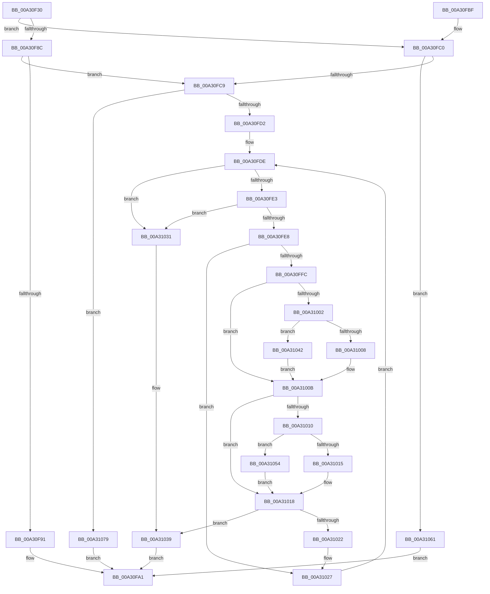

# CmpSortedValueEnumStackValueCompareFunction

- RVA: `0x00A30F30`–`0x00A3109A` (길이 `362` bytes)
- VA: `0x0000000140A30F30`
- 실행 섹션: `PAGE`
- PDB 이름 있음: `예`; PDB Function 태그: `아니요`
- unwind 정보 RVA: `0x000AD108`
- 디코드: `110`개 명령, `362/362` bytes 표시
- 미해석 바이트: `0` (있으면 어셈블리에 `.byte`로 보존)

> 이 문서는 커널 이미지의 기계어와 PDB 기호를 분석해 생성했습니다. 4번과 5번은 함수 원형과 자료형을 바이너리 사용 방식에서 추정한 C 해석이며 원본 소스 복구 결과는 아닙니다.

## 1. Dependencies

- 직접 호출 지점: **5**; 고유 호출 대상: **4**
- 직접 호출자로 확인된 함수: **1**
- RIP 상대 이미지 참조: **0**

### Outgoing calls
- `0x00A30F9C` → [CmpCompareTwoCompressedNames](../84/CmpCompareTwoCompressedNames_function_00847610.md) (function, `0x00847610`)
- `0x00A31045` → [RtlUpcaseUnicodeChar](../85/RtlUpcaseUnicodeChar_function_0085F0F0.md) (function, `0x0085F0F0`)
- `0x00A31057` → [RtlUpcaseUnicodeChar](../85/RtlUpcaseUnicodeChar_function_0085F0F0.md) (function, `0x0085F0F0`)
- `0x00A3106F` → [CmpCompareCompressedName](../95/CmpCompareCompressedName_function_00958030.md) (function, `0x00958030`)
- `0x00A31090` → [RtlCompareUnicodeStrings](../97/RtlCompareUnicodeStrings_function_009727E0.md) (function, `0x009727E0`)

### Direct callers
- [CmpSortedValueEnumStackAdvanceInternal](CmpSortedValueEnumStackAdvanceInternal_function_00A30E14.md) at `0x00A30EC6`
- [CmpSortedValueEnumStackAdvanceInternal](CmpSortedValueEnumStackAdvanceInternal_function_00A30E14.md) at `0x00A30F0C`

### Static image references
- 디코드된 RIP-relative 메모리 참조가 없습니다.

## 2. Other-region calls and transfers

- 다른 실행 섹션으로 향하는 call: **0**
- 별도 외부 분기/꼬리 이동을 확인하지 못했습니다.

## 3. Assembly (complete function range)

```asm
00A30F30  48 8B C4                        mov rax, rsp
00A30F33  48 89 58 08                     mov qword ptr [rax + 8], rbx
00A30F37  48 89 68 10                     mov qword ptr [rax + 0x10], rbp
00A30F3B  48 89 70 18                     mov qword ptr [rax + 0x18], rsi
00A30F3F  57                              push rdi
00A30F40  41 54                           push r12
00A30F42  41 55                           push r13
00A30F44  41 56                           push r14
00A30F46  41 57                           push r15
00A30F48  48 83 EC 40                     sub rsp, 0x40
00A30F4C  0F 57 C0                        xorps xmm0, xmm0
00A30F4F  41 BC 01 00 00 00               mov r12d, 1
00A30F55  0F 11 40 C8                     movups xmmword ptr [rax - 0x38], xmm0
00A30F59  48 8B 01                        mov rax, qword ptr [rcx]
00A30F5C  48 8B 0A                        mov rcx, qword ptr [rdx]
00A30F5F  0F B7 68 02                     movzx ebp, word ptr [rax + 2]
00A30F63  4C 8D 78 14                     lea r15, [rax + 0x14]
00A30F67  0F B7 50 10                     movzx edx, word ptr [rax + 0x10]
00A30F6B  4C 8D 71 14                     lea r14, [rcx + 0x14]
00A30F6F  0F B7 59 02                     movzx ebx, word ptr [rcx + 2]
00A30F73  48 8D 49 10                     lea rcx, [rcx + 0x10]
00A30F77  4C 89 7C 24 38                  mov qword ptr [rsp + 0x38], r15
00A30F7C  66 89 6C 24 30                  mov word ptr [rsp + 0x30], bp
00A30F81  66 89 6C 24 32                  mov word ptr [rsp + 0x32], bp
00A30F86  66 41 23 D4                     and dx, r12w
00A30F8A  74 34                           je 0x140a30fc0
00A30F8C  44 84 21                        test byte ptr [rcx], r12b
00A30F8F  74 38                           je 0x140a30fc9
00A30F91  44 8B CB                        mov r9d, ebx
00A30F94  8B D5                           mov edx, ebp
00A30F96  4D 8B C6                        mov r8, r14
00A30F99  49 8B CF                        mov rcx, r15
00A30F9C  E8 6F 66 E1 FF                  call 0x140847610
00A30FA1  4C 8D 5C 24 40                  lea r11, [rsp + 0x40]
00A30FA6  49 8B 5B 30                     mov rbx, qword ptr [r11 + 0x30]
00A30FAA  49 8B 6B 38                     mov rbp, qword ptr [r11 + 0x38]
00A30FAE  49 8B 73 40                     mov rsi, qword ptr [r11 + 0x40]
00A30FB2  49 8B E3                        mov rsp, r11
00A30FB5  41 5F                           pop r15
00A30FB7  41 5E                           pop r14
00A30FB9  41 5D                           pop r13
00A30FBB  41 5C                           pop r12
00A30FBD  5F                              pop rdi
00A30FBE  C3                              ret
00A30FBF  CC                              int3
00A30FC0  44 84 21                        test byte ptr [rcx], r12b
00A30FC3  0F 85 98 00 00 00               jne 0x140a31061
00A30FC9  66 85 D2                        test dx, dx
00A30FCC  0F 84 A7 00 00 00               je 0x140a31079
00A30FD2  B8 E0 FF 00 00                  mov eax, 0xffe0
00A30FD7  66 D1 EB                        shr bx, 1
00A30FDA  44 8D 68 1F                     lea r13d, [rax + 0x1f]
00A30FDE  66 85 DB                        test bx, bx
00A30FE1  74 4E                           je 0x140a31031
00A30FE3  66 85 ED                        test bp, bp
00A30FE6  74 49                           je 0x140a31031
00A30FE8  41 0F B7 3E                     movzx edi, word ptr [r14]
00A30FEC  49 83 C6 02                     add r14, 2
00A30FF0  41 0F B6 37                     movzx esi, byte ptr [r15]
00A30FF4  4D 03 FC                        add r15, r12
00A30FF7  66 3B FE                        cmp di, si
00A30FFA  74 2B                           je 0x140a31027
00A30FFC  66 83 FF 61                     cmp di, 0x61
00A31000  72 09                           jb 0x140a3100b
00A31002  66 83 FF 7A                     cmp di, 0x7a
00A31006  77 3A                           ja 0x140a31042
00A31008  66 03 F8                        add di, ax
00A3100B  83 FE 61                        cmp esi, 0x61
00A3100E  72 08                           jb 0x140a31018
00A31010  83 FE 7A                        cmp esi, 0x7a
00A31013  77 3F                           ja 0x140a31054
00A31015  66 03 F0                        add si, ax
00A31018  0F B7 C6                        movzx eax, si
00A3101B  0F B7 D7                        movzx edx, di
00A3101E  2B D0                           sub edx, eax
00A31020  75 17                           jne 0x140a31039
00A31022  B8 E0 FF 00 00                  mov eax, 0xffe0
00A31027  66 41 03 DD                     add bx, r13w
00A3102B  66 41 03 ED                     add bp, r13w
00A3102F  EB AD                           jmp 0x140a30fde
00A31031  0F B7 CD                        movzx ecx, bp
00A31034  0F B7 D3                        movzx edx, bx
00A31037  2B D1                           sub edx, ecx
00A31039  F7 DA                           neg edx
00A3103B  8B C2                           mov eax, edx
00A3103D  E9 5F FF FF FF                  jmp 0x140a30fa1
00A31042  0F B7 CF                        movzx ecx, di
00A31045  E8 A6 E0 E2 FF                  call 0x14085f0f0
00A3104A  0F B7 F8                        movzx edi, ax
00A3104D  B8 E0 FF 00 00                  mov eax, 0xffe0
00A31052  EB B7                           jmp 0x140a3100b
00A31054  0F B7 CE                        movzx ecx, si
00A31057  E8 94 E0 E2 FF                  call 0x14085f0f0
00A3105C  0F B7 F0                        movzx esi, ax
00A3105F  EB B7                           jmp 0x140a31018
00A31061  44 8B C3                        mov r8d, ebx
00A31064  48 8D 4C 24 30                  lea rcx, [rsp + 0x30]
00A31069  45 33 C9                        xor r9d, r9d
00A3106C  49 8B D6                        mov rdx, r14
00A3106F  E8 BC 6F F2 FF                  call 0x140958030
00A31074  E9 28 FF FF FF                  jmp 0x140a30fa1
00A31079  4C 8B CB                        mov r9, rbx
00A3107C  44 88 64 24 20                  mov byte ptr [rsp + 0x20], r12b
00A31081  48 8B D5                        mov rdx, rbp
00A31084  49 D1 E9                        shr r9, 1
00A31087  48 D1 EA                        shr rdx, 1
00A3108A  4D 8B C6                        mov r8, r14
00A3108D  49 8B CF                        mov rcx, r15
00A31090  E8 4B 17 F4 FF                  call 0x1409727e0
00A31095  E9 07 FF FF FF                  jmp 0x140a30fa1
```

## 4. C-style interpretation (structured pseudocode)

```c
__int64 __fastcall CmpSortedValueEnumStackValueCompareFunction(__int64 a1, __int64 a2)
{
    __int64 result;
    __int64 v_r14;
    __int64 v_r15;
    __int64 v_rbp;
    __int64 v_rbx;
    __int64 v_rdi;
    __int64 v_rsi;
    __int64 v_rsp;
    unsigned __int64 v_stack_m10;
    unsigned __int8 v_stack_m20;
    unsigned __int64 v_stack_m28;
    unsigned __int64 v_stack_m30;
    unsigned __int16 v_stack_m36;
    unsigned __int16 v_stack_m38;

    *(unsigned __int64 *)(v_rsp + 8) = v_rbx;
    *(unsigned __int64 *)(v_rsp + 16) = v_rbp;
    *(unsigned __int64 *)(v_rsp + 24) = v_rsi;
    v_rsp = (v_rsp) - (64);
    *(unsigned __int64 *)(v_rsp - 56) = v_xmm0;
    v_stack_m30 = *(unsigned __int64 *)(a1) + 20;
    v_stack_m38 = (unsigned __int16)(*(unsigned __int16 *)(*(unsigned __int64 *)(a1) + 2));
    v_stack_m36 = (unsigned __int16)(*(unsigned __int16 *)(*(unsigned __int64 *)(a1) + 2));
    a2 = (unsigned __int16)((*(unsigned __int16 *)(*(unsigned __int64 *)(a1) + 16)) & (1));
    if (condition_is_equal) goto loc_00A30FC0;
    if (((*(unsigned __int8 *)(*(unsigned __int64 *)(a2) + 16)) & (1)) == 0) goto loc_00A30FC9;
    result = CmpCompareTwoCompressedNames(*(unsigned __int64 *)(a1) + 20, (unsigned int)((unsigned int)(*(unsigned __int16 *)(*(unsigned __int64 *)(a1) + 2))), *(unsigned __int64 *)(a2) + 20, (unsigned int)((unsigned int)(*(unsigned __int16 *)(*(unsigned __int64 *)(a2) + 2))));
loc_00A30FA1:
    return result;
loc_00A30FC0:
    if (((*(unsigned __int8 *)(*(unsigned __int64 *)(a1) + 20)) & (1)) != 0) goto loc_00A31061;
loc_00A30FC9:
    if ((unsigned __int16)((unsigned int)((unsigned int)(*(unsigned __int16 *)(*(unsigned __int64 *)(a1) + 2)))) == 0) goto loc_00A31079;
    v_rbx = (unsigned __int16)((*(unsigned __int64 *)(v_stack_m28 + 48)) >> (1));
loc_00A30FDE:
    if ((unsigned __int16)(v_rbx) == 0) goto loc_00A31031;
    if ((unsigned __int16)(*(unsigned __int64 *)(v_stack_m28 + 56)) == 0) goto loc_00A31031;
    v_r14 = (*(unsigned __int64 *)(a2) + 20) + (2);
    v_r15 = (*(unsigned __int64 *)(a1) + 20) + (1);
    if (((unsigned __int16)(*(unsigned __int16 *)(*(unsigned __int64 *)(a2) + 20))) == ((unsigned __int16)(*(unsigned __int8 *)(*(unsigned __int64 *)(a1) + 20)))) goto loc_00A31027;
    if (((unsigned __int16)(*(unsigned __int16 *)(*(unsigned __int64 *)(a2) + 20))) < 97) goto loc_00A3100B;
    if (((unsigned __int16)(*(unsigned __int16 *)(*(unsigned __int64 *)(a2) + 20))) > 122) goto loc_00A31042;
    v_rdi = (unsigned __int16)((*(unsigned __int16 *)(*(unsigned __int64 *)(a2) + 20)) + ((unsigned __int16)((unsigned int)(0xFFE0ULL))));
loc_00A3100B:
    if (((unsigned int)(*(unsigned __int8 *)(*(unsigned __int64 *)(a1) + 20))) < 97) goto loc_00A31018;
    if (((unsigned int)(*(unsigned __int8 *)(*(unsigned __int64 *)(a1) + 20))) > 122) goto loc_00A31054;
    v_rsi = (unsigned __int16)((*(unsigned __int8 *)(*(unsigned __int64 *)(a1) + 20)) + ((unsigned __int16)((unsigned int)(0xFFE0ULL))));
loc_00A31018:
    a2 = (unsigned int)(((unsigned __int16)(v_rdi)) - ((unsigned int)((unsigned __int16)(v_rsi))));
    if (condition_is_not_equal) goto loc_00A31039;
loc_00A31027:
    v_rbx = (unsigned __int16)((v_rbx) + ((unsigned __int16)((unsigned int)(0xFFE0ULL) + 31)));
    v_rbp = (unsigned __int16)((*(unsigned __int64 *)(v_stack_m28 + 56)) + ((unsigned __int16)((unsigned int)(0xFFE0ULL) + 31)));
    goto loc_00A30FDE;
loc_00A31031:
    a2 = (unsigned int)(((unsigned __int16)(v_rbx)) - ((unsigned int)((unsigned __int16)(v_rbp))));
loc_00A31039:
    a2 = (unsigned int)(-(a2));
    goto loc_00A30FA1;
loc_00A31042:
    result = RtlUpcaseUnicodeChar((unsigned __int16)(v_rdi), a2, *(unsigned __int64 *)(a2) + 20, (unsigned int)((unsigned int)(*(unsigned __int16 *)(*(unsigned __int64 *)(a2) + 2))));
    goto loc_00A3100B;
loc_00A31054:
    result = RtlUpcaseUnicodeChar((unsigned __int16)(v_rsi), a2, *(unsigned __int64 *)(a2) + 20, (unsigned int)((unsigned int)(*(unsigned __int16 *)(*(unsigned __int64 *)(a2) + 2))));
    goto loc_00A31018;
loc_00A31061:
    a4 = 0;
    result = CmpCompareCompressedName(v_stack_m10, v_r14, (unsigned int)((unsigned int)(v_rbx)), a4);
    goto loc_00A30FA1;
loc_00A31079:
    v_stack_m20 = 1;
    a4 = (v_rbx) >> (1);
    a2 = (v_rbp) >> (1);
    result = RtlCompareUnicodeStrings(v_r15, a2, v_r14, a4);
    goto loc_00A30FA1;
}
```

## 5. (Beta) C Style

```c
int64_t CmpSortedValueEnumStackValueCompareFunction(void *Arg1, void *Arg2)
{
    uint8_t *arg1 = (uint8_t *)Arg1;
    uint8_t *arg2 = (uint8_t *)Arg2;

    int64_t result;
    int64_t local_r14;
    int64_t local_r15;
    int64_t local_rbp;
    int64_t local_rbx;
    int64_t local_rdi;
    int64_t local_rsi;
    int64_t local_rsp;
    uint64_t v_stack_m10;
    uint8_t v_stack_m20;
    uint64_t v_stack_m28;
    uint64_t v_stack_m30;
    uint16_t v_stack_m36;
    uint16_t v_stack_m38;

    *(uint64_t *)(local_rsp + 0x8) = local_rbx;
    *(uint64_t *)(local_rsp + 0x10) = local_rbp;
    *(uint64_t *)(local_rsp + 0x18) = local_rsi;
    local_rsp = (local_rsp) - (64);
    *(uint64_t *)(local_rsp - 0x38) = v_xmm0;
    v_stack_m30 = *(uint64_t *)(arg1) + 20;
    v_stack_m38 = (uint16_t)(*(uint16_t *)(*(uint64_t *)(arg1) + 0x2));
    v_stack_m36 = (uint16_t)(*(uint16_t *)(*(uint64_t *)(arg1) + 0x2));
    Arg2 = (uint16_t)((*(uint16_t *)(*(uint64_t *)(arg1) + 0x10)) & (1));
    if (condition_is_equal) goto loc_00A30FC0;
    if (((*(uint8_t *)(*(uint64_t *)(arg2) + 0x10)) & (1)) == 0) goto loc_00A30FC9;
    result = CmpCompareTwoCompressedNames(*(uint64_t *)(arg1) + 20, (uint32_t)((uint32_t)(*(uint16_t *)(*(uint64_t *)(arg1) + 0x2))), *(uint64_t *)(arg2) + 20, (uint32_t)((uint32_t)(*(uint16_t *)(*(uint64_t *)(arg2) + 0x2))));
loc_00A30FA1:
    return result;
loc_00A30FC0:
    if (((*(uint8_t *)(*(uint64_t *)(arg1) + 0x14)) & (1)) != 0) goto loc_00A31061;
loc_00A30FC9:
    if ((uint16_t)((uint32_t)((uint32_t)(*(uint16_t *)(*(uint64_t *)(arg1) + 0x2)))) == 0) goto loc_00A31079;
    local_rbx = (uint16_t)((*(uint64_t *)(v_stack_m28 + 0x30)) >> (1));
loc_00A30FDE:
    if ((uint16_t)(local_rbx) == 0) goto loc_00A31031;
    if ((uint16_t)(*(uint64_t *)(v_stack_m28 + 0x38)) == 0) goto loc_00A31031;
    local_r14 = (*(uint64_t *)(arg2) + 20) + (2);
    local_r15 = (*(uint64_t *)(arg1) + 20) + (1);
    if (((uint16_t)(*(uint16_t *)(*(uint64_t *)(arg2) + 0x14))) == ((uint16_t)(*(uint8_t *)(*(uint64_t *)(arg1) + 0x14)))) goto loc_00A31027;
    if (((uint16_t)(*(uint16_t *)(*(uint64_t *)(arg2) + 0x14))) < 97) goto loc_00A3100B;
    if (((uint16_t)(*(uint16_t *)(*(uint64_t *)(arg2) + 0x14))) > 122) goto loc_00A31042;
    local_rdi = (uint16_t)((*(uint16_t *)(*(uint64_t *)(arg2) + 0x14)) + ((uint16_t)((uint32_t)(0xFFE0ULL))));
loc_00A3100B:
    if (((uint32_t)(*(uint8_t *)(*(uint64_t *)(arg1) + 0x14))) < 97) goto loc_00A31018;
    if (((uint32_t)(*(uint8_t *)(*(uint64_t *)(arg1) + 0x14))) > 122) goto loc_00A31054;
    local_rsi = (uint16_t)((*(uint8_t *)(*(uint64_t *)(arg1) + 0x14)) + ((uint16_t)((uint32_t)(0xFFE0ULL))));
loc_00A31018:
    Arg2 = (uint32_t)(((uint16_t)(local_rdi)) - ((uint32_t)((uint16_t)(local_rsi))));
    if (condition_is_not_equal) goto loc_00A31039;
loc_00A31027:
    local_rbx = (uint16_t)((local_rbx) + ((uint16_t)((uint32_t)(0xFFE0ULL) + 31)));
    local_rbp = (uint16_t)((*(uint64_t *)(v_stack_m28 + 0x38)) + ((uint16_t)((uint32_t)(0xFFE0ULL) + 31)));
    goto loc_00A30FDE;
loc_00A31031:
    Arg2 = (uint32_t)(((uint16_t)(local_rbx)) - ((uint32_t)((uint16_t)(local_rbp))));
loc_00A31039:
    Arg2 = (uint32_t)(-(Arg2));
    goto loc_00A30FA1;
loc_00A31042:
    result = RtlUpcaseUnicodeChar((uint16_t)(local_rdi), Arg2, *(uint64_t *)(arg2) + 20, (uint32_t)((uint32_t)(*(uint16_t *)(*(uint64_t *)(arg2) + 0x2))));
    goto loc_00A3100B;
loc_00A31054:
    result = RtlUpcaseUnicodeChar((uint16_t)(local_rsi), Arg2, *(uint64_t *)(arg2) + 20, (uint32_t)((uint32_t)(*(uint16_t *)(*(uint64_t *)(arg2) + 0x2))));
    goto loc_00A31018;
loc_00A31061:
    a4 = 0;
    result = CmpCompareCompressedName(v_stack_m10, local_r14, (uint32_t)((uint32_t)(local_rbx)), a4);
    goto loc_00A30FA1;
loc_00A31079:
    v_stack_m20 = 1;
    a4 = (local_rbx) >> (1);
    Arg2 = (local_rbp) >> (1);
    result = RtlCompareUnicodeStrings(local_r15, Arg2, local_r14, a4);
    goto loc_00A30FA1;
}
```

### 관측된 메모리 오프셋

구조체 형식이 확인되지 않은 접근은 인자 기준의 오프셋으로만 기록했습니다.

| 기준 인자 | 오프셋 표현 | 폭 (bit) | 접근 |
|---|---:|---:|---|
| `Arg1` | `+ 0x0` | `64` | `R` |
| `Arg2` | `+ 0x0` | `64` | `R` |

## 6. Execution-region graph

[열기: 2D/3D 그래프와 함수 탐색 컨트롤 패널](../../../control-panel.html?section=page&rva=0x00A30F30&view=graph)

- 2D 그래프는 위에서 아래로 흐르고, 3D 그래프는 빈 공간을 드래그해 회전합니다. Shift+드래그는 이동, 휠은 확대·축소, 함수 노드 선택은 대상 보고서 이동입니다.

### Static fallback


