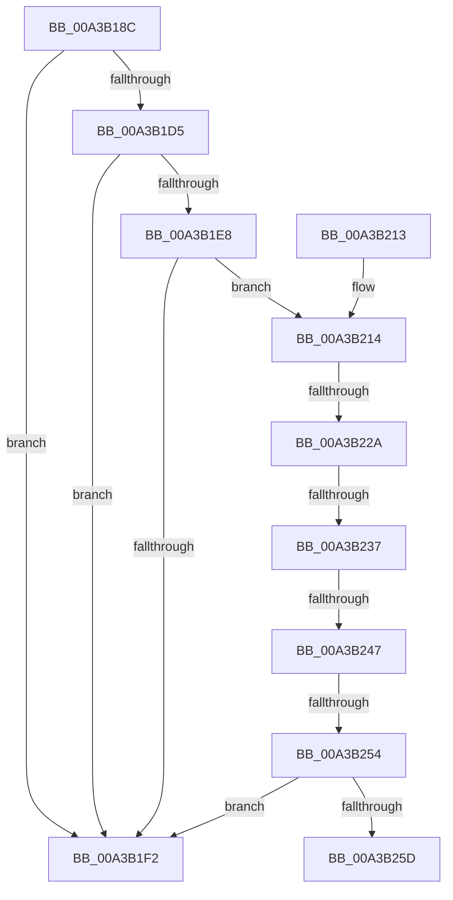

# DbgkUnMapViewOfSection

- RVA: `0x00A3B18C`–`0x00A3B262` (길이 `214` bytes)
- VA: `0x0000000140A3B18C`
- 실행 섹션: `PAGE`
- PDB 이름 있음: `예`; PDB Function 태그: `예`
- unwind 정보 RVA: `0x000AE290`
- 디코드: `43`개 명령, `214/214` bytes 표시
- 미해석 바이트: `0` (있으면 어셈블리에 `.byte`로 보존)

> 이 문서는 커널 이미지의 기계어와 PDB 기호를 분석해 생성했습니다. 4번과 5번은 함수 원형과 자료형을 바이너리 사용 방식에서 추정한 C 해석이며 원본 소스 복구 결과는 아닙니다.

## 1. Dependencies

- 직접 호출 지점: **3**; 고유 호출 대상: **3**
- 직접 호출자로 확인된 함수: **3**
- RIP 상대 이미지 참조: **1**

### Outgoing calls
- `0x00A3B1BE` → [memset](../../text/6C/memset_function_006C6C40.md) (function, `0x006C6C40`)
- `0x00A3B1FD` → [_security_check_cookie](../../text/6A/_security_check_cookie_function_006AC640.md) (function, `0x006AC640`)
- `0x00A3B254` → [DbgkpSuppressDbgMsg](../AC/DbgkpSuppressDbgMsg_function_00AC2700.md) (function, `0x00AC2700`)

### Direct callers
- [MiFreeEnclaveModules](../70/MiFreeEnclaveModules_function_00701B1C.md) at `0x00701B45`
- [sub_00880246](../88/Unknown_function_00880246.md) at `0x00880256`
- [MiUnmapViewOfSection](../88/MiUnmapViewOfSection_function_0088A4C4.md) at `0x0088A65B`

### Static image references
- `0x00A3B199` → RVA `0x00E0A740` (`.data`; read)

## 2. Other-region calls and transfers

- 다른 실행 섹션으로 향하는 call: **2**
  - `0x00A3B1BE` → [memset](../../text/6C/memset_function_006C6C40.md) (`PAGE` → `.text`)
  - `0x00A3B1FD` → [_security_check_cookie](../../text/6A/_security_check_cookie_function_006AC640.md) (`PAGE` → `.text`)
- call이 아닌 외부 분기/꼬리 이동: **5**
  - `0x00A3B224` → [sub_00B3A32E](../B3/Unknown_function_00B3A32E.md) (`tail-transfer`)
  - `0x00A3B231` → [sub_00B3A32E](../B3/Unknown_function_00B3A32E.md) (`tail-transfer`)
  - `0x00A3B241` → [sub_00B3A32E](../B3/Unknown_function_00B3A32E.md) (`tail-transfer`)
  - `0x00A3B24E` → [sub_00B3A32E](../B3/Unknown_function_00B3A32E.md) (`tail-transfer`)
  - `0x00A3B25D` → [sub_00B3A32E](../B3/Unknown_function_00B3A32E.md) (`tail-transfer`)

## 3. Assembly (complete function range)

```asm
00A3B18C  48 89 5C 24 10                  mov qword ptr [rsp + 0x10], rbx
00A3B191  57                              push rdi
00A3B192  48 81 EC 40 01 00 00            sub rsp, 0x140
00A3B199  48 8B 05 A0 F5 3C 00            mov rax, qword ptr [rip + 0x3cf5a0]
00A3B1A0  48 33 C4                        xor rax, rsp
00A3B1A3  48 89 84 24 30 01 00 00         mov qword ptr [rsp + 0x130], rax
00A3B1AB  48 8B FA                        mov rdi, rdx
00A3B1AE  48 8B D9                        mov rbx, rcx
00A3B1B1  33 D2                           xor edx, edx
00A3B1B3  48 8D 4C 24 20                  lea rcx, [rsp + 0x20]
00A3B1B8  41 B8 10 01 00 00               mov r8d, 0x110
00A3B1BE  E8 7D BA C8 FF                  call 0x1406c6c40
00A3B1C3  65 48 8B 04 25 88 01 00 00      mov rax, qword ptr gs:[0x188]
00A3B1CC  80 B8 32 02 00 00 00            cmp byte ptr [rax + 0x232], 0
00A3B1D3  74 1D                           je 0x140a3b1f2
00A3B1D5  65 48 8B 14 25 88 01 00 00      mov rdx, qword ptr gs:[0x188]
00A3B1DE  8B 82 A0 05 00 00               mov eax, dword ptr [rdx + 0x5a0]
00A3B1E4  A8 04                           test al, 4
00A3B1E6  75 0A                           jne 0x140a3b1f2
00A3B1E8  48 83 BB 08 03 00 00 00         cmp qword ptr [rbx + 0x308], 0
00A3B1F0  75 22                           jne 0x140a3b214
00A3B1F2  48 8B 8C 24 30 01 00 00         mov rcx, qword ptr [rsp + 0x130]
00A3B1FA  48 33 CC                        xor rcx, rsp
00A3B1FD  E8 3E 14 C7 FF                  call 0x1406ac640
00A3B202  48 8B 9C 24 58 01 00 00         mov rbx, qword ptr [rsp + 0x158]
00A3B20A  48 81 C4 40 01 00 00            add rsp, 0x140
00A3B211  5F                              pop rdi
00A3B212  C3                              ret
00A3B213  CC                              int3
00A3B214  65 48 8B 0C 25 88 01 00 00      mov rcx, qword ptr gs:[0x188]
00A3B21D  F7 41 74 00 04 00 00            test dword ptr [rcx + 0x74], 0x400
00A3B224  0F 85 04 F1 0F 00               jne 0x140b3a32e
00A3B22A  80 B9 4A 02 00 00 01            cmp byte ptr [rcx + 0x24a], 1
00A3B231  0F 84 F7 F0 0F 00               je 0x140b3a32e
00A3B237  48 8B 89 F0 00 00 00            mov rcx, qword ptr [rcx + 0xf0]
00A3B23E  48 85 C9                        test rcx, rcx
00A3B241  0F 84 E7 F0 0F 00               je 0x140b3a32e
00A3B247  48 3B 9A 20 02 00 00            cmp rbx, qword ptr [rdx + 0x220]
00A3B24E  0F 85 DA F0 0F 00               jne 0x140b3a32e
00A3B254  E8 A7 74 08 00                  call 0x140ac2700
00A3B259  85 C0                           test eax, eax
00A3B25B  75 95                           jne 0x140a3b1f2
00A3B25D  E9 CC F0 0F 00                  jmp 0x140b3a32e
```

## 4. C-style interpretation (structured pseudocode)

```c
__int64 __fastcall DbgkUnMapViewOfSection(__int64 a1, __int64 a2)
{
    __int64 result;
    __int64 v_rsp;
    unsigned __int64 v_stack_m128;
    unsigned __int64 v_stack_m18;
    unsigned __int64 v_stack_p10;

    v_stack_p10 = v_rbx;
    v_rsp = (v_rsp) - (320);
    result = (*(unsigned __int64 *)(v_rip + 3995040)) ^ (v_rsp);
    v_stack_m18 = result;
    a2 = 0;
    result = memset(v_stack_m128, a2, 272, a4);
    if ((*(unsigned __int8 *)(*(unsigned __int64 *)(gs_base + (0 + 392)) + 562)) == 0) goto loc_00A3B1F2;
    if ((((unsigned __int8)((unsigned int)(*(unsigned int *)(*(unsigned __int64 *)(gs_base + (0 + 392)) + 1440)))) & (4)) != 0) goto loc_00A3B1F2;
    if ((*(unsigned __int64 *)(a1 + 776)) != 0) goto loc_00A3B214;
loc_00A3B1F2:
    a1 = (v_stack_m18) ^ (v_rsp);
    result = _security_check_cookie(a1, *(unsigned __int64 *)(gs_base + (0 + 392)), 272, a4);
    v_rsp = (v_rsp) + (320);
    return result;
loc_00A3B214:
    result = DbgkpSuppressDbgMsg(*(unsigned __int64 *)(*(unsigned __int64 *)(gs_base + (0 + 392)) + 240), *(unsigned __int64 *)(gs_base + (0 + 392)), 272, a4);
    if ((unsigned int)(result) != 0) goto loc_00A3B1F2;
}
```

## 5. (Beta) C Style

```c
int64_t DbgkUnMapViewOfSection(void *Arg1, int64_t Arg2)
{
    uint8_t *arg1 = (uint8_t *)Arg1;

    int64_t result;
    int64_t local_rsp;
    uint64_t v_stack_m128;
    uint64_t v_stack_m18;
    uint64_t v_stack_p10;

    v_stack_p10 = local_rbx;
    local_rsp = (local_rsp) - (320);
    result = (*(uint64_t *)(v_rip + 0x3CF5A0)) ^ (local_rsp);
    v_stack_m18 = result;
    Arg2 = 0;
    result = memset(v_stack_m128, Arg2, 272, a4);
    if ((*(uint8_t *)(*(uint64_t *)(gs_base + (0 + 0x188)) + 0x232)) == 0) goto loc_00A3B1F2;
    if ((((uint8_t)((uint32_t)(*(uint32_t *)(*(uint64_t *)(gs_base + (0 + 0x188)) + 0x5A0)))) & (4)) != 0) goto loc_00A3B1F2;
    if ((*(uint64_t *)(arg1 + 0x308)) != 0) goto loc_00A3B214;
loc_00A3B1F2:
    Arg1 = (v_stack_m18) ^ (local_rsp);
    result = _security_check_cookie(Arg1, *(uint64_t *)(gs_base + (0 + 0x188)), 272, a4);
    local_rsp = (local_rsp) + (320);
    return result;
loc_00A3B214:
    result = DbgkpSuppressDbgMsg(*(uint64_t *)(*(uint64_t *)(gs_base + (0 + 0x188)) + 0xF0), *(uint64_t *)(gs_base + (0 + 0x188)), 272, a4);
    if ((uint32_t)(result) != 0) goto loc_00A3B1F2;
}
```

### 관측된 메모리 오프셋

구조체 형식이 확인되지 않은 접근은 인자 기준의 오프셋으로만 기록했습니다.

| 기준 인자 | 오프셋 표현 | 폭 (bit) | 접근 |
|---|---:|---:|---|
| `Arg1` | `+ 0x308` | `64` | `R` |

## 6. Execution-region graph

[열기: 2D/3D 그래프와 함수 탐색 컨트롤 패널](../../../control-panel.html?section=page&rva=0x00A3B18C&view=graph)

- 2D 그래프는 위에서 아래로 흐르고, 3D 그래프는 빈 공간을 드래그해 회전합니다. Shift+드래그는 이동, 휠은 확대·축소, 함수 노드 선택은 대상 보고서 이동입니다.

### Static fallback


