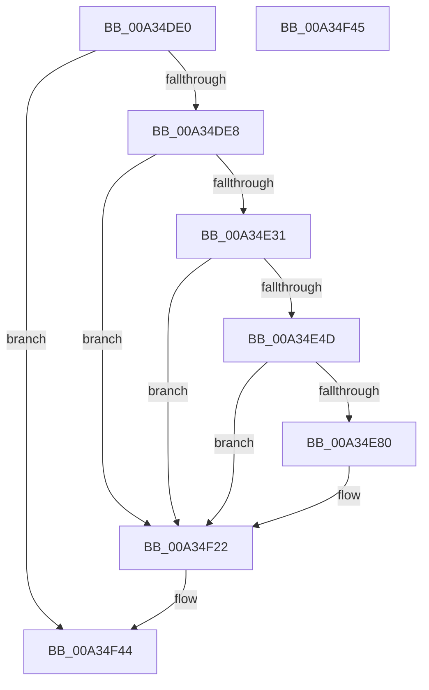

# EtwTiLogSuspendResumeThread

- RVA: `0x00A34DE0`–`0x00A34F46` (길이 `358` bytes)
- VA: `0x0000000140A34DE0`
- 실행 섹션: `PAGE`
- PDB 이름 있음: `예`; PDB Function 태그: `아니요`
- unwind 정보 RVA: `0x000AD654`
- 디코드: `85`개 명령, `358/358` bytes 표시
- 미해석 바이트: `0` (있으면 어셈블리에 `.byte`로 보존)

> 이 문서는 커널 이미지의 기계어와 PDB 기호를 분석해 생성했습니다. 4번과 5번은 함수 원형과 자료형을 바이너리 사용 방식에서 추정한 C 해석이며 원본 소스 복구 결과는 아닙니다.

## 1. Dependencies

- 직접 호출 지점: **8**; 고유 호출 대상: **6**
- 직접 호출자로 확인된 함수: **3**
- RIP 상대 이미지 참조: **4**

### Outgoing calls
- `0x00A34E40` → [EtwProviderEnabled](../../text/3B/EtwProviderEnabled_function_003BA250.md) (function, `0x003BA250`)
- `0x00A34E73` → [EtwEventEnabled](../../text/39/EtwEventEnabled_function_00392450.md) (function, `0x00392450`)
- `0x00A34EA6` → [EtwpTiFillProcessIdentity](../../text/3B/EtwpTiFillProcessIdentity_function_003B8F30.md) (function, `0x003B8F30`)
- `0x00A34EC1` → [EtwpTiFillThreadIdentity](../../text/47/EtwpTiFillThreadIdentity_function_00471C1C.md) (function, `0x00471C1C`)
- `0x00A34EE4` → [EtwpTiFillProcessIdentity](../../text/3B/EtwpTiFillProcessIdentity_function_003B8F30.md) (function, `0x003B8F30`)
- `0x00A34EFE` → [EtwpTiFillThreadIdentity](../../text/47/EtwpTiFillThreadIdentity_function_00471C1C.md) (function, `0x00471C1C`)
- `0x00A34F1D` → [EtwWrite](../../text/41/EtwWrite_function_0041C720.md) (function, `0x0041C720`)
- `0x00A34F29` → [_security_check_cookie](../../text/6A/_security_check_cookie_function_006AC640.md) (function, `0x006AC640`)

### Direct callers
- [PsMultiResumeThread](../../text/20/PsMultiResumeThread_function_002027C4.md) at `0x0020282E`
- [PspSuspendThread](../78/PspSuspendThread_function_00787A0C.md) at `0x00787AEC`
- [PsSuspendThread](../A1/PsSuspendThread_function_00A110D0.md) at `0x00A111B8`

### Static image references
- `0x00A34E04` → RVA `0x00E0A740` (`.data`; read)
- `0x00A34E31` → RVA `0x00EFFA30` (`.data`; read)
- `0x00A34E54` → RVA `0x0001A350` (`.rdata`; read)
- `0x00A34E62` → RVA `0x0001A340` (`.rdata`; read)

## 2. Other-region calls and transfers

- 다른 실행 섹션으로 향하는 call: **8**
  - `0x00A34E40` → [EtwProviderEnabled](../../text/3B/EtwProviderEnabled_function_003BA250.md) (`PAGE` → `.text`)
  - `0x00A34E73` → [EtwEventEnabled](../../text/39/EtwEventEnabled_function_00392450.md) (`PAGE` → `.text`)
  - `0x00A34EA6` → [EtwpTiFillProcessIdentity](../../text/3B/EtwpTiFillProcessIdentity_function_003B8F30.md) (`PAGE` → `.text`)
  - `0x00A34EC1` → [EtwpTiFillThreadIdentity](../../text/47/EtwpTiFillThreadIdentity_function_00471C1C.md) (`PAGE` → `.text`)
  - `0x00A34EE4` → [EtwpTiFillProcessIdentity](../../text/3B/EtwpTiFillProcessIdentity_function_003B8F30.md) (`PAGE` → `.text`)
  - `0x00A34EFE` → [EtwpTiFillThreadIdentity](../../text/47/EtwpTiFillThreadIdentity_function_00471C1C.md) (`PAGE` → `.text`)
  - `0x00A34F1D` → [EtwWrite](../../text/41/EtwWrite_function_0041C720.md) (`PAGE` → `.text`)
  - `0x00A34F29` → [_security_check_cookie](../../text/6A/_security_check_cookie_function_006AC640.md) (`PAGE` → `.text`)
- 별도 외부 분기/꼬리 이동을 확인하지 못했습니다.

## 3. Assembly (complete function range)

```asm
00A34DE0  85 C9                           test ecx, ecx
00A34DE2  0F 88 5C 01 00 00               js 0x140a34f44
00A34DE8  48 89 5C 24 20                  mov qword ptr [rsp + 0x20], rbx
00A34DED  89 4C 24 08                     mov dword ptr [rsp + 8], ecx
00A34DF1  55                              push rbp
00A34DF2  56                              push rsi
00A34DF3  57                              push rdi
00A34DF4  41 56                           push r14
00A34DF6  41 57                           push r15
00A34DF8  48 8D 6C 24 A0                  lea rbp, [rsp - 0x60]
00A34DFD  48 81 EC 60 01 00 00            sub rsp, 0x160
00A34E04  48 8B 05 35 59 3D 00            mov rax, qword ptr [rip + 0x3d5935]
00A34E0B  48 33 C4                        xor rax, rsp
00A34E0E  48 89 45 50                     mov qword ptr [rbp + 0x50], rax
00A34E12  65 48 8B 04 25 88 01 00 00      mov rax, qword ptr gs:[0x188]
00A34E1B  41 8A F1                        mov sil, r9b
00A34E1E  4D 8B F0                        mov r14, r8
00A34E21  48 8B FA                        mov rdi, rdx
00A34E24  80 B8 32 02 00 00 01            cmp byte ptr [rax + 0x232], 1
00A34E2B  0F 85 F1 00 00 00               jne 0x140a34f22
00A34E31  48 8B 0D F8 AB 4C 00            mov rcx, qword ptr [rip + 0x4cabf8]
00A34E38  33 D2                           xor edx, edx
00A34E3A  41 B8 00 00 30 00               mov r8d, 0x300000
00A34E40  E8 0B 54 98 FF                  call 0x1403ba250
00A34E45  84 C0                           test al, al
00A34E47  0F 84 D5 00 00 00               je 0x140a34f22
00A34E4D  48 8B 0D DC AB 4C 00            mov rcx, qword ptr [rip + 0x4cabdc]
00A34E54  48 8D 05 F5 54 5E FF            lea rax, [rip - 0xa1ab0b]
00A34E5B  4C 8B BF 20 02 00 00            mov r15, qword ptr [rdi + 0x220]
00A34E62  48 8D 1D D7 54 5E FF            lea rbx, [rip - 0xa1ab29]
00A34E69  40 84 F6                        test sil, sil
00A34E6C  48 0F 44 D8                     cmove rbx, rax
00A34E70  48 8B D3                        mov rdx, rbx
00A34E73  E8 D8 D5 95 FF                  call 0x140392450
00A34E78  84 C0                           test al, al
00A34E7A  0F 84 A2 00 00 00               je 0x140a34f22
00A34E80  83 64 24 4C 00                  and dword ptr [rsp + 0x4c], 0
00A34E85  48 8D 85 90 00 00 00            lea rax, [rbp + 0x90]
00A34E8C  4C 8D 44 24 30                  lea r8, [rsp + 0x30]
00A34E91  48 89 44 24 40                  mov qword ptr [rsp + 0x40], rax
00A34E96  49 8B D7                        mov rdx, r15
00A34E99  C7 44 24 48 04 00 00 00         mov dword ptr [rsp + 0x48], 4
00A34EA1  48 8D 4C 24 50                  lea rcx, [rsp + 0x50]
00A34EA6  E8 85 40 98 FF                  call 0x1403b8f30
00A34EAB  48 8D 4C 24 40                  lea rcx, [rsp + 0x40]
00A34EB0  48 8B D7                        mov rdx, rdi
00A34EB3  44 8D 48 01                     lea r9d, [rax + 1]
00A34EB7  41 8B C1                        mov eax, r9d
00A34EBA  48 C1 E0 04                     shl rax, 4
00A34EBE  48 03 C8                        add rcx, rax
00A34EC1  E8 56 CD A3 FF                  call 0x140471c1c
00A34EC6  49 8B 96 20 02 00 00            mov rdx, qword ptr [r14 + 0x220]
00A34ECD  48 8D 4C 24 40                  lea rcx, [rsp + 0x40]
00A34ED2  44 03 C8                        add r9d, eax
00A34ED5  4C 8D 44 24 38                  lea r8, [rsp + 0x38]
00A34EDA  41 8B C1                        mov eax, r9d
00A34EDD  48 C1 E0 04                     shl rax, 4
00A34EE1  48 03 C8                        add rcx, rax
00A34EE4  E8 47 40 98 FF                  call 0x1403b8f30
00A34EE9  44 03 C8                        add r9d, eax
00A34EEC  48 8D 4C 24 40                  lea rcx, [rsp + 0x40]
00A34EF1  41 8B C1                        mov eax, r9d
00A34EF4  49 8B D6                        mov rdx, r14
00A34EF7  48 C1 E0 04                     shl rax, 4
00A34EFB  48 03 C8                        add rcx, rax
00A34EFE  E8 19 CD A3 FF                  call 0x140471c1c
00A34F03  48 8B 0D 26 AB 4C 00            mov rcx, qword ptr [rip + 0x4cab26]
00A34F0A  44 03 C8                        add r9d, eax
00A34F0D  48 8D 44 24 40                  lea rax, [rsp + 0x40]
00A34F12  45 33 C0                        xor r8d, r8d
00A34F15  48 8B D3                        mov rdx, rbx
00A34F18  48 89 44 24 20                  mov qword ptr [rsp + 0x20], rax
00A34F1D  E8 FE 77 9E FF                  call 0x14041c720
00A34F22  48 8B 4D 50                     mov rcx, qword ptr [rbp + 0x50]
00A34F26  48 33 CC                        xor rcx, rsp
00A34F29  E8 12 77 C7 FF                  call 0x1406ac640
00A34F2E  48 8B 9C 24 A8 01 00 00         mov rbx, qword ptr [rsp + 0x1a8]
00A34F36  48 81 C4 60 01 00 00            add rsp, 0x160
00A34F3D  41 5F                           pop r15
00A34F3F  41 5E                           pop r14
00A34F41  5F                              pop rdi
00A34F42  5E                              pop rsi
00A34F43  5D                              pop rbp
00A34F44  C3                              ret
00A34F45  CC                              int3
```

## 4. C-style interpretation (structured pseudocode)

```c
__int64 __fastcall EtwTiLogSuspendResumeThread(int a1, __int64 a2, __int64 a3, unsigned __int8 a4)
{
    __int64 result;
    __int64 v_rbx;
    __int64 v_rsp;
    unsigned __int64 v_stack_m138;
    unsigned int v_stack_m13C;
    unsigned int v_stack_m140;
    unsigned __int64 v_stack_m148;
    unsigned __int64 v_stack_m150;
    unsigned __int64 v_stack_m158;
    unsigned __int64 v_stack_m168;
    unsigned __int64 v_stack_m38;
    unsigned __int64 v_stack_m88;
    unsigned __int64 v_stack_p20;
    unsigned int v_stack_p8;

    if (sign_flag) goto loc_00A34F44;
    v_stack_p20 = v_rbx;
    v_stack_p8 = a1;
    v_rsp = (v_rsp) - (352);
    result = (*(unsigned __int64 *)(v_rip + 4020533)) ^ (v_rsp);
    v_stack_m38 = result;
    if ((*(unsigned __int8 *)(*(unsigned __int64 *)(gs_base + (0 + 392)) + 562)) != 1) goto loc_00A34F22;
    a2 = 0;
    result = EtwProviderEnabled(*(unsigned __int64 *)(v_rip + 5024760), a2, (unsigned int)(0x300000ULL), a4);
    if ((unsigned __int8)(result) == 0) goto loc_00A34F22;
    v_rbx = v_rip - 10595113;
    if (a4 == 0) { v_rbx = v_rip - 10595083; }
    result = EtwEventEnabled(*(unsigned __int64 *)(v_rip + 5024732), v_rbx, (unsigned int)(0x300000ULL), a4);
    if ((unsigned __int8)(result) != 0) {
        result = v_stack_p8;
        a3 = v_stack_m158;
        v_stack_m148 = result;
        a2 = *(unsigned __int64 *)(a2 + 544);
        v_stack_m140 = 4;
        a1 = v_stack_m138;
        result = EtwpTiFillProcessIdentity(a1, a2, a3, a4);
        a1 = v_stack_m148;
        a2 = a2;
        a4 = result + 1;
        result = a4;
        result = (result) << (4);
        a1 = (a1) + (result);
        result = EtwpTiFillThreadIdentity(a1, a2, a3, a4);
        a2 = *(unsigned __int64 *)(a3 + 544);
        a1 = v_stack_m148;
        a4 = (unsigned int)((a4) + ((unsigned int)(result)));
        a3 = v_stack_m150;
        result = a4;
        result = (result) << (4);
        a1 = (a1) + (result);
        result = EtwpTiFillProcessIdentity(a1, a2, a3, a4);
        a4 = (unsigned int)((a4) + ((unsigned int)(result)));
        a1 = v_stack_m148;
        result = a4;
        a2 = a3;
        result = (result) << (4);
        a1 = (a1) + (result);
        result = EtwpTiFillThreadIdentity(a1, a2, a3, a4);
        a1 = *(unsigned __int64 *)(v_rip + 5024550);
        a4 = (unsigned int)((a4) + ((unsigned int)(result)));
        result = v_stack_m148;
        a3 = 0;
        a2 = v_rbx;
        v_stack_m168 = result;
        result = EtwWrite(a1, a2, a3, a4);
    }
    a1 = (v_stack_m38) ^ (v_rsp);
    result = _security_check_cookie(a1, a2, a3, a4);
    v_rsp = (v_rsp) + (352);
loc_00A34F44:
    return result;
}
```

## 5. (Beta) C Style

```c
int64_t EtwTiLogSuspendResumeThread(int32_t Arg1, void *Arg2, void *Arg3, uint8_t Arg4)
{
    uint8_t *arg2 = (uint8_t *)Arg2;
    uint8_t *arg3 = (uint8_t *)Arg3;

    int64_t result;
    int64_t local_rbx;
    int64_t local_rsp;
    uint64_t v_stack_m138;
    uint32_t v_stack_m13C;
    uint32_t v_stack_m140;
    uint64_t v_stack_m148;
    uint64_t v_stack_m150;
    uint64_t v_stack_m158;
    uint64_t v_stack_m168;
    uint64_t v_stack_m38;
    uint64_t v_stack_m88;
    uint64_t v_stack_p20;
    uint32_t v_stack_p8;

    if (sign_flag) goto loc_00A34F44;
    v_stack_p20 = local_rbx;
    v_stack_p8 = Arg1;
    local_rsp = (local_rsp) - (352);
    result = (*(uint64_t *)(v_rip + 0x3D5935)) ^ (local_rsp);
    v_stack_m38 = result;
    if ((*(uint8_t *)(*(uint64_t *)(gs_base + (0 + 0x188)) + 0x232)) != 1) goto loc_00A34F22;
    Arg2 = 0;
    result = EtwProviderEnabled(*(uint64_t *)(v_rip + 0x4CABF8), Arg2, (uint32_t)(0x300000ULL), Arg4);
    if ((uint8_t)(result) == 0) goto loc_00A34F22;
    local_rbx = v_rip - 10595113;
    if (Arg4 == 0) { local_rbx = v_rip - 10595083; }
    result = EtwEventEnabled(*(uint64_t *)(v_rip + 0x4CABDC), local_rbx, (uint32_t)(0x300000ULL), Arg4);
    if ((uint8_t)(result) != 0) {
        result = v_stack_p8;
        Arg3 = v_stack_m158;
        v_stack_m148 = result;
        Arg2 = *(uint64_t *)(arg2 + 0x220);
        v_stack_m140 = 4;
        Arg1 = v_stack_m138;
        result = EtwpTiFillProcessIdentity(Arg1, Arg2, Arg3, Arg4);
        Arg1 = v_stack_m148;
        Arg2 = Arg2;
        Arg4 = result + 1;
        result = Arg4;
        result = (result) << (4);
        Arg1 = (Arg1) + (result);
        result = EtwpTiFillThreadIdentity(Arg1, Arg2, Arg3, Arg4);
        Arg2 = *(uint64_t *)(arg3 + 0x220);
        Arg1 = v_stack_m148;
        Arg4 = (uint32_t)((Arg4) + ((uint32_t)(result)));
        Arg3 = v_stack_m150;
        result = Arg4;
        result = (result) << (4);
        Arg1 = (Arg1) + (result);
        result = EtwpTiFillProcessIdentity(Arg1, Arg2, Arg3, Arg4);
        Arg4 = (uint32_t)((Arg4) + ((uint32_t)(result)));
        Arg1 = v_stack_m148;
        result = Arg4;
        Arg2 = Arg3;
        result = (result) << (4);
        Arg1 = (Arg1) + (result);
        result = EtwpTiFillThreadIdentity(Arg1, Arg2, Arg3, Arg4);
        Arg1 = *(uint64_t *)(v_rip + 0x4CAB26);
        Arg4 = (uint32_t)((Arg4) + ((uint32_t)(result)));
        result = v_stack_m148;
        Arg3 = 0;
        Arg2 = local_rbx;
        v_stack_m168 = result;
        result = EtwWrite(Arg1, Arg2, Arg3, Arg4);
    }
    Arg1 = (v_stack_m38) ^ (local_rsp);
    result = _security_check_cookie(Arg1, Arg2, Arg3, Arg4);
    local_rsp = (local_rsp) + (352);
loc_00A34F44:
    return result;
}
```

### 관측된 메모리 오프셋

구조체 형식이 확인되지 않은 접근은 인자 기준의 오프셋으로만 기록했습니다.

| 기준 인자 | 오프셋 표현 | 폭 (bit) | 접근 |
|---|---:|---:|---|
| `Arg2` | `+ 0x220` | `64` | `R` |
| `Arg3` | `+ 0x220` | `64` | `R` |

## 6. Execution-region graph

[열기: 2D/3D 그래프와 함수 탐색 컨트롤 패널](../../../control-panel.html?section=page&rva=0x00A34DE0&view=graph)

- 2D 그래프는 위에서 아래로 흐르고, 3D 그래프는 빈 공간을 드래그해 회전합니다. Shift+드래그는 이동, 휠은 확대·축소, 함수 노드 선택은 대상 보고서 이동입니다.

### Static fallback


