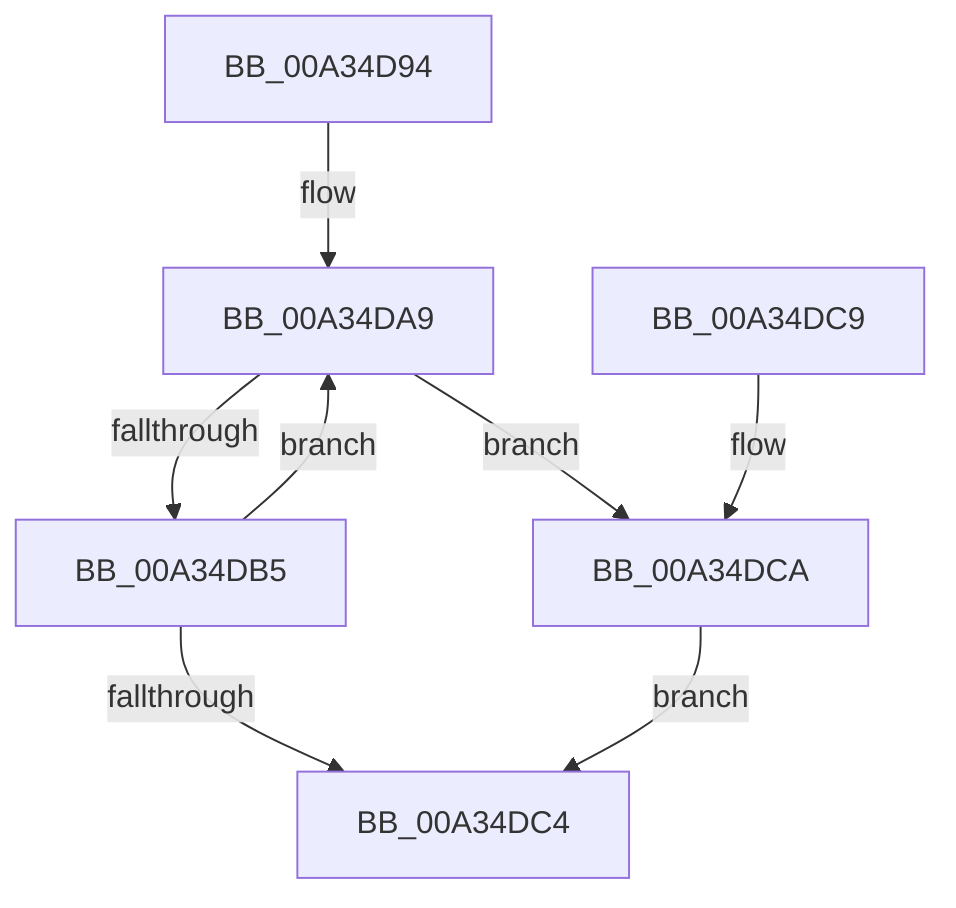

# EtwpDereferenceLoggerSecurityDescriptor

- RVA: `0x00A34D94`–`0x00A34DD9` (길이 `69` bytes)
- VA: `0x0000000140A34D94`
- 실행 섹션: `PAGE`
- PDB 이름 있음: `예`; PDB Function 태그: `아니요`
- unwind 정보 RVA: `0x0005D35C`
- 디코드: `18`개 명령, `69/69` bytes 표시
- 미해석 바이트: `0` (있으면 어셈블리에 `.byte`로 보존)

> 이 문서는 커널 이미지의 기계어와 PDB 기호를 분석해 생성했습니다. 4번과 5번은 함수 원형과 자료형을 바이너리 사용 방식에서 추정한 C 해석이며 원본 소스 복구 결과는 아닙니다.

## 1. Dependencies

- 직접 호출 지점: **1**; 고유 호출 대상: **1**
- 직접 호출자로 확인된 함수: **1**
- RIP 상대 이미지 참조: **0**

### Outgoing calls
- `0x00A34DD2` → [ObDereferenceSecurityDescriptor](../87/ObDereferenceSecurityDescriptor_function_008740A0.md) (function, `0x008740A0`)

### Direct callers
- [EtwQueryPerformanceTraceInformation](../AF/EtwQueryPerformanceTraceInformation_function_00AF28A4.md) at `0x00AF2A30`

### Static image references
- 디코드된 RIP-relative 메모리 참조가 없습니다.

## 2. Other-region calls and transfers

- 다른 실행 섹션으로 향하는 call: **0**
- 별도 외부 분기/꼬리 이동을 확인하지 못했습니다.

## 3. Assembly (complete function range)

```asm
00A34D94  48 83 EC 28                     sub rsp, 0x28
00A34D98  4C 8B CA                        mov r9, rdx
00A34D9B  0F 0D 89 10 03 00 00            prefetchw byte ptr [rcx + 0x310]
00A34DA2  48 8B 81 10 03 00 00            mov rax, qword ptr [rcx + 0x310]
00A34DA9  4C 8B C0                        mov r8, rax
00A34DAC  4D 33 C1                        xor r8, r9
00A34DAF  49 83 F8 0F                     cmp r8, 0xf
00A34DB3  73 15                           jae 0x140a34dca
00A34DB5  48 8D 50 01                     lea rdx, [rax + 1]
00A34DB9  F0 48 0F B1 91 10 03 00 00      lock cmpxchg qword ptr [rcx + 0x310], rdx
00A34DC2  75 E5                           jne 0x140a34da9
00A34DC4  48 83 C4 28                     add rsp, 0x28
00A34DC8  C3                              ret
00A34DC9  CC                              int3
00A34DCA  BA 01 00 00 00                  mov edx, 1
00A34DCF  49 8B C9                        mov rcx, r9
00A34DD2  E8 C9 F2 E3 FF                  call 0x1408740a0
00A34DD7  EB EB                           jmp 0x140a34dc4
```

## 4. C-style interpretation (structured pseudocode)

```c
__int64 __fastcall EtwpDereferenceLoggerSecurityDescriptor(__int64 a1, __int64 a2)
{
    __int64 result;
    __int64 v_rsp;

    v_rsp = (v_rsp) - (40);
loc_00A34DA9:
    a3 = (*(unsigned __int64 *)(a1 + 784)) ^ (a2);
    if (a3 >= 15) goto loc_00A34DCA;
    if (a3 != 15) goto loc_00A34DA9;
loc_00A34DC4:
    v_rsp = (v_rsp) + (40);
    return *(unsigned __int64 *)(a1 + 784);
loc_00A34DCA:
    result = ObDereferenceSecurityDescriptor(a2, 1, a3, a2);
    goto loc_00A34DC4;
}
```

## 5. (Beta) C Style

```c
int64_t EtwpDereferenceLoggerSecurityDescriptor(void *Arg1, int64_t Arg2)
{
    uint8_t *arg1 = (uint8_t *)Arg1;

    int64_t result;
    int64_t local_rsp;

    local_rsp = (local_rsp) - (40);
loc_00A34DA9:
    a3 = (*(uint64_t *)(arg1 + 0x310)) ^ (Arg2);
    if (a3 >= 15) goto loc_00A34DCA;
    if (a3 != 15) goto loc_00A34DA9;
loc_00A34DC4:
    local_rsp = (local_rsp) + (40);
    return *(uint64_t *)(arg1 + 0x310);
loc_00A34DCA:
    result = ObDereferenceSecurityDescriptor(Arg2, 1, a3, Arg2);
    goto loc_00A34DC4;
}
```

### 관측된 메모리 오프셋

구조체 형식이 확인되지 않은 접근은 인자 기준의 오프셋으로만 기록했습니다.

| 기준 인자 | 오프셋 표현 | 폭 (bit) | 접근 |
|---|---:|---:|---|
| `Arg1` | `+ 0x310` | `8` | `R` |
| `Arg1` | `+ 0x310` | `64` | `R` |

## 6. Execution-region graph

[열기: 2D/3D 그래프와 함수 탐색 컨트롤 패널](../../../control-panel.html?section=page&rva=0x00A34D94&view=graph)

- 2D 그래프는 위에서 아래로 흐르고, 3D 그래프는 빈 공간을 드래그해 회전합니다. Shift+드래그는 이동, 휠은 확대·축소, 함수 노드 선택은 대상 보고서 이동입니다.

### Static fallback


