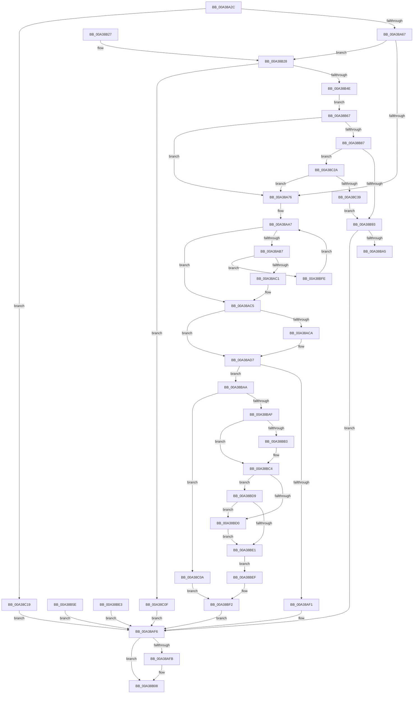

# ExpGetSystemFirmwareTableInformation

- RVA: `0x00A38A2C`–`0x00A38C3E` (길이 `530` bytes)
- VA: `0x0000000140A38A2C`
- 실행 섹션: `PAGE`
- PDB 이름 있음: `예`; PDB Function 태그: `예`
- unwind 정보 RVA: `0x000ADDDC`
- 디코드: `141`개 명령, `530/530` bytes 표시
- 미해석 바이트: `0` (있으면 어셈블리에 `.byte`로 보존)

> 이 문서는 커널 이미지의 기계어와 PDB 기호를 분석해 생성했습니다. 4번과 5번은 함수 원형과 자료형을 바이너리 사용 방식에서 추정한 C 해석이며 원본 소스 복구 결과는 아닙니다.

## 1. Dependencies

- 직접 호출 지점: **11**; 고유 호출 대상: **10**
- 직접 호출자로 확인된 함수: **5**
- RIP 상대 이미지 참조: **4**

### Outgoing calls
- `0x00A38A94` → [ExAcquireResourceSharedLite](../../text/21/ExAcquireResourceSharedLite_function_00211BC0.md) (function, `0x00211BC0`)
- `0x00A38AD0` → [guard_dispatch_icall](../../text/6B/guard_dispatch_icall_function_006BAAD0.md) (function, `0x006BAAD0`)
- `0x00A38ADE` → [ExReleaseResourceLite](../../text/25/ExReleaseResourceLite_function_0025FA10.md) (function, `0x0025FA10`)
- `0x00A38AE3` → [KeLeaveCriticalRegion](../../text/25/KeLeaveCriticalRegion_function_0025D8B0.md) (function, `0x0025D8B0`)
- `0x00A38B03` → [ExFreePoolWithTag](../../poolcode/B8/ExFreePoolWithTag_function_00B82870.md) (function, `0x00B82870`)
- `0x00A38B12` → [_security_check_cookie](../../text/6A/_security_check_cookie_function_006AC640.md) (function, `0x006AC640`)
- `0x00A38B38` → [ExAllocatePool2](../../poolcode/B8/ExAllocatePool2_function_00B820F0.md) (function, `0x00B820F0`)
- `0x00A38B57` → [memcpy](../../text/6C/memcpy_function_006C6840.md) (function, `0x006C6840`)
- `0x00A38B7A` → [PsIsProcessAppContainer](PsIsProcessAppContainer_function_00A38C44.md) (function, `0x00A38C44`)
- `0x00A38BBF` → [memcpy](../../text/6C/memcpy_function_006C6840.md) (function, `0x006C6840`)
- `0x00A38C2C` → [ExpFirmwareAccessAppContainerCheck](../AB/ExpFirmwareAccessAppContainerCheck_function_00AB7AFC.md) (function, `0x00AB7AFC`)

### Direct callers
- [ExEnumerateSystemFirmwareTables](../7C/ExEnumerateSystemFirmwareTables_function_007C3830.md) at `0x007C38A5`
- [ExGetSystemFirmwareTable](../7C/ExGetSystemFirmwareTable_function_007C3920.md) at `0x007C3998`
- [ExpGetSystemPlatformBinary](../7C/ExpGetSystemPlatformBinary_function_007C3C18.md) at `0x007C3DB5`
- [ExpGetSystemPlatformBinary](../7C/ExpGetSystemPlatformBinary_function_007C3C18.md) at `0x007C3E29`
- [ExpQuerySystemInformation](../A5/ExpQuerySystemInformation_function_00A57858.md) at `0x00A58D86`
- [sub_00B3D4BC](../B3/Unknown_function_00B3D4BC.md) at `0x00B3D4ED`
- [sub_00B3D4BC](../B3/Unknown_function_00B3D4BC.md) at `0x00B3D542`

### Static image references
- `0x00A38A3C` → RVA `0x00E0A740` (`.data`; read)
- `0x00A38A8D` → RVA `0x00EFF0A0` (`.data`; read)
- `0x00A38A9C` → RVA `0x00EFF080` (`.data`; read)
- `0x00A38B98` → RVA `0x00E06ED8` (`.data`; read)

## 2. Other-region calls and transfers

- 다른 실행 섹션으로 향하는 call: **9**
  - `0x00A38A94` → [ExAcquireResourceSharedLite](../../text/21/ExAcquireResourceSharedLite_function_00211BC0.md) (`PAGE` → `.text`)
  - `0x00A38AD0` → [guard_dispatch_icall](../../text/6B/guard_dispatch_icall_function_006BAAD0.md) (`PAGE` → `.text`)
  - `0x00A38ADE` → [ExReleaseResourceLite](../../text/25/ExReleaseResourceLite_function_0025FA10.md) (`PAGE` → `.text`)
  - `0x00A38AE3` → [KeLeaveCriticalRegion](../../text/25/KeLeaveCriticalRegion_function_0025D8B0.md) (`PAGE` → `.text`)
  - `0x00A38B03` → [ExFreePoolWithTag](../../poolcode/B8/ExFreePoolWithTag_function_00B82870.md) (`PAGE` → `POOLCODE`)
  - `0x00A38B12` → [_security_check_cookie](../../text/6A/_security_check_cookie_function_006AC640.md) (`PAGE` → `.text`)
  - `0x00A38B38` → [ExAllocatePool2](../../poolcode/B8/ExAllocatePool2_function_00B820F0.md) (`PAGE` → `POOLCODE`)
  - `0x00A38B57` → [memcpy](../../text/6C/memcpy_function_006C6840.md) (`PAGE` → `.text`)
  - `0x00A38BBF` → [memcpy](../../text/6C/memcpy_function_006C6840.md) (`PAGE` → `.text`)
- call이 아닌 외부 분기/꼬리 이동: **1**
  - `0x00A38BA5` → [sub_00B3A22E](../B3/Unknown_function_00B3A22E.md) (`tail-transfer`)

## 3. Assembly (complete function range)

```asm
00A38A2C  40 53                           push rbx
00A38A2E  56                              push rsi
00A38A2F  57                              push rdi
00A38A30  41 54                           push r12
00A38A32  41 55                           push r13
00A38A34  41 56                           push r14
00A38A36  41 57                           push r15
00A38A38  48 83 EC 70                     sub rsp, 0x70
00A38A3C  48 8B 05 FD 1C 3D 00            mov rax, qword ptr [rip + 0x3d1cfd]
00A38A43  48 33 C4                        xor rax, rsp
00A38A46  48 89 44 24 68                  mov qword ptr [rsp + 0x68], rax
00A38A4B  4D 8B E1                        mov r12, r9
00A38A4E  44 8A EA                        mov r13b, dl
00A38A51  4C 8B F9                        mov r15, rcx
00A38A54  33 FF                           xor edi, edi
00A38A56  33 DB                           xor ebx, ebx
00A38A58  48 89 5C 24 30                  mov qword ptr [rsp + 0x30], rbx
00A38A5D  41 83 F8 10                     cmp r8d, 0x10
00A38A61  0F 82 B2 01 00 00               jb 0x140a38c19
00A38A67  48 8B F1                        mov rsi, rcx
00A38A6A  45 8D 70 F0                     lea r14d, [r8 - 0x10]
00A38A6E  84 D2                           test dl, dl
00A38A70  0F 85 B2 00 00 00               jne 0x140a38b28
00A38A76  44 89 76 0C                     mov dword ptr [rsi + 0xc], r14d
00A38A7A  65 48 8B 04 25 88 01 00 00      mov rax, qword ptr gs:[0x188]
00A38A83  66 FF 88 E4 01 00 00            dec word ptr [rax + 0x1e4]
00A38A8A  90                              nop
00A38A8B  B2 01                           mov dl, 1
00A38A8D  48 8D 0D 0C 66 4C 00            lea rcx, [rip + 0x4c660c]
00A38A94  E8 27 91 7D FF                  call 0x140211bc0
00A38A99  45 33 F6                        xor r14d, r14d
00A38A9C  48 8B 0D DD 65 4C 00            mov rcx, qword ptr [rip + 0x4c65dd]
00A38AA3  48 83 C1 E8                     add rcx, -0x18
00A38AA7  48 8D 51 18                     lea rdx, [rcx + 0x18]
00A38AAB  48 8D 05 CE 65 4C 00            lea rax, [rip + 0x4c65ce]
00A38AB2  48 3B C2                        cmp rax, rdx
00A38AB5  74 0E                           je 0x140a38ac5
00A38AB7  8B 06                           mov eax, dword ptr [rsi]
00A38AB9  39 01                           cmp dword ptr [rcx], eax
00A38ABB  0F 85 3D 01 00 00               jne 0x140a38bfe
00A38AC1  4C 8B 71 08                     mov r14, qword ptr [rcx + 8]
00A38AC5  4D 85 F6                        test r14, r14
00A38AC8  74 0D                           je 0x140a38ad7
00A38ACA  48 8B CE                        mov rcx, rsi
00A38ACD  49 8B C6                        mov rax, r14
00A38AD0  E8 FB 1F C8 FF                  call 0x1406baad0
00A38AD5  8B F8                           mov edi, eax
00A38AD7  48 8D 0D C2 65 4C 00            lea rcx, [rip + 0x4c65c2]
00A38ADE  E8 2D 6F 82 FF                  call 0x14025fa10
00A38AE3  E8 C8 4D 82 FF                  call 0x14025d8b0
00A38AE8  4D 85 F6                        test r14, r14
00A38AEB  0F 85 B9 00 00 00               jne 0x140a38baa
00A38AF1  BF 02 00 00 C0                  mov edi, 0xc0000002
00A38AF6  48 85 DB                        test rbx, rbx
00A38AF9  74 0D                           je 0x140a38b08
00A38AFB  BA 41 52 46 54                  mov edx, 0x54465241
00A38B00  48 8B CB                        mov rcx, rbx
00A38B03  E8 68 9D 14 00                  call 0x140b82870
00A38B08  8B C7                           mov eax, edi
00A38B0A  48 8B 4C 24 68                  mov rcx, qword ptr [rsp + 0x68]
00A38B0F  48 33 CC                        xor rcx, rsp
00A38B12  E8 29 3B C7 FF                  call 0x1406ac640
00A38B17  48 83 C4 70                     add rsp, 0x70
00A38B1B  41 5F                           pop r15
00A38B1D  41 5E                           pop r14
00A38B1F  41 5D                           pop r13
00A38B21  41 5C                           pop r12
00A38B23  5F                              pop rdi
00A38B24  5E                              pop rsi
00A38B25  5B                              pop rbx
00A38B26  C3                              ret
00A38B27  CC                              int3
00A38B28  41 8B F0                        mov esi, r8d
00A38B2B  41 B8 41 52 46 54               mov r8d, 0x54465241
00A38B31  8B D6                           mov edx, esi
00A38B33  B9 01 01 00 00                  mov ecx, 0x101
00A38B38  E8 B3 95 14 00                  call 0x140b820f0
00A38B3D  48 8B D8                        mov rbx, rax
00A38B40  48 89 44 24 30                  mov qword ptr [rsp + 0x30], rax
00A38B45  48 85 C0                        test rax, rax
00A38B48  0F 84 C1 00 00 00               je 0x140a38c0f
00A38B4E  44 8B C6                        mov r8d, esi
00A38B51  49 8B D7                        mov rdx, r15
00A38B54  48 8B C8                        mov rcx, rax
00A38B57  E8 E4 DC C8 FF                  call 0x1406c6840
00A38B5C  EB 09                           jmp 0x140a38b67
00A38B5E  8B F8                           mov edi, eax
00A38B60  48 8B 5C 24 30                  mov rbx, qword ptr [rsp + 0x30]
00A38B65  EB 8F                           jmp 0x140a38af6
00A38B67  48 8B F3                        mov rsi, rbx
00A38B6A  65 48 8B 04 25 88 01 00 00      mov rax, qword ptr gs:[0x188]
00A38B73  48 8B 88 B8 00 00 00            mov rcx, qword ptr [rax + 0xb8]
00A38B7A  E8 C5 00 00 00                  call 0x140a38c44
00A38B7F  84 C0                           test al, al
00A38B81  0F 84 EF FE FF FF               je 0x140a38a76
00A38B87  81 3B 42 4D 53 52               cmp dword ptr [rbx], 0x52534d42
00A38B8D  0F 84 97 00 00 00               je 0x140a38c2a
00A38B93  BF 22 00 00 C0                  mov edi, 0xc0000022
00A38B98  83 3D 39 E3 3C 00 05            cmp dword ptr [rip + 0x3ce339], 5
00A38B9F  0F 86 51 FF FF FF               jbe 0x140a38af6
00A38BA5  E9 84 16 10 00                  jmp 0x140b3a22e
00A38BAA  45 84 ED                        test r13b, r13b
00A38BAD  74 5B                           je 0x140a38c0a
00A38BAF  85 FF                           test edi, edi
00A38BB1  78 11                           js 0x140a38bc4
00A38BB3  44 8B 43 0C                     mov r8d, dword ptr [rbx + 0xc]
00A38BB7  48 8D 53 10                     lea rdx, [rbx + 0x10]
00A38BBB  49 8D 4F 10                     lea rcx, [r15 + 0x10]
00A38BBF  E8 7C DC C8 FF                  call 0x1406c6840
00A38BC4  B9 00 00 00 80                  mov ecx, 0x80000000
00A38BC9  8D 04 0F                        lea eax, [rdi + rcx]
00A38BCC  85 C1                           test ecx, eax
00A38BCE  74 09                           je 0x140a38bd9
00A38BD0  8B 43 0C                        mov eax, dword ptr [rbx + 0xc]
00A38BD3  41 89 47 0C                     mov dword ptr [r15 + 0xc], eax
00A38BD7  EB 08                           jmp 0x140a38be1
00A38BD9  81 FF 23 00 00 C0               cmp edi, 0xc0000023
00A38BDF  74 EF                           je 0x140a38bd0
00A38BE1  EB 0C                           jmp 0x140a38bef
00A38BE3  8B F8                           mov edi, eax
00A38BE5  48 8B 5C 24 30                  mov rbx, qword ptr [rsp + 0x30]
00A38BEA  E9 07 FF FF FF                  jmp 0x140a38af6
00A38BEF  8B 43 0C                        mov eax, dword ptr [rbx + 0xc]
00A38BF2  83 C0 10                        add eax, 0x10
00A38BF5  41 89 04 24                     mov dword ptr [r12], eax
00A38BF9  E9 F8 FE FF FF                  jmp 0x140a38af6
00A38BFE  48 8B 0A                        mov rcx, qword ptr [rdx]
00A38C01  48 83 E9 18                     sub rcx, 0x18
00A38C05  E9 9D FE FF FF                  jmp 0x140a38aa7
00A38C0A  8B 46 0C                        mov eax, dword ptr [rsi + 0xc]
00A38C0D  EB E3                           jmp 0x140a38bf2
00A38C0F  BF 9A 00 00 C0                  mov edi, 0xc000009a
00A38C14  E9 DD FE FF FF                  jmp 0x140a38af6
00A38C19  41 C7 01 10 00 00 00            mov dword ptr [r9], 0x10
00A38C20  BF 04 00 00 C0                  mov edi, 0xc0000004
00A38C25  E9 CC FE FF FF                  jmp 0x140a38af6
00A38C2A  33 C9                           xor ecx, ecx
00A38C2C  E8 CB EE 07 00                  call 0x140ab7afc
00A38C31  84 C0                           test al, al
00A38C33  0F 85 3D FE FF FF               jne 0x140a38a76
00A38C39  E9 55 FF FF FF                  jmp 0x140a38b93
```

## 4. C-style interpretation (structured pseudocode)

```c
__int64 __fastcall ExpGetSystemFirmwareTableInformation(__int64 a1, unsigned __int8 a2, __int64 a3, __int64 a4)
{
    __int64 result;
    __int64 v_r14;
    __int64 v_rbx;
    __int64 v_rdi;
    __int64 v_rsp;
    unsigned __int64 v_stack_m40;
    unsigned __int64 v_stack_m78;
    unsigned __int64 v_stack_p30;

    v_rsp = (v_rsp) - (112);
    result = (*(unsigned __int64 *)(v_rip + 4005117)) ^ (v_rsp);
    v_stack_m40 = result;
    v_rdi = 0;
    v_rbx = 0;
    v_stack_m78 = 0;
    if (((unsigned int)(a3)) < 16) goto loc_00A38C19;
    if (a2 != 0) goto loc_00A38B28;
loc_00A38A76:
    *(unsigned int *)(a1 + 12) = (unsigned int)(a3 - 16);
    result = ExAcquireResourceSharedLite(v_rip + 5006860, 1, a3, a4);
    v_r14 = 0;
    a1 = (*(unsigned __int64 *)(v_rip + 5006813)) + (-24);
loc_00A38AA7:
    if ((v_rip + 5006798) == (a1 + 24)) goto loc_00A38AC5;
    if ((*(unsigned int *)(a1)) != ((unsigned int)((unsigned int)(*(unsigned int *)(a1))))) goto loc_00A38BFE;
loc_00A38AC5:
    result = (unsigned int)(*(unsigned int *)(a1));
    if (*(unsigned __int64 *)(a1 + 8) != 0) {
        a1 = a1;
        result = *(unsigned __int64 *)(a1 + 8);
        result = guard_dispatch_icall(a1, a1 + 24, a3, a4);
        v_rdi = (unsigned int)(result);
    }
    result = ExReleaseResourceLite(v_rip + 5006786, a1 + 24, a3, a4);
    result = KeLeaveCriticalRegion(v_rip + 5006786, a1 + 24, a3, a4);
    if (*(unsigned __int64 *)(a1 + 8) != 0) goto loc_00A38BAA;
loc_00A38AF6:
    if (0 != 0) {
        a2 = 0x54465241ULL;
        a1 = 0;
        result = ExFreePoolWithTag(a1, a2, a3, a4);
    }
    a1 = (v_stack_m40) ^ (v_rsp);
    result = _security_check_cookie(a1, a2, a3, a4);
    v_rsp = (v_rsp) + (112);
    return result;
loc_00A38B28:
    result = ExAllocatePool2(257, (unsigned int)((unsigned int)((unsigned int)((unsigned int)(a3)))), (unsigned int)(0x54465241ULL), a4);
    v_stack_p30 = result;
    if (result == 0) goto loc_00A38C0F;
    result = memcpy(result, a1, (unsigned int)((unsigned int)((unsigned int)((unsigned int)(a3)))), a4);
    goto loc_00A38B67;
loc_00A38B67:
    result = PsIsProcessAppContainer(*(unsigned __int64 *)(*(unsigned __int64 *)(gs_base + (0 + 392)) + 184), a1, (unsigned int)((unsigned int)((unsigned int)((unsigned int)(a3)))), a4);
    if ((unsigned __int8)(result) == 0) goto loc_00A38A76;
    if ((*(unsigned int *)(result)) == 0x52534D42ULL) goto loc_00A38C2A;
loc_00A38B93:
    if ((*(unsigned int *)(v_rip + 3990329)) <= 5) goto loc_00A38AF6;
loc_00A38BAA:
    if (a2 == 0) goto loc_00A38C0A;
    if (!(sign_flag)) {
        a3 = *(unsigned int *)(result + 12);
        a2 = result + 16;
        a1 = a1 + 16;
        result = memcpy(a1, a2, a3, a4);
    }
    if ((((unsigned int)((unsigned int)(0x80000000ULL))) & ((unsigned int)((unsigned int)(0xC0000022ULL) + (unsigned int)(0x80000000ULL) * 1))) == 0) goto loc_00A38BD9;
loc_00A38BD0:
    *(unsigned int *)(a1 + 12) = (unsigned int)((unsigned int)(*(unsigned int *)(result + 12)));
    goto loc_00A38BE1;
loc_00A38BD9:
    if (((unsigned int)((unsigned int)(0xC0000022ULL))) == 0xC0000023ULL) goto loc_00A38BD0;
loc_00A38BE1:
    goto loc_00A38BEF;
loc_00A38BEF:
loc_00A38BF2:
    result = (unsigned int)(((unsigned int)(*(unsigned int *)(result + 12))) + (16));
    *(unsigned int *)(a4) = (unsigned int)(result);
    goto loc_00A38AF6;
loc_00A38BFE:
    a1 = (*(unsigned __int64 *)(a2)) - (24);
    goto loc_00A38AA7;
loc_00A38C0A:
    goto loc_00A38BF2;
loc_00A38C0F:
    goto loc_00A38AF6;
loc_00A38C19:
    *(unsigned int *)(a4) = 16;
    goto loc_00A38AF6;
loc_00A38C2A:
    a1 = 0;
    result = ExpFirmwareAccessAppContainerCheck(a1, a2, a3, a4);
    if ((unsigned __int8)(result) != 0) goto loc_00A38A76;
    goto loc_00A38B93;
}
```

## 5. (Beta) C Style

```c
int64_t ExpGetSystemFirmwareTableInformation(void *Arg1, uint8_t Arg2, int64_t Arg3, void *Arg4)
{
    uint8_t *arg1 = (uint8_t *)Arg1;
    uint8_t *arg4 = (uint8_t *)Arg4;

    int64_t result;
    int64_t local_r14;
    int64_t local_rbx;
    int64_t local_rdi;
    int64_t local_rsp;
    uint64_t v_stack_m40;
    uint64_t v_stack_m78;
    uint64_t v_stack_p30;

    local_rsp = (local_rsp) - (112);
    result = (*(uint64_t *)(v_rip + 0x3D1CFD)) ^ (local_rsp);
    v_stack_m40 = result;
    local_rdi = 0;
    local_rbx = 0;
    v_stack_m78 = 0;
    if (((uint32_t)(Arg3)) < 16) goto loc_00A38C19;
    if (Arg2 != 0) goto loc_00A38B28;
loc_00A38A76:
    *(uint32_t *)(arg1 + 0xC) = (uint32_t)(Arg3 - 16);
    result = ExAcquireResourceSharedLite(v_rip + 5006860, 1, Arg3, Arg4);
    local_r14 = 0;
    Arg1 = (*(uint64_t *)(v_rip + 0x4C65DD)) + (-24);
loc_00A38AA7:
    if ((v_rip + 5006798) == (Arg1 + 24)) goto loc_00A38AC5;
    if ((*(uint32_t *)(arg1)) != ((uint32_t)((uint32_t)(*(uint32_t *)(arg1))))) goto loc_00A38BFE;
loc_00A38AC5:
    result = (uint32_t)(*(uint32_t *)(arg1));
    if (*(uint64_t *)(arg1 + 0x8) != 0) {
        Arg1 = Arg1;
        result = *(uint64_t *)(arg1 + 0x8);
        result = guard_dispatch_icall(Arg1, Arg1 + 24, Arg3, Arg4);
        local_rdi = (uint32_t)(result);
    }
    result = ExReleaseResourceLite(v_rip + 5006786, Arg1 + 24, Arg3, Arg4);
    result = KeLeaveCriticalRegion(v_rip + 5006786, Arg1 + 24, Arg3, Arg4);
    if (*(uint64_t *)(arg1 + 0x8) != 0) goto loc_00A38BAA;
loc_00A38AF6:
    if (0 != 0) {
        Arg2 = 0x54465241ULL;
        Arg1 = 0;
        result = ExFreePoolWithTag(Arg1, Arg2, Arg3, Arg4);
    }
    Arg1 = (v_stack_m40) ^ (local_rsp);
    result = _security_check_cookie(Arg1, Arg2, Arg3, Arg4);
    local_rsp = (local_rsp) + (112);
    return result;
loc_00A38B28:
    result = ExAllocatePool2(257, (uint32_t)((uint32_t)((uint32_t)((uint32_t)(Arg3)))), (uint32_t)(0x54465241ULL), Arg4);
    v_stack_p30 = result;
    if (result == 0) goto loc_00A38C0F;
    result = memcpy(result, Arg1, (uint32_t)((uint32_t)((uint32_t)((uint32_t)(Arg3)))), Arg4);
    goto loc_00A38B67;
loc_00A38B67:
    result = PsIsProcessAppContainer(*(uint64_t *)(*(uint64_t *)(gs_base + (0 + 0x188)) + 0xB8), Arg1, (uint32_t)((uint32_t)((uint32_t)((uint32_t)(Arg3)))), Arg4);
    if ((uint8_t)(result) == 0) goto loc_00A38A76;
    if ((*(uint32_t *)(result)) == 0x52534D42ULL) goto loc_00A38C2A;
loc_00A38B93:
    if ((*(uint32_t *)(v_rip + 0x3CE339)) <= 5) goto loc_00A38AF6;
loc_00A38BAA:
    if (Arg2 == 0) goto loc_00A38C0A;
    if (!(sign_flag)) {
        Arg3 = *(uint32_t *)(result + 0xC);
        Arg2 = result + 16;
        Arg1 = Arg1 + 16;
        result = memcpy(Arg1, Arg2, Arg3, Arg4);
    }
    if ((((uint32_t)((uint32_t)(0x80000000ULL))) & ((uint32_t)((uint32_t)(0xC0000022ULL) + (uint32_t)(0x80000000ULL) * 1))) == 0) goto loc_00A38BD9;
loc_00A38BD0:
    *(uint32_t *)(arg1 + 0xC) = (uint32_t)((uint32_t)(*(uint32_t *)(result + 0xC)));
    goto loc_00A38BE1;
loc_00A38BD9:
    if (((uint32_t)((uint32_t)(0xC0000022ULL))) == 0xC0000023ULL) goto loc_00A38BD0;
loc_00A38BE1:
    goto loc_00A38BEF;
loc_00A38BEF:
loc_00A38BF2:
    result = (uint32_t)(((uint32_t)(*(uint32_t *)(result + 0xC))) + (16));
    *(uint32_t *)(arg4) = (uint32_t)(result);
    goto loc_00A38AF6;
loc_00A38BFE:
    Arg1 = (*(uint64_t *)(Arg2)) - (24);
    goto loc_00A38AA7;
loc_00A38C0A:
    goto loc_00A38BF2;
loc_00A38C0F:
    goto loc_00A38AF6;
loc_00A38C19:
    *(uint32_t *)(arg4) = 16;
    goto loc_00A38AF6;
loc_00A38C2A:
    Arg1 = 0;
    result = ExpFirmwareAccessAppContainerCheck(Arg1, Arg2, Arg3, Arg4);
    if ((uint8_t)(result) != 0) goto loc_00A38A76;
    goto loc_00A38B93;
}
```

### 관측된 메모리 오프셋

구조체 형식이 확인되지 않은 접근은 인자 기준의 오프셋으로만 기록했습니다.

| 기준 인자 | 오프셋 표현 | 폭 (bit) | 접근 |
|---|---:|---:|---|
| `Arg1` | `+ 0xC` | `32` | `W` |
| `Arg1` | `+ 0x10` | `64` | `R` |
| `Arg4` | `+ 0x0` | `32` | `W` |

## 6. Execution-region graph

[열기: 2D/3D 그래프와 함수 탐색 컨트롤 패널](../../../control-panel.html?section=page&rva=0x00A38A2C&view=graph)

- 2D 그래프는 위에서 아래로 흐르고, 3D 그래프는 빈 공간을 드래그해 회전합니다. Shift+드래그는 이동, 휠은 확대·축소, 함수 노드 선택은 대상 보고서 이동입니다.

### Static fallback


