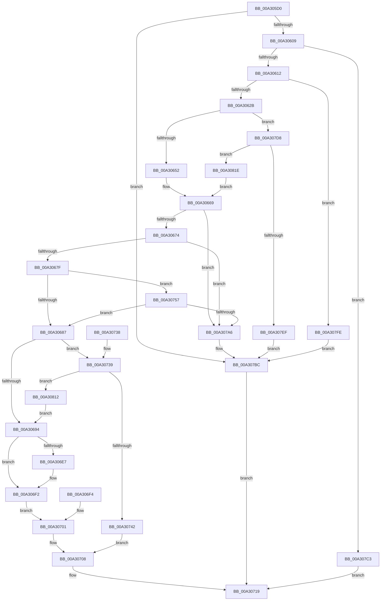

# FsRtlCopyRead

- RVA: `0x00A305D0`–`0x00A30826` (길이 `598` bytes)
- VA: `0x0000000140A305D0`
- 실행 섹션: `PAGE`
- PDB 이름 있음: `예`; PDB Function 태그: `아니요`
- unwind 정보 RVA: `0x000ACF40`
- 디코드: `143`개 명령, `598/598` bytes 표시
- 미해석 바이트: `0` (있으면 어셈블리에 `.byte`로 보존)

> 이 문서는 커널 이미지의 기계어와 PDB 기호를 분석해 생성했습니다. 4번과 5번은 함수 원형과 자료형을 바이너리 사용 방식에서 추정한 C 해석이며 원본 소스 복구 결과는 아닙니다.

## 1. Dependencies

- 직접 호출 지점: **12**; 고유 호출 대상: **7**
- 직접 호출자로 확인된 함수: **0**
- RIP 상대 이미지 참조: **0**

### Outgoing calls
- `0x00A305F9` → [IoGetTopLevelIrp](../../text/41/IoGetTopLevelIrp_function_0041D910.md) (function, `0x0041D910`)
- `0x00A30664` → [ExAcquireResourceSharedLite](../../text/21/ExAcquireResourceSharedLite_function_00211BC0.md) (function, `0x00211BC0`)
- `0x00A30699` → [IoSetTopLevelIrp](../../text/42/IoSetTopLevelIrp_function_0042A7D0.md) (function, `0x0042A7D0`)
- `0x00A306CB` → [CcCopyReadEx](../../text/45/CcCopyReadEx_function_0045E160.md) (function, `0x0045E160`)
- `0x00A30703` → [IoSetTopLevelIrp](../../text/42/IoSetTopLevelIrp_function_0042A7D0.md) (function, `0x0042A7D0`)
- `0x00A3070C` → [ExReleaseResourceLite](../../text/25/ExReleaseResourceLite_function_0025FA10.md) (function, `0x0025FA10`)
- `0x00A30711` → [KeLeaveCriticalRegion](../../text/25/KeLeaveCriticalRegion_function_0025D8B0.md) (function, `0x0025D8B0`)
- `0x00A30799` → [guard_dispatch_icall](../../text/6B/guard_dispatch_icall_function_006BAAD0.md) (function, `0x006BAAD0`)
- `0x00A307AA` → [ExReleaseResourceLite](../../text/25/ExReleaseResourceLite_function_0025FA10.md) (function, `0x0025FA10`)
- `0x00A307AF` → [KeLeaveCriticalRegion](../../text/25/KeLeaveCriticalRegion_function_0025D8B0.md) (function, `0x0025D8B0`)
- `0x00A307E6` → [ExAcquireResourceSharedLite](../../text/21/ExAcquireResourceSharedLite_function_00211BC0.md) (function, `0x00211BC0`)
- `0x00A307EF` → [KeLeaveCriticalRegion](../../text/25/KeLeaveCriticalRegion_function_0025D8B0.md) (function, `0x0025D8B0`)

### Direct callers
- 이 함수 시작 RVA로 연결되는 직접 call은 확인되지 않았습니다. 간접 호출은 완전히 역산할 수 없습니다.

### Static image references
- 디코드된 RIP-relative 메모리 참조가 없습니다.

## 2. Other-region calls and transfers

- 다른 실행 섹션으로 향하는 call: **12**
  - `0x00A305F9` → [IoGetTopLevelIrp](../../text/41/IoGetTopLevelIrp_function_0041D910.md) (`PAGE` → `.text`)
  - `0x00A30664` → [ExAcquireResourceSharedLite](../../text/21/ExAcquireResourceSharedLite_function_00211BC0.md) (`PAGE` → `.text`)
  - `0x00A30699` → [IoSetTopLevelIrp](../../text/42/IoSetTopLevelIrp_function_0042A7D0.md) (`PAGE` → `.text`)
  - `0x00A306CB` → [CcCopyReadEx](../../text/45/CcCopyReadEx_function_0045E160.md) (`PAGE` → `.text`)
  - `0x00A30703` → [IoSetTopLevelIrp](../../text/42/IoSetTopLevelIrp_function_0042A7D0.md) (`PAGE` → `.text`)
  - `0x00A3070C` → [ExReleaseResourceLite](../../text/25/ExReleaseResourceLite_function_0025FA10.md) (`PAGE` → `.text`)
  - `0x00A30711` → [KeLeaveCriticalRegion](../../text/25/KeLeaveCriticalRegion_function_0025D8B0.md) (`PAGE` → `.text`)
  - `0x00A30799` → [guard_dispatch_icall](../../text/6B/guard_dispatch_icall_function_006BAAD0.md) (`PAGE` → `.text`)
  - `0x00A307AA` → [ExReleaseResourceLite](../../text/25/ExReleaseResourceLite_function_0025FA10.md) (`PAGE` → `.text`)
  - `0x00A307AF` → [KeLeaveCriticalRegion](../../text/25/KeLeaveCriticalRegion_function_0025D8B0.md) (`PAGE` → `.text`)
  - `0x00A307E6` → [ExAcquireResourceSharedLite](../../text/21/ExAcquireResourceSharedLite_function_00211BC0.md) (`PAGE` → `.text`)
  - `0x00A307EF` → [KeLeaveCriticalRegion](../../text/25/KeLeaveCriticalRegion_function_0025D8B0.md) (`PAGE` → `.text`)
- 별도 외부 분기/꼬리 이동을 확인하지 못했습니다.

## 3. Assembly (complete function range)

```asm
00A305D0  48 8B C4                        mov rax, rsp
00A305D3  48 89 58 08                     mov qword ptr [rax + 8], rbx
00A305D7  48 89 70 10                     mov qword ptr [rax + 0x10], rsi
00A305DB  48 89 78 18                     mov qword ptr [rax + 0x18], rdi
00A305DF  4C 89 60 20                     mov qword ptr [rax + 0x20], r12
00A305E3  41 55                           push r13
00A305E5  41 56                           push r14
00A305E7  41 57                           push r15
00A305E9  48 83 EC 60                     sub rsp, 0x60
00A305ED  45 8A E1                        mov r12b, r9b
00A305F0  45 8B F0                        mov r14d, r8d
00A305F3  4C 8B FA                        mov r15, rdx
00A305F6  4C 8B E9                        mov r13, rcx
00A305F9  E8 12 D3 9E FF                  call 0x14041d910
00A305FE  33 F6                           xor esi, esi
00A30600  48 85 C0                        test rax, rax
00A30603  0F 85 B3 01 00 00               jne 0x140a307bc
00A30609  45 85 F6                        test r14d, r14d
00A3060C  0F 84 B1 01 00 00               je 0x140a307c3
00A30612  49 8B 0F                        mov rcx, qword ptr [r15]
00A30615  48 B8 FF FF FF FF FF FF FF 7F   movabs rax, 0x7fffffffffffffff
00A3061F  48 2B C1                        sub rax, rcx
00A30622  49 3B C6                        cmp rax, r14
00A30625  0F 8C D3 01 00 00               jl 0x140a307fe
00A3062B  49 8D 1C 0E                     lea rbx, [r14 + rcx]
00A3062F  49 8B 7D 18                     mov rdi, qword ptr [r13 + 0x18]
00A30633  48 89 7C 24 58                  mov qword ptr [rsp + 0x58], rdi
00A30638  65 48 8B 04 25 88 01 00 00      mov rax, qword ptr gs:[0x188]
00A30641  66 FF 88 E4 01 00 00            dec word ptr [rax + 0x1e4]
00A30648  90                              nop
00A30649  45 84 E4                        test r12b, r12b
00A3064C  0F 84 86 01 00 00               je 0x140a307d8
00A30652  65 FF 04 25 C8 2E 00 00         inc dword ptr gs:[0x2ec8]
00A3065A  40 B6 01                        mov sil, 1
00A3065D  40 8A D6                        mov dl, sil
00A30660  48 8B 4F 08                     mov rcx, qword ptr [rdi + 8]
00A30664  E8 57 15 7E FF                  call 0x140211bc0
00A30669  49 83 7D 30 00                  cmp qword ptr [r13 + 0x30], 0
00A3066E  0F 84 32 01 00 00               je 0x140a307a6
00A30674  8A 47 05                        mov al, byte ptr [rdi + 5]
00A30677  84 C0                           test al, al
00A30679  0F 84 27 01 00 00               je 0x140a307a6
00A3067F  3C 02                           cmp al, 2
00A30681  0F 84 D0 00 00 00               je 0x140a30757
00A30687  48 8B 47 20                     mov rax, qword ptr [rdi + 0x20]
00A3068B  48 3B D8                        cmp rbx, rax
00A3068E  0F 8F A5 00 00 00               jg 0x140a30739
00A30694  B9 04 00 00 00                  mov ecx, 4
00A30699  E8 32 A1 9F FF                  call 0x14042a7d0
00A3069E  90                              nop
00A3069F  48 83 64 24 30 00               and qword ptr [rsp + 0x30], 0
00A306A5  48 8B 9C 24 B0 00 00 00         mov rbx, qword ptr [rsp + 0xb0]
00A306AD  48 89 5C 24 28                  mov qword ptr [rsp + 0x28], rbx
00A306B2  48 8B 84 24 A8 00 00 00         mov rax, qword ptr [rsp + 0xa8]
00A306BA  48 89 44 24 20                  mov qword ptr [rsp + 0x20], rax
00A306BF  45 8A CC                        mov r9b, r12b
00A306C2  45 8B C6                        mov r8d, r14d
00A306C5  49 8B D7                        mov rdx, r15
00A306C8  49 8B CD                        mov rcx, r13
00A306CB  E8 90 DA A2 FF                  call 0x14045e160
00A306D0  40 8A F0                        mov sil, al
00A306D3  88 44 24 50                     mov byte ptr [rsp + 0x50], al
00A306D7  41 8B 4D 50                     mov ecx, dword ptr [r13 + 0x50]
00A306DB  0F BA E9 13                     bts ecx, 0x13
00A306DF  41 89 4D 50                     mov dword ptr [r13 + 0x50], ecx
00A306E3  84 C0                           test al, al
00A306E5  74 0B                           je 0x140a306f2
00A306E7  48 8B 4B 08                     mov rcx, qword ptr [rbx + 8]
00A306EB  49 03 0F                        add rcx, qword ptr [r15]
00A306EE  49 89 4D 68                     mov qword ptr [r13 + 0x68], rcx
00A306F2  EB 0D                           jmp 0x140a30701
00A306F4  40 32 F6                        xor sil, sil
00A306F7  40 88 74 24 50                  mov byte ptr [rsp + 0x50], sil
00A306FC  48 8B 7C 24 58                  mov rdi, qword ptr [rsp + 0x58]
00A30701  33 C9                           xor ecx, ecx
00A30703  E8 C8 A0 9F FF                  call 0x14042a7d0
00A30708  48 8B 4F 08                     mov rcx, qword ptr [rdi + 8]
00A3070C  E8 FF F2 82 FF                  call 0x14025fa10
00A30711  E8 9A D1 82 FF                  call 0x14025d8b0
00A30716  40 8A C6                        mov al, sil
00A30719  4C 8D 5C 24 60                  lea r11, [rsp + 0x60]
00A3071E  49 8B 5B 20                     mov rbx, qword ptr [r11 + 0x20]
00A30722  49 8B 73 28                     mov rsi, qword ptr [r11 + 0x28]
00A30726  49 8B 7B 30                     mov rdi, qword ptr [r11 + 0x30]
00A3072A  4D 8B 63 38                     mov r12, qword ptr [r11 + 0x38]
00A3072E  49 8B E3                        mov rsp, r11
00A30731  41 5F                           pop r15
00A30733  41 5E                           pop r14
00A30735  41 5D                           pop r13
00A30737  C3                              ret
00A30738  CC                              int3
00A30739  49 39 07                        cmp qword ptr [r15], rax
00A3073C  0F 8C D0 00 00 00               jl 0x140a30812
00A30742  48 8B 9C 24 B0 00 00 00         mov rbx, qword ptr [rsp + 0xb0]
00A3074A  C7 03 11 00 00 C0               mov dword ptr [rbx], 0xc0000011
00A30750  48 83 63 08 00                  and qword ptr [rbx + 8], 0
00A30755  EB B1                           jmp 0x140a30708
00A30757  48 8B 94 24 B8 00 00 00         mov rdx, qword ptr [rsp + 0xb8]
00A3075F  48 8B 42 08                     mov rax, qword ptr [rdx + 8]
00A30763  48 8B 48 50                     mov rcx, qword ptr [rax + 0x50]
00A30767  48 8B 41 08                     mov rax, qword ptr [rcx + 8]
00A3076B  48 89 54 24 38                  mov qword ptr [rsp + 0x38], rdx
00A30770  48 8B 8C 24 B0 00 00 00         mov rcx, qword ptr [rsp + 0xb0]
00A30778  48 89 4C 24 30                  mov qword ptr [rsp + 0x30], rcx
00A3077D  40 88 74 24 28                  mov byte ptr [rsp + 0x28], sil
00A30782  8B 8C 24 A0 00 00 00            mov ecx, dword ptr [rsp + 0xa0]
00A30789  89 4C 24 20                     mov dword ptr [rsp + 0x20], ecx
00A3078D  45 8A CC                        mov r9b, r12b
00A30790  45 8B C6                        mov r8d, r14d
00A30793  49 8B D7                        mov rdx, r15
00A30796  49 8B CD                        mov rcx, r13
00A30799  E8 32 A3 C8 FF                  call 0x1406baad0
00A3079E  84 C0                           test al, al
00A307A0  0F 85 E1 FE FF FF               jne 0x140a30687
00A307A6  48 8B 4F 08                     mov rcx, qword ptr [rdi + 8]
00A307AA  E8 61 F2 82 FF                  call 0x14025fa10
00A307AF  E8 FC D0 82 FF                  call 0x14025d8b0
00A307B4  65 FF 04 25 CC 2E 00 00         inc dword ptr gs:[0x2ecc]
00A307BC  32 C0                           xor al, al
00A307BE  E9 56 FF FF FF                  jmp 0x140a30719
00A307C3  48 8B 84 24 B0 00 00 00         mov rax, qword ptr [rsp + 0xb0]
00A307CB  89 30                           mov dword ptr [rax], esi
00A307CD  48 89 70 08                     mov qword ptr [rax + 8], rsi
00A307D1  B0 01                           mov al, 1
00A307D3  E9 41 FF FF FF                  jmp 0x140a30719
00A307D8  65 FF 04 25 C4 2E 00 00         inc dword ptr gs:[0x2ec4]
00A307E0  33 D2                           xor edx, edx
00A307E2  48 8B 4F 08                     mov rcx, qword ptr [rdi + 8]
00A307E6  E8 D5 13 7E FF                  call 0x140211bc0
00A307EB  84 C0                           test al, al
00A307ED  75 2F                           jne 0x140a3081e
00A307EF  E8 BC D0 82 FF                  call 0x14025d8b0
00A307F4  65 FF 04 25 80 89 00 00         inc dword ptr gs:[0x8980]
00A307FC  EB BE                           jmp 0x140a307bc
00A307FE  48 8B 84 24 B0 00 00 00         mov rax, qword ptr [rsp + 0xb0]
00A30806  C7 00 0D 00 00 C0               mov dword ptr [rax], 0xc000000d
00A3080C  48 89 70 08                     mov qword ptr [rax + 8], rsi
00A30810  EB AA                           jmp 0x140a307bc
00A30812  44 8B 77 20                     mov r14d, dword ptr [rdi + 0x20]
00A30816  45 2B 37                        sub r14d, dword ptr [r15]
00A30819  E9 76 FE FF FF                  jmp 0x140a30694
00A3081E  40 B6 01                        mov sil, 1
00A30821  E9 43 FE FF FF                  jmp 0x140a30669
```

## 4. C-style interpretation (structured pseudocode)

```c
__int64 __fastcall FsRtlCopyRead(__int64 a1, __int64 a2, int a3, unsigned __int8 a4, unsigned int a5, __int64 a6, __int64 a7, __int64 a8)
{
    __int64 result;
    __int64 v_r14;
    __int64 v_rsi;
    __int64 v_rsp;
    unsigned __int64 v_stack_m18;
    unsigned __int64 v_stack_m20;
    unsigned __int8 v_stack_m28;
    unsigned __int64 v_stack_m30;
    unsigned __int8 v_stack_m38;
    unsigned int v_stack_m40;
    unsigned __int64 v_stack_m48;
    unsigned __int64 v_stack_m50;
    unsigned __int64 v_stack_m58;

    *(unsigned __int64 *)(v_rsp + 8) = v_rbx;
    *(unsigned __int64 *)(v_rsp + 16) = v_rsi;
    *(unsigned __int64 *)(v_rsp + 24) = v_rdi;
    *(unsigned __int64 *)(v_rsp + 32) = v_r12;
    v_rsp = (v_rsp) - (96);
    result = IoGetTopLevelIrp(a1, a2, a3, a4);
    v_rsi = 0;
    if (result != 0) goto loc_00A307BC;
    if ((unsigned int)((unsigned int)(a3)) == 0) goto loc_00A307C3;
    result = (result) - (*(unsigned __int64 *)(a2));
    if (result < ((unsigned int)(a3))) goto loc_00A307FE;
    v_stack_m20 = *(unsigned __int64 *)(a1 + 24);
    if (a4 == 0) goto loc_00A307D8;
    result = ExAcquireResourceSharedLite(*(unsigned __int64 *)(*(unsigned __int64 *)(a1 + 24) + 8), 1, a3, a4);
loc_00A30669:
    if ((*(unsigned __int64 *)(a1 + 48)) == 0) goto loc_00A307A6;
    if ((unsigned __int8)(*(unsigned __int8 *)(*(unsigned __int64 *)(a1 + 24) + 5)) == 0) goto loc_00A307A6;
    if (((unsigned __int8)(*(unsigned __int8 *)(*(unsigned __int64 *)(a1 + 24) + 5))) == 2) goto loc_00A30757;
loc_00A30687:
    if (((unsigned int)(a3) + *(unsigned __int64 *)(a2) * 1) > (*(unsigned __int64 *)(*(unsigned __int64 *)(a1 + 24) + 32))) goto loc_00A30739;
loc_00A30694:
    result = IoSetTopLevelIrp(4, 1, a3, a4);
    v_stack_m50 = a7;
    v_stack_m58 = a6;
    result = CcCopyReadEx(a1, a2, (unsigned int)((unsigned int)((unsigned int)(a3))), a4);
    v_stack_m28 = (unsigned __int8)(result);
    *(unsigned int *)(a1 + 80) = (unsigned int)((unsigned int)(*(unsigned int *)(a1 + 80)));
    if ((unsigned __int8)(result) != 0) {
        a1 = *(unsigned __int64 *)(a7 + 8);
        a1 = (a1) + (*(unsigned __int64 *)(a2));
        *(unsigned __int64 *)(a1 + 104) = a1;
    }
    goto loc_00A30701;
loc_00A30701:
    a1 = 0;
    result = IoSetTopLevelIrp(a1, a2, (unsigned int)((unsigned int)((unsigned int)(a3))), a4);
loc_00A30708:
    result = ExReleaseResourceLite(*(unsigned __int64 *)(*(unsigned __int64 *)(a1 + 24) + 8), a2, (unsigned int)((unsigned int)((unsigned int)(a3))), a4);
    result = KeLeaveCriticalRegion(*(unsigned __int64 *)(*(unsigned __int64 *)(a1 + 24) + 8), a2, (unsigned int)((unsigned int)((unsigned int)(a3))), a4);
loc_00A30719:
    return (unsigned __int8)((unsigned __int8)(result));
loc_00A30739:
    if ((*(unsigned __int64 *)(a2)) < ((unsigned __int8)((unsigned __int8)(result)))) goto loc_00A30812;
    *(unsigned int *)(a7) = 0xC0000011ULL;
    goto loc_00A30708;
loc_00A30757:
    v_stack_m28 = a8;
    v_stack_m30 = a7;
    v_stack_m38 = (unsigned __int8)(*(unsigned __int64 *)(v_stack_m18 + 40));
    v_stack_m40 = (unsigned int)((unsigned int)(a5));
    result = guard_dispatch_icall(0, a2, (unsigned int)((unsigned int)((unsigned int)(a3))), (unsigned __int8)(*(unsigned __int64 *)(v_stack_m18 + 56)));
    if ((unsigned __int8)(result) != 0) goto loc_00A30687;
loc_00A307A6:
    result = ExReleaseResourceLite(*(unsigned __int64 *)(*(unsigned __int64 *)(v_stack_m18 + 48) + 8), a2, (unsigned int)((unsigned int)((unsigned int)(a3))), (unsigned __int8)(*(unsigned __int64 *)(v_stack_m18 + 56)));
    result = KeLeaveCriticalRegion(*(unsigned __int64 *)(*(unsigned __int64 *)(v_stack_m18 + 48) + 8), a2, (unsigned int)((unsigned int)((unsigned int)(a3))), (unsigned __int8)(*(unsigned __int64 *)(v_stack_m18 + 56)));
loc_00A307BC:
    result = 0;
    goto loc_00A30719;
loc_00A307C3:
    *(unsigned int *)(a7) = (unsigned int)(*(unsigned __int64 *)(v_stack_m18 + 40));
    *(unsigned __int64 *)(a7 + 8) = *(unsigned __int64 *)(v_stack_m18 + 40);
    goto loc_00A30719;
loc_00A307D8:
    a2 = 0;
    result = ExAcquireResourceSharedLite(*(unsigned __int64 *)(*(unsigned __int64 *)(v_stack_m18 + 48) + 8), a2, (unsigned int)((unsigned int)((unsigned int)(a3))), (unsigned __int8)(*(unsigned __int64 *)(v_stack_m18 + 56)));
    if ((unsigned __int8)(result) != 0) goto loc_00A3081E;
    result = KeLeaveCriticalRegion(*(unsigned __int64 *)(*(unsigned __int64 *)(v_stack_m18 + 48) + 8), a2, (unsigned int)((unsigned int)((unsigned int)(a3))), (unsigned __int8)(*(unsigned __int64 *)(v_stack_m18 + 56)));
    goto loc_00A307BC;
loc_00A307FE:
    *(unsigned int *)(a7) = 0xC000000DULL;
    *(unsigned __int64 *)(a7 + 8) = *(unsigned __int64 *)(v_stack_m18 + 40);
    goto loc_00A307BC;
loc_00A30812:
    v_r14 = (unsigned int)(((unsigned int)(*(unsigned int *)(*(unsigned __int64 *)(v_stack_m18 + 48) + 32))) - (*(unsigned int *)(a2)));
    goto loc_00A30694;
loc_00A3081E:
    goto loc_00A30669;
}
```

## 5. (Beta) C Style

```c
int64_t FsRtlCopyRead(void *Arg1, void *Arg2, int32_t Arg3, uint8_t Arg4, uint32_t Arg5, int64_t Arg6, void *Arg7, void *Arg8)
{
    uint8_t *arg1 = (uint8_t *)Arg1;
    uint8_t *arg2 = (uint8_t *)Arg2;
    uint8_t *arg7 = (uint8_t *)Arg7;
    uint8_t *arg8 = (uint8_t *)Arg8;

    int64_t result;
    int64_t local_r14;
    int64_t local_rsi;
    int64_t local_rsp;
    uint64_t v_stack_m18;
    uint64_t v_stack_m20;
    uint8_t v_stack_m28;
    uint64_t v_stack_m30;
    uint8_t v_stack_m38;
    uint32_t v_stack_m40;
    uint64_t v_stack_m48;
    uint64_t v_stack_m50;
    uint64_t v_stack_m58;

    *(uint64_t *)(local_rsp + 0x8) = local_rbx;
    *(uint64_t *)(local_rsp + 0x10) = local_rsi;
    *(uint64_t *)(local_rsp + 0x18) = local_rdi;
    *(uint64_t *)(local_rsp + 0x20) = local_r12;
    local_rsp = (local_rsp) - (96);
    result = IoGetTopLevelIrp(Arg1, Arg2, Arg3, Arg4);
    local_rsi = 0;
    if (result != 0) goto loc_00A307BC;
    if ((uint32_t)((uint32_t)(Arg3)) == 0) goto loc_00A307C3;
    result = (result) - (*(uint64_t *)(arg2));
    if (result < ((uint32_t)(Arg3))) goto loc_00A307FE;
    v_stack_m20 = *(uint64_t *)(arg1 + 0x18);
    if (Arg4 == 0) goto loc_00A307D8;
    result = ExAcquireResourceSharedLite(*(uint64_t *)(*(uint64_t *)(arg1 + 0x18) + 0x8), 1, Arg3, Arg4);
loc_00A30669:
    if ((*(uint64_t *)(arg1 + 0x30)) == 0) goto loc_00A307A6;
    if ((uint8_t)(*(uint8_t *)(*(uint64_t *)(arg1 + 0x18) + 0x5)) == 0) goto loc_00A307A6;
    if (((uint8_t)(*(uint8_t *)(*(uint64_t *)(arg1 + 0x18) + 0x5))) == 2) goto loc_00A30757;
loc_00A30687:
    if (((uint32_t)(Arg3) + *(uint64_t *)(arg2) * 1) > (*(uint64_t *)(*(uint64_t *)(arg1 + 0x18) + 0x20))) goto loc_00A30739;
loc_00A30694:
    result = IoSetTopLevelIrp(4, 1, Arg3, Arg4);
    v_stack_m50 = Arg7;
    v_stack_m58 = Arg6;
    result = CcCopyReadEx(Arg1, Arg2, (uint32_t)((uint32_t)((uint32_t)(Arg3))), Arg4);
    v_stack_m28 = (uint8_t)(result);
    *(uint32_t *)(arg1 + 0x50) = (uint32_t)((uint32_t)(*(uint32_t *)(arg1 + 0x50)));
    if ((uint8_t)(result) != 0) {
        Arg1 = *(uint64_t *)(arg7 + 0x8);
        Arg1 = (Arg1) + (*(uint64_t *)(arg2));
        *(void **)(arg1 + 0x68) = Arg1;
    }
    goto loc_00A30701;
loc_00A30701:
    Arg1 = 0;
    result = IoSetTopLevelIrp(Arg1, Arg2, (uint32_t)((uint32_t)((uint32_t)(Arg3))), Arg4);
loc_00A30708:
    result = ExReleaseResourceLite(*(uint64_t *)(*(uint64_t *)(arg1 + 0x18) + 0x8), Arg2, (uint32_t)((uint32_t)((uint32_t)(Arg3))), Arg4);
    result = KeLeaveCriticalRegion(*(uint64_t *)(*(uint64_t *)(arg1 + 0x18) + 0x8), Arg2, (uint32_t)((uint32_t)((uint32_t)(Arg3))), Arg4);
loc_00A30719:
    return (uint8_t)((uint8_t)(result));
loc_00A30739:
    if ((*(uint64_t *)(arg2)) < ((uint8_t)((uint8_t)(result)))) goto loc_00A30812;
    *(uint32_t *)(arg7) = 0xC0000011ULL;
    goto loc_00A30708;
loc_00A30757:
    v_stack_m28 = Arg8;
    v_stack_m30 = Arg7;
    v_stack_m38 = (uint8_t)(*(uint64_t *)(v_stack_m18 + 0x28));
    v_stack_m40 = (uint32_t)((uint32_t)(Arg5));
    result = guard_dispatch_icall(0, Arg2, (uint32_t)((uint32_t)((uint32_t)(Arg3))), (uint8_t)(*(uint64_t *)(v_stack_m18 + 0x38)));
    if ((uint8_t)(result) != 0) goto loc_00A30687;
loc_00A307A6:
    result = ExReleaseResourceLite(*(uint64_t *)(*(uint64_t *)(v_stack_m18 + 0x30) + 0x8), Arg2, (uint32_t)((uint32_t)((uint32_t)(Arg3))), (uint8_t)(*(uint64_t *)(v_stack_m18 + 0x38)));
    result = KeLeaveCriticalRegion(*(uint64_t *)(*(uint64_t *)(v_stack_m18 + 0x30) + 0x8), Arg2, (uint32_t)((uint32_t)((uint32_t)(Arg3))), (uint8_t)(*(uint64_t *)(v_stack_m18 + 0x38)));
loc_00A307BC:
    result = 0;
    goto loc_00A30719;
loc_00A307C3:
    *(uint32_t *)(arg7) = (uint32_t)(*(uint64_t *)(v_stack_m18 + 0x28));
    *(uint64_t *)(arg7 + 0x8) = *(uint64_t *)(v_stack_m18 + 0x28);
    goto loc_00A30719;
loc_00A307D8:
    Arg2 = 0;
    result = ExAcquireResourceSharedLite(*(uint64_t *)(*(uint64_t *)(v_stack_m18 + 0x30) + 0x8), Arg2, (uint32_t)((uint32_t)((uint32_t)(Arg3))), (uint8_t)(*(uint64_t *)(v_stack_m18 + 0x38)));
    if ((uint8_t)(result) != 0) goto loc_00A3081E;
    result = KeLeaveCriticalRegion(*(uint64_t *)(*(uint64_t *)(v_stack_m18 + 0x30) + 0x8), Arg2, (uint32_t)((uint32_t)((uint32_t)(Arg3))), (uint8_t)(*(uint64_t *)(v_stack_m18 + 0x38)));
    goto loc_00A307BC;
loc_00A307FE:
    *(uint32_t *)(arg7) = 0xC000000DULL;
    *(uint64_t *)(arg7 + 0x8) = *(uint64_t *)(v_stack_m18 + 0x28);
    goto loc_00A307BC;
loc_00A30812:
    local_r14 = (uint32_t)(((uint32_t)(*(uint32_t *)(*(uint64_t *)(v_stack_m18 + 0x30) + 0x20))) - (*(uint32_t *)(arg2)));
    goto loc_00A30694;
loc_00A3081E:
    goto loc_00A30669;
}
```

### 관측된 메모리 오프셋

구조체 형식이 확인되지 않은 접근은 인자 기준의 오프셋으로만 기록했습니다.

| 기준 인자 | 오프셋 표현 | 폭 (bit) | 접근 |
|---|---:|---:|---|
| `Arg1` | `+ 0x18` | `64` | `R` |
| `Arg1` | `+ 0x30` | `64` | `R` |
| `Arg1` | `+ 0x50` | `32` | `R` |
| `Arg1` | `+ 0x50` | `32` | `W` |
| `Arg1` | `+ 0x68` | `64` | `W` |
| `Arg2` | `+ 0x0` | `32` | `R` |
| `Arg2` | `+ 0x0` | `64` | `R` |
| `Arg7` | `+ 0x0` | `32` | `W` |
| `Arg7` | `+ 0x8` | `64` | `R` |
| `Arg7` | `+ 0x8` | `64` | `R/W` |
| `Arg7` | `+ 0x8` | `64` | `W` |
| `Arg8` | `+ 0x8` | `64` | `R` |

## 6. Execution-region graph

[열기: 2D/3D 그래프와 함수 탐색 컨트롤 패널](../../../control-panel.html?section=page&rva=0x00A305D0&view=graph)

- 2D 그래프는 위에서 아래로 흐르고, 3D 그래프는 빈 공간을 드래그해 회전합니다. Shift+드래그는 이동, 휠은 확대·축소, 함수 노드 선택은 대상 보고서 이동입니다.

### Static fallback


