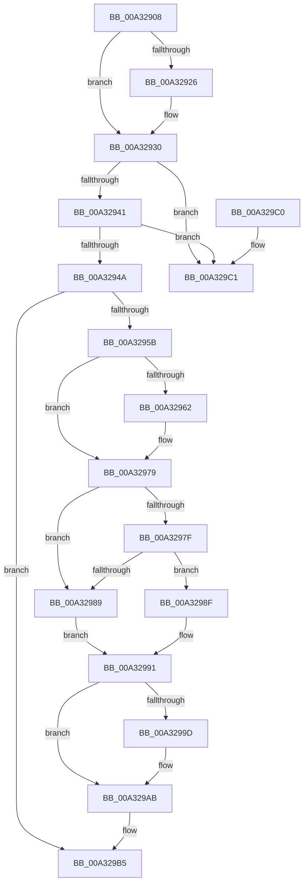

# FsRtlNotifyCleanupOneEntry

- RVA: `0x00A32908`–`0x00A329C8` (길이 `192` bytes)
- VA: `0x0000000140A32908`
- 실행 섹션: `PAGE`
- PDB 이름 있음: `예`; PDB Function 태그: `아니요`
- unwind 정보 RVA: `0x0006CF28`
- 디코드: `55`개 명령, `192/192` bytes 표시
- 미해석 바이트: `0` (있으면 어셈블리에 `.byte`로 보존)

> 이 문서는 커널 이미지의 기계어와 PDB 기호를 분석해 생성했습니다. 4번과 5번은 함수 원형과 자료형을 바이너리 사용 방식에서 추정한 C 해석이며 원본 소스 복구 결과는 아닙니다.

## 1. Dependencies

- 직접 호출 지점: **6**; 고유 호출 대상: **5**
- 직접 호출자로 확인된 함수: **2**
- RIP 상대 이미지 참조: **0**

### Outgoing calls
- `0x00A3292B` → [FsRtlNotifyCompleteIrpList](../A1/FsRtlNotifyCompleteIrpList_function_00A1F98C.md) (function, `0x00A1F98C`)
- `0x00A32969` → [PsReturnProcessPagedPoolQuota](../../text/2A/PsReturnProcessPagedPoolQuota_function_002A6860.md) (function, `0x002A6860`)
- `0x00A32974` → [ExFreePoolWithTag](../../poolcode/B8/ExFreePoolWithTag_function_00B82870.md) (function, `0x00B82870`)
- `0x00A32994` → [Feature_4131803451__private_IsEnabledDeviceUsageNoInline](../../text/58/Feature_4131803451__private_IsEnabledDeviceUsageNoInline_function_0058336C.md) (function, `0x0058336C`)
- `0x00A329A6` → [ObfDereferenceObjectWithTag](../../text/2F/ObfDereferenceObjectWithTag_function_002F78E0.md) (function, `0x002F78E0`)
- `0x00A329B0` → [ExFreePoolWithTag](../../poolcode/B8/ExFreePoolWithTag_function_00B82870.md) (function, `0x00B82870`)

### Direct callers
- [FsRtlNotifyCleanupAll](../71/FsRtlNotifyCleanupAll_function_00716D90.md) at `0x00716DDE`
- [FsRtlNotifyCleanup](FsRtlNotifyCleanup_function_00A32840.md) at `0x00A32894`

### Static image references
- 디코드된 RIP-relative 메모리 참조가 없습니다.

## 2. Other-region calls and transfers

- 다른 실행 섹션으로 향하는 call: **5**
  - `0x00A32969` → [PsReturnProcessPagedPoolQuota](../../text/2A/PsReturnProcessPagedPoolQuota_function_002A6860.md) (`PAGE` → `.text`)
  - `0x00A32974` → [ExFreePoolWithTag](../../poolcode/B8/ExFreePoolWithTag_function_00B82870.md) (`PAGE` → `POOLCODE`)
  - `0x00A32994` → [Feature_4131803451__private_IsEnabledDeviceUsageNoInline](../../text/58/Feature_4131803451__private_IsEnabledDeviceUsageNoInline_function_0058336C.md) (`PAGE` → `.text`)
  - `0x00A329A6` → [ObfDereferenceObjectWithTag](../../text/2F/ObfDereferenceObjectWithTag_function_002F78E0.md) (`PAGE` → `.text`)
  - `0x00A329B0` → [ExFreePoolWithTag](../../poolcode/B8/ExFreePoolWithTag_function_00B82870.md) (`PAGE` → `POOLCODE`)
- 별도 외부 분기/꼬리 이동을 확인하지 못했습니다.

## 3. Assembly (complete function range)

```asm
00A32908  48 89 5C 24 08                  mov qword ptr [rsp + 8], rbx
00A3290D  57                              push rdi
00A3290E  48 83 EC 20                     sub rsp, 0x20
00A32912  66 83 49 48 04                  or word ptr [rcx + 0x48], 4
00A32917  48 8D 41 30                     lea rax, [rcx + 0x30]
00A3291B  48 8B FA                        mov rdi, rdx
00A3291E  48 8B D9                        mov rbx, rcx
00A32921  48 39 00                        cmp qword ptr [rax], rax
00A32924  74 0A                           je 0x140a32930
00A32926  BA 0B 01 00 00                  mov edx, 0x10b
00A3292B  E8 5C D0 FE FF                  call 0x140a1f98c
00A32930  48 8D 43 20                     lea rax, [rbx + 0x20]
00A32934  48 8B 10                        mov rdx, qword ptr [rax]
00A32937  48 39 42 08                     cmp qword ptr [rdx + 8], rax
00A3293B  0F 85 80 00 00 00               jne 0x140a329c1
00A32941  48 8B 48 08                     mov rcx, qword ptr [rax + 8]
00A32945  48 39 01                        cmp qword ptr [rcx], rax
00A32948  75 77                           jne 0x140a329c1
00A3294A  48 89 11                        mov qword ptr [rcx], rdx
00A3294D  48 89 4A 08                     mov qword ptr [rdx + 8], rcx
00A32951  F0 FF 4B 70                     lock dec dword ptr [rbx + 0x70]
00A32955  83 7B 70 00                     cmp dword ptr [rbx + 0x70], 0
00A32959  75 5A                           jne 0x140a329b5
00A3295B  48 83 7B 50 00                  cmp qword ptr [rbx + 0x50], 0
00A32960  74 17                           je 0x140a32979
00A32962  8B 53 64                        mov edx, dword ptr [rbx + 0x64]
00A32965  48 8B 4B 78                     mov rcx, qword ptr [rbx + 0x78]
00A32969  E8 F2 3E 87 FF                  call 0x1402a6860
00A3296E  48 8B 4B 50                     mov rcx, qword ptr [rbx + 0x50]
00A32972  33 D2                           xor edx, edx
00A32974  E8 F7 FE 14 00                  call 0x140b82870
00A32979  F6 43 48 40                     test byte ptr [rbx + 0x48], 0x40
00A3297D  75 0A                           jne 0x140a32989
00A3297F  48 83 BB 88 00 00 00 00         cmp qword ptr [rbx + 0x88], 0
00A32987  74 06                           je 0x140a3298f
00A32989  48 8B 43 18                     mov rax, qword ptr [rbx + 0x18]
00A3298D  EB 02                           jmp 0x140a32991
00A3298F  33 C0                           xor eax, eax
00A32991  48 89 07                        mov qword ptr [rdi], rax
00A32994  E8 D3 09 B5 FF                  call 0x14058336c
00A32999  85 C0                           test eax, eax
00A3299B  74 0E                           je 0x140a329ab
00A3299D  48 8B 4B 78                     mov rcx, qword ptr [rbx + 0x78]
00A329A1  BA 46 73 4E 74                  mov edx, 0x744e7346
00A329A6  E8 35 4F 8C FF                  call 0x1402f78e0
00A329AB  33 D2                           xor edx, edx
00A329AD  48 8B CB                        mov rcx, rbx
00A329B0  E8 BB FE 14 00                  call 0x140b82870
00A329B5  48 8B 5C 24 30                  mov rbx, qword ptr [rsp + 0x30]
00A329BA  48 83 C4 20                     add rsp, 0x20
00A329BE  5F                              pop rdi
00A329BF  C3                              ret
00A329C0  CC                              int3
00A329C1  B9 03 00 00 00                  mov ecx, 3
00A329C6  CD 29                           int 0x29
```

## 4. C-style interpretation (structured pseudocode)

```c
__int64 __fastcall FsRtlNotifyCleanupOneEntry(__int64 a1, __int64 a2)
{
    __int64 result;
    __int64 v_rsp;
    unsigned __int64 v_stack_p8;

    v_stack_p8 = v_rbx;
    v_rsp = (v_rsp) - (32);
    result = a1 + 48;
    if ((*(unsigned __int64 *)(a1 + 48)) != (a1 + 48)) {
        a2 = 267;
        result = FsRtlNotifyCompleteIrpList(a1, a2, a3, a4);
    }
    if ((*(unsigned __int64 *)(*(unsigned __int64 *)(a1 + 32) + 8)) != (a1 + 32)) goto loc_00A329C1;
    if ((*(unsigned __int64 *)(*(unsigned __int64 *)(a1 + 32 + 8))) != (a1 + 32)) goto loc_00A329C1;
    *(unsigned __int64 *)(*(unsigned __int64 *)(a1 + 32 + 8)) = *(unsigned __int64 *)(a1 + 32);
    *(unsigned __int64 *)(*(unsigned __int64 *)(a1 + 32) + 8) = *(unsigned __int64 *)(a1 + 32 + 8);
    if ((*(unsigned int *)(a1 + 112)) != 0) goto loc_00A329B5;
    result = a1 + 32;
    if ((*(unsigned __int64 *)(a1 + 80)) != 0) {
        a2 = *(unsigned int *)(a1 + 100);
        a1 = *(unsigned __int64 *)(a1 + 120);
        result = PsReturnProcessPagedPoolQuota(a1, a2, a3, a4);
        a1 = *(unsigned __int64 *)(a1 + 80);
        a2 = 0;
        result = ExFreePoolWithTag(a1, a2, a3, a4);
    }
    if (((*(unsigned __int8 *)(a1 + 72)) & (64)) != 0) goto loc_00A32989;
    if ((*(unsigned __int64 *)(a1 + 136)) == 0) goto loc_00A3298F;
loc_00A32989:
    goto loc_00A32991;
loc_00A3298F:
    result = 0;
loc_00A32991:
    *(unsigned __int64 *)(a2) = 0;
    result = Feature_4131803451__private_IsEnabledDeviceUsageNoInline(a1, a2, a3, a4);
    if ((unsigned int)(result) != 0) {
        a1 = *(unsigned __int64 *)(a1 + 120);
        a2 = 0x744E7346ULL;
        result = ObfDereferenceObjectWithTag(a1, a2, a3, a4);
    }
    a2 = 0;
    result = ExFreePoolWithTag(a1, a2, a3, a4);
loc_00A329B5:
    v_rsp = (v_rsp) + (32);
    return result;
loc_00A329C1:
    return result;
}
```

## 5. (Beta) C Style

```c
int64_t FsRtlNotifyCleanupOneEntry(void *Arg1, void *Arg2)
{
    uint8_t *arg1 = (uint8_t *)Arg1;
    uint8_t *arg2 = (uint8_t *)Arg2;

    int64_t result;
    int64_t local_rsp;
    uint64_t v_stack_p8;

    v_stack_p8 = local_rbx;
    local_rsp = (local_rsp) - (32);
    result = Arg1 + 48;
    if ((*(uint64_t *)(arg1 + 0x30)) != (Arg1 + 48)) {
        Arg2 = 267;
        result = FsRtlNotifyCompleteIrpList(Arg1, Arg2, a3, a4);
    }
    if ((*(uint64_t *)(*(uint64_t *)(arg1 + 0x20) + 0x8)) != (Arg1 + 32)) goto loc_00A329C1;
    if ((*(uint64_t *)(*(uint64_t *)(arg1 + 0x20 + 0x8))) != (Arg1 + 32)) goto loc_00A329C1;
    *(uint64_t *)(*(uint64_t *)(arg1 + 0x20 + 0x8)) = *(uint64_t *)(arg1 + 0x20);
    *(uint64_t *)(*(uint64_t *)(arg1 + 0x20) + 0x8) = *(uint64_t *)(arg1 + 0x20 + 0x8);
    if ((*(uint32_t *)(arg1 + 0x70)) != 0) goto loc_00A329B5;
    result = Arg1 + 32;
    if ((*(uint64_t *)(arg1 + 0x50)) != 0) {
        Arg2 = *(uint32_t *)(arg1 + 0x64);
        Arg1 = *(uint64_t *)(arg1 + 0x78);
        result = PsReturnProcessPagedPoolQuota(Arg1, Arg2, a3, a4);
        Arg1 = *(uint64_t *)(arg1 + 0x50);
        Arg2 = 0;
        result = ExFreePoolWithTag(Arg1, Arg2, a3, a4);
    }
    if (((*(uint8_t *)(arg1 + 0x48)) & (64)) != 0) goto loc_00A32989;
    if ((*(uint64_t *)(arg1 + 0x88)) == 0) goto loc_00A3298F;
loc_00A32989:
    goto loc_00A32991;
loc_00A3298F:
    result = 0;
loc_00A32991:
    *(uint64_t *)(arg2) = 0;
    result = Feature_4131803451__private_IsEnabledDeviceUsageNoInline(Arg1, Arg2, a3, a4);
    if ((uint32_t)(result) != 0) {
        Arg1 = *(uint64_t *)(arg1 + 0x78);
        Arg2 = 0x744E7346ULL;
        result = ObfDereferenceObjectWithTag(Arg1, Arg2, a3, a4);
    }
    Arg2 = 0;
    result = ExFreePoolWithTag(Arg1, Arg2, a3, a4);
loc_00A329B5:
    local_rsp = (local_rsp) + (32);
    return result;
loc_00A329C1:
    return result;
}
```

### 관측된 메모리 오프셋

구조체 형식이 확인되지 않은 접근은 인자 기준의 오프셋으로만 기록했습니다.

| 기준 인자 | 오프셋 표현 | 폭 (bit) | 접근 |
|---|---:|---:|---|
| `Arg1` | `+ 0x0` | `64` | `R` |
| `Arg1` | `+ 0x8` | `64` | `R` |
| `Arg1` | `+ 0x18` | `64` | `R` |
| `Arg1` | `+ 0x20` | `64` | `R` |
| `Arg1` | `+ 0x30` | `64` | `R` |
| `Arg1` | `+ 0x48` | `8` | `R` |
| `Arg1` | `+ 0x48` | `16` | `R/W` |
| `Arg1` | `+ 0x50` | `64` | `R` |
| `Arg1` | `+ 0x64` | `32` | `R` |
| `Arg1` | `+ 0x70` | `32` | `R` |
| `Arg1` | `+ 0x70` | `32` | `R/W` |
| `Arg1` | `+ 0x78` | `64` | `R` |
| `Arg1` | `+ 0x88` | `64` | `R` |
| `Arg2` | `+ 0x0` | `64` | `W` |

## 6. Execution-region graph

[열기: 2D/3D 그래프와 함수 탐색 컨트롤 패널](../../../control-panel.html?section=page&rva=0x00A32908&view=graph)

- 2D 그래프는 위에서 아래로 흐르고, 3D 그래프는 빈 공간을 드래그해 회전합니다. Shift+드래그는 이동, 휠은 확대·축소, 함수 노드 선택은 대상 보고서 이동입니다.

### Static fallback


