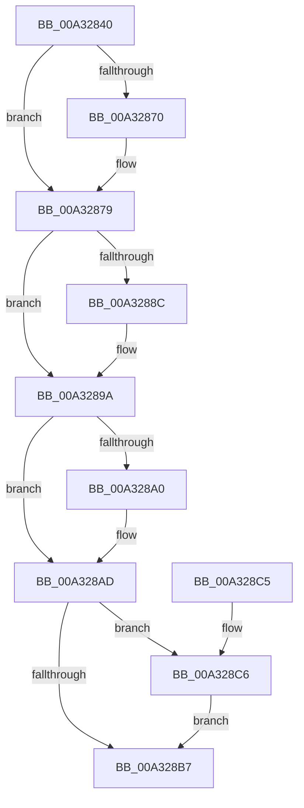

# FsRtlNotifyCleanup

- RVA: `0x00A32840`–`0x00A328DA` (길이 `154` bytes)
- VA: `0x0000000140A32840`
- 실행 섹션: `PAGE`
- PDB 이름 있음: `예`; PDB Function 태그: `아니요`
- unwind 정보 RVA: `0x000AD3FC`
- 디코드: `46`개 명령, `154/154` bytes 표시
- 미해석 바이트: `0` (있으면 어셈블리에 `.byte`로 보존)

> 이 문서는 커널 이미지의 기계어와 PDB 기호를 분석해 생성했습니다. 4번과 5번은 함수 원형과 자료형을 바이너리 사용 방식에서 추정한 C 해석이며 원본 소스 복구 결과는 아닙니다.

## 1. Dependencies

- 직접 호출 지점: **6**; 고유 호출 대상: **6**
- 직접 호출자로 확인된 함수: **0**
- RIP 상대 이미지 참조: **0**

### Outgoing calls
- `0x00A32870` → [ExAcquireFastMutexUnsafe](../../text/3F/ExAcquireFastMutexUnsafe_function_003F3720.md) (function, `0x003F3720`)
- `0x00A32882` → [FsRtlIsNotifyOnList](FsRtlIsNotifyOnList_function_00A328E0.md) (function, `0x00A328E0`)
- `0x00A32894` → [FsRtlNotifyCleanupOneEntry](FsRtlNotifyCleanupOneEntry_function_00A32908.md) (function, `0x00A32908`)
- `0x00A328A8` → [ExReleaseFastMutexUnsafe](../../text/25/ExReleaseFastMutexUnsafe_function_002503A0.md) (function, `0x002503A0`)
- `0x00A328C9` → [SeReleaseSubjectContext](../86/SeReleaseSubjectContext_function_0086B710.md) (function, `0x0086B710`)
- `0x00A328D3` → [ExFreePoolWithTag](../../poolcode/B8/ExFreePoolWithTag_function_00B82870.md) (function, `0x00B82870`)

### Direct callers
- 이 함수 시작 RVA로 연결되는 직접 call은 확인되지 않았습니다. 간접 호출은 완전히 역산할 수 없습니다.

### Static image references
- 디코드된 RIP-relative 메모리 참조가 없습니다.

## 2. Other-region calls and transfers

- 다른 실행 섹션으로 향하는 call: **3**
  - `0x00A32870` → [ExAcquireFastMutexUnsafe](../../text/3F/ExAcquireFastMutexUnsafe_function_003F3720.md) (`PAGE` → `.text`)
  - `0x00A328A8` → [ExReleaseFastMutexUnsafe](../../text/25/ExReleaseFastMutexUnsafe_function_002503A0.md) (`PAGE` → `.text`)
  - `0x00A328D3` → [ExFreePoolWithTag](../../poolcode/B8/ExFreePoolWithTag_function_00B82870.md) (`PAGE` → `POOLCODE`)
- 별도 외부 분기/꼬리 이동을 확인하지 못했습니다.

## 3. Assembly (complete function range)

```asm
00A32840  48 89 5C 24 10                  mov qword ptr [rsp + 0x10], rbx
00A32845  48 89 4C 24 08                  mov qword ptr [rsp + 8], rcx
00A3284A  56                              push rsi
00A3284B  57                              push rdi
00A3284C  41 56                           push r14
00A3284E  48 83 EC 20                     sub rsp, 0x20
00A32852  49 8B F0                        mov rsi, r8
00A32855  4C 8B F2                        mov r14, rdx
00A32858  48 8B D9                        mov rbx, rcx
00A3285B  48 83 64 24 58 00               and qword ptr [rsp + 0x58], 0
00A32861  65 48 8B 3C 25 88 01 00 00      mov rdi, qword ptr gs:[0x188]
00A3286A  48 3B 79 38                     cmp rdi, qword ptr [rcx + 0x38]
00A3286E  74 09                           je 0x140a32879
00A32870  E8 AB 0E 9C FF                  call 0x1403f3720
00A32875  48 89 7B 38                     mov qword ptr [rbx + 0x38], rdi
00A32879  FF 43 40                        inc dword ptr [rbx + 0x40]
00A3287C  48 8B D6                        mov rdx, rsi
00A3287F  49 8B CE                        mov rcx, r14
00A32882  E8 59 00 00 00                  call 0x140a328e0
00A32887  48 85 C0                        test rax, rax
00A3288A  74 0E                           je 0x140a3289a
00A3288C  48 8D 54 24 58                  lea rdx, [rsp + 0x58]
00A32891  48 8B C8                        mov rcx, rax
00A32894  E8 6F 00 00 00                  call 0x140a32908
00A32899  90                              nop
00A3289A  83 43 40 FF                     add dword ptr [rbx + 0x40], -1
00A3289E  75 0D                           jne 0x140a328ad
00A328A0  48 83 63 38 00                  and qword ptr [rbx + 0x38], 0
00A328A5  48 8B CB                        mov rcx, rbx
00A328A8  E8 F3 DA 81 FF                  call 0x1402503a0
00A328AD  48 8B 5C 24 58                  mov rbx, qword ptr [rsp + 0x58]
00A328B2  48 85 DB                        test rbx, rbx
00A328B5  75 0F                           jne 0x140a328c6
00A328B7  48 8B 5C 24 48                  mov rbx, qword ptr [rsp + 0x48]
00A328BC  48 83 C4 20                     add rsp, 0x20
00A328C0  41 5E                           pop r14
00A328C2  5F                              pop rdi
00A328C3  5E                              pop rsi
00A328C4  C3                              ret
00A328C5  CC                              int3
00A328C6  48 8B CB                        mov rcx, rbx
00A328C9  E8 42 8E E3 FF                  call 0x14086b710
00A328CE  33 D2                           xor edx, edx
00A328D0  48 8B CB                        mov rcx, rbx
00A328D3  E8 98 FF 14 00                  call 0x140b82870
00A328D8  EB DD                           jmp 0x140a328b7
```

## 4. C-style interpretation (structured pseudocode)

```c
__int64 __fastcall FsRtlNotifyCleanup(__int64 a1, __int64 a2, __int64 a3)
{
    __int64 result;
    __int64 v_rsp;
    unsigned __int64 v_stack_p10;
    unsigned __int64 v_stack_p20;
    unsigned __int64 v_stack_p8;

    v_stack_p10 = v_rbx;
    v_stack_p8 = a1;
    v_rsp = (v_rsp) - (32);
    if ((*(unsigned __int64 *)(gs_base + (0 + 392))) != (*(unsigned __int64 *)(a1 + 56))) {
        result = ExAcquireFastMutexUnsafe(a1, a2, a3, a4);
        *(unsigned __int64 *)(a1 + 56) = *(unsigned __int64 *)(gs_base + (0 + 392));
    }
    result = FsRtlIsNotifyOnList(a2, a3, a3, a4);
    if (result != 0) {
        a2 = v_stack_p20;
        a1 = result;
        result = FsRtlNotifyCleanupOneEntry(a1, a2, a3, a4);
    }
    if (result == 0) {
        a1 = a1;
        result = ExReleaseFastMutexUnsafe(a1, a2, a3, a4);
    }
    if (v_stack_p20 != 0) goto loc_00A328C6;
loc_00A328B7:
    v_rsp = (v_rsp) + (32);
    return result;
loc_00A328C6:
    result = SeReleaseSubjectContext(v_stack_p10, a2, a3, a4);
    a2 = 0;
    result = ExFreePoolWithTag(v_stack_p10, a2, a3, a4);
    goto loc_00A328B7;
}
```

## 5. (Beta) C Style

```c
int64_t FsRtlNotifyCleanup(void *Arg1, int64_t Arg2, int64_t Arg3)
{
    uint8_t *arg1 = (uint8_t *)Arg1;

    int64_t result;
    int64_t local_rsp;
    uint64_t v_stack_p10;
    uint64_t v_stack_p20;
    uint64_t v_stack_p8;

    v_stack_p10 = local_rbx;
    v_stack_p8 = Arg1;
    local_rsp = (local_rsp) - (32);
    if ((*(uint64_t *)(gs_base + (0 + 0x188))) != (*(uint64_t *)(arg1 + 0x38))) {
        result = ExAcquireFastMutexUnsafe(Arg1, Arg2, Arg3, a4);
        *(uint64_t *)(arg1 + 0x38) = *(uint64_t *)(gs_base + (0 + 0x188));
    }
    result = FsRtlIsNotifyOnList(Arg2, Arg3, Arg3, a4);
    if (result != 0) {
        Arg2 = v_stack_p20;
        Arg1 = result;
        result = FsRtlNotifyCleanupOneEntry(Arg1, Arg2, Arg3, a4);
    }
    if (result == 0) {
        Arg1 = Arg1;
        result = ExReleaseFastMutexUnsafe(Arg1, Arg2, Arg3, a4);
    }
    if (v_stack_p20 != 0) goto loc_00A328C6;
loc_00A328B7:
    local_rsp = (local_rsp) + (32);
    return result;
loc_00A328C6:
    result = SeReleaseSubjectContext(v_stack_p10, Arg2, Arg3, a4);
    Arg2 = 0;
    result = ExFreePoolWithTag(v_stack_p10, Arg2, Arg3, a4);
    goto loc_00A328B7;
}
```

### 관측된 메모리 오프셋

구조체 형식이 확인되지 않은 접근은 인자 기준의 오프셋으로만 기록했습니다.

| 기준 인자 | 오프셋 표현 | 폭 (bit) | 접근 |
|---|---:|---:|---|
| `Arg1` | `+ 0x38` | `64` | `R` |
| `Arg1` | `+ 0x38` | `64` | `R/W` |
| `Arg1` | `+ 0x38` | `64` | `W` |
| `Arg1` | `+ 0x40` | `32` | `R/W` |

## 6. Execution-region graph

[열기: 2D/3D 그래프와 함수 탐색 컨트롤 패널](../../../control-panel.html?section=page&rva=0x00A32840&view=graph)

- 2D 그래프는 위에서 아래로 흐르고, 3D 그래프는 빈 공간을 드래그해 회전합니다. Shift+드래그는 이동, 휠은 확대·축소, 함수 노드 선택은 대상 보고서 이동입니다.

### Static fallback


