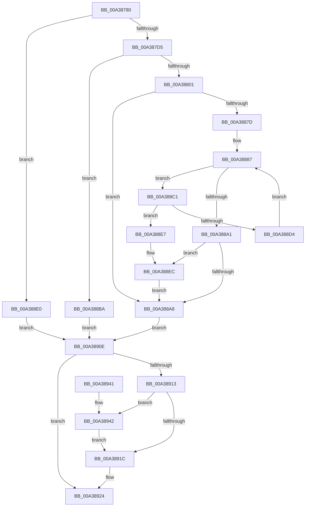

# FsRtlQueryInformationFile

- RVA: `0x00A38780`–`0x00A3894E` (길이 `462` bytes)
- VA: `0x0000000140A38780`
- 실행 섹션: `PAGE`
- PDB 이름 있음: `예`; PDB Function 태그: `아니요`
- unwind 정보 RVA: `0x000ADD84`
- 디코드: `121`개 명령, `462/462` bytes 표시
- 미해석 바이트: `0` (있으면 어셈블리에 `.byte`로 보존)

> 이 문서는 커널 이미지의 기계어와 PDB 기호를 분석해 생성했습니다. 4번과 5번은 함수 원형과 자료형을 바이너리 사용 방식에서 추정한 C 해석이며 원본 소스 복구 결과는 아닙니다.

## 1. Dependencies

- 직접 호출 지점: **9**; 고유 호출 대상: **8**
- 직접 호출자로 확인된 함수: **0**
- RIP 상대 이미지 참조: **1**

### Outgoing calls
- `0x00A387C2` → [KeInitializeEvent](../../text/40/KeInitializeEvent_function_0040DD10.md) (function, `0x0040DD10`)
- `0x00A387D8` → [IoGetRelatedDeviceObject](../../text/29/IoGetRelatedDeviceObject_function_0029B120.md) (function, `0x0029B120`)
- `0x00A387EB` → [IoAllocateIrpEx](../../text/20/IoAllocateIrpEx_function_00207510.md) (function, `0x00207510`)
- `0x00A38871` → [IofCallDriver](../../text/29/IofCallDriver_function_0029B4B0.md) (function, `0x0029B4B0`)
- `0x00A38895` → [KeWaitForSingleObject](../../text/20/KeWaitForSingleObject_function_0020E6B0.md) (function, `0x0020E6B0`)
- `0x00A388EF` → [IoCancelIrp](../../text/27/IoCancelIrp_function_002720E0.md) (function, `0x002720E0`)
- `0x00A38907` → [KeWaitForSingleObject](../../text/20/KeWaitForSingleObject_function_0020E6B0.md) (function, `0x0020E6B0`)
- `0x00A3891F` → [IoFreeIrp](../../text/24/IoFreeIrp_function_0024DF70.md) (function, `0x0024DF70`)
- `0x00A38942` → [FsRtlpFreeMdlChain](../71/FsRtlpFreeMdlChain_function_00716394.md) (function, `0x00716394`)

### Direct callers
- 이 함수 시작 RVA로 연결되는 직접 call은 확인되지 않았습니다. 간접 호출은 완전히 역산할 수 없습니다.

### Static image references
- `0x00A38845` → RVA `0x0048B010` (`CmpCompleteFlushAndPurgeIrp`; read)

## 2. Other-region calls and transfers

- 다른 실행 섹션으로 향하는 call: **8**
  - `0x00A387C2` → [KeInitializeEvent](../../text/40/KeInitializeEvent_function_0040DD10.md) (`PAGE` → `.text`)
  - `0x00A387D8` → [IoGetRelatedDeviceObject](../../text/29/IoGetRelatedDeviceObject_function_0029B120.md) (`PAGE` → `.text`)
  - `0x00A387EB` → [IoAllocateIrpEx](../../text/20/IoAllocateIrpEx_function_00207510.md) (`PAGE` → `.text`)
  - `0x00A38871` → [IofCallDriver](../../text/29/IofCallDriver_function_0029B4B0.md) (`PAGE` → `.text`)
  - `0x00A38895` → [KeWaitForSingleObject](../../text/20/KeWaitForSingleObject_function_0020E6B0.md) (`PAGE` → `.text`)
  - `0x00A388EF` → [IoCancelIrp](../../text/27/IoCancelIrp_function_002720E0.md) (`PAGE` → `.text`)
  - `0x00A38907` → [KeWaitForSingleObject](../../text/20/KeWaitForSingleObject_function_0020E6B0.md) (`PAGE` → `.text`)
  - `0x00A3891F` → [IoFreeIrp](../../text/24/IoFreeIrp_function_0024DF70.md) (`PAGE` → `.text`)
- 별도 외부 분기/꼬리 이동을 확인하지 못했습니다.

## 3. Assembly (complete function range)

```asm
00A38780  4C 8B DC                        mov r11, rsp
00A38783  49 89 5B 08                     mov qword ptr [r11 + 8], rbx
00A38787  49 89 73 10                     mov qword ptr [r11 + 0x10], rsi
00A3878B  49 89 7B 18                     mov qword ptr [r11 + 0x18], rdi
00A3878F  4D 89 73 20                     mov qword ptr [r11 + 0x20], r14
00A38793  41 57                           push r15
00A38795  48 83 EC 60                     sub rsp, 0x60
00A38799  41 8B F1                        mov esi, r9d
00A3879C  45 8B F0                        mov r14d, r8d
00A3879F  4C 8B FA                        mov r15, rdx
00A387A2  48 8B F9                        mov rdi, rcx
00A387A5  33 DB                           xor ebx, ebx
00A387A7  49 89 5B C8                     mov qword ptr [r11 - 0x38], rbx
00A387AB  0F 57 C0                        xorps xmm0, xmm0
00A387AE  33 C0                           xor eax, eax
00A387B0  0F 11 44 24 40                  movups xmmword ptr [rsp + 0x40], xmm0
00A387B5  49 89 43 E8                     mov qword ptr [r11 - 0x18], rax
00A387B9  45 33 C0                        xor r8d, r8d
00A387BC  33 D2                           xor edx, edx
00A387BE  49 8D 4B D8                     lea rcx, [r11 - 0x28]
00A387C2  E8 49 55 9D FF                  call 0x14040dd10
00A387C7  90                              nop
00A387C8  8B 47 50                        mov eax, dword ptr [rdi + 0x50]
00A387CB  0F BA E0 0B                     bt eax, 0xb
00A387CF  0F 82 0B 01 00 00               jb 0x140a388e0
00A387D5  48 8B CF                        mov rcx, rdi
00A387D8  E8 43 29 86 FF                  call 0x14029b120
00A387DD  48 89 44 24 38                  mov qword ptr [rsp + 0x38], rax
00A387E2  45 33 C0                        xor r8d, r8d
00A387E5  8A 50 4C                        mov dl, byte ptr [rax + 0x4c]
00A387E8  48 8B C8                        mov rcx, rax
00A387EB  E8 20 ED 7C FF                  call 0x140207510
00A387F0  48 8B D8                        mov rbx, rax
00A387F3  48 89 44 24 30                  mov qword ptr [rsp + 0x30], rax
00A387F8  48 85 C0                        test rax, rax
00A387FB  0F 84 B9 00 00 00               je 0x140a388ba
00A38801  48 8D 88 B8 00 00 00            lea rcx, [rax + 0xb8]
00A38808  48 8B 01                        mov rax, qword ptr [rcx]
00A3880B  66 C7 40 B8 05 04               mov word ptr [rax - 0x48], 0x405
00A38811  48 89 78 E8                     mov qword ptr [rax - 0x18], rdi
00A38815  4C 89 7B 18                     mov qword ptr [rbx + 0x18], r15
00A38819  44 89 70 C0                     mov dword ptr [rax - 0x40], r14d
00A3881D  89 70 C8                        mov dword ptr [rax - 0x38], esi
00A38820  65 48 8B 04 25 88 01 00 00      mov rax, qword ptr gs:[0x188]
00A38829  48 8B 5C 24 30                  mov rbx, qword ptr [rsp + 0x30]
00A3882E  48 89 83 98 00 00 00            mov qword ptr [rbx + 0x98], rax
00A38835  8B 43 10                        mov eax, dword ptr [rbx + 0x10]
00A38838  83 C8 04                        or eax, 4
00A3883B  89 43 10                        mov dword ptr [rbx + 0x10], eax
00A3883E  C6 43 40 00                     mov byte ptr [rbx + 0x40], 0
00A38842  48 8B 01                        mov rax, qword ptr [rcx]
00A38845  48 8D 0D C4 27 A5 FF            lea rcx, [rip - 0x5ad83c]
00A3884C  48 89 48 F0                     mov qword ptr [rax - 0x10], rcx
00A38850  48 8D 4C 24 40                  lea rcx, [rsp + 0x40]
00A38855  48 89 48 F8                     mov qword ptr [rax - 8], rcx
00A38859  C6 40 BB 00                     mov byte ptr [rax - 0x45], 0
00A3885D  C6 40 BB 40                     mov byte ptr [rax - 0x45], 0x40
00A38861  C6 40 BB C0                     mov byte ptr [rax - 0x45], 0xc0
00A38865  C6 40 BB E0                     mov byte ptr [rax - 0x45], 0xe0
00A38869  48 8B D3                        mov rdx, rbx
00A3886C  48 8B 4C 24 38                  mov rcx, qword ptr [rsp + 0x38]
00A38871  E8 3A 2C 86 FF                  call 0x14029b4b0
00A38876  3D 03 01 00 00                  cmp eax, 0x103
00A3887B  75 2B                           jne 0x140a388a8
00A3887D  48 8D 4C 24 40                  lea rcx, [rsp + 0x40]
00A38882  48 89 4C 24 38                  mov qword ptr [rsp + 0x38], rcx
00A38887  48 83 64 24 20 00               and qword ptr [rsp + 0x20], 0
00A3888D  41 B1 01                        mov r9b, 1
00A38890  45 33 C0                        xor r8d, r8d
00A38893  33 D2                           xor edx, edx
00A38895  E8 16 5E 7D FF                  call 0x14020e6b0
00A3889A  3D 01 01 00 00                  cmp eax, 0x101
00A3889F  74 20                           je 0x140a388c1
00A388A1  3D 4B 00 00 C0                  cmp eax, 0xc000004b
00A388A6  74 44                           je 0x140a388ec
00A388A8  8B 7B 30                        mov edi, dword ptr [rbx + 0x30]
00A388AB  8B 4B 38                        mov ecx, dword ptr [rbx + 0x38]
00A388AE  48 8B 84 24 90 00 00 00         mov rax, qword ptr [rsp + 0x90]
00A388B6  89 08                           mov dword ptr [rax], ecx
00A388B8  EB 54                           jmp 0x140a3890e
00A388BA  BF 9A 00 00 C0                  mov edi, 0xc000009a
00A388BF  EB 4D                           jmp 0x140a3890e
00A388C1  65 48 8B 04 25 88 01 00 00      mov rax, qword ptr gs:[0x188]
00A388CA  8B 80 A0 05 00 00               mov eax, dword ptr [rax + 0x5a0]
00A388D0  A8 01                           test al, 1
00A388D2  75 13                           jne 0x140a388e7
00A388D4  48 8B 5C 24 30                  mov rbx, qword ptr [rsp + 0x30]
00A388D9  48 8B 4C 24 38                  mov rcx, qword ptr [rsp + 0x38]
00A388DE  EB A7                           jmp 0x140a38887
00A388E0  BF 10 00 00 C0                  mov edi, 0xc0000010
00A388E5  EB 27                           jmp 0x140a3890e
00A388E7  48 8B 5C 24 30                  mov rbx, qword ptr [rsp + 0x30]
00A388EC  48 8B CB                        mov rcx, rbx
00A388EF  E8 EC 97 83 FF                  call 0x1402720e0
00A388F4  48 83 64 24 20 00               and qword ptr [rsp + 0x20], 0
00A388FA  45 33 C9                        xor r9d, r9d
00A388FD  45 33 C0                        xor r8d, r8d
00A38900  33 D2                           xor edx, edx
00A38902  48 8D 4C 24 40                  lea rcx, [rsp + 0x40]
00A38907  E8 A4 5D 7D FF                  call 0x14020e6b0
00A3890C  EB 9A                           jmp 0x140a388a8
00A3890E  48 85 DB                        test rbx, rbx
00A38911  74 11                           je 0x140a38924
00A38913  48 8B 4B 08                     mov rcx, qword ptr [rbx + 8]
00A38917  48 85 C9                        test rcx, rcx
00A3891A  75 26                           jne 0x140a38942
00A3891C  48 8B CB                        mov rcx, rbx
00A3891F  E8 4C 56 81 FF                  call 0x14024df70
00A38924  8B C7                           mov eax, edi
00A38926  4C 8D 5C 24 60                  lea r11, [rsp + 0x60]
00A3892B  49 8B 5B 10                     mov rbx, qword ptr [r11 + 0x10]
00A3892F  49 8B 73 18                     mov rsi, qword ptr [r11 + 0x18]
00A38933  49 8B 7B 20                     mov rdi, qword ptr [r11 + 0x20]
00A38937  4D 8B 73 28                     mov r14, qword ptr [r11 + 0x28]
00A3893B  49 8B E3                        mov rsp, r11
00A3893E  41 5F                           pop r15
00A38940  C3                              ret
00A38941  CC                              int3
00A38942  E8 4D DA CD FF                  call 0x140716394
00A38947  48 83 63 08 00                  and qword ptr [rbx + 8], 0
00A3894C  EB CE                           jmp 0x140a3891c
```

## 4. C-style interpretation (structured pseudocode)

```c
__int64 __fastcall FsRtlQueryInformationFile(__int64 a1, __int64 a2, int a3, int a4, __int64 a5)
{
    __int64 result;
    __int64 v_rbx;
    __int64 v_rsp;
    unsigned __int64 v_stack_m28;
    unsigned __int64 v_stack_m30;
    unsigned __int64 v_stack_m38;
    unsigned __int64 v_stack_m48;
    unsigned __int64 v_stack_m8;

    *(unsigned __int64 *)(v_rsp + 8) = v_rbx;
    *(unsigned __int64 *)(v_rsp + 16) = v_rsi;
    *(unsigned __int64 *)(v_rsp + 24) = v_rdi;
    *(unsigned __int64 *)(v_rsp + 32) = v_r14;
    v_rsp = (v_rsp) - (96);
    v_rbx = 0;
    *(unsigned __int64 *)(v_rsp - 56) = 0;
    result = 0;
    v_stack_m28 = v_xmm0;
    *(unsigned __int64 *)(v_rsp - 24) = 0;
    a3 = 0;
    a2 = 0;
    result = KeInitializeEvent(v_rsp - 40, a2, a3, a4);
    if (condition_is_below) goto loc_00A388E0;
    result = IoGetRelatedDeviceObject(a1, a2, a3, a4);
    v_stack_m30 = result;
    a3 = 0;
    result = IoAllocateIrpEx(result, *(unsigned __int8 *)(result + 76), a3, a4);
    v_stack_m38 = result;
    if (result == 0) goto loc_00A388BA;
    *(unsigned __int16 *)(*(unsigned __int64 *)(result + 184) - 72) = 0x405ULL;
    *(unsigned __int64 *)(*(unsigned __int64 *)(result + 184) - 24) = a1;
    *(unsigned __int64 *)(result + 24) = 0;
    *(unsigned int *)(*(unsigned __int64 *)(result + 184) - 64) = (unsigned int)((unsigned int)(a3));
    *(unsigned int *)(*(unsigned __int64 *)(result + 184) - 56) = (unsigned int)((unsigned int)(a4));
    *(unsigned __int64 *)(v_stack_m38 + 152) = *(unsigned __int64 *)(gs_base + (0 + 392));
    result = (unsigned int)(((unsigned int)(*(unsigned int *)(v_stack_m38 + 16))) | (4));
    *(unsigned int *)(v_stack_m38 + 16) = (unsigned int)(result);
    *(unsigned __int8 *)(v_stack_m38 + 64) = 0;
    *(unsigned __int64 *)(*(unsigned __int64 *)(result + 184) - 16) = v_rip - 5953596;
    *(unsigned __int64 *)(*(unsigned __int64 *)(result + 184) - 8) = v_stack_m28;
    *(unsigned __int8 *)(*(unsigned __int64 *)(result + 184) - 69) = 0;
    *(unsigned __int8 *)(*(unsigned __int64 *)(result + 184) - 69) = 64;
    *(unsigned __int8 *)(*(unsigned __int64 *)(result + 184) - 69) = 192;
    *(unsigned __int8 *)(*(unsigned __int64 *)(result + 184) - 69) = 224;
    result = IofCallDriver(v_stack_m30, v_stack_m38, a3, a4);
    if (((unsigned int)(result)) != 259) goto loc_00A388A8;
    v_stack_m30 = v_stack_m28;
loc_00A38887:
    a3 = 0;
    a2 = 0;
    result = KeWaitForSingleObject(v_stack_m28, a2, a3, 1);
    if (((unsigned int)(result)) == 257) goto loc_00A388C1;
    if (((unsigned int)(result)) == 0xC000004BULL) goto loc_00A388EC;
loc_00A388A8:
    *(unsigned int *)(a5) = (unsigned int)((unsigned int)(*(unsigned int *)(v_stack_m38 + 56)));
    goto loc_00A3890E;
loc_00A388BA:
    goto loc_00A3890E;
loc_00A388C1:
    if ((((unsigned __int8)((unsigned int)(*(unsigned int *)(*(unsigned __int64 *)(gs_base + (0 + 392)) + 1440)))) & (1)) != 0) goto loc_00A388E7;
    goto loc_00A38887;
loc_00A388E0:
    goto loc_00A3890E;
loc_00A388E7:
loc_00A388EC:
    result = IoCancelIrp(v_stack_m38, a2, a3, 1);
    a4 = 0;
    a3 = 0;
    a2 = 0;
    result = KeWaitForSingleObject(v_stack_m28, a2, a3, a4);
    goto loc_00A388A8;
loc_00A3890E:
    if (v_stack_m38 == 0) goto loc_00A38924;
    if (*(unsigned __int64 *)(v_stack_m38 + 8) != 0) goto loc_00A38942;
loc_00A3891C:
    result = IoFreeIrp(v_stack_m38, a2, a3, a4);
loc_00A38924:
    return (unsigned int)((unsigned int)((unsigned int)(0xC0000010ULL)));
loc_00A38942:
    result = FsRtlpFreeMdlChain(v_stack_m38, a2, a3, a4);
    goto loc_00A3891C;
}
```

## 5. (Beta) C Style

```c
int64_t FsRtlQueryInformationFile(void *Arg1, int64_t Arg2, int32_t Arg3, int32_t Arg4, void *Arg5)
{
    uint8_t *arg1 = (uint8_t *)Arg1;
    uint8_t *arg5 = (uint8_t *)Arg5;

    int64_t result;
    int64_t local_rbx;
    int64_t local_rsp;
    uint64_t v_stack_m28;
    uint64_t v_stack_m30;
    uint64_t v_stack_m38;
    uint64_t v_stack_m48;
    uint64_t v_stack_m8;

    *(uint64_t *)(local_rsp + 0x8) = local_rbx;
    *(uint64_t *)(local_rsp + 0x10) = local_rsi;
    *(uint64_t *)(local_rsp + 0x18) = local_rdi;
    *(uint64_t *)(local_rsp + 0x20) = local_r14;
    local_rsp = (local_rsp) - (96);
    local_rbx = 0;
    *(uint64_t *)(local_rsp - 0x38) = 0;
    result = 0;
    v_stack_m28 = v_xmm0;
    *(uint64_t *)(local_rsp - 0x18) = 0;
    Arg3 = 0;
    Arg2 = 0;
    result = KeInitializeEvent(local_rsp - 40, Arg2, Arg3, Arg4);
    if (condition_is_below) goto loc_00A388E0;
    result = IoGetRelatedDeviceObject(Arg1, Arg2, Arg3, Arg4);
    v_stack_m30 = result;
    Arg3 = 0;
    result = IoAllocateIrpEx(result, *(uint8_t *)(result + 0x4C), Arg3, Arg4);
    v_stack_m38 = result;
    if (result == 0) goto loc_00A388BA;
    *(uint16_t *)(*(uint64_t *)(result + 0xB8) - 0x48) = 0x405ULL;
    *(void **)(*(uint64_t *)(result + 0xB8) - 0x18) = Arg1;
    *(uint64_t *)(result + 0x18) = 0;
    *(uint32_t *)(*(uint64_t *)(result + 0xB8) - 0x40) = (uint32_t)((uint32_t)(Arg3));
    *(uint32_t *)(*(uint64_t *)(result + 0xB8) - 0x38) = (uint32_t)((uint32_t)(Arg4));
    *(uint64_t *)(v_stack_m38 + 0x98) = *(uint64_t *)(gs_base + (0 + 0x188));
    result = (uint32_t)(((uint32_t)(*(uint32_t *)(v_stack_m38 + 0x10))) | (4));
    *(uint32_t *)(v_stack_m38 + 0x10) = (uint32_t)(result);
    *(uint8_t *)(v_stack_m38 + 0x40) = 0;
    *(uint64_t *)(*(uint64_t *)(result + 0xB8) - 0x10) = v_rip - 5953596;
    *(uint64_t *)(*(uint64_t *)(result + 0xB8) - 0x8) = v_stack_m28;
    *(uint8_t *)(*(uint64_t *)(result + 0xB8) - 0x45) = 0;
    *(uint8_t *)(*(uint64_t *)(result + 0xB8) - 0x45) = 64;
    *(uint8_t *)(*(uint64_t *)(result + 0xB8) - 0x45) = 192;
    *(uint8_t *)(*(uint64_t *)(result + 0xB8) - 0x45) = 224;
    result = IofCallDriver(v_stack_m30, v_stack_m38, Arg3, Arg4);
    if (((uint32_t)(result)) != 259) goto loc_00A388A8;
    v_stack_m30 = v_stack_m28;
loc_00A38887:
    Arg3 = 0;
    Arg2 = 0;
    result = KeWaitForSingleObject(v_stack_m28, Arg2, Arg3, 1);
    if (((uint32_t)(result)) == 257) goto loc_00A388C1;
    if (((uint32_t)(result)) == 0xC000004BULL) goto loc_00A388EC;
loc_00A388A8:
    *(uint32_t *)(arg5) = (uint32_t)((uint32_t)(*(uint32_t *)(v_stack_m38 + 0x38)));
    goto loc_00A3890E;
loc_00A388BA:
    goto loc_00A3890E;
loc_00A388C1:
    if ((((uint8_t)((uint32_t)(*(uint32_t *)(*(uint64_t *)(gs_base + (0 + 0x188)) + 0x5A0)))) & (1)) != 0) goto loc_00A388E7;
    goto loc_00A38887;
loc_00A388E0:
    goto loc_00A3890E;
loc_00A388E7:
loc_00A388EC:
    result = IoCancelIrp(v_stack_m38, Arg2, Arg3, 1);
    Arg4 = 0;
    Arg3 = 0;
    Arg2 = 0;
    result = KeWaitForSingleObject(v_stack_m28, Arg2, Arg3, Arg4);
    goto loc_00A388A8;
loc_00A3890E:
    if (v_stack_m38 == 0) goto loc_00A38924;
    if (*(uint64_t *)(v_stack_m38 + 0x8) != 0) goto loc_00A38942;
loc_00A3891C:
    result = IoFreeIrp(v_stack_m38, Arg2, Arg3, Arg4);
loc_00A38924:
    return (uint32_t)((uint32_t)((uint32_t)(0xC0000010ULL)));
loc_00A38942:
    result = FsRtlpFreeMdlChain(v_stack_m38, Arg2, Arg3, Arg4);
    goto loc_00A3891C;
}
```

### 관측된 메모리 오프셋

구조체 형식이 확인되지 않은 접근은 인자 기준의 오프셋으로만 기록했습니다.

| 기준 인자 | 오프셋 표현 | 폭 (bit) | 접근 |
|---|---:|---:|---|
| `Arg1` | `+ 0x50` | `32` | `R` |
| `Arg5` | `+ 0x0` | `32` | `W` |

## 6. Execution-region graph

[열기: 2D/3D 그래프와 함수 탐색 컨트롤 패널](../../../control-panel.html?section=page&rva=0x00A38780&view=graph)

- 2D 그래프는 위에서 아래로 흐르고, 3D 그래프는 빈 공간을 드래그해 회전합니다. Shift+드래그는 이동, 휠은 확대·축소, 함수 노드 선택은 대상 보고서 이동입니다.

### Static fallback


