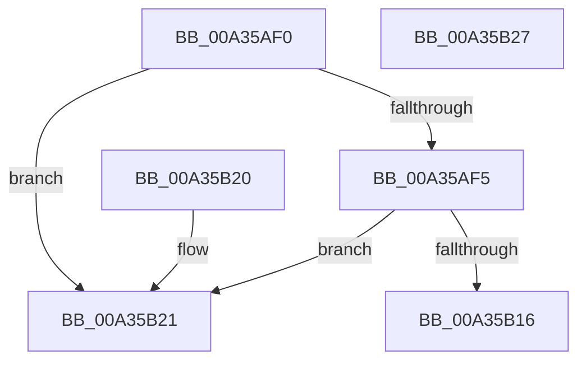

# IoCheckQuerySetFileInformation

- RVA: `0x00A35AF0`–`0x00A35B28` (길이 `56` bytes)
- VA: `0x0000000140A35AF0`
- 실행 섹션: `PAGE`
- PDB 이름 있음: `예`; PDB Function 태그: `아니요`
- unwind 정보 RVA: `0x000DB714`
- 디코드: `18`개 명령, `56/56` bytes 표시
- 미해석 바이트: `0` (있으면 어셈블리에 `.byte`로 보존)

> 이 문서는 커널 이미지의 기계어와 PDB 기호를 분석해 생성했습니다. 4번과 5번은 함수 원형과 자료형을 바이너리 사용 방식에서 추정한 C 해석이며 원본 소스 복구 결과는 아닙니다.

## 1. Dependencies

- 직접 호출 지점: **0**; 고유 호출 대상: **0**
- 직접 호출자로 확인된 함수: **0**
- RIP 상대 이미지 참조: **2**

### Outgoing calls
- 직접 디코드된 call 명령이 없습니다.

### Direct callers
- 이 함수 시작 RVA로 연결되는 직접 call은 확인되지 않았습니다. 간접 호출은 완전히 역산할 수 없습니다.

### Static image references
- `0x00A35AF8` → RVA `0x00B4C880` (`IopQueryOperationLength`; read)
- `0x00A35AFF` → RVA `0x00B4C8E0` (`IopSetOperationLength`; read)

## 2. Other-region calls and transfers

- 다른 실행 섹션으로 향하는 call: **0**
- 별도 외부 분기/꼬리 이동을 확인하지 못했습니다.

## 3. Assembly (complete function range)

```asm
00A35AF0  83 F9 54                        cmp ecx, 0x54
00A35AF3  73 2C                           jae 0x140a35b21
00A35AF5  45 84 C0                        test r8b, r8b
00A35AF8  48 8D 05 81 6D 11 00            lea rax, [rip + 0x116d81]
00A35AFF  4C 8D 0D DA 6D 11 00            lea r9, [rip + 0x116dda]
00A35B06  4C 0F 44 C8                     cmove r9, rax
00A35B0A  48 63 C1                        movsxd rax, ecx
00A35B0D  41 0F BE 0C 01                  movsx ecx, byte ptr [r9 + rax]
00A35B12  84 C9                           test cl, cl
00A35B14  74 0B                           je 0x140a35b21
00A35B16  3B D1                           cmp edx, ecx
00A35B18  1B C0                           sbb eax, eax
00A35B1A  25 04 00 00 C0                  and eax, 0xc0000004
00A35B1F  C3                              ret
00A35B20  CC                              int3
00A35B21  B8 03 00 00 C0                  mov eax, 0xc0000003
00A35B26  C3                              ret
00A35B27  CC                              int3
```

## 4. C-style interpretation (structured pseudocode)

```c
__int64 __fastcall IoCheckQuerySetFileInformation(int a1, int a2, unsigned __int8 a3)
{
    __int64 result;

    if (a1 >= 84) goto loc_00A35B21;
    a4 = v_rip + 1142234;
    if (a3 == 0) { a4 = v_rip + 1142145; }
    if ((unsigned __int8)((__int8)(*(unsigned __int8 *)(a4 + (int)(a1) * 1))) == 0) goto loc_00A35B21;
    result = (unsigned int)(((int)(a1)) & (0xC0000004ULL));
    return result;
loc_00A35B21:
    return (unsigned int)(0xC0000003ULL);
}
```

## 5. (Beta) C Style

```c
int64_t IoCheckQuerySetFileInformation(int32_t Arg1, int32_t Arg2, uint8_t Arg3)
{
    int64_t result;

    if (Arg1 >= 84) goto loc_00A35B21;
    a4 = v_rip + 1142234;
    if (Arg3 == 0) { a4 = v_rip + 1142145; }
    if ((uint8_t)((int8_t)(*(uint8_t *)(a4 + (int32_t)(Arg1) * 1))) == 0) goto loc_00A35B21;
    result = (uint32_t)(((int32_t)(Arg1)) & (0xC0000004ULL));
    return result;
loc_00A35B21:
    return (uint32_t)(0xC0000003ULL);
}
```

## 6. Execution-region graph

[열기: 2D/3D 그래프와 함수 탐색 컨트롤 패널](../../../control-panel.html?section=page&rva=0x00A35AF0&view=graph)

- 2D 그래프는 위에서 아래로 흐르고, 3D 그래프는 빈 공간을 드래그해 회전합니다. Shift+드래그는 이동, 휠은 확대·축소, 함수 노드 선택은 대상 보고서 이동입니다.

### Static fallback


