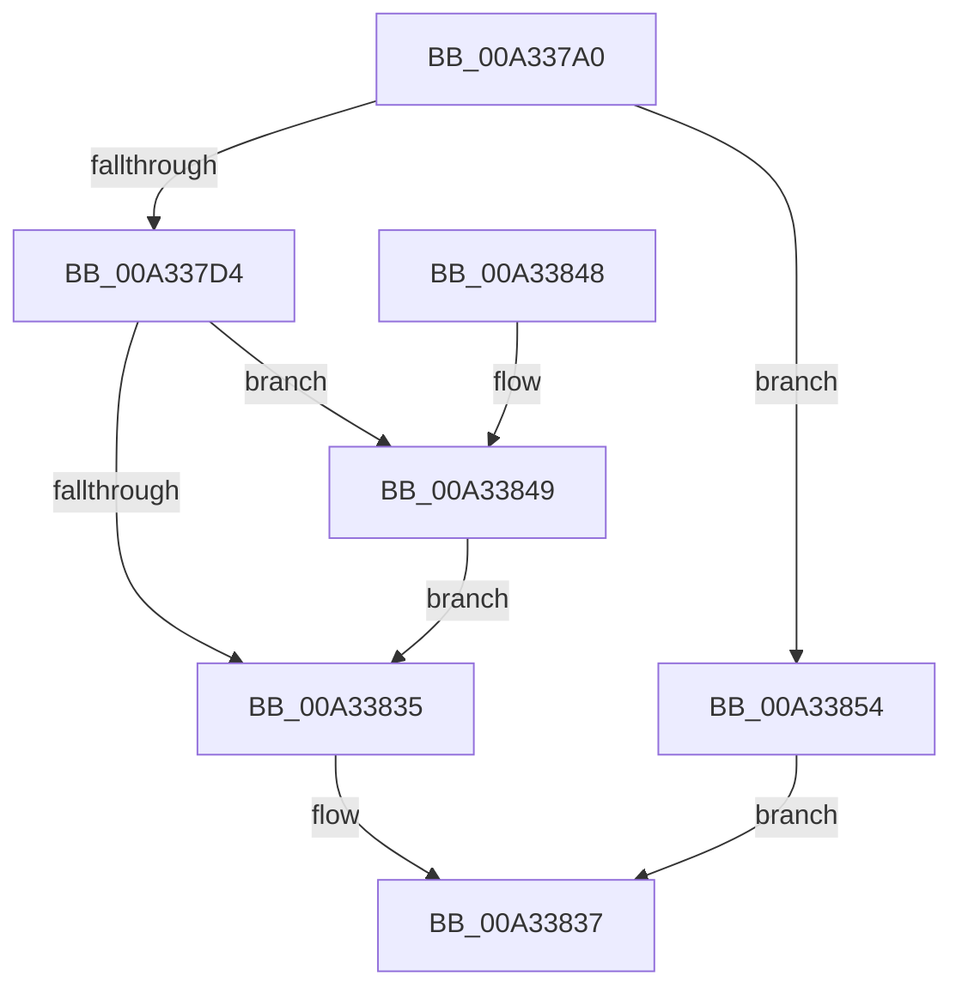

# IoCreateSymbolicLink2

- RVA: `0x00A337A0`–`0x00A3385B` (길이 `187` bytes)
- VA: `0x0000000140A337A0`
- 실행 섹션: `PAGE`
- PDB 이름 있음: `예`; PDB Function 태그: `아니요`
- unwind 정보 RVA: `0x000AD50C`
- 디코드: `48`개 명령, `187/187` bytes 표시
- 미해석 바이트: `0` (있으면 어셈블리에 `.byte`로 보존)

> 이 문서는 커널 이미지의 기계어와 PDB 기호를 분석해 생성했습니다. 4번과 5번은 함수 원형과 자료형을 바이너리 사용 방식에서 추정한 C 해석이며 원본 소스 복구 결과는 아닙니다.

## 1. Dependencies

- 직접 호출 지점: **2**; 고유 호출 대상: **2**
- 직접 호출자로 확인된 함수: **1**
- RIP 상대 이미지 참조: **1**

### Outgoing calls
- `0x00A3382A` → [ObCreateSymbolicLink](ObCreateSymbolicLink_function_00A33B98.md) (function, `0x00A33B98`)
- `0x00A3384D` → [ZwClose](../../text/6A/ZwClose_function_006AD2B0.md) (function, `0x006AD2B0`)

### Direct callers
- [IoCreateSymbolicLink](IoCreateSymbolicLink_function_00A33760.md) at `0x00A33781`

### Static image references
- `0x00A3381A` → RVA `0x00FD9AA8` (`PAGEDATA`; read)

## 2. Other-region calls and transfers

- 다른 실행 섹션으로 향하는 call: **1**
  - `0x00A3384D` → [ZwClose](../../text/6A/ZwClose_function_006AD2B0.md) (`PAGE` → `.text`)
- 별도 외부 분기/꼬리 이동을 확인하지 못했습니다.

## 3. Assembly (complete function range)

```asm
00A337A0  48 89 5C 24 08                  mov qword ptr [rsp + 8], rbx
00A337A5  55                              push rbp
00A337A6  48 8B EC                        mov rbp, rsp
00A337A9  48 81 EC 80 00 00 00            sub rsp, 0x80
00A337B0  33 C0                           xor eax, eax
00A337B2  0F 57 C0                        xorps xmm0, xmm0
00A337B5  21 45 E4                        and dword ptr [rbp - 0x1c], eax
00A337B8  48 21 45 18                     and qword ptr [rbp + 0x18], rax
00A337BC  89 45 CC                        mov dword ptr [rbp - 0x34], eax
00A337BF  21 45 CC                        and dword ptr [rbp - 0x34], eax
00A337C2  8B 02                           mov eax, dword ptr [rdx]
00A337C4  F3 0F 7F 45 B4                  movdqu xmmword ptr [rbp - 0x4c], xmm0
00A337C9  A9 FE FF FF FF                  test eax, 0xfffffffe
00A337CE  0F 85 80 00 00 00               jne 0x140a33854
00A337D4  0F 10 42 08                     movups xmm0, xmmword ptr [rdx + 8]
00A337D8  A8 01                           test al, 1
00A337DA  48 89 4D D8                     mov qword ptr [rbp - 0x28], rcx
00A337DE  B8 00 00 00 00                  mov eax, 0
00A337E3  C7 45 C8 30 00 00 00            mov dword ptr [rbp - 0x38], 0x30
00A337EA  4C 8D 4D B0                     lea r9, [rbp - 0x50]
00A337EE  C7 45 E0 50 02 00 00            mov dword ptr [rbp - 0x20], 0x250
00A337F5  4C 8D 45 C8                     lea r8, [rbp - 0x38]
00A337F9  C6 44 24 20 00                  mov byte ptr [rsp + 0x20], 0
00A337FE  48 8D 4D 18                     lea rcx, [rbp + 0x18]
00A33802  8D 50 02                        lea edx, [rax + 2]
00A33805  0F 45 C2                        cmovne eax, edx
00A33808  48 83 65 D0 00                  and qword ptr [rbp - 0x30], 0
00A3380D  48 83 65 F0 00                  and qword ptr [rbp - 0x10], 0
00A33812  BA 01 00 0F 00                  mov edx, 0xf0001
00A33817  89 45 B0                        mov dword ptr [rbp - 0x50], eax
00A3381A  48 8B 05 87 62 5A 00            mov rax, qword ptr [rip + 0x5a6287]
00A33821  48 89 45 E8                     mov qword ptr [rbp - 0x18], rax
00A33825  F3 0F 7F 45 B8                  movdqu xmmword ptr [rbp - 0x48], xmm0
00A3382A  E8 69 03 00 00                  call 0x140a33b98
00A3382F  8B D8                           mov ebx, eax
00A33831  85 C0                           test eax, eax
00A33833  79 14                           jns 0x140a33849
00A33835  8B C3                           mov eax, ebx
00A33837  48 8B 9C 24 90 00 00 00         mov rbx, qword ptr [rsp + 0x90]
00A3383F  48 81 C4 80 00 00 00            add rsp, 0x80
00A33846  5D                              pop rbp
00A33847  C3                              ret
00A33848  CC                              int3
00A33849  48 8B 4D 18                     mov rcx, qword ptr [rbp + 0x18]
00A3384D  E8 5E 9A C7 FF                  call 0x1406ad2b0
00A33852  EB E1                           jmp 0x140a33835
00A33854  B8 0D 00 00 C0                  mov eax, 0xc000000d
00A33859  EB DC                           jmp 0x140a33837
```

## 4. C-style interpretation (structured pseudocode)

```c
__int64 __fastcall IoCreateSymbolicLink2(__int64 a1, __int64 a2)
{
    __int64 result;
    __int64 v_rsp;
    unsigned __int64 v_stack_m18;
    unsigned __int64 v_stack_m20;
    unsigned int v_stack_m24;
    unsigned int v_stack_m28;
    unsigned __int64 v_stack_m30;
    unsigned __int64 v_stack_m38;
    unsigned int v_stack_m3C;
    unsigned int v_stack_m40;
    unsigned __int64 v_stack_m50;
    unsigned __int64 v_stack_m54;
    unsigned __int64 v_stack_m58;
    unsigned __int8 v_stack_m68;
    unsigned __int64 v_stack_p10;
    unsigned __int64 v_stack_p8;

    v_stack_p8 = v_rbx;
    v_rsp = (v_rsp) - (128);
    result = 0;
    v_stack_m3C = 0;
    v_stack_m54 = v_xmm0;
    if ((((unsigned int)((unsigned int)(*(unsigned int *)(a2)))) & (0xFFFFFFFEULL)) != 0) goto loc_00A33854;
    v_stack_m30 = a1;
    v_stack_m40 = 48;
    v_stack_m28 = 592;
    v_stack_m68 = 0;
    result = 0;
    if ((((unsigned __int8)((unsigned int)(*(unsigned int *)(a2)))) & (1)) != 0) { result = (unsigned int)(0 + 2); }
    v_stack_m58 = (unsigned int)(result);
    v_stack_m20 = *(unsigned __int64 *)(v_rip + 5923463);
    v_stack_m50 = v_xmm0;
    result = ObCreateSymbolicLink(v_stack_p10, (unsigned int)(0xF0001ULL), v_stack_m40, v_stack_m58);
    if (!sign_flag) goto loc_00A33849;
loc_00A33835:
loc_00A33837:
    v_rsp = (v_rsp) + (128);
    return (unsigned int)((unsigned int)((unsigned int)((unsigned int)(result))));
loc_00A33849:
    result = ZwClose(v_stack_p10, (unsigned int)(0xF0001ULL), v_stack_m40, v_stack_m58);
    goto loc_00A33835;
loc_00A33854:
    goto loc_00A33837;
}
```

## 5. (Beta) C Style

```c
int64_t IoCreateSymbolicLink2(int64_t Arg1, void *Arg2)
{
    uint8_t *arg2 = (uint8_t *)Arg2;

    int64_t result;
    int64_t local_rsp;
    uint64_t v_stack_m18;
    uint64_t v_stack_m20;
    uint32_t v_stack_m24;
    uint32_t v_stack_m28;
    uint64_t v_stack_m30;
    uint64_t v_stack_m38;
    uint32_t v_stack_m3C;
    uint32_t v_stack_m40;
    uint64_t v_stack_m50;
    uint64_t v_stack_m54;
    uint64_t v_stack_m58;
    uint8_t v_stack_m68;
    uint64_t v_stack_p10;
    uint64_t v_stack_p8;

    v_stack_p8 = local_rbx;
    local_rsp = (local_rsp) - (128);
    result = 0;
    v_stack_m3C = 0;
    v_stack_m54 = v_xmm0;
    if ((((uint32_t)((uint32_t)(*(uint32_t *)(arg2)))) & (0xFFFFFFFEULL)) != 0) goto loc_00A33854;
    v_stack_m30 = Arg1;
    v_stack_m40 = 48;
    v_stack_m28 = 592;
    v_stack_m68 = 0;
    result = 0;
    if ((((uint8_t)((uint32_t)(*(uint32_t *)(arg2)))) & (1)) != 0) { result = (uint32_t)(0 + 2); }
    v_stack_m58 = (uint32_t)(result);
    v_stack_m20 = *(uint64_t *)(v_rip + 0x5A6287);
    v_stack_m50 = v_xmm0;
    result = ObCreateSymbolicLink(v_stack_p10, (uint32_t)(0xF0001ULL), v_stack_m40, v_stack_m58);
    if (!sign_flag) goto loc_00A33849;
loc_00A33835:
loc_00A33837:
    local_rsp = (local_rsp) + (128);
    return (uint32_t)((uint32_t)((uint32_t)((uint32_t)(result))));
loc_00A33849:
    result = ZwClose(v_stack_p10, (uint32_t)(0xF0001ULL), v_stack_m40, v_stack_m58);
    goto loc_00A33835;
loc_00A33854:
    goto loc_00A33837;
}
```

### 관측된 메모리 오프셋

구조체 형식이 확인되지 않은 접근은 인자 기준의 오프셋으로만 기록했습니다.

| 기준 인자 | 오프셋 표현 | 폭 (bit) | 접근 |
|---|---:|---:|---|
| `Arg2` | `+ 0x0` | `32` | `R` |
| `Arg2` | `+ 0x8` | `128` | `R` |

## 6. Execution-region graph

[열기: 2D/3D 그래프와 함수 탐색 컨트롤 패널](../../../control-panel.html?section=page&rva=0x00A337A0&view=graph)

- 2D 그래프는 위에서 아래로 흐르고, 3D 그래프는 빈 공간을 드래그해 회전합니다. Shift+드래그는 이동, 휠은 확대·축소, 함수 노드 선택은 대상 보고서 이동입니다.

### Static fallback


