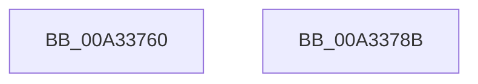

# IoCreateSymbolicLink

- RVA: `0x00A33760`–`0x00A3378C` (길이 `44` bytes)
- VA: `0x0000000140A33760`
- 실행 섹션: `PAGE`
- PDB 이름 있음: `예`; PDB Function 태그: `아니요`
- unwind 정보 RVA: `0x00063458`
- 디코드: `12`개 명령, `44/44` bytes 표시
- 미해석 바이트: `0` (있으면 어셈블리에 `.byte`로 보존)

> 이 문서는 커널 이미지의 기계어와 PDB 기호를 분석해 생성했습니다. 4번과 5번은 함수 원형과 자료형을 바이너리 사용 방식에서 추정한 C 해석이며 원본 소스 복구 결과는 아닙니다.

## 1. Dependencies

- 직접 호출 지점: **1**; 고유 호출 대상: **1**
- 직접 호출자로 확인된 함수: **6**
- RIP 상대 이미지 참조: **0**

### Outgoing calls
- `0x00A33781` → [IoCreateSymbolicLink2](IoCreateSymbolicLink2_function_00A337A0.md) (function, `0x00A337A0`)

### Direct callers
- [DifIoCreateSymbolicLinkWrapper](../../text/62/DifIoCreateSymbolicLinkWrapper_function_00629670.md) at `0x00629744`
- [sub_00B46364](../B4/Unknown_function_00B46364.md) at `0x00B463FB`
- [sub_00B46364](../B4/Unknown_function_00B46364.md) at `0x00B464F4`
- [IopCreateArcNamesCd](../../init/C2/IopCreateArcNamesCd_function_00C2C060.md) at `0x00C2C4E6`
- [WmipDriverEntry](../../init/C4/WmipDriverEntry_function_00C4D490.md) at `0x00C4D593`
- [CimfsInitialize](../../init/C6/CimfsInitialize_function_00C6E64C.md) at `0x00C6E95B`
- [RamdiskCreateSymbolicLink](../../init/C6/RamdiskCreateSymbolicLink_function_00C6EDB8.md) at `0x00C6EEA1`

### Static image references
- 디코드된 RIP-relative 메모리 참조가 없습니다.

## 2. Other-region calls and transfers

- 다른 실행 섹션으로 향하는 call: **0**
- 별도 외부 분기/꼬리 이동을 확인하지 못했습니다.

## 3. Assembly (complete function range)

```asm
00A33760  48 83 EC 48                     sub rsp, 0x48
00A33764  0F 57 C0                        xorps xmm0, xmm0
00A33767  33 C0                           xor eax, eax
00A33769  21 44 24 20                     and dword ptr [rsp + 0x20], eax
00A3376D  F3 0F 7F 44 24 24               movdqu xmmword ptr [rsp + 0x24], xmm0
00A33773  0F 10 02                        movups xmm0, xmmword ptr [rdx]
00A33776  48 8D 54 24 20                  lea rdx, [rsp + 0x20]
00A3377B  F3 0F 7F 44 24 28               movdqu xmmword ptr [rsp + 0x28], xmm0
00A33781  E8 1A 00 00 00                  call 0x140a337a0
00A33786  48 83 C4 48                     add rsp, 0x48
00A3378A  C3                              ret
00A3378B  CC                              int3
```

## 4. C-style interpretation (structured pseudocode)

```c
__int64 __fastcall IoCreateSymbolicLink(__int64 a1, __int64 a2)
{
    __int64 result;
    __int64 v_rsp;
    unsigned __int64 v_stack_m20;
    unsigned __int64 v_stack_m24;
    unsigned int v_stack_m28;

    v_rsp = (v_rsp) - (72);
    result = 0;
    v_stack_m24 = v_xmm0;
    v_stack_m20 = v_xmm0;
    result = IoCreateSymbolicLink2(a1, v_stack_m28, a3, a4);
    v_rsp = (v_rsp) + (72);
    return result;
}
```

## 5. (Beta) C Style

```c
int64_t IoCreateSymbolicLink(int64_t Arg1, void *Arg2)
{
    uint8_t *arg2 = (uint8_t *)Arg2;

    int64_t result;
    int64_t local_rsp;
    uint64_t v_stack_m20;
    uint64_t v_stack_m24;
    uint32_t v_stack_m28;

    local_rsp = (local_rsp) - (72);
    result = 0;
    v_stack_m24 = v_xmm0;
    v_stack_m20 = v_xmm0;
    result = IoCreateSymbolicLink2(Arg1, v_stack_m28, a3, a4);
    local_rsp = (local_rsp) + (72);
    return result;
}
```

### 관측된 메모리 오프셋

구조체 형식이 확인되지 않은 접근은 인자 기준의 오프셋으로만 기록했습니다.

| 기준 인자 | 오프셋 표현 | 폭 (bit) | 접근 |
|---|---:|---:|---|
| `Arg2` | `+ 0x0` | `128` | `R` |

## 6. Execution-region graph

[열기: 2D/3D 그래프와 함수 탐색 컨트롤 패널](../../../control-panel.html?section=page&rva=0x00A33760&view=graph)

- 2D 그래프는 위에서 아래로 흐르고, 3D 그래프는 빈 공간을 드래그해 회전합니다. Shift+드래그는 이동, 휠은 확대·축소, 함수 노드 선택은 대상 보고서 이동입니다.

### Static fallback


