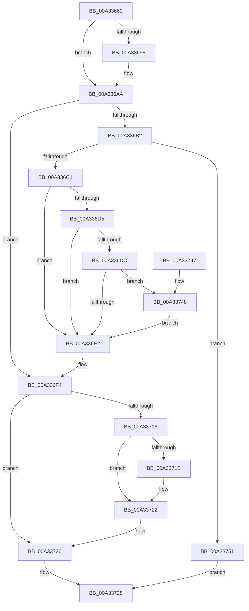

# IopCopyOverNewPathSecure

- RVA: `0x00A33660`–`0x00A33758` (길이 `248` bytes)
- VA: `0x0000000140A33660`
- 실행 섹션: `PAGE`
- PDB 이름 있음: `예`; PDB Function 태그: `아니요`
- unwind 정보 RVA: `0x000AD4EC`
- 디코드: `72`개 명령, `248/248` bytes 표시
- 미해석 바이트: `0` (있으면 어셈블리에 `.byte`로 보존)

> 이 문서는 커널 이미지의 기계어와 PDB 기호를 분석해 생성했습니다. 4번과 5번은 함수 원형과 자료형을 바이너리 사용 방식에서 추정한 C 해석이며 원본 소스 복구 결과는 아닙니다.

## 1. Dependencies

- 직접 호출 지점: **3**; 고유 호출 대상: **2**
- 직접 호출자로 확인된 함수: **1**
- RIP 상대 이미지 참조: **0**

### Outgoing calls
- `0x00A3369E` → [memcpy](../../text/6C/memcpy_function_006C6840.md) (function, `0x006C6840`)
- `0x00A336E8` → [memcpy](../../text/6C/memcpy_function_006C6840.md) (function, `0x006C6840`)
- `0x00A3371D` → [ExFreePoolWithTag](../../poolcode/B8/ExFreePoolWithTag_function_00B82870.md) (function, `0x00B82870`)

### Direct callers
- [IopGraftName](IopGraftName_function_00A33160.md) at `0x00A3335E`

### Static image references
- 디코드된 RIP-relative 메모리 참조가 없습니다.

## 2. Other-region calls and transfers

- 다른 실행 섹션으로 향하는 call: **3**
  - `0x00A3369E` → [memcpy](../../text/6C/memcpy_function_006C6840.md) (`PAGE` → `.text`)
  - `0x00A336E8` → [memcpy](../../text/6C/memcpy_function_006C6840.md) (`PAGE` → `.text`)
  - `0x00A3371D` → [ExFreePoolWithTag](../../poolcode/B8/ExFreePoolWithTag_function_00B82870.md) (`PAGE` → `POOLCODE`)
- 별도 외부 분기/꼬리 이동을 확인하지 못했습니다.

## 3. Assembly (complete function range)

```asm
00A33660  48 8B C4                        mov rax, rsp
00A33663  48 89 58 08                     mov qword ptr [rax + 8], rbx
00A33667  48 89 68 10                     mov qword ptr [rax + 0x10], rbp
00A3366B  48 89 70 18                     mov qword ptr [rax + 0x18], rsi
00A3366F  48 89 78 20                     mov qword ptr [rax + 0x20], rdi
00A33673  41 54                           push r12
00A33675  41 55                           push r13
00A33677  41 57                           push r15
00A33679  48 83 EC 20                     sub rsp, 0x20
00A3367D  45 0F B7 E0                     movzx r12d, r8w
00A33681  45 33 ED                        xor r13d, r13d
00A33684  49 8B F1                        mov rsi, r9
00A33687  48 8B F9                        mov rdi, rcx
00A3368A  48 8B D9                        mov rbx, rcx
00A3368D  BD 02 00 00 00                  mov ebp, 2
00A33692  66 45 85 E4                     test r12w, r12w
00A33696  74 12                           je 0x140a336aa
00A33698  45 8B C4                        mov r8d, r12d
00A3369B  41 8B DC                        mov ebx, r12d
00A3369E  E8 9D 31 C9 FF                  call 0x1406c6840
00A336A3  48 D1 EB                        shr rbx, 1
00A336A6  48 8D 1C 5F                     lea rbx, [rdi + rbx*2]
00A336AA  66 44 39 6C 24 60               cmp word ptr [rsp + 0x60], r13w
00A336B0  74 42                           je 0x140a336f4
00A336B2  0F B7 46 58                     movzx eax, word ptr [rsi + 0x58]
00A336B6  66 39 44 24 60                  cmp word ptr [rsp + 0x60], ax
00A336BB  0F 87 90 00 00 00               ja 0x140a33751
00A336C1  44 0F B7 7C 24 60               movzx r15d, word ptr [rsp + 0x60]
00A336C7  8B D0                           mov edx, eax
00A336C9  49 2B D7                        sub rdx, r15
00A336CC  48 03 56 60                     add rdx, qword ptr [rsi + 0x60]
00A336D0  48 3B DF                        cmp rbx, rdi
00A336D3  76 0D                           jbe 0x140a336e2
00A336D5  66 83 7B FE 5C                  cmp word ptr [rbx - 2], 0x5c
00A336DA  75 06                           jne 0x140a336e2
00A336DC  66 83 3A 5C                     cmp word ptr [rdx], 0x5c
00A336E0  74 66                           je 0x140a33748
00A336E2  4D 8B C7                        mov r8, r15
00A336E5  48 8B CB                        mov rcx, rbx
00A336E8  E8 53 31 C9 FF                  call 0x1406c6840
00A336ED  49 D1 EF                        shr r15, 1
00A336F0  4A 8D 1C 7B                     lea rbx, [rbx + r15*2]
00A336F4  66 41 03 EC                     add bp, r12w
00A336F8  66 03 6C 24 60                  add bp, word ptr [rsp + 0x60]
00A336FD  66 89 6E 5A                     mov word ptr [rsi + 0x5a], bp
00A33701  66 83 ED 02                     sub bp, 2
00A33705  66 89 6E 58                     mov word ptr [rsi + 0x58], bp
00A33709  66 44 89 2B                     mov word ptr [rbx], r13w
00A3370D  48 8B 4E 60                     mov rcx, qword ptr [rsi + 0x60]
00A33711  48 3B F9                        cmp rdi, rcx
00A33714  74 10                           je 0x140a33726
00A33716  48 85 C9                        test rcx, rcx
00A33719  74 07                           je 0x140a33722
00A3371B  33 D2                           xor edx, edx
00A3371D  E8 4E F1 14 00                  call 0x140b82870
00A33722  48 89 7E 60                     mov qword ptr [rsi + 0x60], rdi
00A33726  33 C0                           xor eax, eax
00A33728  48 8B 5C 24 40                  mov rbx, qword ptr [rsp + 0x40]
00A3372D  48 8B 6C 24 48                  mov rbp, qword ptr [rsp + 0x48]
00A33732  48 8B 74 24 50                  mov rsi, qword ptr [rsp + 0x50]
00A33737  48 8B 7C 24 58                  mov rdi, qword ptr [rsp + 0x58]
00A3373C  48 83 C4 20                     add rsp, 0x20
00A33740  41 5F                           pop r15
00A33742  41 5D                           pop r13
00A33744  41 5C                           pop r12
00A33746  C3                              ret
00A33747  CC                              int3
00A33748  48 83 C3 FE                     add rbx, -2
00A3374C  41 8B ED                        mov ebp, r13d
00A3374F  EB 91                           jmp 0x140a336e2
00A33751  B8 80 02 00 C0                  mov eax, 0xc0000280
00A33756  EB D0                           jmp 0x140a33728
```

## 4. C-style interpretation (structured pseudocode)

```c
__int64 __fastcall IopCopyOverNewPathSecure(__int64 a1, __int64 a2, unsigned __int16 a3, __int64 a4, unsigned __int16 a5)
{
    __int64 result;
    __int64 v_r13;
    __int64 v_r15;
    __int64 v_rbp;
    __int64 v_rbx;
    __int64 v_rsp;
    unsigned __int64 v_stack_p10;
    unsigned __int64 v_stack_p18;
    unsigned __int64 v_stack_p20;
    unsigned __int64 v_stack_p8;

    *(unsigned __int64 *)(v_rsp + 8) = v_rbx;
    *(unsigned __int64 *)(v_rsp + 16) = v_rbp;
    *(unsigned __int64 *)(v_rsp + 24) = v_rsi;
    *(unsigned __int64 *)(v_rsp + 32) = v_rdi;
    v_rsp = (v_rsp) - (32);
    v_r13 = 0;
    result = v_rsp;
    v_rbx = a1;
    if (a3 != 0) {
        a3 = a3;
        v_rbx = a3;
        result = memcpy(a1, a2, a3, a4);
        v_rbx = (v_rbx) >> (1);
        v_rbx = a1 + v_rbx * 2;
    }
    if (a5 == 0) goto loc_00A336F4;
    if (a5 > ((unsigned __int16)(*(unsigned __int16 *)(a4 + 88)))) goto loc_00A33751;
    a2 = ((unsigned int)((unsigned int)(*(unsigned __int16 *)(a4 + 88)))) - (a5);
    a2 = (a2) + (*(unsigned __int64 *)(a4 + 96));
    if (v_rbx <= a1) goto loc_00A336E2;
    if ((*(unsigned __int16 *)(v_rbx - 2)) != 92) goto loc_00A336E2;
    if ((*(unsigned __int16 *)(a2)) == 92) goto loc_00A33748;
loc_00A336E2:
    result = memcpy(v_rbx, a2, a5, a4);
    v_r15 = (a5) >> (1);
loc_00A336F4:
    v_rbp = (unsigned __int16)((2) + (a3));
    v_rbp = (unsigned __int16)((v_rbp) + (a5));
    *(unsigned __int16 *)(a4 + 90) = (unsigned __int16)(v_rbp);
    v_rbp = (unsigned __int16)((v_rbp) - (2));
    *(unsigned __int16 *)(a4 + 88) = (unsigned __int16)(v_rbp);
    *(unsigned __int16 *)(v_rbx + v_r15 * 2) = 0;
    if (a1 == (*(unsigned __int64 *)(a4 + 96))) goto loc_00A33726;
    if (*(unsigned __int64 *)(a4 + 96) != 0) {
        a2 = 0;
        result = ExFreePoolWithTag(*(unsigned __int64 *)(a4 + 96), a2, a5, a4);
    }
    *(unsigned __int64 *)(a4 + 96) = a1;
loc_00A33726:
    result = 0;
loc_00A33728:
    v_rsp = (v_rsp) + (32);
    return result;
loc_00A33748:
    v_rbx = (v_stack_p8) + (-2);
    goto loc_00A336E2;
loc_00A33751:
    goto loc_00A33728;
}
```

## 5. (Beta) C Style

```c
int64_t IopCopyOverNewPathSecure(void *Arg1, int64_t Arg2, uint16_t Arg3, void *Arg4, uint16_t Arg5)
{
    uint8_t *arg1 = (uint8_t *)Arg1;
    uint8_t *arg4 = (uint8_t *)Arg4;

    int64_t result;
    int64_t local_r13;
    int64_t local_r15;
    int64_t local_rbp;
    int64_t local_rbx;
    int64_t local_rsp;
    uint64_t v_stack_p10;
    uint64_t v_stack_p18;
    uint64_t v_stack_p20;
    uint64_t v_stack_p8;

    *(uint64_t *)(local_rsp + 0x8) = local_rbx;
    *(uint64_t *)(local_rsp + 0x10) = local_rbp;
    *(uint64_t *)(local_rsp + 0x18) = local_rsi;
    *(uint64_t *)(local_rsp + 0x20) = local_rdi;
    local_rsp = (local_rsp) - (32);
    local_r13 = 0;
    result = local_rsp;
    local_rbx = Arg1;
    if (Arg3 != 0) {
        Arg3 = Arg3;
        local_rbx = Arg3;
        result = memcpy(Arg1, Arg2, Arg3, Arg4);
        local_rbx = (local_rbx) >> (1);
        local_rbx = Arg1 + local_rbx * 2;
    }
    if (Arg5 == 0) goto loc_00A336F4;
    if (Arg5 > ((uint16_t)(*(uint16_t *)(arg4 + 0x58)))) goto loc_00A33751;
    Arg2 = ((uint32_t)((uint32_t)(*(uint16_t *)(arg4 + 0x58)))) - (Arg5);
    Arg2 = (Arg2) + (*(uint64_t *)(arg4 + 0x60));
    if (local_rbx <= Arg1) goto loc_00A336E2;
    if ((*(uint16_t *)(local_rbx - 0x2)) != 92) goto loc_00A336E2;
    if ((*(uint16_t *)(Arg2)) == 92) goto loc_00A33748;
loc_00A336E2:
    result = memcpy(local_rbx, Arg2, Arg5, Arg4);
    local_r15 = (Arg5) >> (1);
loc_00A336F4:
    local_rbp = (uint16_t)((2) + (Arg3));
    local_rbp = (uint16_t)((local_rbp) + (Arg5));
    *(uint16_t *)(arg4 + 0x5A) = (uint16_t)(local_rbp);
    local_rbp = (uint16_t)((local_rbp) - (2));
    *(uint16_t *)(arg4 + 0x58) = (uint16_t)(local_rbp);
    *(uint16_t *)(local_rbx + local_r15 * 2) = 0;
    if (Arg1 == (*(uint64_t *)(arg4 + 0x60))) goto loc_00A33726;
    if (*(uint64_t *)(arg4 + 0x60) != 0) {
        Arg2 = 0;
        result = ExFreePoolWithTag(*(uint64_t *)(arg4 + 0x60), Arg2, Arg5, Arg4);
    }
    *(void **)(arg4 + 0x60) = Arg1;
loc_00A33726:
    result = 0;
loc_00A33728:
    local_rsp = (local_rsp) + (32);
    return result;
loc_00A33748:
    local_rbx = (v_stack_p8) + (-2);
    goto loc_00A336E2;
loc_00A33751:
    goto loc_00A33728;
}
```

### 관측된 메모리 오프셋

구조체 형식이 확인되지 않은 접근은 인자 기준의 오프셋으로만 기록했습니다.

| 기준 인자 | 오프셋 표현 | 폭 (bit) | 접근 |
|---|---:|---:|---|
| `Arg1` | `+ 0x0 + rbx*2` | `64` | `R` |
| `Arg4` | `+ 0x58` | `16` | `R` |
| `Arg4` | `+ 0x58` | `16` | `W` |
| `Arg4` | `+ 0x5A` | `16` | `W` |
| `Arg4` | `+ 0x60` | `64` | `R` |
| `Arg4` | `+ 0x60` | `64` | `W` |

## 6. Execution-region graph

[열기: 2D/3D 그래프와 함수 탐색 컨트롤 패널](../../../control-panel.html?section=page&rva=0x00A33660&view=graph)

- 2D 그래프는 위에서 아래로 흐르고, 3D 그래프는 빈 공간을 드래그해 회전합니다. Shift+드래그는 이동, 휠은 확대·축소, 함수 노드 선택은 대상 보고서 이동입니다.

### Static fallback


