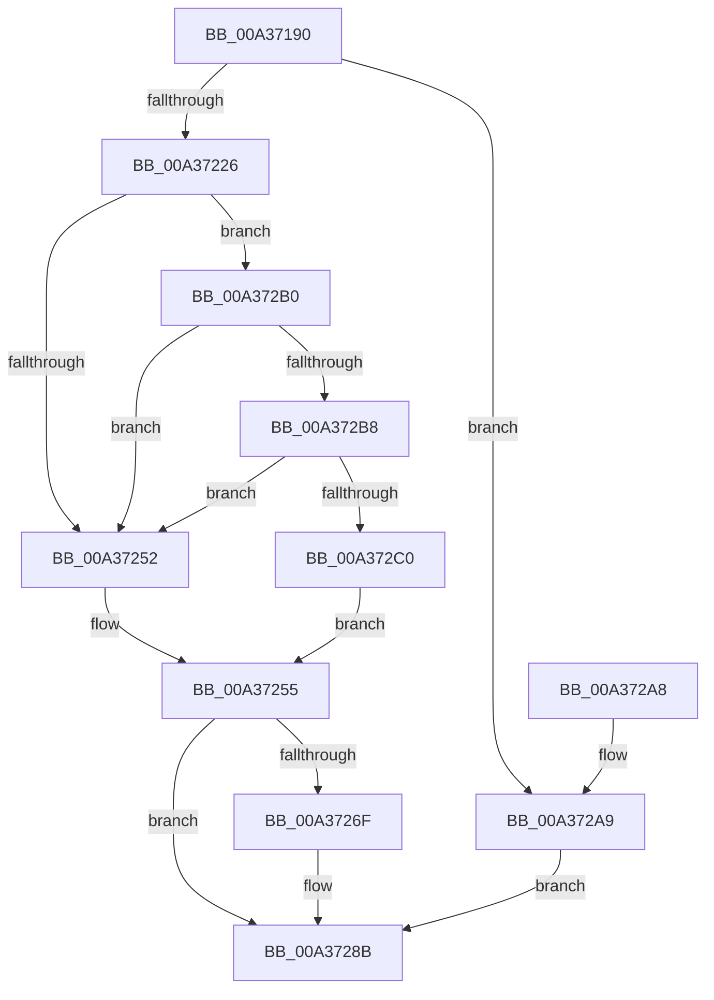

# IopGetSetObjectId

- RVA: `0x00A37190`–`0x00A372C5` (길이 `309` bytes)
- VA: `0x0000000140A37190`
- 실행 섹션: `PAGE`
- PDB 이름 있음: `예`; PDB Function 태그: `아니요`
- unwind 정보 RVA: `0x000ADA48`
- 디코드: `82`개 명령, `309/309` bytes 표시
- 미해석 바이트: `0` (있으면 어셈블리에 `.byte`로 보존)

> 이 문서는 커널 이미지의 기계어와 PDB 기호를 분석해 생성했습니다. 4번과 5번은 함수 원형과 자료형을 바이너리 사용 방식에서 추정한 C 해석이며 원본 소스 복구 결과는 아닙니다.

## 1. Dependencies

- 직접 호출 지점: **6**; 고유 호출 대상: **6**
- 직접 호출자로 확인된 함수: **1**
- RIP 상대 이미지 참조: **0**

### Outgoing calls
- `0x00A371D6` → [KeInitializeEvent](../../text/40/KeInitializeEvent_function_0040DD10.md) (function, `0x0040DD10`)
- `0x00A371DE` → [IoGetRelatedDeviceObject](../../text/29/IoGetRelatedDeviceObject_function_0029B120.md) (function, `0x0029B120`)
- `0x00A37215` → [IoBuildDeviceIoControlRequest](../../text/20/IoBuildDeviceIoControlRequest_function_00204FD0.md) (function, `0x00204FD0`)
- `0x00A37258` → [ObfReferenceObject](../../text/20/ObfReferenceObject_function_0020FA20.md) (function, `0x0020FA20`)
- `0x00A37263` → [IofCallDriver](../../text/29/IofCallDriver_function_0029B4B0.md) (function, `0x0029B4B0`)
- `0x00A37282` → [KeWaitForSingleObject](../../text/20/KeWaitForSingleObject_function_0020E6B0.md) (function, `0x0020E6B0`)

### Direct callers
- [IopTrackLink](IopTrackLink_function_00A36764.md) at `0x00A368E5`
- [IopTrackLink](IopTrackLink_function_00A36764.md) at `0x00A36943`
- [IopTrackLink](IopTrackLink_function_00A36764.md) at `0x00A369E4`
- [IopTrackLink](IopTrackLink_function_00A36764.md) at `0x00A36AA6`
- [IopTrackLink](IopTrackLink_function_00A36764.md) at `0x00A36AD6`
- [IopTrackLink](IopTrackLink_function_00A36764.md) at `0x00A36AFC`
- [IopTrackLink](IopTrackLink_function_00A36764.md) at `0x00A36C4D`
- [IopTrackLink](IopTrackLink_function_00A36764.md) at `0x00A36D17`
- [IopTrackLink](IopTrackLink_function_00A36764.md) at `0x00A36D3B`
- [IopTrackLink](IopTrackLink_function_00A36764.md) at `0x00A36D45`
- [IopTrackLink](IopTrackLink_function_00A36764.md) at `0x00A36DB0`
- [IopTrackLink](IopTrackLink_function_00A36764.md) at `0x00A36DE1`
- [IopTrackLink](IopTrackLink_function_00A36764.md) at `0x00A36E5E`
- [IopTrackLink](IopTrackLink_function_00A36764.md) at `0x00A36F26`
- [IopTrackLink](IopTrackLink_function_00A36764.md) at `0x00A36F50`
- [IopTrackLink](IopTrackLink_function_00A36764.md) at `0x00A36FE9`
- [IopTrackLink](IopTrackLink_function_00A36764.md) at `0x00A37013`

### Static image references
- 디코드된 RIP-relative 메모리 참조가 없습니다.

## 2. Other-region calls and transfers

- 다른 실행 섹션으로 향하는 call: **6**
  - `0x00A371D6` → [KeInitializeEvent](../../text/40/KeInitializeEvent_function_0040DD10.md) (`PAGE` → `.text`)
  - `0x00A371DE` → [IoGetRelatedDeviceObject](../../text/29/IoGetRelatedDeviceObject_function_0029B120.md) (`PAGE` → `.text`)
  - `0x00A37215` → [IoBuildDeviceIoControlRequest](../../text/20/IoBuildDeviceIoControlRequest_function_00204FD0.md) (`PAGE` → `.text`)
  - `0x00A37258` → [ObfReferenceObject](../../text/20/ObfReferenceObject_function_0020FA20.md) (`PAGE` → `.text`)
  - `0x00A37263` → [IofCallDriver](../../text/29/IofCallDriver_function_0029B4B0.md) (`PAGE` → `.text`)
  - `0x00A37282` → [KeWaitForSingleObject](../../text/20/KeWaitForSingleObject_function_0020E6B0.md) (`PAGE` → `.text`)
- 별도 외부 분기/꼬리 이동을 확인하지 못했습니다.

## 3. Assembly (complete function range)

```asm
00A37190  4C 8B DC                        mov r11, rsp
00A37193  49 89 5B 08                     mov qword ptr [r11 + 8], rbx
00A37197  49 89 6B 10                     mov qword ptr [r11 + 0x10], rbp
00A3719B  49 89 73 18                     mov qword ptr [r11 + 0x18], rsi
00A3719F  57                              push rdi
00A371A0  41 56                           push r14
00A371A2  41 57                           push r15
00A371A4  48 81 EC 80 00 00 00            sub rsp, 0x80
00A371AB  0F 57 C9                        xorps xmm1, xmm1
00A371AE  41 8B E8                        mov ebp, r8d
00A371B1  4C 8B F2                        mov r14, rdx
00A371B4  48 8B F1                        mov rsi, rcx
00A371B7  0F 57 C0                        xorps xmm0, xmm0
00A371BA  49 8D 4B C8                     lea rcx, [r11 - 0x38]
00A371BE  33 C0                           xor eax, eax
00A371C0  45 33 C0                        xor r8d, r8d
00A371C3  0F 11 4C 24 60                  movups xmmword ptr [rsp + 0x60], xmm1
00A371C8  33 D2                           xor edx, edx
00A371CA  49 89 43 D8                     mov qword ptr [r11 - 0x28], rax
00A371CE  41 8B F9                        mov edi, r9d
00A371D1  0F 11 44 24 50                  movups xmmword ptr [rsp + 0x50], xmm0
00A371D6  E8 35 6B 9D FF                  call 0x14040dd10
00A371DB  48 8B CE                        mov rcx, rsi
00A371DE  E8 3D 3F 86 FF                  call 0x14029b120
00A371E3  4C 8B F8                        mov r15, rax
00A371E6  45 33 C9                        xor r9d, r9d
00A371E9  48 8D 44 24 50                  lea rax, [rsp + 0x50]
00A371EE  45 33 C0                        xor r8d, r8d
00A371F1  48 89 44 24 40                  mov qword ptr [rsp + 0x40], rax
00A371F6  49 8B D7                        mov rdx, r15
00A371F9  48 8D 44 24 60                  lea rax, [rsp + 0x60]
00A371FE  8B CF                           mov ecx, edi
00A37200  48 89 44 24 38                  mov qword ptr [rsp + 0x38], rax
00A37205  C6 44 24 30 00                  mov byte ptr [rsp + 0x30], 0
00A3720A  83 64 24 28 00                  and dword ptr [rsp + 0x28], 0
00A3720F  48 83 64 24 20 00               and qword ptr [rsp + 0x20], 0
00A37215  E8 B6 DD 7C FF                  call 0x140204fd0
00A3721A  48 8B D8                        mov rbx, rax
00A3721D  48 85 C0                        test rax, rax
00A37220  0F 84 83 00 00 00               je 0x140a372a9
00A37226  83 48 10 04                     or dword ptr [rax + 0x10], 4
00A3722A  4C 89 70 70                     mov qword ptr [rax + 0x70], r14
00A3722E  4C 89 70 18                     mov qword ptr [rax + 0x18], r14
00A37232  48 89 B0 C0 00 00 00            mov qword ptr [rax + 0xc0], rsi
00A37239  48 8B 80 B8 00 00 00            mov rax, qword ptr [rax + 0xb8]
00A37240  48 89 70 E8                     mov qword ptr [rax - 0x18], rsi
00A37244  66 C7 40 B8 0D 04               mov word ptr [rax - 0x48], 0x40d
00A3724A  81 FF 9C 00 09 00               cmp edi, 0x9009c
00A37250  75 5E                           jne 0x140a372b0
00A37252  89 68 C0                        mov dword ptr [rax - 0x40], ebp
00A37255  48 8B CE                        mov rcx, rsi
00A37258  E8 C3 87 7D FF                  call 0x14020fa20
00A3725D  48 8B D3                        mov rdx, rbx
00A37260  49 8B CF                        mov rcx, r15
00A37263  E8 48 42 86 FF                  call 0x14029b4b0
00A37268  3D 03 01 00 00                  cmp eax, 0x103
00A3726D  75 1C                           jne 0x140a3728b
00A3726F  48 83 64 24 20 00               and qword ptr [rsp + 0x20], 0
00A37275  48 8D 4C 24 60                  lea rcx, [rsp + 0x60]
00A3727A  45 33 C9                        xor r9d, r9d
00A3727D  45 33 C0                        xor r8d, r8d
00A37280  33 D2                           xor edx, edx
00A37282  E8 29 74 7D FF                  call 0x14020e6b0
00A37287  8B 44 24 50                     mov eax, dword ptr [rsp + 0x50]
00A3728B  4C 8D 9C 24 80 00 00 00         lea r11, [rsp + 0x80]
00A37293  49 8B 5B 20                     mov rbx, qword ptr [r11 + 0x20]
00A37297  49 8B 6B 28                     mov rbp, qword ptr [r11 + 0x28]
00A3729B  49 8B 73 30                     mov rsi, qword ptr [r11 + 0x30]
00A3729F  49 8B E3                        mov rsp, r11
00A372A2  41 5F                           pop r15
00A372A4  41 5E                           pop r14
00A372A6  5F                              pop rdi
00A372A7  C3                              ret
00A372A8  CC                              int3
00A372A9  B8 9A 00 00 C0                  mov eax, 0xc000009a
00A372AE  EB DB                           jmp 0x140a3728b
00A372B0  81 FF E8 00 14 00               cmp edi, 0x1400e8
00A372B6  74 9A                           je 0x140a37252
00A372B8  81 FF C0 00 09 00               cmp edi, 0x900c0
00A372BE  74 92                           je 0x140a37252
00A372C0  89 68 C8                        mov dword ptr [rax - 0x38], ebp
00A372C3  EB 90                           jmp 0x140a37255
```

## 4. C-style interpretation (structured pseudocode)

```c
__int64 __fastcall IopGetSetObjectId(__int64 a1, __int64 a2, int a3, int a4)
{
    __int64 result;
    __int64 v_rsp;
    unsigned __int64 v_stack_m18;
    unsigned __int64 v_stack_m38;
    unsigned __int64 v_stack_m48;
    unsigned __int64 v_stack_m58;
    unsigned __int64 v_stack_m60;
    unsigned __int8 v_stack_m68;
    unsigned int v_stack_m70;
    unsigned __int64 v_stack_m78;

    *(unsigned __int64 *)(v_rsp + 8) = v_rbx;
    *(unsigned __int64 *)(v_rsp + 16) = v_rbp;
    *(unsigned __int64 *)(v_rsp + 24) = v_rsi;
    v_rsp = (v_rsp) - (128);
    result = 0;
    a3 = 0;
    v_stack_m38 = v_xmm1;
    a2 = 0;
    *(unsigned __int64 *)(v_rsp - 40) = 0;
    v_stack_m48 = v_xmm0;
    result = KeInitializeEvent(v_rsp - 56, a2, a3, a4);
    result = IoGetRelatedDeviceObject(a1, a2, a3, a4);
    a4 = 0;
    a3 = 0;
    v_stack_m58 = v_stack_m48;
    v_stack_m60 = v_stack_m38;
    v_stack_m68 = 0;
    result = IoBuildDeviceIoControlRequest((unsigned int)((unsigned int)((unsigned int)(a4))), result, a3, a4);
    if (result == 0) goto loc_00A372A9;
    *(unsigned __int64 *)(result + 112) = 0;
    *(unsigned __int64 *)(result + 24) = 0;
    *(unsigned __int64 *)(result + 192) = a1;
    *(unsigned __int64 *)(*(unsigned __int64 *)(result + 184) - 24) = a1;
    *(unsigned __int16 *)(*(unsigned __int64 *)(result + 184) - 72) = 0x40DULL;
    if (((unsigned int)((unsigned int)(a4))) != 0x9009CULL) goto loc_00A372B0;
loc_00A37252:
    *(unsigned int *)(*(unsigned __int64 *)(result + 184) - 64) = (unsigned int)((unsigned int)(a3));
loc_00A37255:
    result = ObfReferenceObject(a1, result, a3, a4);
    result = IofCallDriver(result, result, a3, a4);
    if (((unsigned int)(result)) == 259) {
        a1 = v_stack_m38;
        a4 = 0;
        a3 = 0;
        a2 = 0;
        result = KeWaitForSingleObject(a1, a2, a3, a4);
        result = v_stack_m48;
    }
    return result;
loc_00A372A9:
    goto loc_00A3728B;
loc_00A372B0:
    if (((unsigned int)((unsigned int)(a4))) == 0x1400E8ULL) goto loc_00A37252;
    if (((unsigned int)((unsigned int)(a4))) == 0x900C0ULL) goto loc_00A37252;
    *(unsigned int *)((unsigned int)(0xC000009AULL) - 56) = (unsigned int)(*(unsigned __int64 *)(v_stack_m18 + 40));
    goto loc_00A37255;
}
```

## 5. (Beta) C Style

```c
int64_t IopGetSetObjectId(int64_t Arg1, int64_t Arg2, int32_t Arg3, int32_t Arg4)
{
    int64_t result;
    int64_t local_rsp;
    uint64_t v_stack_m18;
    uint64_t v_stack_m38;
    uint64_t v_stack_m48;
    uint64_t v_stack_m58;
    uint64_t v_stack_m60;
    uint8_t v_stack_m68;
    uint32_t v_stack_m70;
    uint64_t v_stack_m78;

    *(uint64_t *)(local_rsp + 0x8) = local_rbx;
    *(uint64_t *)(local_rsp + 0x10) = local_rbp;
    *(uint64_t *)(local_rsp + 0x18) = local_rsi;
    local_rsp = (local_rsp) - (128);
    result = 0;
    Arg3 = 0;
    v_stack_m38 = v_xmm1;
    Arg2 = 0;
    *(uint64_t *)(local_rsp - 0x28) = 0;
    v_stack_m48 = v_xmm0;
    result = KeInitializeEvent(local_rsp - 56, Arg2, Arg3, Arg4);
    result = IoGetRelatedDeviceObject(Arg1, Arg2, Arg3, Arg4);
    Arg4 = 0;
    Arg3 = 0;
    v_stack_m58 = v_stack_m48;
    v_stack_m60 = v_stack_m38;
    v_stack_m68 = 0;
    result = IoBuildDeviceIoControlRequest((uint32_t)((uint32_t)((uint32_t)(Arg4))), result, Arg3, Arg4);
    if (result == 0) goto loc_00A372A9;
    *(uint64_t *)(result + 0x70) = 0;
    *(uint64_t *)(result + 0x18) = 0;
    *(uint64_t *)(result + 0xC0) = Arg1;
    *(uint64_t *)(*(uint64_t *)(result + 0xB8) - 0x18) = Arg1;
    *(uint16_t *)(*(uint64_t *)(result + 0xB8) - 0x48) = 0x40DULL;
    if (((uint32_t)((uint32_t)(Arg4))) != 0x9009CULL) goto loc_00A372B0;
loc_00A37252:
    *(uint32_t *)(*(uint64_t *)(result + 0xB8) - 0x40) = (uint32_t)((uint32_t)(Arg3));
loc_00A37255:
    result = ObfReferenceObject(Arg1, result, Arg3, Arg4);
    result = IofCallDriver(result, result, Arg3, Arg4);
    if (((uint32_t)(result)) == 259) {
        Arg1 = v_stack_m38;
        Arg4 = 0;
        Arg3 = 0;
        Arg2 = 0;
        result = KeWaitForSingleObject(Arg1, Arg2, Arg3, Arg4);
        result = v_stack_m48;
    }
    return result;
loc_00A372A9:
    goto loc_00A3728B;
loc_00A372B0:
    if (((uint32_t)((uint32_t)(Arg4))) == 0x1400E8ULL) goto loc_00A37252;
    if (((uint32_t)((uint32_t)(Arg4))) == 0x900C0ULL) goto loc_00A37252;
    *(uint32_t *)((uint32_t)(0xC000009AULL) - 0x38) = (uint32_t)(*(uint64_t *)(v_stack_m18 + 0x28));
    goto loc_00A37255;
}
```

## 6. Execution-region graph

[열기: 2D/3D 그래프와 함수 탐색 컨트롤 패널](../../../control-panel.html?section=page&rva=0x00A37190&view=graph)

- 2D 그래프는 위에서 아래로 흐르고, 3D 그래프는 빈 공간을 드래그해 회전합니다. Shift+드래그는 이동, 휠은 확대·축소, 함수 노드 선택은 대상 보고서 이동입니다.

### Static fallback


