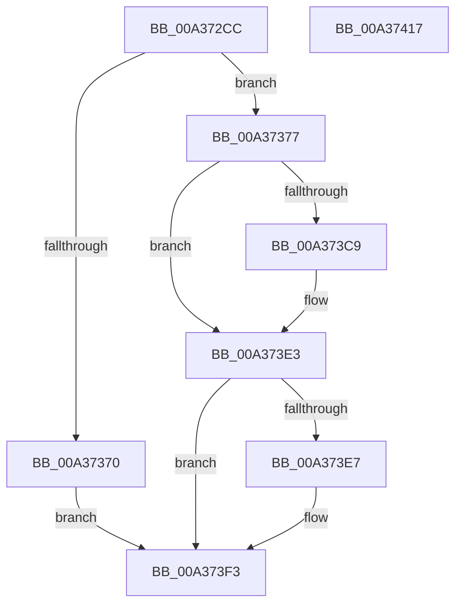

# IopGetVolumeId

- RVA: `0x00A372CC`–`0x00A37418` (길이 `332` bytes)
- VA: `0x0000000140A372CC`
- 실행 섹션: `PAGE`
- PDB 이름 있음: `예`; PDB Function 태그: `아니요`
- unwind 정보 RVA: `0x000ADA64`
- 디코드: `88`개 명령, `332/332` bytes 표시
- 미해석 바이트: `0` (있으면 어셈블리에 `.byte`로 보존)

> 이 문서는 커널 이미지의 기계어와 PDB 기호를 분석해 생성했습니다. 4번과 5번은 함수 원형과 자료형을 바이너리 사용 방식에서 추정한 C 해석이며 원본 소스 복구 결과는 아닙니다.

## 1. Dependencies

- 직접 호출 지점: **8**; 고유 호출 대상: **8**
- 직접 호출자로 확인된 함수: **1**
- RIP 상대 이미지 참조: **1**

### Outgoing calls
- `0x00A37318` → [memset](../../text/6C/memset_function_006C6C40.md) (function, `0x006C6C40`)
- `0x00A37326` → [KeInitializeEvent](../../text/40/KeInitializeEvent_function_0040DD10.md) (function, `0x0040DD10`)
- `0x00A3732E` → [IoGetRelatedDeviceObject](../../text/29/IoGetRelatedDeviceObject_function_0029B120.md) (function, `0x0029B120`)
- `0x00A37363` → [IoBuildDeviceIoControlRequest](../../text/20/IoBuildDeviceIoControlRequest_function_00204FD0.md) (function, `0x00204FD0`)
- `0x00A373B2` → [ObfReferenceObject](../../text/20/ObfReferenceObject_function_0020FA20.md) (function, `0x0020FA20`)
- `0x00A373BD` → [IofCallDriver](../../text/29/IofCallDriver_function_0029B4B0.md) (function, `0x0029B4B0`)
- `0x00A373DB` → [KeWaitForSingleObject](../../text/20/KeWaitForSingleObject_function_0020E6B0.md) (function, `0x0020E6B0`)
- `0x00A373FA` → [_security_check_cookie](../../text/6A/_security_check_cookie_function_006AC640.md) (function, `0x006AC640`)

### Direct callers
- [IopTrackLink](IopTrackLink_function_00A36764.md) at `0x00A369A5`
- [IopTrackLink](IopTrackLink_function_00A36764.md) at `0x00A369C3`
- [IopTrackLink](IopTrackLink_function_00A36764.md) at `0x00A36C23`
- [IopTrackLink](IopTrackLink_function_00A36764.md) at `0x00A36DB7`

### Static image references
- `0x00A372E6` → RVA `0x00E0A740` (`.data`; read)

## 2. Other-region calls and transfers

- 다른 실행 섹션으로 향하는 call: **8**
  - `0x00A37318` → [memset](../../text/6C/memset_function_006C6C40.md) (`PAGE` → `.text`)
  - `0x00A37326` → [KeInitializeEvent](../../text/40/KeInitializeEvent_function_0040DD10.md) (`PAGE` → `.text`)
  - `0x00A3732E` → [IoGetRelatedDeviceObject](../../text/29/IoGetRelatedDeviceObject_function_0029B120.md) (`PAGE` → `.text`)
  - `0x00A37363` → [IoBuildDeviceIoControlRequest](../../text/20/IoBuildDeviceIoControlRequest_function_00204FD0.md) (`PAGE` → `.text`)
  - `0x00A373B2` → [ObfReferenceObject](../../text/20/ObfReferenceObject_function_0020FA20.md) (`PAGE` → `.text`)
  - `0x00A373BD` → [IofCallDriver](../../text/29/IofCallDriver_function_0029B4B0.md) (`PAGE` → `.text`)
  - `0x00A373DB` → [KeWaitForSingleObject](../../text/20/KeWaitForSingleObject_function_0020E6B0.md) (`PAGE` → `.text`)
  - `0x00A373FA` → [_security_check_cookie](../../text/6A/_security_check_cookie_function_006AC640.md) (`PAGE` → `.text`)
- 별도 외부 분기/꼬리 이동을 확인하지 못했습니다.

## 3. Assembly (complete function range)

```asm
00A372CC  48 89 5C 24 18                  mov qword ptr [rsp + 0x18], rbx
00A372D1  48 89 74 24 20                  mov qword ptr [rsp + 0x20], rsi
00A372D6  55                              push rbp
00A372D7  57                              push rdi
00A372D8  41 56                           push r14
00A372DA  48 8D 6C 24 B9                  lea rbp, [rsp - 0x47]
00A372DF  48 81 EC D0 00 00 00            sub rsp, 0xd0
00A372E6  48 8B 05 53 34 3D 00            mov rax, qword ptr [rip + 0x3d3453]
00A372ED  48 33 C4                        xor rax, rsp
00A372F0  48 89 45 37                     mov qword ptr [rbp + 0x37], rax
00A372F4  33 C0                           xor eax, eax
00A372F6  48 8B F2                        mov rsi, rdx
00A372F9  48 8B F9                        mov rdi, rcx
00A372FC  48 89 45 D7                     mov qword ptr [rbp - 0x29], rax
00A37300  0F 57 C0                        xorps xmm0, xmm0
00A37303  48 8D 4D F7                     lea rcx, [rbp - 9]
00A37307  0F 57 C9                        xorps xmm1, xmm1
00A3730A  33 D2                           xor edx, edx
00A3730C  44 8D 40 40                     lea r8d, [rax + 0x40]
00A37310  0F 11 45 DF                     movups xmmword ptr [rbp - 0x21], xmm0
00A37314  0F 11 4D C7                     movups xmmword ptr [rbp - 0x39], xmm1
00A37318  E8 23 F9 C8 FF                  call 0x1406c6c40
00A3731D  45 33 C0                        xor r8d, r8d
00A37320  48 8D 4D C7                     lea rcx, [rbp - 0x39]
00A37324  33 D2                           xor edx, edx
00A37326  E8 E5 69 9D FF                  call 0x14040dd10
00A3732B  48 8B CF                        mov rcx, rdi
00A3732E  E8 ED 3D 86 FF                  call 0x14029b120
00A37333  4C 8B F0                        mov r14, rax
00A37336  45 33 C9                        xor r9d, r9d
00A37339  48 8D 45 DF                     lea rax, [rbp - 0x21]
00A3733D  45 33 C0                        xor r8d, r8d
00A37340  48 89 44 24 40                  mov qword ptr [rsp + 0x40], rax
00A37345  49 8B D6                        mov rdx, r14
00A37348  48 8D 45 C7                     lea rax, [rbp - 0x39]
00A3734C  33 C9                           xor ecx, ecx
00A3734E  48 89 44 24 38                  mov qword ptr [rsp + 0x38], rax
00A37353  C6 44 24 30 00                  mov byte ptr [rsp + 0x30], 0
00A37358  83 64 24 28 00                  and dword ptr [rsp + 0x28], 0
00A3735D  48 83 64 24 20 00               and qword ptr [rsp + 0x20], 0
00A37363  E8 68 DC 7C FF                  call 0x140204fd0
00A37368  48 8B D8                        mov rbx, rax
00A3736B  48 85 C0                        test rax, rax
00A3736E  75 07                           jne 0x140a37377
00A37370  B8 9A 00 00 C0                  mov eax, 0xc000009a
00A37375  EB 7C                           jmp 0x140a373f3
00A37377  83 48 10 04                     or dword ptr [rax + 0x10], 4
00A3737B  48 8B CF                        mov rcx, rdi
00A3737E  48 89 BB C0 00 00 00            mov qword ptr [rbx + 0xc0], rdi
00A37385  48 8D 45 F7                     lea rax, [rbp - 9]
00A37389  48 89 43 70                     mov qword ptr [rbx + 0x70], rax
00A3738D  48 8D 45 F7                     lea rax, [rbp - 9]
00A37391  48 89 43 18                     mov qword ptr [rbx + 0x18], rax
00A37395  48 8B 83 B8 00 00 00            mov rax, qword ptr [rbx + 0xb8]
00A3739C  48 89 78 E8                     mov qword ptr [rax - 0x18], rdi
00A373A0  C6 40 B8 0A                     mov byte ptr [rax - 0x48], 0xa
00A373A4  C7 40 C0 40 00 00 00            mov dword ptr [rax - 0x40], 0x40
00A373AB  C7 40 C8 08 00 00 00            mov dword ptr [rax - 0x38], 8
00A373B2  E8 69 86 7D FF                  call 0x14020fa20
00A373B7  48 8B D3                        mov rdx, rbx
00A373BA  49 8B CE                        mov rcx, r14
00A373BD  E8 EE 40 86 FF                  call 0x14029b4b0
00A373C2  3D 03 01 00 00                  cmp eax, 0x103
00A373C7  75 1A                           jne 0x140a373e3
00A373C9  48 83 64 24 20 00               and qword ptr [rsp + 0x20], 0
00A373CF  48 8D 4D C7                     lea rcx, [rbp - 0x39]
00A373D3  45 33 C9                        xor r9d, r9d
00A373D6  45 33 C0                        xor r8d, r8d
00A373D9  33 D2                           xor edx, edx
00A373DB  E8 D0 72 7D FF                  call 0x14020e6b0
00A373E0  8B 45 DF                        mov eax, dword ptr [rbp - 0x21]
00A373E3  85 C0                           test eax, eax
00A373E5  78 0C                           js 0x140a373f3
00A373E7  0F 28 45 F7                     movaps xmm0, xmmword ptr [rbp - 9]
00A373EB  83 26 00                        and dword ptr [rsi], 0
00A373EE  F3 0F 7F 46 04                  movdqu xmmword ptr [rsi + 4], xmm0
00A373F3  48 8B 4D 37                     mov rcx, qword ptr [rbp + 0x37]
00A373F7  48 33 CC                        xor rcx, rsp
00A373FA  E8 41 52 C7 FF                  call 0x1406ac640
00A373FF  4C 8D 9C 24 D0 00 00 00         lea r11, [rsp + 0xd0]
00A37407  49 8B 5B 30                     mov rbx, qword ptr [r11 + 0x30]
00A3740B  49 8B 73 38                     mov rsi, qword ptr [r11 + 0x38]
00A3740F  49 8B E3                        mov rsp, r11
00A37412  41 5E                           pop r14
00A37414  5F                              pop rdi
00A37415  5D                              pop rbp
00A37416  C3                              ret
00A37417  CC                              int3
```

## 4. C-style interpretation (structured pseudocode)

```c
__int64 __fastcall IopGetVolumeId(__int64 a1, __int64 a2, __int64 a3, int a4)
{
    __int64 result;
    __int64 v_rsp;
    unsigned __int64 v_stack_m18;
    unsigned __int64 v_stack_m28;
    unsigned __int64 v_stack_m5F;
    unsigned __int64 v_stack_m68;
    unsigned __int64 v_stack_m80;
    unsigned __int64 v_stack_m88;
    unsigned __int64 v_stack_m98;
    unsigned __int64 v_stack_mA8;
    unsigned __int64 v_stack_mB0;
    unsigned __int8 v_stack_mB8;
    unsigned int v_stack_mC0;
    unsigned __int64 v_stack_mC8;
    unsigned __int64 v_stack_p18;
    unsigned __int64 v_stack_p20;

    v_stack_p18 = v_rbx;
    v_stack_p20 = v_rsi;
    v_rsp = (v_rsp) - (208);
    result = (*(unsigned __int64 *)(v_rip + 4011091)) ^ (v_rsp);
    v_stack_m28 = result;
    result = 0;
    v_stack_m88 = 0;
    a2 = 0;
    v_stack_m80 = v_xmm0;
    v_stack_m98 = v_xmm1;
    result = memset(v_stack_m68, a2, result + 64, a4);
    a3 = 0;
    a2 = 0;
    result = KeInitializeEvent(v_stack_m98, a2, a3, a4);
    result = IoGetRelatedDeviceObject(a1, a2, a3, a4);
    a4 = 0;
    a3 = 0;
    v_stack_mA8 = v_stack_m80;
    a1 = 0;
    v_stack_mB0 = v_stack_m98;
    v_stack_mB8 = 0;
    result = IoBuildDeviceIoControlRequest(a1, result, a3, a4);
    if (result != 0) goto loc_00A37377;
    goto loc_00A373F3;
loc_00A37377:
    *(unsigned __int64 *)(result + 192) = 0;
    *(unsigned __int64 *)(result + 112) = v_stack_m68;
    *(unsigned __int64 *)(result + 24) = v_stack_m68;
    *(unsigned __int64 *)(*(unsigned __int64 *)(result + 184) - 24) = 0;
    *(unsigned __int8 *)(*(unsigned __int64 *)(result + 184) - 72) = 10;
    *(unsigned int *)(*(unsigned __int64 *)(result + 184) - 64) = 64;
    *(unsigned int *)(*(unsigned __int64 *)(result + 184) - 56) = 8;
    result = ObfReferenceObject(0, result, a3, a4);
    result = IofCallDriver(result, result, a3, a4);
    if (((unsigned int)(result)) == 259) {
        a1 = v_stack_m98;
        a4 = 0;
        a3 = 0;
        a2 = 0;
        result = KeWaitForSingleObject(a1, a2, a3, a4);
        result = v_stack_m80;
    }
    if (!(sign_flag)) {
        *(unsigned __int64 *)(a2 + 4) = v_xmm0;
    }
    a1 = (v_stack_m28) ^ (v_rsp);
    result = _security_check_cookie(a1, a2, a3, a4);
    return result;
}
```

## 5. (Beta) C Style

```c
int64_t IopGetVolumeId(int64_t Arg1, void *Arg2, int64_t Arg3, int32_t Arg4)
{
    uint8_t *arg2 = (uint8_t *)Arg2;

    int64_t result;
    int64_t local_rsp;
    uint64_t v_stack_m18;
    uint64_t v_stack_m28;
    uint64_t v_stack_m5F;
    uint64_t v_stack_m68;
    uint64_t v_stack_m80;
    uint64_t v_stack_m88;
    uint64_t v_stack_m98;
    uint64_t v_stack_mA8;
    uint64_t v_stack_mB0;
    uint8_t v_stack_mB8;
    uint32_t v_stack_mC0;
    uint64_t v_stack_mC8;
    uint64_t v_stack_p18;
    uint64_t v_stack_p20;

    v_stack_p18 = local_rbx;
    v_stack_p20 = local_rsi;
    local_rsp = (local_rsp) - (208);
    result = (*(uint64_t *)(v_rip + 0x3D3453)) ^ (local_rsp);
    v_stack_m28 = result;
    result = 0;
    v_stack_m88 = 0;
    Arg2 = 0;
    v_stack_m80 = v_xmm0;
    v_stack_m98 = v_xmm1;
    result = memset(v_stack_m68, Arg2, result + 64, Arg4);
    Arg3 = 0;
    Arg2 = 0;
    result = KeInitializeEvent(v_stack_m98, Arg2, Arg3, Arg4);
    result = IoGetRelatedDeviceObject(Arg1, Arg2, Arg3, Arg4);
    Arg4 = 0;
    Arg3 = 0;
    v_stack_mA8 = v_stack_m80;
    Arg1 = 0;
    v_stack_mB0 = v_stack_m98;
    v_stack_mB8 = 0;
    result = IoBuildDeviceIoControlRequest(Arg1, result, Arg3, Arg4);
    if (result != 0) goto loc_00A37377;
    goto loc_00A373F3;
loc_00A37377:
    *(uint64_t *)(result + 0xC0) = 0;
    *(uint64_t *)(result + 0x70) = v_stack_m68;
    *(uint64_t *)(result + 0x18) = v_stack_m68;
    *(uint64_t *)(*(uint64_t *)(result + 0xB8) - 0x18) = 0;
    *(uint8_t *)(*(uint64_t *)(result + 0xB8) - 0x48) = 10;
    *(uint32_t *)(*(uint64_t *)(result + 0xB8) - 0x40) = 64;
    *(uint32_t *)(*(uint64_t *)(result + 0xB8) - 0x38) = 8;
    result = ObfReferenceObject(0, result, Arg3, Arg4);
    result = IofCallDriver(result, result, Arg3, Arg4);
    if (((uint32_t)(result)) == 259) {
        Arg1 = v_stack_m98;
        Arg4 = 0;
        Arg3 = 0;
        Arg2 = 0;
        result = KeWaitForSingleObject(Arg1, Arg2, Arg3, Arg4);
        result = v_stack_m80;
    }
    if (!(sign_flag)) {
        *(uint64_t *)(arg2 + 0x4) = v_xmm0;
    }
    Arg1 = (v_stack_m28) ^ (local_rsp);
    result = _security_check_cookie(Arg1, Arg2, Arg3, Arg4);
    return result;
}
```

### 관측된 메모리 오프셋

구조체 형식이 확인되지 않은 접근은 인자 기준의 오프셋으로만 기록했습니다.

| 기준 인자 | 오프셋 표현 | 폭 (bit) | 접근 |
|---|---:|---:|---|
| `Arg2` | `+ 0x0` | `32` | `R/W` |
| `Arg2` | `+ 0x4` | `128` | `W` |

## 6. Execution-region graph

[열기: 2D/3D 그래프와 함수 탐색 컨트롤 패널](../../../control-panel.html?section=page&rva=0x00A372CC&view=graph)

- 2D 그래프는 위에서 아래로 흐르고, 3D 그래프는 빈 공간을 드래그해 회전합니다. Shift+드래그는 이동, 휠은 확대·축소, 함수 노드 선택은 대상 보고서 이동입니다.

### Static fallback


