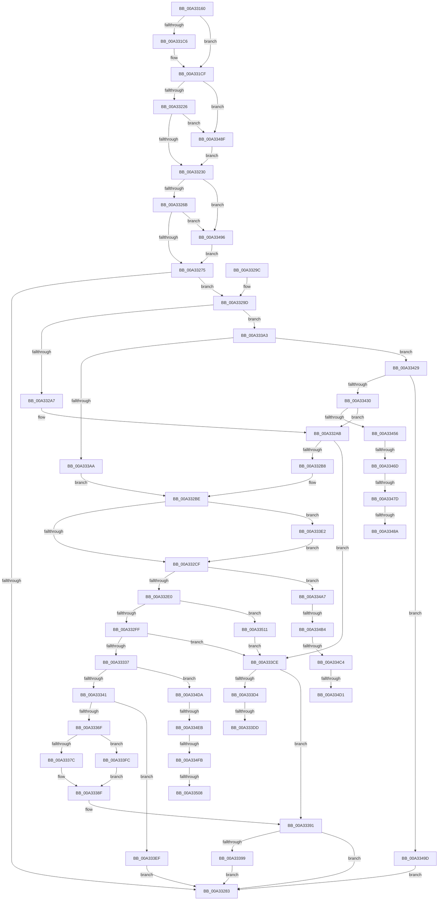

# IopGraftName

- RVA: `0x00A33160`–`0x00A3351B` (길이 `955` bytes)
- VA: `0x0000000140A33160`
- 실행 섹션: `PAGE`
- PDB 이름 있음: `예`; PDB Function 태그: `예`
- unwind 정보 RVA: `0x000AD490`
- 디코드: `236`개 명령, `955/955` bytes 표시
- 미해석 바이트: `0` (있으면 어셈블리에 `.byte`로 보존)

> 이 문서는 커널 이미지의 기계어와 PDB 기호를 분석해 생성했습니다. 4번과 5번은 함수 원형과 자료형을 바이너리 사용 방식에서 추정한 C 해석이며 원본 소스 복구 결과는 아닙니다.

## 1. Dependencies

- 직접 호출 지점: **8**; 고유 호출 대상: **8**
- 직접 호출자로 확인된 함수: **1**
- RIP 상대 이미지 참조: **0**

### Outgoing calls
- `0x00A331D6` → [IopSymlinkGetECP](../../text/45/IopSymlinkGetECP_function_00458288.md) (function, `0x00458288`)
- `0x00A332C1` → [IopSymlinkGetRelatedMountPoint](IopSymlinkGetRelatedMountPoint_function_00A33628.md) (function, `0x00A33628`)
- `0x00A3330D` → [ExAllocatePool2](../../poolcode/B8/ExAllocatePool2_function_00B820F0.md) (function, `0x00B820F0`)
- `0x00A3335E` → [IopCopyOverNewPathSecure](IopCopyOverNewPathSecure_function_00A33660.md) (function, `0x00A33660`)
- `0x00A3338A` → [IopSymlinkRememberJunction](IopSymlinkRememberJunction_function_00A33524.md) (function, `0x00A33524`)
- `0x00A333E5` → [IopSymlinkGetMostRecentlyUsedName](../../text/48/IopSymlinkGetMostRecentlyUsedName_function_0048476C.md) (function, `0x0048476C`)
- `0x00A333F2` → [ExFreePoolWithTag](../../poolcode/B8/ExFreePoolWithTag_function_00B82870.md) (function, `0x00B82870`)
- `0x00A3341F` → [IopSymlinkUpdateECP](../8A/IopSymlinkUpdateECP_function_008A20CC.md) (function, `0x008A20CC`)

### Direct callers
- [IopSymlinkProcessReparse](IopSymlinkProcessReparse_function_00A330B4.md) at `0x00A330F1`

### Static image references
- 디코드된 RIP-relative 메모리 참조가 없습니다.

## 2. Other-region calls and transfers

- 다른 실행 섹션으로 향하는 call: **4**
  - `0x00A331D6` → [IopSymlinkGetECP](../../text/45/IopSymlinkGetECP_function_00458288.md) (`PAGE` → `.text`)
  - `0x00A3330D` → [ExAllocatePool2](../../poolcode/B8/ExAllocatePool2_function_00B820F0.md) (`PAGE` → `POOLCODE`)
  - `0x00A333E5` → [IopSymlinkGetMostRecentlyUsedName](../../text/48/IopSymlinkGetMostRecentlyUsedName_function_0048476C.md) (`PAGE` → `.text`)
  - `0x00A333F2` → [ExFreePoolWithTag](../../poolcode/B8/ExFreePoolWithTag_function_00B82870.md) (`PAGE` → `POOLCODE`)
- call이 아닌 외부 분기/꼬리 이동: **14**
  - `0x00A333D7` → [sub_00B39C68 + 0x100](../B3/Unknown_function_00B39C68.md) (`tail-transfer`)
  - `0x00A333DD` → [sub_00B39C68 + 0x10A](../B3/Unknown_function_00B39C68.md) (`tail-transfer`)
  - `0x00A33467` → [sub_00B39C68 + 0x12B](../B3/Unknown_function_00B39C68.md) (`tail-transfer`)
  - `0x00A33477` → [sub_00B39C68](../B3/Unknown_function_00B39C68.md) (`tail-transfer`)
  - `0x00A33484` → [sub_00B39C68](../B3/Unknown_function_00B39C68.md) (`tail-transfer`)
  - `0x00A3348A` → [sub_00B39C68 + 0x127](../B3/Unknown_function_00B39C68.md) (`tail-transfer`)
  - `0x00A334AE` → [sub_00B39C68 + 0x185](../B3/Unknown_function_00B39C68.md) (`tail-transfer`)
  - `0x00A334BE` → [sub_00B39C68 + 0x17D](../B3/Unknown_function_00B39C68.md) (`tail-transfer`)
  - `0x00A334CB` → [sub_00B39C68 + 0x17D](../B3/Unknown_function_00B39C68.md) (`tail-transfer`)
  - `0x00A334D5` → [sub_00B39C68 + 0x185](../B3/Unknown_function_00B39C68.md) (`tail-transfer`)
  - `0x00A334E5` → [sub_00B39C68 + 0x29F](../B3/Unknown_function_00B39C68.md) (`tail-transfer`)
  - `0x00A334F5` → [sub_00B39C68 + 0x192](../B3/Unknown_function_00B39C68.md) (`tail-transfer`)
  - `0x00A33502` → [sub_00B39C68 + 0x192](../B3/Unknown_function_00B39C68.md) (`tail-transfer`)
  - `0x00A3350C` → [sub_00B39C68 + 0x29F](../B3/Unknown_function_00B39C68.md) (`tail-transfer`)

## 3. Assembly (complete function range)

```asm
00A33160  48 89 54 24 10                  mov qword ptr [rsp + 0x10], rdx
00A33165  55                              push rbp
00A33166  53                              push rbx
00A33167  56                              push rsi
00A33168  57                              push rdi
00A33169  41 54                           push r12
00A3316B  41 55                           push r13
00A3316D  41 56                           push r14
00A3316F  41 57                           push r15
00A33171  48 8D 6C 24 E1                  lea rbp, [rsp - 0x1f]
00A33176  48 81 EC 98 00 00 00            sub rsp, 0x98
00A3317D  48 8B 7A 40                     mov rdi, qword ptr [rdx + 0x40]
00A33181  4C 8B E1                        mov r12, rcx
00A33184  33 C9                           xor ecx, ecx
00A33186  48 89 7D DF                     mov qword ptr [rbp - 0x21], rdi
00A3318A  4D 8B F0                        mov r14, r8
00A3318D  89 4D 7F                        mov dword ptr [rbp + 0x7f], ecx
00A33190  4C 8B FA                        mov r15, rdx
00A33193  66 89 4D 77                     mov word ptr [rbp + 0x77], cx
00A33197  41 8B 5C 24 10                  mov ebx, dword ptr [r12 + 0x10]
00A3319C  8B F1                           mov esi, ecx
00A3319E  48 89 4D F7                     mov qword ptr [rbp - 9], rcx
00A331A2  44 8B E9                        mov r13d, ecx
00A331A5  48 89 4D D7                     mov qword ptr [rbp - 0x29], rcx
00A331A9  8B C1                           mov eax, ecx
00A331AB  88 4D 67                        mov byte ptr [rbp + 0x67], cl
00A331AE  48 89 4D 0F                     mov qword ptr [rbp + 0xf], rcx
00A331B2  48 89 4D E7                     mov qword ptr [rbp - 0x19], rcx
00A331B6  48 89 4D FF                     mov qword ptr [rbp - 1], rcx
00A331BA  48 89 4D 07                     mov qword ptr [rbp + 7], rcx
00A331BE  81 E3 80 00 00 00               and ebx, 0x80
00A331C4  74 09                           je 0x140a331cf
00A331C6  49 8B 44 24 70                  mov rax, qword ptr [r12 + 0x70]
00A331CB  48 89 45 07                     mov qword ptr [rbp + 7], rax
00A331CF  48 8D 55 D7                     lea rdx, [rbp - 0x29]
00A331D3  48 8B C8                        mov rcx, rax
00A331D6  E8 AD 50 A2 FF                  call 0x140458288
00A331DB  48 8B 7D D7                     mov rdi, qword ptr [rbp - 0x29]
00A331DF  41 BA 02 00 00 00               mov r10d, 2
00A331E5  48 BA FD FF FF 5F FF FF FF FF   movabs rdx, 0xffffffff5ffffffd
00A331EF  41 B9 01 02 40 00               mov r9d, 0x400201
00A331F5  66 44 09 57 02                  or word ptr [rdi + 2], r10w
00A331FA  F7 DB                           neg ebx
00A331FC  BB 78 02 00 C0                  mov ebx, 0xc0000278
00A33201  1B C9                           sbb ecx, ecx
00A33203  F7 D1                           not ecx
00A33205  81 E1 0D 00 00 C0               and ecx, 0xc000000d
00A3320B  41 81 7C 24 30 04 01 00 00      cmp dword ptr [r12 + 0x30], 0x104
00A33214  0F 45 CB                        cmovne ecx, ebx
00A33217  49 03 54 24 38                  add rdx, qword ptr [r12 + 0x38]
00A3321C  48 83 FA 16                     cmp rdx, 0x16
00A33220  0F 87 69 02 00 00               ja 0x140a3348f
00A33226  49 0F A3 D1                     bt r9, rdx
00A3322A  0F 83 5F 02 00 00               jae 0x140a3348f
00A33230  45 33 C0                        xor r8d, r8d
00A33233  B8 00 40 00 00                  mov eax, 0x4000
00A33238  4D 39 84 24 A0 00 00 00         cmp qword ptr [r12 + 0xa0], r8
00A33240  0F 44 CB                        cmove ecx, ebx
00A33243  4D 85 F6                        test r14, r14
00A33246  0F 44 CB                        cmove ecx, ebx
00A33249  66 41 39 46 06                  cmp word ptr [r14 + 6], ax
00A3324E  0F 43 CB                        cmovae ecx, ebx
00A33251  66 41 39 46 04                  cmp word ptr [r14 + 4], ax
00A33256  41 8B 06                        mov eax, dword ptr [r14]
00A33259  0F 43 CB                        cmovae ecx, ebx
00A3325C  8D 90 FD FF FF 5F               lea edx, [rax + 0x5ffffffd]
00A33262  83 FA 16                        cmp edx, 0x16
00A33265  0F 87 2B 02 00 00               ja 0x140a33496
00A3326B  41 0F A3 D1                     bt r9d, edx
00A3326F  0F 83 21 02 00 00               jae 0x140a33496
00A33275  49 8D 57 58                     lea rdx, [r15 + 0x58]
00A33279  48 89 55 EF                     mov qword ptr [rbp - 0x11], rdx
00A3327D  66 44 39 02                     cmp word ptr [rdx], r8w
00A33281  75 1A                           jne 0x140a3329d
00A33283  41 89 5C 24 30                  mov dword ptr [r12 + 0x30], ebx
00A33288  48 81 C4 98 00 00 00            add rsp, 0x98
00A3328F  41 5F                           pop r15
00A33291  41 5E                           pop r14
00A33293  41 5D                           pop r13
00A33295  41 5C                           pop r12
00A33297  5F                              pop rdi
00A33298  5E                              pop rsi
00A33299  5B                              pop rbx
00A3329A  5D                              pop rbp
00A3329B  C3                              ret
00A3329C  CC                              int3
00A3329D  8B D9                           mov ebx, ecx
00A3329F  85 C9                           test ecx, ecx
00A332A1  0F 89 FC 00 00 00               jns 0x140a333a3
00A332A7  44 0F B7 FE                     movzx r15d, si
00A332AB  41 0F B7 56 06                  movzx edx, word ptr [r14 + 6]
00A332B0  85 DB                           test ebx, ebx
00A332B2  0F 88 16 01 00 00               js 0x140a333ce
00A332B8  41 BA 02 00 00 00               mov r10d, 2
00A332BE  48 8B CF                        mov rcx, rdi
00A332C1  E8 62 03 00 00                  call 0x140a33628
00A332C6  48 85 C0                        test rax, rax
00A332C9  0F 84 13 01 00 00               je 0x140a333e2
00A332CF  0F B7 40 10                     movzx eax, word ptr [rax + 0x10]
00A332D3  0F B7 C8                        movzx ecx, ax
00A332D6  44 38 45 67                     cmp byte ptr [rbp + 0x67], r8b
00A332DA  0F 85 C7 01 00 00               jne 0x140a334a7
00A332E0  41 0F B7 56 06                  movzx edx, word ptr [r14 + 6]
00A332E5  41 0F B7 C7                     movzx eax, r15w
00A332E9  03 C6                           add eax, esi
00A332EB  44 8D 7A 04                     lea r15d, [rdx + 4]
00A332EF  44 03 F8                        add r15d, eax
00A332F2  41 81 FF FF FF 00 00            cmp r15d, 0xffff
00A332F9  0F 83 12 02 00 00               jae 0x140a33511
00A332FF  41 8B D7                        mov edx, r15d
00A33302  B9 00 01 00 00                  mov ecx, 0x100
00A33307  41 B8 49 6F 46 63               mov r8d, 0x63466f49
00A3330D  E8 DE ED 14 00                  call 0x140b820f0
00A33312  8B CB                           mov ecx, ebx
00A33314  45 33 C0                        xor r8d, r8d
00A33317  48 85 C0                        test rax, rax
00A3331A  BB 9A 00 00 C0                  mov ebx, 0xc000009a
00A3331F  48 8B F0                        mov rsi, rax
00A33322  0F 44 CB                        cmove ecx, ebx
00A33325  41 83 C7 FE                     add r15d, -2
00A33329  44 89 7D EF                     mov dword ptr [rbp - 0x11], r15d
00A3332D  8B D9                           mov ebx, ecx
00A3332F  85 C9                           test ecx, ecx
00A33331  0F 88 97 00 00 00               js 0x140a333ce
00A33337  44 38 45 67                     cmp byte ptr [rbp + 0x67], r8b
00A3333B  0F 85 99 01 00 00               jne 0x140a334da
00A33341  41 0F B7 46 06                  movzx eax, word ptr [r14 + 6]
00A33346  48 8B CE                        mov rcx, rsi
00A33349  4C 8B 7D 6F                     mov r15, qword ptr [rbp + 0x6f]
00A3334D  44 0F B7 45 77                  movzx r8d, word ptr [rbp + 0x77]
00A33352  4D 8B CF                        mov r9, r15
00A33355  48 8B 55 F7                     mov rdx, qword ptr [rbp - 9]
00A33359  66 89 44 24 20                  mov word ptr [rsp + 0x20], ax
00A3335E  E8 FD 02 00 00                  call 0x140a33660
00A33363  33 D2                           xor edx, edx
00A33365  8B D8                           mov ebx, eax
00A33367  85 C0                           test eax, eax
00A33369  0F 88 80 00 00 00               js 0x140a333ef
00A3336F  41 81 3E 03 00 00 A0            cmp dword ptr [r14], 0xa0000003
00A33376  0F 85 80 00 00 00               jne 0x140a333fc
00A3337C  41 0F B7 4E 06                  movzx ecx, word ptr [r14 + 6]
00A33381  4C 8B CF                        mov r9, rdi
00A33384  4D 8B C4                        mov r8, r12
00A33387  49 8B D7                        mov rdx, r15
00A3338A  E8 95 01 00 00                  call 0x140a33524
00A3338F  8B D8                           mov ebx, eax
00A33391  85 DB                           test ebx, ebx
00A33393  0F 88 EA FE FF FF               js 0x140a33283
00A33399  BB 04 01 00 00                  mov ebx, 0x104
00A3339E  E9 E0 FE FF FF                  jmp 0x140a33283
00A333A3  3D 03 00 00 A0                  cmp eax, 0xa0000003
00A333A8  75 7F                           jne 0x140a33429
00A333AA  41 0F B7 46 08                  movzx eax, word ptr [r14 + 8]
00A333AF  45 0F B7 7E 0A                  movzx r15d, word ptr [r14 + 0xa]
00A333B4  48 83 C0 10                     add rax, 0x10
00A333B8  41 0F B7 56 06                  movzx edx, word ptr [r14 + 6]
00A333BD  49 03 C6                        add rax, r14
00A333C0  48 89 45 F7                     mov qword ptr [rbp - 9], rax
00A333C4  66 44 89 7D 77                  mov word ptr [rbp + 0x77], r15w
00A333C9  E9 F0 FE FF FF                  jmp 0x140a332be
00A333CE  44 38 45 67                     cmp byte ptr [rbp + 0x67], r8b
00A333D2  74 BD                           je 0x140a33391
00A333D4  4D 85 ED                        test r13, r13
00A333D7  0F 85 8B 69 10 00               jne 0x140b39d68
00A333DD  E9 90 69 10 00                  jmp 0x140b39d72
00A333E2  48 8B CF                        mov rcx, rdi
00A333E5  E8 82 13 A5 FF                  call 0x14048476c
00A333EA  E9 E0 FE FF FF                  jmp 0x140a332cf
00A333EF  48 8B CE                        mov rcx, rsi
00A333F2  E8 79 F4 14 00                  call 0x140b82870
00A333F7  E9 87 FE FF FF                  jmp 0x140a33283
00A333FC  0F B7 47 02                     movzx eax, word ptr [rdi + 2]
00A33400  4D 8D 4F 58                     lea r9, [r15 + 0x58]
00A33404  B9 FE FF 00 00                  mov ecx, 0xfffe
00A33409  45 33 C0                        xor r8d, r8d
00A3340C  66 23 C1                        and ax, cx
00A3340F  49 8B CC                        mov rcx, r12
00A33412  66 89 44 24 28                  mov word ptr [rsp + 0x28], ax
00A33417  66 89 54 24 20                  mov word ptr [rsp + 0x20], dx
00A3341C  48 8B D7                        mov rdx, rdi
00A3341F  E8 A8 EC E6 FF                  call 0x1408a20cc
00A33424  E9 66 FF FF FF                  jmp 0x140a3338f
00A33429  3D 0C 00 00 A0                  cmp eax, 0xa000000c
00A3342E  75 6D                           jne 0x140a3349d
00A33430  41 0F B7 46 08                  movzx eax, word ptr [r14 + 8]
00A33435  45 0F B7 7E 0A                  movzx r15d, word ptr [r14 + 0xa]
00A3343A  48 83 C0 14                     add rax, 0x14
00A3343E  49 03 C6                        add rax, r14
00A33441  66 44 89 7D 77                  mov word ptr [rbp + 0x77], r15w
00A33446  48 89 45 F7                     mov qword ptr [rbp - 9], rax
00A3344A  41 8B 46 10                     mov eax, dword ptr [r14 + 0x10]
00A3344E  A8 01                           test al, 1
00A33450  0F 84 55 FE FF FF               je 0x140a332ab
00A33456  48 8B 45 DF                     mov rax, qword ptr [rbp - 0x21]
00A3345A  41 BF 00 01 00 00               mov r15d, 0x100
00A33460  C6 45 67 01                     mov byte ptr [rbp + 0x67], 1
00A33464  48 85 C0                        test rax, rax
00A33467  0F 84 26 69 10 00               je 0x140b39d93
00A3346D  48 8B 80 D0 00 00 00            mov rax, qword ptr [rax + 0xd0]
00A33474  48 85 C0                        test rax, rax
00A33477  0F 84 EB 67 10 00               je 0x140b39c68
00A3347D  48 8B 40 30                     mov rax, qword ptr [rax + 0x30]
00A33481  48 85 C0                        test rax, rax
00A33484  0F 84 DE 67 10 00               je 0x140b39c68
00A3348A  E9 00 69 10 00                  jmp 0x140b39d8f
00A3348F  8B CB                           mov ecx, ebx
00A33491  E9 9A FD FF FF                  jmp 0x140a33230
00A33496  8B CB                           mov ecx, ebx
00A33498  E9 D8 FD FF FF                  jmp 0x140a33275
00A3349D  BB 76 02 00 C0                  mov ebx, 0xc0000276
00A334A2  E9 DC FD FF FF                  jmp 0x140a33283
00A334A7  48 8B 45 DF                     mov rax, qword ptr [rbp - 0x21]
00A334AB  48 85 C0                        test rax, rax
00A334AE  0F 84 39 69 10 00               je 0x140b39ded
00A334B4  48 8B 80 D0 00 00 00            mov rax, qword ptr [rax + 0xd0]
00A334BB  48 85 C0                        test rax, rax
00A334BE  0F 84 21 69 10 00               je 0x140b39de5
00A334C4  48 8B 40 30                     mov rax, qword ptr [rax + 0x30]
00A334C8  48 85 C0                        test rax, rax
00A334CB  0F 84 14 69 10 00               je 0x140b39de5
00A334D1  48 8B 7D D7                     mov rdi, qword ptr [rbp - 0x29]
00A334D5  E9 13 69 10 00                  jmp 0x140b39ded
00A334DA  48 8B 45 DF                     mov rax, qword ptr [rbp - 0x21]
00A334DE  4C 89 45 67                     mov qword ptr [rbp + 0x67], r8
00A334E2  48 85 C0                        test rax, rax
00A334E5  0F 84 1C 6A 10 00               je 0x140b39f07
00A334EB  48 8B 80 D0 00 00 00            mov rax, qword ptr [rax + 0xd0]
00A334F2  48 85 C0                        test rax, rax
00A334F5  0F 84 FF 68 10 00               je 0x140b39dfa
00A334FB  48 8B 40 30                     mov rax, qword ptr [rax + 0x30]
00A334FF  48 85 C0                        test rax, rax
00A33502  0F 84 F2 68 10 00               je 0x140b39dfa
00A33508  48 8B 7D D7                     mov rdi, qword ptr [rbp - 0x29]
00A3350C  E9 F6 69 10 00                  jmp 0x140b39f07
00A33511  BB 06 01 00 C0                  mov ebx, 0xc0000106
00A33516  E9 B3 FE FF FF                  jmp 0x140a333ce
```

## 4. C-style interpretation (structured pseudocode)

```c
__int64 __fastcall IopGraftName(__int64 a1, __int64 a2, __int64 a3)
{
    __int64 result;
    __int64 v_r15;
    __int64 v_rbx;
    __int64 v_rsp;
    unsigned __int64 v_stack_m50;
    unsigned __int64 v_stack_m58;
    unsigned __int64 v_stack_m5F;
    unsigned __int64 v_stack_m60;
    unsigned __int64 v_stack_m68;
    unsigned __int64 v_stack_m70;
    unsigned __int64 v_stack_m78;
    unsigned __int64 v_stack_m80;
    unsigned __int64 v_stack_m88;
    unsigned __int64 v_stack_p10;
    unsigned __int16 v_stack_p18;
    unsigned int v_stack_p20;
    unsigned __int16 v_stack_p28;
    unsigned __int8 v_stack_p8;

    v_stack_p10 = a2;
    v_rsp = (v_rsp) - (152);
    a1 = 0;
    v_stack_m80 = *(unsigned __int64 *)(a2 + 64);
    v_stack_p20 = 0;
    v_stack_p18 = 0;
    v_stack_m68 = 0;
    v_stack_m88 = 0;
    v_stack_p8 = 0;
    v_stack_m50 = 0;
    v_stack_m78 = 0;
    v_stack_m60 = 0;
    v_stack_m58 = 0;
    v_rbx = (unsigned int)(((unsigned int)(*(unsigned int *)(a1 + 16))) & (128));
    result = 0;
    if (!(condition_is_equal)) {
        result = *(unsigned __int64 *)(a1 + 112);
        v_stack_m58 = result;
    }
    result = IopSymlinkGetECP(result, v_stack_m88, a3, a4);
    v_rbx = (unsigned int)(-(v_rbx));
    a1 = (unsigned int)(~(result));
    a1 = (unsigned int)((a1) & (0xC000000DULL));
    if ((*(unsigned int *)(a1 + 48)) != 260) { a1 = (unsigned int)((unsigned int)(0xC0000278ULL)); }
    a2 = (v_stack_m88) + (*(unsigned __int64 *)(a1 + 56));
    if (a2 > 22) goto loc_00A3348F;
    if (a2 >= 22) goto loc_00A3348F;
loc_00A33230:
    a3 = 0;
    if ((*(unsigned __int64 *)(a1 + 160)) == 0) { a1 = (unsigned int)((unsigned int)(0xC0000278ULL)); }
    if (0 == 0) { a1 = (unsigned int)((unsigned int)(0xC0000278ULL)); }
    if ((*(unsigned __int16 *)(a3 + 6)) >= ((unsigned __int16)((unsigned int)(0x4000ULL)))) { a1 = (unsigned int)((unsigned int)(0xC0000278ULL)); }
    if ((*(unsigned __int16 *)(a3 + 4)) >= ((unsigned __int16)((unsigned int)(0x4000ULL)))) { a1 = (unsigned int)((unsigned int)(0xC0000278ULL)); }
    if (((unsigned int)((unsigned int)(*(unsigned int *)(a3)) + 1610612733)) > 22) goto loc_00A33496;
    if (((unsigned int)((unsigned int)(*(unsigned int *)(a3)) + 1610612733)) >= 22) goto loc_00A33496;
loc_00A33275:
    v_stack_m70 = a2 + 88;
    if ((*(unsigned __int16 *)(a2 + 88)) != 0) goto loc_00A3329D;
loc_00A33283:
    *(unsigned int *)(a1 + 48) = (unsigned int)((unsigned int)(0xC0000278ULL));
    v_rsp = (v_rsp) + (152);
    return (unsigned int)(*(unsigned int *)(a3));
loc_00A3329D:
    if (!sign_flag) goto loc_00A333A3;
loc_00A332AB:
    if (sign_flag) goto loc_00A333CE;
loc_00A332BE:
    result = IopSymlinkGetRelatedMountPoint(v_stack_m88, *(unsigned __int16 *)(a3 + 6), a3, (unsigned int)(0x400201ULL));
    if (result == 0) goto loc_00A333E2;
loc_00A332CF:
    if (v_stack_p8 != 0) goto loc_00A334A7;
    result = (unsigned int)((0) + (0));
    v_r15 = (unsigned int)((*(unsigned __int16 *)(a3 + 6) + 4) + ((unsigned int)(result)));
    if (((unsigned int)(v_r15)) >= 0xFFFFULL) goto loc_00A33511;
    result = ExAllocatePool2(256, (unsigned int)((unsigned int)(v_r15)), (unsigned int)(0x63466F49ULL), (unsigned int)(0x400201ULL));
    a3 = 0;
    a1 = (unsigned int)((unsigned int)((unsigned int)((unsigned int)(a1))));
    if (result == 0) { a1 = (unsigned int)((unsigned int)(0xC000009AULL)); }
    v_r15 = (unsigned int)((v_r15) + (-2));
    v_stack_m70 = (unsigned int)(v_r15);
    if (sign_flag) goto loc_00A333CE;
    if (v_stack_p8 != 0) goto loc_00A334DA;
    v_stack_p20 = (unsigned __int16)(*(unsigned __int16 *)(a3 + 6));
    result = IopCopyOverNewPathSecure(result, v_stack_m68, v_stack_p18, v_stack_p10);
    a2 = 0;
    if (sign_flag) goto loc_00A333EF;
    if ((*(unsigned int *)(a3)) != 0xA0000003ULL) goto loc_00A333FC;
    result = IopSymlinkRememberJunction(*(unsigned __int16 *)(a3 + 6), v_stack_p10, a1, v_stack_m88);
loc_00A3338F:
loc_00A33391:
    if (sign_flag) goto loc_00A33283;
    goto loc_00A33283;
loc_00A333A3:
    if (((unsigned int)(result)) != 0xA0000003ULL) goto loc_00A33429;
    result = (*(unsigned __int16 *)(a3 + 8)) + (16);
    result = (result) + (0);
    v_stack_m68 = result;
    v_stack_p18 = (unsigned __int16)(*(unsigned __int16 *)(a3 + 10));
    goto loc_00A332BE;
loc_00A333CE:
    if (v_stack_p8 == ((unsigned __int8)(a1))) goto loc_00A33391;
loc_00A333E2:
    result = IopSymlinkGetMostRecentlyUsedName(v_stack_m88, *(unsigned __int16 *)(a3 + 6), a1, v_stack_m88);
    goto loc_00A332CF;
loc_00A333EF:
    result = ExFreePoolWithTag(result, *(unsigned __int16 *)(a3 + 6), a1, v_stack_m88);
    goto loc_00A33283;
loc_00A333FC:
    a3 = 0;
    result = (unsigned __int16)((*(unsigned __int16 *)(v_stack_m88 + 2)) & ((unsigned __int16)((unsigned int)(0xFFFEULL))));
    v_stack_p28 = (unsigned __int16)(result);
    v_stack_p20 = (unsigned __int16)(*(unsigned __int16 *)(a3 + 6));
    result = IopSymlinkUpdateECP(a1, v_stack_m88, a3, *(unsigned __int16 *)(a3 + 10) + 88);
    goto loc_00A3338F;
loc_00A33429:
    if (((unsigned int)(result)) != 0xA000000CULL) goto loc_00A3349D;
    result = (*(unsigned __int16 *)(a3 + 8)) + (20);
    result = (result) + (0);
    v_stack_p18 = (unsigned __int16)(*(unsigned __int16 *)(a3 + 10));
    v_stack_m68 = result;
    if ((((unsigned __int8)((unsigned int)(*(unsigned int *)(a3 + 16)))) & (1)) == 0) goto loc_00A332AB;
    v_stack_p8 = 1;
loc_00A3348F:
    goto loc_00A33230;
loc_00A33496:
    goto loc_00A33275;
loc_00A3349D:
    goto loc_00A33283;
loc_00A334A7:
loc_00A334DA:
    v_stack_p8 = 0;
loc_00A33511:
    goto loc_00A333CE;
}
```

## 5. (Beta) C Style

```c
int64_t IopGraftName(void *Arg1, void *Arg2, int64_t Arg3)
{
    uint8_t *arg1 = (uint8_t *)Arg1;
    uint8_t *arg2 = (uint8_t *)Arg2;

    int64_t result;
    int64_t local_r15;
    int64_t local_rbx;
    int64_t local_rsp;
    uint64_t v_stack_m50;
    uint64_t v_stack_m58;
    uint64_t v_stack_m5F;
    uint64_t v_stack_m60;
    uint64_t v_stack_m68;
    uint64_t v_stack_m70;
    uint64_t v_stack_m78;
    uint64_t v_stack_m80;
    uint64_t v_stack_m88;
    uint64_t v_stack_p10;
    uint16_t v_stack_p18;
    uint32_t v_stack_p20;
    uint16_t v_stack_p28;
    uint8_t v_stack_p8;

    v_stack_p10 = Arg2;
    local_rsp = (local_rsp) - (152);
    Arg1 = 0;
    v_stack_m80 = *(uint64_t *)(arg2 + 0x40);
    v_stack_p20 = 0;
    v_stack_p18 = 0;
    v_stack_m68 = 0;
    v_stack_m88 = 0;
    v_stack_p8 = 0;
    v_stack_m50 = 0;
    v_stack_m78 = 0;
    v_stack_m60 = 0;
    v_stack_m58 = 0;
    local_rbx = (uint32_t)(((uint32_t)(*(uint32_t *)(arg1 + 0x10))) & (128));
    result = 0;
    if (!(condition_is_equal)) {
        result = *(uint64_t *)(arg1 + 0x70);
        v_stack_m58 = result;
    }
    result = IopSymlinkGetECP(result, v_stack_m88, Arg3, a4);
    local_rbx = (uint32_t)(-(local_rbx));
    Arg1 = (uint32_t)(~(result));
    Arg1 = (uint32_t)((Arg1) & (0xC000000DULL));
    if ((*(uint32_t *)(arg1 + 0x30)) != 260) { Arg1 = (uint32_t)((uint32_t)(0xC0000278ULL)); }
    Arg2 = (v_stack_m88) + (*(uint64_t *)(arg1 + 0x38));
    if (Arg2 > 22) goto loc_00A3348F;
    if (Arg2 >= 22) goto loc_00A3348F;
loc_00A33230:
    Arg3 = 0;
    if ((*(uint64_t *)(arg1 + 0xA0)) == 0) { Arg1 = (uint32_t)((uint32_t)(0xC0000278ULL)); }
    if (0 == 0) { Arg1 = (uint32_t)((uint32_t)(0xC0000278ULL)); }
    if ((*(uint16_t *)(Arg3 + 0x6)) >= ((uint16_t)((uint32_t)(0x4000ULL)))) { Arg1 = (uint32_t)((uint32_t)(0xC0000278ULL)); }
    if ((*(uint16_t *)(Arg3 + 0x4)) >= ((uint16_t)((uint32_t)(0x4000ULL)))) { Arg1 = (uint32_t)((uint32_t)(0xC0000278ULL)); }
    if (((uint32_t)((uint32_t)(*(uint32_t *)(Arg3)) + 1610612733)) > 22) goto loc_00A33496;
    if (((uint32_t)((uint32_t)(*(uint32_t *)(Arg3)) + 1610612733)) >= 22) goto loc_00A33496;
loc_00A33275:
    v_stack_m70 = Arg2 + 88;
    if ((*(uint16_t *)(arg2 + 0x58)) != 0) goto loc_00A3329D;
loc_00A33283:
    *(uint32_t *)(arg1 + 0x30) = (uint32_t)((uint32_t)(0xC0000278ULL));
    local_rsp = (local_rsp) + (152);
    return (uint32_t)(*(uint32_t *)(Arg3));
loc_00A3329D:
    if (!sign_flag) goto loc_00A333A3;
loc_00A332AB:
    if (sign_flag) goto loc_00A333CE;
loc_00A332BE:
    result = IopSymlinkGetRelatedMountPoint(v_stack_m88, *(uint16_t *)(Arg3 + 0x6), Arg3, (uint32_t)(0x400201ULL));
    if (result == 0) goto loc_00A333E2;
loc_00A332CF:
    if (v_stack_p8 != 0) goto loc_00A334A7;
    result = (uint32_t)((0) + (0));
    local_r15 = (uint32_t)((*(uint16_t *)(Arg3 + 0x6) + 4) + ((uint32_t)(result)));
    if (((uint32_t)(local_r15)) >= 0xFFFFULL) goto loc_00A33511;
    result = ExAllocatePool2(256, (uint32_t)((uint32_t)(local_r15)), (uint32_t)(0x63466F49ULL), (uint32_t)(0x400201ULL));
    Arg3 = 0;
    Arg1 = (uint32_t)((uint32_t)((uint32_t)((uint32_t)(Arg1))));
    if (result == 0) { Arg1 = (uint32_t)((uint32_t)(0xC000009AULL)); }
    local_r15 = (uint32_t)((local_r15) + (-2));
    v_stack_m70 = (uint32_t)(local_r15);
    if (sign_flag) goto loc_00A333CE;
    if (v_stack_p8 != 0) goto loc_00A334DA;
    v_stack_p20 = (uint16_t)(*(uint16_t *)(Arg3 + 0x6));
    result = IopCopyOverNewPathSecure(result, v_stack_m68, v_stack_p18, v_stack_p10);
    Arg2 = 0;
    if (sign_flag) goto loc_00A333EF;
    if ((*(uint32_t *)(Arg3)) != 0xA0000003ULL) goto loc_00A333FC;
    result = IopSymlinkRememberJunction(*(uint16_t *)(Arg3 + 0x6), v_stack_p10, Arg1, v_stack_m88);
loc_00A3338F:
loc_00A33391:
    if (sign_flag) goto loc_00A33283;
    goto loc_00A33283;
loc_00A333A3:
    if (((uint32_t)(result)) != 0xA0000003ULL) goto loc_00A33429;
    result = (*(uint16_t *)(Arg3 + 0x8)) + (16);
    result = (result) + (0);
    v_stack_m68 = result;
    v_stack_p18 = (uint16_t)(*(uint16_t *)(Arg3 + 0xA));
    goto loc_00A332BE;
loc_00A333CE:
    if (v_stack_p8 == ((uint8_t)(Arg1))) goto loc_00A33391;
loc_00A333E2:
    result = IopSymlinkGetMostRecentlyUsedName(v_stack_m88, *(uint16_t *)(Arg3 + 0x6), Arg1, v_stack_m88);
    goto loc_00A332CF;
loc_00A333EF:
    result = ExFreePoolWithTag(result, *(uint16_t *)(Arg3 + 0x6), Arg1, v_stack_m88);
    goto loc_00A33283;
loc_00A333FC:
    Arg3 = 0;
    result = (uint16_t)((*(uint16_t *)(v_stack_m88 + 0x2)) & ((uint16_t)((uint32_t)(0xFFFEULL))));
    v_stack_p28 = (uint16_t)(result);
    v_stack_p20 = (uint16_t)(*(uint16_t *)(Arg3 + 0x6));
    result = IopSymlinkUpdateECP(Arg1, v_stack_m88, Arg3, *(uint16_t *)(Arg3 + 0xA) + 88);
    goto loc_00A3338F;
loc_00A33429:
    if (((uint32_t)(result)) != 0xA000000CULL) goto loc_00A3349D;
    result = (*(uint16_t *)(Arg3 + 0x8)) + (20);
    result = (result) + (0);
    v_stack_p18 = (uint16_t)(*(uint16_t *)(Arg3 + 0xA));
    v_stack_m68 = result;
    if ((((uint8_t)((uint32_t)(*(uint32_t *)(Arg3 + 0x10)))) & (1)) == 0) goto loc_00A332AB;
    v_stack_p8 = 1;
loc_00A3348F:
    goto loc_00A33230;
loc_00A33496:
    goto loc_00A33275;
loc_00A3349D:
    goto loc_00A33283;
loc_00A334A7:
loc_00A334DA:
    v_stack_p8 = 0;
loc_00A33511:
    goto loc_00A333CE;
}
```

### 관측된 메모리 오프셋

구조체 형식이 확인되지 않은 접근은 인자 기준의 오프셋으로만 기록했습니다.

| 기준 인자 | 오프셋 표현 | 폭 (bit) | 접근 |
|---|---:|---:|---|
| `Arg1` | `+ 0x10` | `32` | `R` |
| `Arg1` | `+ 0x30` | `32` | `R` |
| `Arg1` | `+ 0x30` | `32` | `W` |
| `Arg1` | `+ 0x38` | `64` | `R` |
| `Arg1` | `+ 0x70` | `64` | `R` |
| `Arg1` | `+ 0xA0` | `64` | `R` |
| `Arg2` | `+ 0x0` | `16` | `R` |
| `Arg2` | `+ 0x40` | `64` | `R` |
| `Arg2` | `+ 0x58` | `64` | `R` |

## 6. Execution-region graph

[열기: 2D/3D 그래프와 함수 탐색 컨트롤 패널](../../../control-panel.html?section=page&rva=0x00A33160&view=graph)

- 2D 그래프는 위에서 아래로 흐르고, 3D 그래프는 빈 공간을 드래그해 회전합니다. Shift+드래그는 이동, 휠은 확대·축소, 함수 노드 선택은 대상 보고서 이동입니다.

### Static fallback


