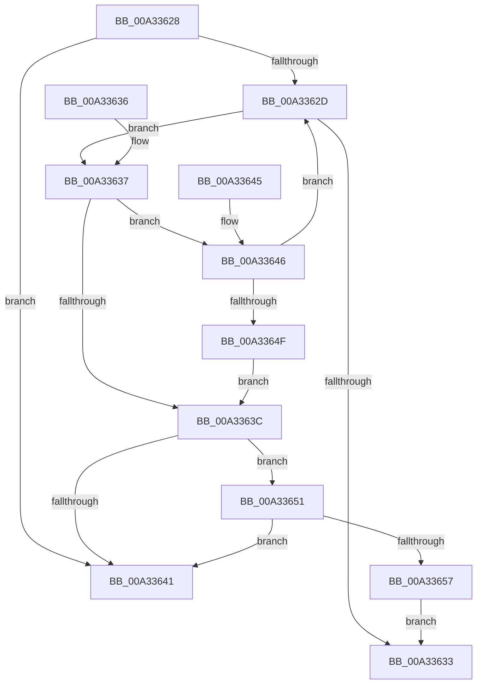

# IopSymlinkGetRelatedMountPoint

- RVA: `0x00A33628`–`0x00A33659` (길이 `49` bytes)
- VA: `0x0000000140A33628`
- 실행 섹션: `PAGE`
- PDB 이름 있음: `예`; PDB Function 태그: `아니요`
- unwind 정보 RVA: `0x000DB714`
- 디코드: `21`개 명령, `49/49` bytes 표시
- 미해석 바이트: `0` (있으면 어셈블리에 `.byte`로 보존)

> 이 문서는 커널 이미지의 기계어와 PDB 기호를 분석해 생성했습니다. 4번과 5번은 함수 원형과 자료형을 바이너리 사용 방식에서 추정한 C 해석이며 원본 소스 복구 결과는 아닙니다.

## 1. Dependencies

- 직접 호출 지점: **0**; 고유 호출 대상: **0**
- 직접 호출자로 확인된 함수: **3**
- RIP 상대 이미지 참조: **0**

### Outgoing calls
- 직접 디코드된 call 명령이 없습니다.

### Direct callers
- [IopGraftName](IopGraftName_function_00A33160.md) at `0x00A332C1`
- [IopSymlinkRememberJunction](IopSymlinkRememberJunction_function_00A33524.md) at `0x00A3355C`
- [sub_00B39C68](../B3/Unknown_function_00B39C68.md) at `0x00B39F0F`

### Static image references
- 디코드된 RIP-relative 메모리 참조가 없습니다.

## 2. Other-region calls and transfers

- 다른 실행 섹션으로 향하는 call: **0**
- 별도 외부 분기/꼬리 이동을 확인하지 못했습니다.

## 3. Assembly (complete function range)

```asm
00A33628  48 85 C9                        test rcx, rcx
00A3362B  74 14                           je 0x140a33641
00A3362D  F6 41 02 01                     test byte ptr [rcx + 2], 1
00A33631  75 04                           jne 0x140a33637
00A33633  33 C0                           xor eax, eax
00A33635  C3                              ret
00A33636  CC                              int3
00A33637  66 39 11                        cmp word ptr [rcx], dx
00A3363A  76 0A                           jbe 0x140a33646
00A3363C  48 85 C9                        test rcx, rcx
00A3363F  75 10                           jne 0x140a33651
00A33641  48 8B C1                        mov rax, rcx
00A33644  C3                              ret
00A33645  CC                              int3
00A33646  48 8B 49 08                     mov rcx, qword ptr [rcx + 8]
00A3364A  48 85 C9                        test rcx, rcx
00A3364D  75 DE                           jne 0x140a3362d
00A3364F  EB EB                           jmp 0x140a3363c
00A33651  F6 41 02 01                     test byte ptr [rcx + 2], 1
00A33655  75 EA                           jne 0x140a33641
00A33657  EB DA                           jmp 0x140a33633
```

## 4. C-style interpretation (structured pseudocode)

```c
__int64 __fastcall IopSymlinkGetRelatedMountPoint(__int64 a1, unsigned __int16 a2)
{
    __int64 result;

    if (a1 == 0) goto loc_00A33641;
loc_00A3362D:
    if (((*(unsigned __int8 *)(a1 + 2)) & (1)) != 0) goto loc_00A33637;
loc_00A33633:
    result = 0;
    return result;
loc_00A33637:
    if ((*(unsigned __int16 *)(a1)) <= a2) goto loc_00A33646;
loc_00A3363C:
    if (a1 != 0) goto loc_00A33651;
loc_00A33641:
    return a1;
loc_00A33646:
    if (*(unsigned __int64 *)(a1 + 8) != 0) goto loc_00A3362D;
    goto loc_00A3363C;
loc_00A33651:
    if (((*(unsigned __int8 *)(*(unsigned __int64 *)(a1 + 8) + 2)) & (1)) != 0) goto loc_00A33641;
    goto loc_00A33633;
}
```

## 5. (Beta) C Style

```c
int64_t IopSymlinkGetRelatedMountPoint(int64_t Arg1, uint16_t Arg2)
{
    int64_t result;

    if (Arg1 == 0) goto loc_00A33641;
loc_00A3362D:
    if (((*(uint8_t *)(Arg1 + 0x2)) & (1)) != 0) goto loc_00A33637;
loc_00A33633:
    result = 0;
    return result;
loc_00A33637:
    if ((*(uint16_t *)(Arg1)) <= Arg2) goto loc_00A33646;
loc_00A3363C:
    if (Arg1 != 0) goto loc_00A33651;
loc_00A33641:
    return Arg1;
loc_00A33646:
    if (*(uint64_t *)(Arg1 + 0x8) != 0) goto loc_00A3362D;
    goto loc_00A3363C;
loc_00A33651:
    if (((*(uint8_t *)(*(uint64_t *)(Arg1 + 0x8) + 0x2)) & (1)) != 0) goto loc_00A33641;
    goto loc_00A33633;
}
```

## 6. Execution-region graph

[열기: 2D/3D 그래프와 함수 탐색 컨트롤 패널](../../../control-panel.html?section=page&rva=0x00A33628&view=graph)

- 2D 그래프는 위에서 아래로 흐르고, 3D 그래프는 빈 공간을 드래그해 회전합니다. Shift+드래그는 이동, 휠은 확대·축소, 함수 노드 선택은 대상 보고서 이동입니다.

### Static fallback


