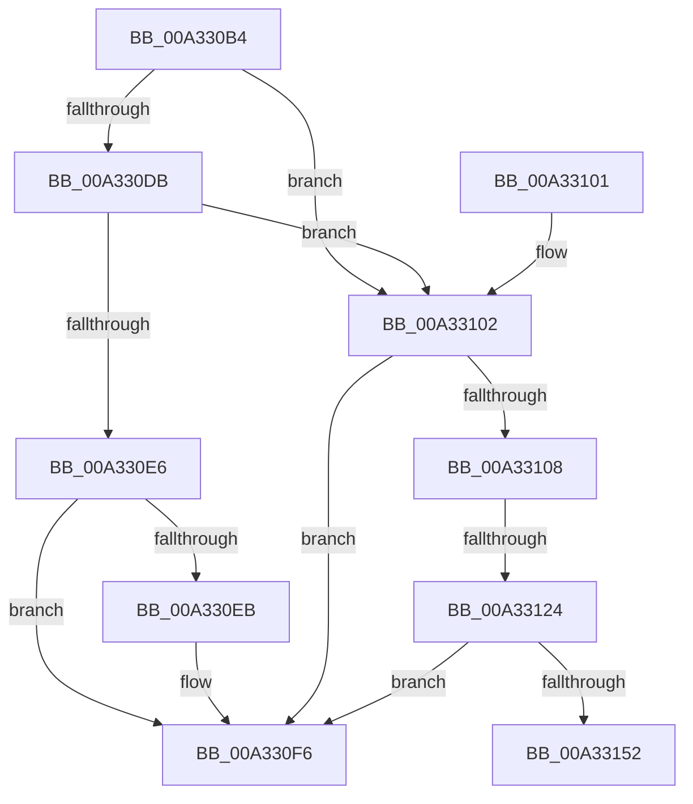

# IopSymlinkProcessReparse

- RVA: `0x00A330B4`–`0x00A33157` (길이 `163` bytes)
- VA: `0x0000000140A330B4`
- 실행 섹션: `PAGE`
- PDB 이름 있음: `예`; PDB Function 태그: `예`
- unwind 정보 RVA: `0x000AD470`
- 디코드: `44`개 명령, `163/163` bytes 표시
- 미해석 바이트: `0` (있으면 어셈블리에 `.byte`로 보존)

> 이 문서는 커널 이미지의 기계어와 PDB 기호를 분석해 생성했습니다. 4번과 5번은 함수 원형과 자료형을 바이너리 사용 방식에서 추정한 C 해석이며 원본 소스 복구 결과는 아닙니다.

## 1. Dependencies

- 직접 호출 지점: **5**; 고유 호출 대상: **5**
- 직접 호출자로 확인된 함수: **1**
- RIP 상대 이미지 참조: **0**

### Outgoing calls
- `0x00A330F1` → [IopGraftName](IopGraftName_function_00A33160.md) (function, `0x00A33160`)
- `0x00A33117` → [IopSymlinkGetECP](../../text/45/IopSymlinkGetECP_function_00458288.md) (function, `0x00458288`)
- `0x00A33129` → [IopSymlinkGetMostRecentlyUsedName](../../text/48/IopSymlinkGetMostRecentlyUsedName_function_0048476C.md) (function, `0x0048476C`)
- `0x00A33136` → [IopFindMatchingComponentsLengthR](../71/IopFindMatchingComponentsLengthR_function_0071E614.md) (function, `0x0071E614`)
- `0x00A33149` → [IopSymlinkRememberJunction](IopSymlinkRememberJunction_function_00A33524.md) (function, `0x00A33524`)

### Direct callers
- [IopParseDevice](../89/IopParseDevice_function_0089E510.md) at `0x0089FF52`

### Static image references
- 디코드된 RIP-relative 메모리 참조가 없습니다.

## 2. Other-region calls and transfers

- 다른 실행 섹션으로 향하는 call: **2**
  - `0x00A33117` → [IopSymlinkGetECP](../../text/45/IopSymlinkGetECP_function_00458288.md) (`PAGE` → `.text`)
  - `0x00A33129` → [IopSymlinkGetMostRecentlyUsedName](../../text/48/IopSymlinkGetMostRecentlyUsedName_function_0048476C.md) (`PAGE` → `.text`)
- call이 아닌 외부 분기/꼬리 이동: **2**
  - `0x00A3311E` → [sub_00B39C60](../B3/Unknown_function_00B39C60.md) (`tail-transfer`)
  - `0x00A33152` → [sub_00B39C60](../B3/Unknown_function_00B39C60.md) (`tail-transfer`)

## 3. Assembly (complete function range)

```asm
00A330B4  48 89 5C 24 10                  mov qword ptr [rsp + 0x10], rbx
00A330B9  57                              push rdi
00A330BA  48 83 EC 20                     sub rsp, 0x20
00A330BE  48 8B 41 38                     mov rax, qword ptr [rcx + 0x38]
00A330C2  48 8B D9                        mov rbx, rcx
00A330C5  48 B9 FD FF FF 5F FF FF FF FF   movabs rcx, 0xffffffff5ffffffd
00A330CF  48 8B FA                        mov rdi, rdx
00A330D2  48 03 C8                        add rcx, rax
00A330D5  48 83 F9 16                     cmp rcx, 0x16
00A330D9  77 27                           ja 0x140a33102
00A330DB  BA 01 02 40 00                  mov edx, 0x400201
00A330E0  48 0F A3 CA                     bt rdx, rcx
00A330E4  73 1C                           jae 0x140a33102
00A330E6  45 84 C9                        test r9b, r9b
00A330E9  75 0B                           jne 0x140a330f6
00A330EB  48 8B D7                        mov rdx, rdi
00A330EE  48 8B CB                        mov rcx, rbx
00A330F1  E8 6A 00 00 00                  call 0x140a33160
00A330F6  48 8B 5C 24 38                  mov rbx, qword ptr [rsp + 0x38]
00A330FB  48 83 C4 20                     add rsp, 0x20
00A330FF  5F                              pop rdi
00A33100  C3                              ret
00A33101  CC                              int3
00A33102  48 83 F8 02                     cmp rax, 2
00A33106  76 EE                           jbe 0x140a330f6
00A33108  48 8B 4B 70                     mov rcx, qword ptr [rbx + 0x70]
00A3310C  48 8D 54 24 30                  lea rdx, [rsp + 0x30]
00A33111  48 83 64 24 30 00               and qword ptr [rsp + 0x30], 0
00A33117  E8 6C 51 A2 FF                  call 0x140458288
00A3311C  85 C0                           test eax, eax
00A3311E  0F 88 3C 6B 10 00               js 0x140b39c60
00A33124  48 8B 4C 24 30                  mov rcx, qword ptr [rsp + 0x30]
00A33129  E8 3E 16 A5 FF                  call 0x14048476c
00A3312E  48 8D 4F 58                     lea rcx, [rdi + 0x58]
00A33132  48 8D 50 10                     lea rdx, [rax + 0x10]
00A33136  E8 D9 B4 CE FF                  call 0x14071e614
00A3313B  4C 8B 4C 24 30                  mov r9, qword ptr [rsp + 0x30]
00A33140  4C 8B C3                        mov r8, rbx
00A33143  48 8B D7                        mov rdx, rdi
00A33146  0F B7 C8                        movzx ecx, ax
00A33149  E8 D6 03 00 00                  call 0x140a33524
00A3314E  85 C0                           test eax, eax
00A33150  79 A4                           jns 0x140a330f6
00A33152  E9 09 6B 10 00                  jmp 0x140b39c60
```

## 4. C-style interpretation (structured pseudocode)

```c
__int64 __fastcall IopSymlinkProcessReparse(__int64 a1, __int64 a2, __int64 a3, unsigned __int8 a4)
{
    __int64 result;
    __int64 v_rsp;
    unsigned __int64 v_stack_p10;
    unsigned __int64 v_stack_p30;

    v_stack_p10 = v_rbx;
    v_rsp = (v_rsp) - (32);
    a1 = (a1) + (*(unsigned __int64 *)(a1 + 56));
    if (a1 > 22) goto loc_00A33102;
    if (a1 >= 22) goto loc_00A33102;
    result = *(unsigned __int64 *)(a1 + 56);
    if (a4 == 0) {
        a2 = a2;
        a1 = a1;
        result = IopGraftName(a1, a2, a3, a4);
    }
    v_rsp = (v_rsp) + (32);
    return result;
loc_00A33102:
    if (result <= 2) goto loc_00A330F6;
    result = IopSymlinkGetECP(*(unsigned __int64 *)(v_stack_p10 + 112), v_stack_p30, a3, a4);
    result = IopSymlinkGetMostRecentlyUsedName(v_stack_p30, v_stack_p30, a3, a4);
    result = IopFindMatchingComponentsLengthR(a2 + 88, result + 16, a3, a4);
    result = IopSymlinkRememberJunction((unsigned __int16)(result), a2, v_stack_p10, v_stack_p30);
    if (!sign_flag) goto loc_00A330F6;
}
```

## 5. (Beta) C Style

```c
int64_t IopSymlinkProcessReparse(void *Arg1, void *Arg2, int64_t Arg3, uint8_t Arg4)
{
    uint8_t *arg1 = (uint8_t *)Arg1;
    uint8_t *arg2 = (uint8_t *)Arg2;

    int64_t result;
    int64_t local_rsp;
    uint64_t v_stack_p10;
    uint64_t v_stack_p30;

    v_stack_p10 = local_rbx;
    local_rsp = (local_rsp) - (32);
    Arg1 = (Arg1) + (*(uint64_t *)(arg1 + 0x38));
    if (Arg1 > 22) goto loc_00A33102;
    if (Arg1 >= 22) goto loc_00A33102;
    result = *(uint64_t *)(arg1 + 0x38);
    if (Arg4 == 0) {
        Arg2 = Arg2;
        Arg1 = Arg1;
        result = IopGraftName(Arg1, Arg2, Arg3, Arg4);
    }
    local_rsp = (local_rsp) + (32);
    return result;
loc_00A33102:
    if (result <= 2) goto loc_00A330F6;
    result = IopSymlinkGetECP(*(uint64_t *)(v_stack_p10 + 0x70), v_stack_p30, Arg3, Arg4);
    result = IopSymlinkGetMostRecentlyUsedName(v_stack_p30, v_stack_p30, Arg3, Arg4);
    result = IopFindMatchingComponentsLengthR(Arg2 + 88, result + 16, Arg3, Arg4);
    result = IopSymlinkRememberJunction((uint16_t)(result), Arg2, v_stack_p10, v_stack_p30);
    if (!sign_flag) goto loc_00A330F6;
}
```

### 관측된 메모리 오프셋

구조체 형식이 확인되지 않은 접근은 인자 기준의 오프셋으로만 기록했습니다.

| 기준 인자 | 오프셋 표현 | 폭 (bit) | 접근 |
|---|---:|---:|---|
| `Arg1` | `+ 0x38` | `64` | `R` |
| `Arg1` | `+ 0x70` | `64` | `R` |
| `Arg2` | `+ 0x58` | `64` | `R` |

## 6. Execution-region graph

[열기: 2D/3D 그래프와 함수 탐색 컨트롤 패널](../../../control-panel.html?section=page&rva=0x00A330B4&view=graph)

- 2D 그래프는 위에서 아래로 흐르고, 3D 그래프는 빈 공간을 드래그해 회전합니다. Shift+드래그는 이동, 휠은 확대·축소, 함수 노드 선택은 대상 보고서 이동입니다.

### Static fallback


