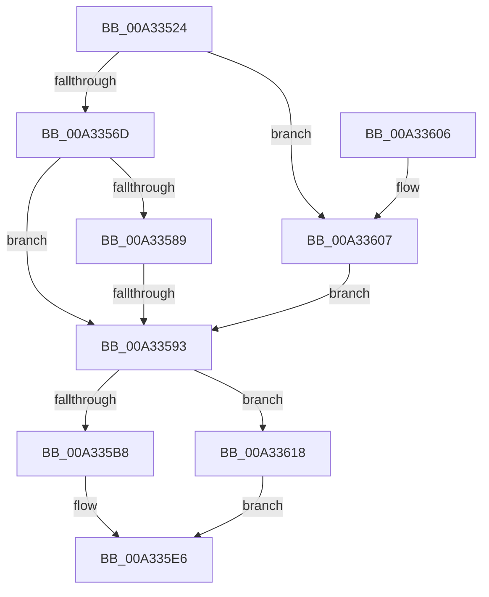

# IopSymlinkRememberJunction

- RVA: `0x00A33524`–`0x00A3361F` (길이 `251` bytes)
- VA: `0x0000000140A33524`
- 실행 섹션: `PAGE`
- PDB 이름 있음: `예`; PDB Function 태그: `예`
- unwind 정보 RVA: `0x000AD4BC`
- 디코드: `71`개 명령, `251/251` bytes 표시
- 미해석 바이트: `0` (있으면 어셈블리에 `.byte`로 보존)

> 이 문서는 커널 이미지의 기계어와 PDB 기호를 분석해 생성했습니다. 4번과 5번은 함수 원형과 자료형을 바이너리 사용 방식에서 추정한 C 해석이며 원본 소스 복구 결과는 아닙니다.

## 1. Dependencies

- 직접 호출 지점: **5**; 고유 호출 대상: **5**
- 직접 호출자로 확인된 함수: **2**
- RIP 상대 이미지 참조: **0**

### Outgoing calls
- `0x00A3355C` → [IopSymlinkGetRelatedMountPoint](IopSymlinkGetRelatedMountPoint_function_00A33628.md) (function, `0x00A33628`)
- `0x00A33570` → [IopSymlinkGetMostRecentlyUsedName](../../text/48/IopSymlinkGetMostRecentlyUsedName_function_0048476C.md) (function, `0x0048476C`)
- `0x00A335A7` → [ExAllocatePool2](../../poolcode/B8/ExAllocatePool2_function_00B820F0.md) (function, `0x00B820F0`)
- `0x00A335DD` → [memcpy](../../text/6C/memcpy_function_006C6840.md) (function, `0x006C6840`)
- `0x00A3360E` → [IopSymlinkFreeRelatedMountPointChain](../8A/IopSymlinkFreeRelatedMountPointChain_function_008A1828.md) (function, `0x008A1828`)

### Direct callers
- [IopSymlinkProcessReparse](IopSymlinkProcessReparse_function_00A330B4.md) at `0x00A33149`
- [IopGraftName](IopGraftName_function_00A33160.md) at `0x00A3338A`

### Static image references
- 디코드된 RIP-relative 메모리 참조가 없습니다.

## 2. Other-region calls and transfers

- 다른 실행 섹션으로 향하는 call: **3**
  - `0x00A33570` → [IopSymlinkGetMostRecentlyUsedName](../../text/48/IopSymlinkGetMostRecentlyUsedName_function_0048476C.md) (`PAGE` → `.text`)
  - `0x00A335A7` → [ExAllocatePool2](../../poolcode/B8/ExAllocatePool2_function_00B820F0.md) (`PAGE` → `POOLCODE`)
  - `0x00A335DD` → [memcpy](../../text/6C/memcpy_function_006C6840.md) (`PAGE` → `.text`)
- call이 아닌 외부 분기/꼬리 이동: **1**
  - `0x00A3358D` → [sub_00B39F44](../B3/Unknown_function_00B39F44.md) (`tail-transfer`)

## 3. Assembly (complete function range)

```asm
00A33524  48 89 5C 24 08                  mov qword ptr [rsp + 8], rbx
00A33529  48 89 74 24 10                  mov qword ptr [rsp + 0x10], rsi
00A3352E  48 89 7C 24 18                  mov qword ptr [rsp + 0x18], rdi
00A33533  55                              push rbp
00A33534  41 54                           push r12
00A33536  41 55                           push r13
00A33538  41 56                           push r14
00A3353A  41 57                           push r15
00A3353C  48 8B EC                        mov rbp, rsp
00A3353F  48 83 EC 50                     sub rsp, 0x50
00A33543  44 0F B7 F1                     movzx r14d, cx
00A33547  4C 8B FA                        mov r15, rdx
00A3354A  0F B7 D1                        movzx edx, cx
00A3354D  45 33 E4                        xor r12d, r12d
00A33550  49 8B C9                        mov rcx, r9
00A33553  49 8B F9                        mov rdi, r9
00A33556  4D 8B E8                        mov r13, r8
00A33559  41 8B F4                        mov esi, r12d
00A3355C  E8 C7 00 00 00                  call 0x140a33628
00A33561  48 8B D8                        mov rbx, rax
00A33564  48 85 C0                        test rax, rax
00A33567  0F 85 9A 00 00 00               jne 0x140a33607
00A3356D  49 8B C9                        mov rcx, r9
00A33570  E8 F7 11 A5 FF                  call 0x14048476c
00A33575  48 8B D8                        mov rbx, rax
00A33578  48 89 45 E8                     mov qword ptr [rbp - 0x18], rax
00A3357C  66 83 48 02 01                  or word ptr [rax + 2], 1
00A33581  66 89 10                        mov word ptr [rax], dx
00A33584  4C 3B C8                        cmp r9, rax
00A33587  75 0A                           jne 0x140a33593
00A33589  4D 39 67 40                     cmp qword ptr [r15 + 0x40], r12
00A3358D  0F 85 B1 69 10 00               jne 0x140b39f44
00A33593  41 0F B7 57 58                  movzx edx, word ptr [r15 + 0x58]
00A33598  B9 00 01 00 00                  mov ecx, 0x100
00A3359D  48 83 C2 20                     add rdx, 0x20
00A335A1  41 B8 49 6F 53 69               mov r8d, 0x69536f49
00A335A7  E8 44 EB 14 00                  call 0x140b820f0
00A335AC  48 89 43 08                     mov qword ptr [rbx + 8], rax
00A335B0  48 8B F8                        mov rdi, rax
00A335B3  48 85 C0                        test rax, rax
00A335B6  74 60                           je 0x140a33618
00A335B8  41 0F B7 5F 58                  movzx ebx, word ptr [r15 + 0x58]
00A335BD  48 8D 48 20                     lea rcx, [rax + 0x20]
00A335C1  49 8B 57 60                     mov rdx, qword ptr [r15 + 0x60]
00A335C5  44 8B C3                        mov r8d, ebx
00A335C8  48 83 20 00                     and qword ptr [rax], 0
00A335CC  66 44 89 60 10                  mov word ptr [rax + 0x10], r12w
00A335D1  66 89 58 12                     mov word ptr [rax + 0x12], bx
00A335D5  48 89 48 18                     mov qword ptr [rax + 0x18], rcx
00A335D9  4C 89 60 08                     mov qword ptr [rax + 8], r12
00A335DD  E8 5E 32 C9 FF                  call 0x1406c6840
00A335E2  66 01 5F 10                     add word ptr [rdi + 0x10], bx
00A335E6  4C 8D 5C 24 50                  lea r11, [rsp + 0x50]
00A335EB  8B C6                           mov eax, esi
00A335ED  49 8B 5B 30                     mov rbx, qword ptr [r11 + 0x30]
00A335F1  49 8B 73 38                     mov rsi, qword ptr [r11 + 0x38]
00A335F5  49 8B 7B 40                     mov rdi, qword ptr [r11 + 0x40]
00A335F9  49 8B E3                        mov rsp, r11
00A335FC  41 5F                           pop r15
00A335FE  41 5E                           pop r14
00A33600  41 5D                           pop r13
00A33602  41 5C                           pop r12
00A33604  5D                              pop rbp
00A33605  C3                              ret
00A33606  CC                              int3
00A33607  48 8B C8                        mov rcx, rax
00A3360A  66 44 89 30                     mov word ptr [rax], r14w
00A3360E  E8 15 E2 E6 FF                  call 0x1408a1828
00A33613  E9 7B FF FF FF                  jmp 0x140a33593
00A33618  BE 9A 00 00 C0                  mov esi, 0xc000009a
00A3361D  EB C7                           jmp 0x140a335e6
```

## 4. C-style interpretation (structured pseudocode)

```c
__int64 __fastcall IopSymlinkRememberJunction(unsigned __int16 a1, __int64 a2, __int64 a3, __int64 a4)
{
    __int64 result;
    __int64 v_r12;
    __int64 v_rsp;
    unsigned __int64 v_stack_m28;
    unsigned __int64 v_stack_m40;
    unsigned __int64 v_stack_p10;
    unsigned __int64 v_stack_p18;
    unsigned __int64 v_stack_p8;

    v_stack_p8 = v_rbx;
    v_stack_p10 = v_rsi;
    v_stack_p18 = v_rdi;
    v_rsp = (v_rsp) - (80);
    v_r12 = 0;
    result = IopSymlinkGetRelatedMountPoint(a4, a1, a3, a4);
    if (result != 0) goto loc_00A33607;
    result = IopSymlinkGetMostRecentlyUsedName(a4, a1, a3, a4);
    v_stack_m40 = result;
    *(unsigned __int16 *)(result) = a1;
    if (a4 != result) goto loc_00A33593;
loc_00A33593:
    a2 = (*(unsigned __int16 *)(a2 + 88)) + (32);
    result = ExAllocatePool2(256, a2, (unsigned int)(0x69536F49ULL), a4);
    *(unsigned __int64 *)(result + 8) = result;
    if (result == 0) goto loc_00A33618;
    *(unsigned __int16 *)(result + 16) = 0;
    *(unsigned __int16 *)(result + 18) = (unsigned __int16)(*(unsigned __int16 *)(a2 + 88));
    *(unsigned __int64 *)(result + 24) = result + 32;
    *(unsigned __int64 *)(result + 8) = 0;
    result = memcpy(result + 32, *(unsigned __int64 *)(a2 + 96), (unsigned int)((unsigned int)(*(unsigned __int16 *)(a2 + 88))), a4);
loc_00A335E6:
    return 0;
loc_00A33607:
    *(unsigned __int16 *)(0) = a1;
    result = IopSymlinkFreeRelatedMountPointChain(0, *(unsigned __int64 *)(a2 + 96), (unsigned int)((unsigned int)(*(unsigned __int16 *)(a2 + 88))), a4);
    goto loc_00A33593;
loc_00A33618:
    goto loc_00A335E6;
}
```

## 5. (Beta) C Style

```c
int64_t IopSymlinkRememberJunction(uint16_t Arg1, void *Arg2, int64_t Arg3, int64_t Arg4)
{
    uint8_t *arg2 = (uint8_t *)Arg2;

    int64_t result;
    int64_t local_r12;
    int64_t local_rsp;
    uint64_t v_stack_m28;
    uint64_t v_stack_m40;
    uint64_t v_stack_p10;
    uint64_t v_stack_p18;
    uint64_t v_stack_p8;

    v_stack_p8 = local_rbx;
    v_stack_p10 = local_rsi;
    v_stack_p18 = local_rdi;
    local_rsp = (local_rsp) - (80);
    local_r12 = 0;
    result = IopSymlinkGetRelatedMountPoint(Arg4, Arg1, Arg3, Arg4);
    if (result != 0) goto loc_00A33607;
    result = IopSymlinkGetMostRecentlyUsedName(Arg4, Arg1, Arg3, Arg4);
    v_stack_m40 = result;
    *(uint16_t *)(result) = Arg1;
    if (Arg4 != result) goto loc_00A33593;
loc_00A33593:
    Arg2 = (*(uint16_t *)(arg2 + 0x58)) + (32);
    result = ExAllocatePool2(256, Arg2, (uint32_t)(0x69536F49ULL), Arg4);
    *(uint64_t *)(result + 0x8) = result;
    if (result == 0) goto loc_00A33618;
    *(uint16_t *)(result + 0x10) = 0;
    *(uint16_t *)(result + 0x12) = (uint16_t)(*(uint16_t *)(arg2 + 0x58));
    *(uint64_t *)(result + 0x18) = result + 32;
    *(uint64_t *)(result + 0x8) = 0;
    result = memcpy(result + 32, *(uint64_t *)(arg2 + 0x60), (uint32_t)((uint32_t)(*(uint16_t *)(arg2 + 0x58))), Arg4);
loc_00A335E6:
    return 0;
loc_00A33607:
    *(uint16_t *)(0) = Arg1;
    result = IopSymlinkFreeRelatedMountPointChain(0, *(uint64_t *)(arg2 + 0x60), (uint32_t)((uint32_t)(*(uint16_t *)(arg2 + 0x58))), Arg4);
    goto loc_00A33593;
loc_00A33618:
    goto loc_00A335E6;
}
```

### 관측된 메모리 오프셋

구조체 형식이 확인되지 않은 접근은 인자 기준의 오프셋으로만 기록했습니다.

| 기준 인자 | 오프셋 표현 | 폭 (bit) | 접근 |
|---|---:|---:|---|
| `Arg2` | `+ 0x40` | `64` | `R` |
| `Arg2` | `+ 0x58` | `16` | `R` |
| `Arg2` | `+ 0x60` | `64` | `R` |

## 6. Execution-region graph

[열기: 2D/3D 그래프와 함수 탐색 컨트롤 패널](../../../control-panel.html?section=page&rva=0x00A33524&view=graph)

- 2D 그래프는 위에서 아래로 흐르고, 3D 그래프는 빈 공간을 드래그해 회전합니다. Shift+드래그는 이동, 휠은 확대·축소, 함수 노드 선택은 대상 보고서 이동입니다.

### Static fallback


