# KeConfigureHeteroPolicy

- RVA: `0x00A36548`–`0x00A366E5` (길이 `413` bytes)
- VA: `0x0000000140A36548`
- 실행 섹션: `PAGE`
- PDB 이름 있음: `예`; PDB Function 태그: `아니요`
- unwind 정보 RVA: `0x000AD9C8`
- 디코드: `98`개 명령, `413/413` bytes 표시
- 미해석 바이트: `0` (있으면 어셈블리에 `.byte`로 보존)

> 이 문서는 커널 이미지의 기계어와 PDB 기호를 분석해 생성했습니다. 4번과 5번은 함수 원형과 자료형을 바이너리 사용 방식에서 추정한 C 해석이며 원본 소스 복구 결과는 아닙니다.

## 1. Dependencies

- 직접 호출 지점: **0**; 고유 호출 대상: **0**
- 직접 호출자로 확인된 함수: **1**
- RIP 상대 이미지 참조: **14**

### Outgoing calls
- 직접 디코드된 call 명령이 없습니다.

### Direct callers
- [PopConfigureHeteroPolicies](PopConfigureHeteroPolicies_function_00A35B30.md) at `0x00A35E40`

### Static image references
- `0x00A365AB` → RVA `0x00FC51AC` (`ALMOSTRO`; read)
- `0x00A365BB` → RVA `0x00FC5118` (`ALMOSTRO`; read)
- `0x00A365C7` → RVA `0x00FC5080` (`ALMOSTRO`; read)
- `0x00A365D6` → RVA `0x00FC51A8` (`ALMOSTRO`; read)
- `0x00A365E2` → RVA `0x00FC5460` (`ALMOSTRO`; read)
- `0x00A365EF` → RVA `0x00FC70F8` (`ALMOSTRO`; read)
- `0x00A36625` → RVA `0x00FC70E8` (`ALMOSTRO`; read)
- `0x00A36663` → RVA `0x00FC6CE4` (`ALMOSTRO`; write)
- `0x00A3666D` → RVA `0x00FC51AC` (`ALMOSTRO`; write)
- `0x00A3667A` → RVA `0x00FC5118` (`ALMOSTRO`; write)
- `0x00A36683` → RVA `0x00FC5080` (`ALMOSTRO`; write)
- `0x00A3668C` → RVA `0x00FC8C40` (`ALMOSTRO`; read)
- `0x00A36693` → RVA `0x00FC51A8` (`ALMOSTRO`; write)
- `0x00A3669D` → RVA `0x00FC537C` (`ALMOSTRO`; write)

## 2. Other-region calls and transfers

- 다른 실행 섹션으로 향하는 call: **0**
- 별도 외부 분기/꼬리 이동을 확인하지 못했습니다.

## 3. Assembly (complete function range)

```asm
00A36548  48 8B C4                        mov rax, rsp
00A3654B  48 89 58 08                     mov qword ptr [rax + 8], rbx
00A3654F  48 89 68 10                     mov qword ptr [rax + 0x10], rbp
00A36553  48 89 70 18                     mov qword ptr [rax + 0x18], rsi
00A36557  48 89 78 20                     mov qword ptr [rax + 0x20], rdi
00A3655B  41 57                           push r15
00A3655D  45 33 C0                        xor r8d, r8d
00A36560  48 8B D1                        mov rdx, rcx
00A36563  83 39 09                        cmp dword ptr [rcx], 9
00A36566  0F 83 3C 01 00 00               jae 0x140a366a8
00A3656C  BB 07 00 00 00                  mov ebx, 7
00A36571  48 8D 41 04                     lea rax, [rcx + 4]
00A36575  44 8B CB                        mov r9d, ebx
00A36578  B9 02 00 00 00                  mov ecx, 2
00A3657D  83 38 05                        cmp dword ptr [rax], 5
00A36580  0F 8D 2A 01 00 00               jge 0x140a366b0
00A36586  48 83 C0 04                     add rax, 4
00A3658A  48 83 E9 01                     sub rcx, 1
00A3658E  75 ED                           jne 0x140a3657d
00A36590  49 83 E9 01                     sub r9, 1
00A36594  75 E2                           jne 0x140a36578
00A36596  8B 4A 44                        mov ecx, dword ptr [rdx + 0x44]
00A36599  F7 C1 CC FF FF FF               test ecx, 0xffffffcc
00A3659F  0F 85 13 01 00 00               jne 0x140a366b8
00A365A5  44 8B 12                        mov r10d, dword ptr [rdx]
00A365A8  45 8A C8                        mov r9b, r8b
00A365AB  44 39 15 FA EB 58 00            cmp dword ptr [rip + 0x58ebfa], r10d
00A365B2  0F 85 B5 00 00 00               jne 0x140a3666d
00A365B8  8B 42 3C                        mov eax, dword ptr [rdx + 0x3c]
00A365BB  39 05 57 EB 58 00               cmp dword ptr [rip + 0x58eb57], eax
00A365C1  0F 85 A6 00 00 00               jne 0x140a3666d
00A365C7  39 0D B3 EA 58 00               cmp dword ptr [rip + 0x58eab3], ecx
00A365CD  0F 85 9A 00 00 00               jne 0x140a3666d
00A365D3  8B 42 40                        mov eax, dword ptr [rdx + 0x40]
00A365D6  39 05 CC EB 58 00               cmp dword ptr [rip + 0x58ebcc], eax
00A365DC  0F 85 8B 00 00 00               jne 0x140a3666d
00A365E2  48 8D 0D 77 EE 58 00            lea rcx, [rip + 0x58ee77]
00A365E9  48 8B F2                        mov rsi, rdx
00A365EC  48 2B F1                        sub rsi, rcx
00A365EF  4C 8D 3D 02 0B 59 00            lea r15, [rip + 0x590b02]
00A365F6  48 8B FA                        mov rdi, rdx
00A365F9  49 2B FF                        sub rdi, r15
00A365FC  41 BB 02 00 00 00               mov r11d, 2
00A36602  8B 44 0E 04                     mov eax, dword ptr [rsi + rcx + 4]
00A36606  39 01                           cmp dword ptr [rcx], eax
00A36608  0F 85 B6 00 00 00               jne 0x140a366c4
00A3660E  4B 8D 04 38                     lea rax, [r8 + r15]
00A36612  44 8A 54 38 5A                  mov r10b, byte ptr [rax + rdi + 0x5a]
00A36617  44 38 10                        cmp byte ptr [rax], r10b
00A3661A  0F 85 AE 00 00 00               jne 0x140a366ce
00A36620  44 8A 54 38 4C                  mov r10b, byte ptr [rax + rdi + 0x4c]
00A36625  48 8D 2D BC 0A 59 00            lea rbp, [rip + 0x590abc]
00A3662C  45 38 14 28                     cmp byte ptr [r8 + rbp], r10b
00A36630  0F 85 A3 00 00 00               jne 0x140a366d9
00A36636  48 83 C1 04                     add rcx, 4
00A3663A  49 FF C0                        inc r8
00A3663D  49 83 EB 01                     sub r11, 1
00A36641  75 BF                           jne 0x140a36602
00A36643  48 83 EB 01                     sub rbx, 1
00A36647  75 B3                           jne 0x140a365fc
00A36649  8B 4A 48                        mov ecx, dword ptr [rdx + 0x48]
00A3664C  41 8A C1                        mov al, r9b
00A3664F  48 8B 5C 24 10                  mov rbx, qword ptr [rsp + 0x10]
00A36654  48 8B 6C 24 18                  mov rbp, qword ptr [rsp + 0x18]
00A36659  48 8B 74 24 20                  mov rsi, qword ptr [rsp + 0x20]
00A3665E  48 8B 7C 24 28                  mov rdi, qword ptr [rsp + 0x28]
00A36663  89 0D 7B 06 59 00               mov dword ptr [rip + 0x59067b], ecx
00A36669  41 5F                           pop r15
00A3666B  C3                              ret
00A3666C  CC                              int3
00A3666D  44 89 15 38 EB 58 00            mov dword ptr [rip + 0x58eb38], r10d
00A36674  41 B1 01                        mov r9b, 1
00A36677  8B 42 3C                        mov eax, dword ptr [rdx + 0x3c]
00A3667A  89 05 98 EA 58 00               mov dword ptr [rip + 0x58ea98], eax
00A36680  8B 42 44                        mov eax, dword ptr [rdx + 0x44]
00A36683  89 05 F7 E9 58 00               mov dword ptr [rip + 0x58e9f7], eax
00A36689  8B 4A 40                        mov ecx, dword ptr [rdx + 0x40]
00A3668C  48 8B 05 AD 25 59 00            mov rax, qword ptr [rip + 0x5925ad]
00A36693  89 0D 0F EB 58 00               mov dword ptr [rip + 0x58eb0f], ecx
00A36699  0F AF 48 44                     imul ecx, dword ptr [rax + 0x44]
00A3669D  89 0D D9 EC 58 00               mov dword ptr [rip + 0x58ecd9], ecx
00A366A3  E9 3A FF FF FF                  jmp 0x140a365e2
00A366A8  44 89 01                        mov dword ptr [rcx], r8d
00A366AB  E9 BC FE FF FF                  jmp 0x140a3656c
00A366B0  44 89 00                        mov dword ptr [rax], r8d
00A366B3  E9 CE FE FF FF                  jmp 0x140a36586
00A366B8  44 89 42 44                     mov dword ptr [rdx + 0x44], r8d
00A366BC  41 8B C8                        mov ecx, r8d
00A366BF  E9 E1 FE FF FF                  jmp 0x140a365a5
00A366C4  41 B1 01                        mov r9b, 1
00A366C7  89 01                           mov dword ptr [rcx], eax
00A366C9  E9 40 FF FF FF                  jmp 0x140a3660e
00A366CE  41 B1 01                        mov r9b, 1
00A366D1  44 88 10                        mov byte ptr [rax], r10b
00A366D4  E9 47 FF FF FF                  jmp 0x140a36620
00A366D9  41 B1 01                        mov r9b, 1
00A366DC  45 88 14 28                     mov byte ptr [r8 + rbp], r10b
00A366E0  E9 51 FF FF FF                  jmp 0x140a36636
```

## 4. C-style interpretation (structured pseudocode)

```c
__int64 __fastcall KeConfigureHeteroPolicy(__int64 a1, __int64 a2, int a3)
{
    __int64 result;
    __int64 v_r11;
    __int64 v_rbx;
    __int64 v_rdi;
    __int64 v_rsi;
    unsigned __int64 v_stack_p10;
    unsigned __int64 v_stack_p18;
    unsigned __int64 v_stack_p20;
    unsigned __int64 v_stack_p8;

    *(unsigned __int64 *)(v_rsp + 8) = v_rbx;
    *(unsigned __int64 *)(v_rsp + 16) = v_rbp;
    *(unsigned __int64 *)(v_rsp + 24) = v_rsi;
    *(unsigned __int64 *)(v_rsp + 32) = v_rdi;
    a3 = 0;
    if ((*(unsigned int *)(a1)) >= 9) goto loc_00A366A8;
loc_00A3656C:
loc_00A36578:
loc_00A3657D:
    if ((*(unsigned int *)(a1 + 4)) >= 5) goto loc_00A366B0;
loc_00A36586:
    result = (a1 + 4) + (4);
    a1 = (2) - (1);
    if (condition_is_not_equal) goto loc_00A3657D;
    a4 = (7) - (1);
    if (condition_is_not_equal) goto loc_00A36578;
    if ((((unsigned int)((unsigned int)(*(unsigned int *)(a1 + 68)))) & (0xFFFFFFCCULL)) != 0) goto loc_00A366B8;
loc_00A365A5:
    if ((*(unsigned int *)(v_rip + 5827578)) != ((unsigned int)((unsigned int)(*(unsigned int *)(a1))))) goto loc_00A3666D;
    if ((*(unsigned int *)(v_rip + 5827415)) != ((unsigned int)((unsigned int)(*(unsigned int *)(a1 + 60))))) goto loc_00A3666D;
    if ((*(unsigned int *)(v_rip + 5827251)) != ((unsigned int)((unsigned int)(*(unsigned int *)(a1 + 68))))) goto loc_00A3666D;
    if ((*(unsigned int *)(v_rip + 5827532)) != ((unsigned int)((unsigned int)(*(unsigned int *)(a1 + 64))))) goto loc_00A3666D;
loc_00A365E2:
    v_rsi = (a1) - (v_rip + 5828215);
    v_rdi = (a1) - (v_rip + 5835522);
loc_00A365FC:
loc_00A36602:
    if ((*(unsigned int *)(v_rip + 5828215)) != ((unsigned int)((unsigned int)(*(unsigned int *)(v_rsi + v_rip + 5828215 * 1 + 4))))) goto loc_00A366C4;
loc_00A3660E:
    if ((*(unsigned __int8 *)(a3 + v_rip + 5835522 * 1)) != ((unsigned __int8)(*(unsigned __int8 *)(a3 + v_rip + 5835522 * 1 + v_rdi * 1 + 90)))) goto loc_00A366CE;
loc_00A36620:
    if ((*(unsigned __int8 *)(a3 + v_rip + 5835452 * 1)) != ((unsigned __int8)(*(unsigned __int8 *)(a3 + v_rip + 5835522 * 1 + v_rdi * 1 + 76)))) goto loc_00A366D9;
loc_00A36636:
    a1 = (v_rip + 5828215) + (4);
    a3 = (a3) + 1;
    v_r11 = (2) - (1);
    if (condition_is_not_equal) goto loc_00A36602;
    v_rbx = (7) - (1);
    if (condition_is_not_equal) goto loc_00A365FC;
    *(unsigned int *)(v_rip + 5834363) = (unsigned int)((unsigned int)(*(unsigned int *)(a1 + 72)));
    return 0;
loc_00A3666D:
    *(unsigned int *)(v_rip + 5827384) = (unsigned int)(*(unsigned __int8 *)(a3 + v_rip + 5835522 * 1 + v_rdi * 1 + 76));
    *(unsigned int *)(v_rip + 5827224) = (unsigned int)((unsigned int)(*(unsigned int *)(a1 + 60)));
    *(unsigned int *)(v_rip + 5827063) = (unsigned int)((unsigned int)(*(unsigned int *)(a1 + 68)));
    *(unsigned int *)(v_rip + 5827343) = (unsigned int)((unsigned int)(*(unsigned int *)(a1 + 64)));
    a1 = (unsigned int)(((unsigned int)(*(unsigned int *)(a1 + 64))) * (*(unsigned int *)(*(unsigned __int64 *)(v_rip + 5842349) + 68)));
    *(unsigned int *)(v_rip + 5827801) = (unsigned int)(a1);
    goto loc_00A365E2;
loc_00A366A8:
    *(unsigned int *)(a1) = a3;
    goto loc_00A3656C;
loc_00A366B0:
    *(unsigned int *)(*(unsigned __int64 *)(v_rip + 5842349)) = a3;
    goto loc_00A36586;
loc_00A366B8:
    *(unsigned int *)(a1 + 68) = a3;
    goto loc_00A365A5;
loc_00A366C4:
    *(unsigned int *)((unsigned int)(a3)) = (unsigned int)(*(unsigned __int64 *)(v_rip + 5842349));
    goto loc_00A3660E;
loc_00A366CE:
    *(unsigned __int8 *)(*(unsigned __int64 *)(v_rip + 5842349)) = (unsigned __int8)(*(unsigned __int8 *)(a3 + v_rip + 5835522 * 1 + v_rdi * 1 + 76));
    goto loc_00A36620;
loc_00A366D9:
    *(unsigned __int8 *)(a3 + v_stack_p10 * 1) = (unsigned __int8)(*(unsigned __int8 *)(a3 + v_rip + 5835522 * 1 + v_rdi * 1 + 76));
    goto loc_00A36636;
}
```

## 5. (Beta) C Style

```c
int64_t KeConfigureHeteroPolicy(void *Arg1, int64_t Arg2, int32_t Arg3)
{
    uint8_t *arg1 = (uint8_t *)Arg1;

    int64_t result;
    int64_t local_r11;
    int64_t local_rbx;
    int64_t local_rdi;
    int64_t local_rsi;
    uint64_t v_stack_p10;
    uint64_t v_stack_p18;
    uint64_t v_stack_p20;
    uint64_t v_stack_p8;

    *(uint64_t *)(local_rsp + 0x8) = local_rbx;
    *(uint64_t *)(local_rsp + 0x10) = local_rbp;
    *(uint64_t *)(local_rsp + 0x18) = local_rsi;
    *(uint64_t *)(local_rsp + 0x20) = local_rdi;
    Arg3 = 0;
    if ((*(uint32_t *)(arg1)) >= 9) goto loc_00A366A8;
loc_00A3656C:
loc_00A36578:
loc_00A3657D:
    if ((*(uint32_t *)(arg1 + 0x4)) >= 5) goto loc_00A366B0;
loc_00A36586:
    result = (Arg1 + 4) + (4);
    Arg1 = (2) - (1);
    if (condition_is_not_equal) goto loc_00A3657D;
    a4 = (7) - (1);
    if (condition_is_not_equal) goto loc_00A36578;
    if ((((uint32_t)((uint32_t)(*(uint32_t *)(arg1 + 0x44)))) & (0xFFFFFFCCULL)) != 0) goto loc_00A366B8;
loc_00A365A5:
    if ((*(uint32_t *)(v_rip + 0x58EBFA)) != ((uint32_t)((uint32_t)(*(uint32_t *)(arg1))))) goto loc_00A3666D;
    if ((*(uint32_t *)(v_rip + 0x58EB57)) != ((uint32_t)((uint32_t)(*(uint32_t *)(arg1 + 0x3C))))) goto loc_00A3666D;
    if ((*(uint32_t *)(v_rip + 0x58EAB3)) != ((uint32_t)((uint32_t)(*(uint32_t *)(arg1 + 0x44))))) goto loc_00A3666D;
    if ((*(uint32_t *)(v_rip + 0x58EBCC)) != ((uint32_t)((uint32_t)(*(uint32_t *)(arg1 + 0x40))))) goto loc_00A3666D;
loc_00A365E2:
    local_rsi = (Arg1) - (v_rip + 5828215);
    local_rdi = (Arg1) - (v_rip + 5835522);
loc_00A365FC:
loc_00A36602:
    if ((*(uint32_t *)(v_rip + 0x58EE77)) != ((uint32_t)((uint32_t)(*(uint32_t *)(local_rsi + v_rip + 0x58EE77 * 1 + 0x4))))) goto loc_00A366C4;
loc_00A3660E:
    if ((*(uint8_t *)(Arg3 + v_rip + 0x590B02 * 1)) != ((uint8_t)(*(uint8_t *)(Arg3 + v_rip + 0x590B02 * 1 + local_rdi * 1 + 0x5A)))) goto loc_00A366CE;
loc_00A36620:
    if ((*(uint8_t *)(Arg3 + v_rip + 0x590ABC * 1)) != ((uint8_t)(*(uint8_t *)(Arg3 + v_rip + 0x590B02 * 1 + local_rdi * 1 + 0x4C)))) goto loc_00A366D9;
loc_00A36636:
    Arg1 = (v_rip + 5828215) + (4);
    Arg3 = (Arg3) + 1;
    local_r11 = (2) - (1);
    if (condition_is_not_equal) goto loc_00A36602;
    local_rbx = (7) - (1);
    if (condition_is_not_equal) goto loc_00A365FC;
    *(uint32_t *)(v_rip + 0x59067B) = (uint32_t)((uint32_t)(*(uint32_t *)(arg1 + 0x48)));
    return 0;
loc_00A3666D:
    *(uint32_t *)(v_rip + 0x58EB38) = (uint32_t)(*(uint8_t *)(Arg3 + v_rip + 0x590B02 * 1 + local_rdi * 1 + 0x4C));
    *(uint32_t *)(v_rip + 0x58EA98) = (uint32_t)((uint32_t)(*(uint32_t *)(arg1 + 0x3C)));
    *(uint32_t *)(v_rip + 0x58E9F7) = (uint32_t)((uint32_t)(*(uint32_t *)(arg1 + 0x44)));
    *(uint32_t *)(v_rip + 0x58EB0F) = (uint32_t)((uint32_t)(*(uint32_t *)(arg1 + 0x40)));
    Arg1 = (uint32_t)(((uint32_t)(*(uint32_t *)(arg1 + 0x40))) * (*(uint32_t *)(*(uint64_t *)(v_rip + 0x5925AD) + 0x44)));
    *(uint32_t *)(v_rip + 0x58ECD9) = (uint32_t)(Arg1);
    goto loc_00A365E2;
loc_00A366A8:
    *(uint32_t *)(arg1) = Arg3;
    goto loc_00A3656C;
loc_00A366B0:
    *(uint32_t *)(*(uint64_t *)(v_rip + 0x5925AD)) = Arg3;
    goto loc_00A36586;
loc_00A366B8:
    *(uint32_t *)(arg1 + 0x44) = Arg3;
    goto loc_00A365A5;
loc_00A366C4:
    *(uint32_t *)((uint32_t)(Arg3)) = (uint32_t)(*(uint64_t *)(v_rip + 0x5925AD));
    goto loc_00A3660E;
loc_00A366CE:
    *(uint8_t *)(*(uint64_t *)(v_rip + 0x5925AD)) = (uint8_t)(*(uint8_t *)(Arg3 + v_rip + 0x590B02 * 1 + local_rdi * 1 + 0x4C));
    goto loc_00A36620;
loc_00A366D9:
    *(uint8_t *)(Arg3 + v_stack_p10 * 1) = (uint8_t)(*(uint8_t *)(Arg3 + v_rip + 0x590B02 * 1 + local_rdi * 1 + 0x4C));
    goto loc_00A36636;
}
```

### 관측된 메모리 오프셋

구조체 형식이 확인되지 않은 접근은 인자 기준의 오프셋으로만 기록했습니다.

| 기준 인자 | 오프셋 표현 | 폭 (bit) | 접근 |
|---|---:|---:|---|
| `Arg1` | `+ 0x0` | `32` | `R` |
| `Arg1` | `+ 0x0` | `32` | `W` |
| `Arg1` | `+ 0x4` | `64` | `R` |
| `Arg1` | `+ 0x4 + rcx*1` | `32` | `R` |
| `Arg1` | `+ 0x3C` | `32` | `R` |
| `Arg1` | `+ 0x40` | `32` | `R` |
| `Arg1` | `+ 0x44` | `32` | `R` |
| `Arg1` | `+ 0x44` | `32` | `W` |
| `Arg1` | `+ 0x48` | `32` | `R` |

## 6. Execution-region graph

[열기: 2D/3D 그래프와 함수 탐색 컨트롤 패널](../../../control-panel.html?section=page&rva=0x00A36548&view=graph)

- 2D 그래프는 위에서 아래로 흐르고, 3D 그래프는 빈 공간을 드래그해 회전합니다. Shift+드래그는 이동, 휠은 확대·축소, 함수 노드 선택은 대상 보고서 이동입니다.

### Static fallback

```mermaid
flowchart TD
  bb_00A36548[BB_00A36548]
  bb_00A3656C[BB_00A3656C]
  bb_00A36578[BB_00A36578]
  bb_00A3657D[BB_00A3657D]
  bb_00A36586[BB_00A36586]
  bb_00A36590[BB_00A36590]
  bb_00A36596[BB_00A36596]
  bb_00A365A5[BB_00A365A5]
  bb_00A365B8[BB_00A365B8]
  bb_00A365C7[BB_00A365C7]
  bb_00A365D3[BB_00A365D3]
  bb_00A365E2[BB_00A365E2]
  bb_00A365FC[BB_00A365FC]
  bb_00A36602[BB_00A36602]
  bb_00A3660E[BB_00A3660E]
  bb_00A36620[BB_00A36620]
  bb_00A36636[BB_00A36636]
  bb_00A36643[BB_00A36643]
  bb_00A36649[BB_00A36649]
  bb_00A3666C[BB_00A3666C]
  bb_00A3666D[BB_00A3666D]
  bb_00A366A8[BB_00A366A8]
  bb_00A366B0[BB_00A366B0]
  bb_00A366B8[BB_00A366B8]
  bb_00A366C4[BB_00A366C4]
  bb_00A366CE[BB_00A366CE]
  bb_00A366D9[BB_00A366D9]
  bb_00A36548 -->|branch| bb_00A366A8
  bb_00A36548 -->|fallthrough| bb_00A3656C
  bb_00A3656C -->|flow| bb_00A36578
  bb_00A36578 -->|flow| bb_00A3657D
  bb_00A3657D -->|branch| bb_00A366B0
  bb_00A3657D -->|fallthrough| bb_00A36586
  bb_00A36586 -->|branch| bb_00A3657D
  bb_00A36586 -->|fallthrough| bb_00A36590
  bb_00A36590 -->|branch| bb_00A36578
  bb_00A36590 -->|fallthrough| bb_00A36596
  bb_00A36596 -->|branch| bb_00A366B8
  bb_00A36596 -->|fallthrough| bb_00A365A5
  bb_00A365A5 -->|branch| bb_00A3666D
  bb_00A365A5 -->|fallthrough| bb_00A365B8
  bb_00A365B8 -->|branch| bb_00A3666D
  bb_00A365B8 -->|fallthrough| bb_00A365C7
  bb_00A365C7 -->|branch| bb_00A3666D
  bb_00A365C7 -->|fallthrough| bb_00A365D3
  bb_00A365D3 -->|branch| bb_00A3666D
  bb_00A365D3 -->|fallthrough| bb_00A365E2
  bb_00A365E2 -->|flow| bb_00A365FC
  bb_00A365FC -->|flow| bb_00A36602
  bb_00A36602 -->|branch| bb_00A366C4
  bb_00A36602 -->|fallthrough| bb_00A3660E
  bb_00A3660E -->|branch| bb_00A366CE
  bb_00A3660E -->|fallthrough| bb_00A36620
  bb_00A36620 -->|branch| bb_00A366D9
  bb_00A36620 -->|fallthrough| bb_00A36636
  bb_00A36636 -->|branch| bb_00A36602
  bb_00A36636 -->|fallthrough| bb_00A36643
  bb_00A36643 -->|branch| bb_00A365FC
  bb_00A36643 -->|fallthrough| bb_00A36649
  bb_00A3666C -->|flow| bb_00A3666D
  bb_00A3666D -->|branch| bb_00A365E2
  bb_00A366A8 -->|branch| bb_00A3656C
  bb_00A366B0 -->|branch| bb_00A36586
  bb_00A366B8 -->|branch| bb_00A365A5
  bb_00A366C4 -->|branch| bb_00A3660E
  bb_00A366CE -->|branch| bb_00A36620
  bb_00A366D9 -->|branch| bb_00A36636
```


