# MiCheckForUserStackOverflow

- RVA: `0x00A30854`–`0x00A30B5F` (길이 `779` bytes)
- VA: `0x0000000140A30854`
- 실행 섹션: `PAGE`
- PDB 이름 있음: `예`; PDB Function 태그: `아니요`
- unwind 정보 RVA: `0x000AD030`
- 디코드: `181`개 명령, `779/779` bytes 표시
- 미해석 바이트: `0` (있으면 어셈블리에 `.byte`로 보존)

> 이 문서는 커널 이미지의 기계어와 PDB 기호를 분석해 생성했습니다. 4번과 5번은 함수 원형과 자료형을 바이너리 사용 방식에서 추정한 C 해석이며 원본 소스 복구 결과는 아닙니다.

## 1. Dependencies

- 직접 호출 지점: **4**; 고유 호출 대상: **4**
- 직접 호출자로 확인된 함수: **1**
- RIP 상대 이미지 참조: **0**

### Outgoing calls
- `0x00A308C0` → [MiCheckShadowStackOverflow](MiCheckShadowStackOverflow_function_00A30B68.md) (function, `0x00A30B68`)
- `0x00A309BA` → [ZwAllocateVirtualMemory](../../text/6A/ZwAllocateVirtualMemory_function_006AD3D0.md) (function, `0x006AD3D0`)
- `0x00A30A41` → [ExRaiseDatatypeMisalignment](../89/ExRaiseDatatypeMisalignment_function_00899FD0.md) (function, `0x00899FD0`)
- `0x00A30AC4` → [ZwProtectVirtualMemory](../../text/6A/ZwProtectVirtualMemory_function_006ADAD0.md) (function, `0x006ADAD0`)

### Direct callers
- [MiUserFault](../../text/32/MiUserFault_function_00329840.md) at `0x00329E06`
- [MiUserFault](../../text/32/MiUserFault_function_00329840.md) at `0x0032A014`
- [MiUserFault](../../text/32/MiUserFault_function_00329840.md) at `0x0032A028`

### Static image references
- 디코드된 RIP-relative 메모리 참조가 없습니다.

## 2. Other-region calls and transfers

- 다른 실행 섹션으로 향하는 call: **2**
  - `0x00A309BA` → [ZwAllocateVirtualMemory](../../text/6A/ZwAllocateVirtualMemory_function_006AD3D0.md) (`PAGE` → `.text`)
  - `0x00A30AC4` → [ZwProtectVirtualMemory](../../text/6A/ZwProtectVirtualMemory_function_006ADAD0.md) (`PAGE` → `.text`)
- 별도 외부 분기/꼬리 이동을 확인하지 못했습니다.

## 3. Assembly (complete function range)

```asm
00A30854  4C 8B DC                        mov r11, rsp
00A30857  49 89 5B 08                     mov qword ptr [r11 + 8], rbx
00A3085B  49 89 73 10                     mov qword ptr [r11 + 0x10], rsi
00A3085F  57                              push rdi
00A30860  41 56                           push r14
00A30862  41 57                           push r15
00A30864  48 83 EC 60                     sub rsp, 0x60
00A30868  48 8B D9                        mov rbx, rcx
00A3086B  49 83 63 C0 00                  and qword ptr [r11 - 0x40], 0
00A30870  41 83 63 18 00                  and dword ptr [r11 + 0x18], 0
00A30875  41 83 63 20 00                  and dword ptr [r11 + 0x20], 0
00A3087A  33 FF                           xor edi, edi
00A3087C  65 4C 8B 34 25 88 01 00 00      mov r14, qword ptr gs:[0x188]
00A30885  41 F7 86 A8 05 00 00 80 40 00 00  test dword ptr [r14 + 0x5a8], 0x4080
00A30890  41 0F 94 C0                     sete r8b
00A30894  41 F6 86 A8 05 00 00 03         test byte ptr [r14 + 0x5a8], 3
00A3089C  0F 94 C0                        sete al
00A3089F  44 84 C0                        test al, r8b
00A308A2  0F 84 6F 01 00 00               je 0x140a30a17
00A308A8  40 B6 01                        mov sil, 1
00A308AB  41 38 B6 4A 02 00 00            cmp byte ptr [r14 + 0x24a], sil
00A308B2  0F 84 5F 01 00 00               je 0x140a30a17
00A308B8  85 D2                           test edx, edx
00A308BA  75 11                           jne 0x140a308cd
00A308BC  49 8D 53 18                     lea rdx, [r11 + 0x18]
00A308C0  E8 A3 02 00 00                  call 0x140a30b68
00A308C5  85 C0                           test eax, eax
00A308C7  0F 85 53 02 00 00               jne 0x140a30b20
00A308CD  4D 8B 86 F0 00 00 00            mov r8, qword ptr [r14 + 0xf0]
00A308D4  4D 8B 48 08                     mov r9, qword ptr [r8 + 8]
00A308D8  4C 89 4C 24 48                  mov qword ptr [rsp + 0x48], r9
00A308DD  49 8B 90 78 14 00 00            mov rdx, qword ptr [r8 + 0x1478]
00A308E4  48 89 54 24 50                  mov qword ptr [rsp + 0x50], rdx
00A308E9  41 8B 88 48 17 00 00            mov ecx, dword ptr [r8 + 0x1748]
00A308F0  48 89 4C 24 38                  mov qword ptr [rsp + 0x38], rcx
00A308F5  EB 0A                           jmp 0x140a30901
00A308F7  B8 01 00 00 80                  mov eax, 0x80000001
00A308FC  E9 EE 00 00 00                  jmp 0x140a309ef
00A30901  49 C7 C3 00 F0 FF FF            mov r11, 0xfffffffffffff000
00A30908  49 23 D3                        and rdx, r11
00A3090B  48 81 C1 FF 0F 00 00            add rcx, 0xfff
00A30912  49 23 CB                        and rcx, r11
00A30915  48 89 4C 24 38                  mov qword ptr [rsp + 0x38], rcx
00A3091A  4D 8D 78 10                     lea r15, [r8 + 0x10]
00A3091E  48 8B C1                        mov rax, rcx
00A30921  74 0F                           je 0x140a30932
00A30923  48 8D 81 00 10 00 00            lea rax, [rcx + 0x1000]
00A3092A  48 8B C8                        mov rcx, rax
00A3092D  48 89 44 24 38                  mov qword ptr [rsp + 0x38], rax
00A30932  41 BA 00 30 00 00               mov r10d, 0x3000
00A30938  49 3B C2                        cmp rax, r10
00A3093B  73 0B                           jae 0x140a30948
00A3093D  41 8B CA                        mov ecx, r10d
00A30940  48 89 4C 24 38                  mov qword ptr [rsp + 0x38], rcx
00A30945  41 8B C2                        mov eax, r10d
00A30948  49 3B D9                        cmp rbx, r9
00A3094B  0F 83 B5 00 00 00               jae 0x140a30a06
00A30951  48 3B DA                        cmp rbx, rdx
00A30954  0F 82 AC 00 00 00               jb 0x140a30a06
00A3095A  49 23 DB                        and rbx, r11
00A3095D  48 2B D8                        sub rbx, rax
00A30960  48 89 5C 24 40                  mov qword ptr [rsp + 0x40], rbx
00A30965  48 3B DA                        cmp rbx, rdx
00A30968  0F 86 29 01 00 00               jbe 0x140a30a97
00A3096E  49 8B 86 B8 00 00 00            mov rax, qword ptr [r14 + 0xb8]
00A30975  48 8B 80 E0 02 00 00            mov rax, qword ptr [rax + 0x2e0]
00A3097C  8B 80 BC 00 00 00               mov eax, dword ptr [rax + 0xbc]
00A30982  89 44 24 30                     mov dword ptr [rsp + 0x30], eax
00A30986  EB 07                           jmp 0x140a3098f
00A30988  B8 01 00 00 80                  mov eax, 0x80000001
00A3098D  EB 60                           jmp 0x140a309ef
00A3098F  0F BA E0 10                     bt eax, 0x10
00A30993  0F 82 A4 01 00 00               jb 0x140a30b3d
00A30999  C7 44 24 28 04 01 00 00         mov dword ptr [rsp + 0x28], 0x104
00A309A1  C7 44 24 20 00 10 00 00         mov dword ptr [rsp + 0x20], 0x1000
00A309A9  4C 8D 4C 24 38                  lea r9, [rsp + 0x38]
00A309AE  45 33 C0                        xor r8d, r8d
00A309B1  48 8D 54 24 40                  lea rdx, [rsp + 0x40]
00A309B6  48 83 C9 FF                     or rcx, 0xffffffffffffffff
00A309BA  E8 11 CA C7 FF                  call 0x1406ad3d0
00A309BF  48 8B 4C 24 38                  mov rcx, qword ptr [rsp + 0x38]
00A309C4  48 8B 5C 24 40                  mov rbx, qword ptr [rsp + 0x40]
00A309C9  85 C0                           test eax, eax
00A309CB  0F 88 76 01 00 00               js 0x140a30b47
00A309D1  48 8D 14 0B                     lea rdx, [rbx + rcx]
00A309D5  B8 13 01 00 00                  mov eax, 0x113
00A309DA  90                              nop
00A309DB  48 85 FF                        test rdi, rdi
00A309DE  75 05                           jne 0x140a309e5
00A309E0  49 89 17                        mov qword ptr [r15], rdx
00A309E3  EB 03                           jmp 0x140a309e8
00A309E5  41 89 17                        mov dword ptr [r15], edx
00A309E8  EB 05                           jmp 0x140a309ef
00A309EA  B8 01 00 00 80                  mov eax, 0x80000001
00A309EF  4C 8D 5C 24 60                  lea r11, [rsp + 0x60]
00A309F4  49 8B 5B 20                     mov rbx, qword ptr [r11 + 0x20]
00A309F8  49 8B 73 28                     mov rsi, qword ptr [r11 + 0x28]
00A309FC  49 8B E3                        mov rsp, r11
00A309FF  41 5F                           pop r15
00A30A01  41 5E                           pop r14
00A30A03  5F                              pop rdi
00A30A04  C3                              ret
00A30A05  CC                              int3
00A30A06  49 8B 86 B8 00 00 00            mov rax, qword ptr [r14 + 0xb8]
00A30A0D  48 83 B8 10 03 00 00 00         cmp qword ptr [rax + 0x310], 0
00A30A15  75 07                           jne 0x140a30a1e
00A30A17  B8 01 00 00 80                  mov eax, 0x80000001
00A30A1C  EB D1                           jmp 0x140a309ef
00A30A1E  0F B7 88 EC 06 00 00            movzx ecx, word ptr [rax + 0x6ec]
00A30A25  B8 4C 01 00 00                  mov eax, 0x14c
00A30A2A  66 3B C8                        cmp cx, ax
00A30A2D  75 59                           jne 0x140a30a88
00A30A2F  40 84 F6                        test sil, sil
00A30A32  74 E3                           je 0x140a30a17
00A30A34  49 8D B8 00 20 00 00            lea rdi, [r8 + 0x2000]
00A30A3B  40 F6 C7 03                     test dil, 3
00A30A3F  74 06                           je 0x140a30a47
00A30A41  E8 8A 95 E6 FF                  call 0x140899fd0
00A30A46  CC                              int3
00A30A47  48 8B C7                        mov rax, rdi
00A30A4A  48 B9 00 00 FF FF FF 7F 00 00   movabs rcx, 0x7fffffff0000
00A30A54  48 3B F9                        cmp rdi, rcx
00A30A57  48 0F 43 C1                     cmovae rax, rcx
00A30A5B  90                              nop
00A30A5C  8A 00                           mov al, byte ptr [rax]
00A30A5E  8B 47 04                        mov eax, dword ptr [rdi + 4]
00A30A61  48 89 44 24 48                  mov qword ptr [rsp + 0x48], rax
00A30A66  8B 97 0C 0E 00 00               mov edx, dword ptr [rdi + 0xe0c]
00A30A6C  48 89 54 24 50                  mov qword ptr [rsp + 0x50], rdx
00A30A71  8B 8F 78 0F 00 00               mov ecx, dword ptr [rdi + 0xf78]
00A30A77  48 89 4C 24 38                  mov qword ptr [rsp + 0x38], rcx
00A30A7C  EB 5A                           jmp 0x140a30ad8
00A30A7E  B8 01 00 00 80                  mov eax, 0x80000001
00A30A83  E9 67 FF FF FF                  jmp 0x140a309ef
00A30A88  B8 C4 01 00 00                  mov eax, 0x1c4
00A30A8D  66 3B C8                        cmp cx, ax
00A30A90  74 9D                           je 0x140a30a2f
00A30A92  40 32 F6                        xor sil, sil
00A30A95  EB 98                           jmp 0x140a30a2f
00A30A97  48 81 C2 00 10 00 00            add rdx, 0x1000
00A30A9E  48 89 54 24 40                  mov qword ptr [rsp + 0x40], rdx
00A30AA3  48 8D 84 24 98 00 00 00         lea rax, [rsp + 0x98]
00A30AAB  48 89 44 24 20                  mov qword ptr [rsp + 0x20], rax
00A30AB0  41 B9 04 00 00 00               mov r9d, 4
00A30AB6  4C 8D 44 24 38                  lea r8, [rsp + 0x38]
00A30ABB  48 8D 54 24 40                  lea rdx, [rsp + 0x40]
00A30AC0  48 83 C9 FF                     or rcx, 0xffffffffffffffff
00A30AC4  E8 07 D0 C7 FF                  call 0x1406adad0
00A30AC9  48 8B 54 24 40                  mov rdx, qword ptr [rsp + 0x40]
00A30ACE  B8 FD 00 00 C0                  mov eax, 0xc00000fd
00A30AD3  E9 02 FF FF FF                  jmp 0x140a309da
00A30AD8  49 23 D3                        and rdx, r11
00A30ADB  48 3B D8                        cmp rbx, rax
00A30ADE  0F 83 33 FF FF FF               jae 0x140a30a17
00A30AE4  48 3B DA                        cmp rbx, rdx
00A30AE7  0F 82 2A FF FF FF               jb 0x140a30a17
00A30AED  48 81 C1 FF 0F 00 00            add rcx, 0xfff
00A30AF4  49 23 CB                        and rcx, r11
00A30AF7  48 8B C1                        mov rax, rcx
00A30AFA  48 89 4C 24 38                  mov qword ptr [rsp + 0x38], rcx
00A30AFF  75 2B                           jne 0x140a30b2c
00A30B01  41 B8 00 20 00 00               mov r8d, 0x2000
00A30B07  49 3B C0                        cmp rax, r8
00A30B0A  73 0B                           jae 0x140a30b17
00A30B0C  41 8B C8                        mov ecx, r8d
00A30B0F  48 89 4C 24 38                  mov qword ptr [rsp + 0x38], rcx
00A30B14  41 8B C0                        mov eax, r8d
00A30B17  4C 8D 7F 08                     lea r15, [rdi + 8]
00A30B1B  E9 3A FE FF FF                  jmp 0x140a3095a
00A30B20  8B 84 24 90 00 00 00            mov eax, dword ptr [rsp + 0x90]
00A30B27  E9 C3 FE FF FF                  jmp 0x140a309ef
00A30B2C  48 81 C1 00 10 00 00            add rcx, 0x1000
00A30B33  48 89 4C 24 38                  mov qword ptr [rsp + 0x38], rcx
00A30B38  48 8B C1                        mov rax, rcx
00A30B3B  EB C4                           jmp 0x140a30b01
00A30B3D  B8 2D 01 00 C0                  mov eax, 0xc000012d
00A30B42  E9 82 FE FF FF                  jmp 0x140a309c9
00A30B47  48 81 E9 00 10 00 00            sub rcx, 0x1000
00A30B4E  48 89 4C 24 38                  mov qword ptr [rsp + 0x38], rcx
00A30B53  48 8D 93 00 10 00 00            lea rdx, [rbx + 0x1000]
00A30B5A  E9 3F FF FF FF                  jmp 0x140a30a9e
```

## 4. C-style interpretation (structured pseudocode)

```c
__int64 __fastcall MiCheckForUserStackOverflow(__int64 a1, int a2)
{
    __int64 result;
    __int64 v_rbx;
    __int64 v_rdi;
    __int64 v_rsi;
    __int64 v_rsp;
    unsigned __int64 v_stack_m10;
    unsigned __int64 v_stack_m18;
    unsigned __int64 v_stack_m20;
    unsigned __int64 v_stack_m28;
    unsigned __int64 v_stack_m30;
    unsigned __int64 v_stack_m38;
    unsigned __int64 v_stack_m40;
    unsigned int v_stack_m48;
    unsigned int v_stack_m50;
    unsigned int v_stack_m58;
    unsigned int v_stack_p30;
    unsigned __int64 v_stack_p38;

    *(unsigned __int64 *)(v_rsp + 8) = v_rbx;
    *(unsigned __int64 *)(v_rsp + 16) = v_rsi;
    v_rsp = (v_rsp) - (96);
    v_rdi = 0;
    a3 = (((*(unsigned int *)(*(unsigned __int64 *)(gs_base + (0 + 392)) + 1448)) & (0x4080ULL)) == 0) ? 1 : 0;
    result = (((*(unsigned __int8 *)(*(unsigned __int64 *)(gs_base + (0 + 392)) + 1448)) & (3)) == 0) ? 1 : 0;
    if ((((unsigned __int8)(result)) & ((unsigned __int8)(a3))) == 0) goto loc_00A30A17;
    if ((*(unsigned __int8 *)(*(unsigned __int64 *)(gs_base + (0 + 392)) + 586)) == 1) goto loc_00A30A17;
    if (a2 != 0) goto loc_00A308CD;
    result = MiCheckShadowStackOverflow(a1, v_rsp + 24, a3, a4);
    if ((unsigned int)(result) != 0) goto loc_00A30B20;
loc_00A308CD:
    v_stack_m30 = *(unsigned __int64 *)(*(unsigned __int64 *)(*(unsigned __int64 *)(gs_base + (0 + 392)) + 240) + 8);
    v_stack_m28 = *(unsigned __int64 *)(*(unsigned __int64 *)(*(unsigned __int64 *)(gs_base + (0 + 392)) + 240) + 5240);
    v_stack_m40 = (unsigned int)(*(unsigned int *)(*(unsigned __int64 *)(*(unsigned __int64 *)(gs_base + (0 + 392)) + 240) + 5960));
    goto loc_00A30901;
loc_00A30901:
    a2 = (*(unsigned __int64 *)(*(unsigned __int64 *)(*(unsigned __int64 *)(gs_base + (0 + 392)) + 240) + 5240)) & (0xFFFFFFFFFFFFF000ULL);
    a1 = ((unsigned int)(*(unsigned int *)(*(unsigned __int64 *)(*(unsigned __int64 *)(gs_base + (0 + 392)) + 240) + 5960))) + (0xFFFULL);
    a1 = (a1) & (0xFFFFFFFFFFFFF000ULL);
    v_stack_m40 = a1;
    result = a1;
    if (!(condition_is_equal)) {
        result = a1 + 4096;
        a1 = result;
        v_stack_m40 = result;
    }
    if (result < ((unsigned int)(0x3000ULL))) {
        a1 = (unsigned int)((unsigned int)(0x3000ULL));
        v_stack_m40 = a1;
        result = (unsigned int)((unsigned int)(0x3000ULL));
    }
    if (a1 >= (*(unsigned __int64 *)(*(unsigned __int64 *)(*(unsigned __int64 *)(gs_base + (0 + 392)) + 240) + 8))) goto loc_00A30A06;
    if (a1 < a2) goto loc_00A30A06;
loc_00A3095A:
    v_rbx = (a1) & (0xFFFFFFFFFFFFF000ULL);
    v_rbx = (v_rbx) - (result);
    v_stack_m38 = v_rbx;
    if (v_rbx <= a2) goto loc_00A30A97;
    v_stack_m48 = (unsigned int)((unsigned int)(*(unsigned int *)(*(unsigned __int64 *)(*(unsigned __int64 *)(*(unsigned __int64 *)(gs_base + (0 + 392)) + 184) + 736) + 188)));
    goto loc_00A3098F;
loc_00A3098F:
    if (v_rbx < a2) goto loc_00A30B3D;
    v_stack_m50 = 260;
    v_stack_m58 = 0x1000ULL;
    a3 = 0;
    a1 = (a1) | (-1);
    result = ZwAllocateVirtualMemory(a1, v_stack_m38, a3, v_stack_m40);
loc_00A309C9:
    if (sign_flag) goto loc_00A30B47;
loc_00A309DA:
    if (0 != 0) goto loc_00A309E5;
    *(unsigned __int64 *)(*(unsigned __int64 *)(*(unsigned __int64 *)(gs_base + (0 + 392)) + 240) + 16) = v_stack_m38 + v_stack_m40 * 1;
    goto loc_00A309E8;
loc_00A309E5:
    *(unsigned int *)(*(unsigned __int64 *)(*(unsigned __int64 *)(gs_base + (0 + 392)) + 240) + 16) = (unsigned int)(v_stack_m38 + v_stack_m40 * 1);
loc_00A309E8:
    goto loc_00A309EF;
loc_00A309EF:
    return 275;
loc_00A30A06:
    if ((*(unsigned __int64 *)(*(unsigned __int64 *)(*(unsigned __int64 *)(gs_base + (0 + 392)) + 184) + 784)) != 0) goto loc_00A30A1E;
loc_00A30A17:
    goto loc_00A309EF;
loc_00A30A1E:
    if (((unsigned __int16)(*(unsigned __int16 *)((unsigned int)(0x80000001ULL) + 1772))) != 332) goto loc_00A30A88;
loc_00A30A2F:
    if ((unsigned __int8)(*(unsigned __int64 *)(v_stack_m18 + 40)) == 0) goto loc_00A30A17;
    result = 332;
    if ((((unsigned __int8)(a3 + 8192)) & (3)) != 0) {
        result = ExRaiseDatatypeMisalignment(*(unsigned __int16 *)((unsigned int)(0x80000001ULL) + 1772), v_stack_m38 + v_stack_m40 * 1, a3, v_stack_m40);
    }
    result = a3 + 8192;
    if ((a3 + 8192) >= (*(unsigned __int16 *)((unsigned int)(0x80000001ULL) + 1772))) { result = *(unsigned __int16 *)((unsigned int)(0x80000001ULL) + 1772); }
    v_stack_m18 = (unsigned int)(*(unsigned int *)(a3 + 8192 + 4));
    v_stack_m10 = (unsigned int)(*(unsigned int *)(a3 + 8192 + 3596));
    v_stack_m28 = (unsigned int)(*(unsigned int *)(a3 + 8192 + 3960));
    goto loc_00A30AD8;
loc_00A30A88:
    if (((unsigned __int16)((unsigned int)(*(unsigned int *)(a3 + 8192 + 3960)))) == 452) goto loc_00A30A2F;
    v_rsi = 0;
    goto loc_00A30A2F;
loc_00A30A97:
    a2 = ((unsigned int)(*(unsigned int *)(a3 + 8192 + 3596))) + (0x1000ULL);
loc_00A30A9E:
    v_stack_m20 = a2;
    v_stack_m40 = v_stack_p38;
    a1 = ((unsigned int)(*(unsigned int *)(a3 + 8192 + 3960))) | (-1);
    result = ZwProtectVirtualMemory(a1, v_stack_m20, v_stack_m28, 4);
    goto loc_00A309DA;
loc_00A30AD8:
    a2 = (v_stack_m20) & (v_stack_m18);
    if ((*(unsigned __int64 *)(v_stack_m18 + 32)) >= ((unsigned int)(0xC00000FDULL))) goto loc_00A30A17;
    if ((*(unsigned __int64 *)(v_stack_m18 + 32)) < a2) goto loc_00A30A17;
    a1 = (a1) + (0xFFFULL);
    a1 = (a1) & (v_stack_m18);
    v_stack_m28 = a1;
    if (condition_is_not_equal) goto loc_00A30B2C;
loc_00A30B01:
    result = a1;
    if (a1 < ((unsigned int)(0x2000ULL))) {
        a1 = (unsigned int)((unsigned int)(0x2000ULL));
        v_stack_m28 = a1;
        result = (unsigned int)((unsigned int)(0x2000ULL));
    }
    goto loc_00A3095A;
loc_00A30B20:
    goto loc_00A309EF;
loc_00A30B2C:
    a1 = (a1) + (0x1000ULL);
    v_stack_m28 = a1;
    goto loc_00A30B01;
loc_00A30B3D:
    goto loc_00A309C9;
loc_00A30B47:
    a1 = (a1) - (0x1000ULL);
    v_stack_m28 = a1;
    goto loc_00A30A9E;
}
```

## 5. (Beta) C Style

```c
int64_t MiCheckForUserStackOverflow(int64_t Arg1, int32_t Arg2)
{
    int64_t result;
    int64_t local_rbx;
    int64_t local_rdi;
    int64_t local_rsi;
    int64_t local_rsp;
    uint64_t v_stack_m10;
    uint64_t v_stack_m18;
    uint64_t v_stack_m20;
    uint64_t v_stack_m28;
    uint64_t v_stack_m30;
    uint64_t v_stack_m38;
    uint64_t v_stack_m40;
    uint32_t v_stack_m48;
    uint32_t v_stack_m50;
    uint32_t v_stack_m58;
    uint32_t v_stack_p30;
    uint64_t v_stack_p38;

    *(uint64_t *)(local_rsp + 0x8) = local_rbx;
    *(uint64_t *)(local_rsp + 0x10) = local_rsi;
    local_rsp = (local_rsp) - (96);
    local_rdi = 0;
    a3 = (((*(uint32_t *)(*(uint64_t *)(gs_base + (0 + 0x188)) + 0x5A8)) & (0x4080ULL)) == 0) ? 1 : 0;
    result = (((*(uint8_t *)(*(uint64_t *)(gs_base + (0 + 0x188)) + 0x5A8)) & (3)) == 0) ? 1 : 0;
    if ((((uint8_t)(result)) & ((uint8_t)(a3))) == 0) goto loc_00A30A17;
    if ((*(uint8_t *)(*(uint64_t *)(gs_base + (0 + 0x188)) + 0x24A)) == 1) goto loc_00A30A17;
    if (Arg2 != 0) goto loc_00A308CD;
    result = MiCheckShadowStackOverflow(Arg1, local_rsp + 24, a3, a4);
    if ((uint32_t)(result) != 0) goto loc_00A30B20;
loc_00A308CD:
    v_stack_m30 = *(uint64_t *)(*(uint64_t *)(*(uint64_t *)(gs_base + (0 + 0x188)) + 0xF0) + 0x8);
    v_stack_m28 = *(uint64_t *)(*(uint64_t *)(*(uint64_t *)(gs_base + (0 + 0x188)) + 0xF0) + 0x1478);
    v_stack_m40 = (uint32_t)(*(uint32_t *)(*(uint64_t *)(*(uint64_t *)(gs_base + (0 + 0x188)) + 0xF0) + 0x1748));
    goto loc_00A30901;
loc_00A30901:
    Arg2 = (*(uint64_t *)(*(uint64_t *)(*(uint64_t *)(gs_base + (0 + 0x188)) + 0xF0) + 0x1478)) & (0xFFFFFFFFFFFFF000ULL);
    Arg1 = ((uint32_t)(*(uint32_t *)(*(uint64_t *)(*(uint64_t *)(gs_base + (0 + 0x188)) + 0xF0) + 0x1748))) + (0xFFFULL);
    Arg1 = (Arg1) & (0xFFFFFFFFFFFFF000ULL);
    v_stack_m40 = Arg1;
    result = Arg1;
    if (!(condition_is_equal)) {
        result = Arg1 + 4096;
        Arg1 = result;
        v_stack_m40 = result;
    }
    if (result < ((uint32_t)(0x3000ULL))) {
        Arg1 = (uint32_t)((uint32_t)(0x3000ULL));
        v_stack_m40 = Arg1;
        result = (uint32_t)((uint32_t)(0x3000ULL));
    }
    if (Arg1 >= (*(uint64_t *)(*(uint64_t *)(*(uint64_t *)(gs_base + (0 + 0x188)) + 0xF0) + 0x8))) goto loc_00A30A06;
    if (Arg1 < Arg2) goto loc_00A30A06;
loc_00A3095A:
    local_rbx = (Arg1) & (0xFFFFFFFFFFFFF000ULL);
    local_rbx = (local_rbx) - (result);
    v_stack_m38 = local_rbx;
    if (local_rbx <= Arg2) goto loc_00A30A97;
    v_stack_m48 = (uint32_t)((uint32_t)(*(uint32_t *)(*(uint64_t *)(*(uint64_t *)(*(uint64_t *)(gs_base + (0 + 0x188)) + 0xB8) + 0x2E0) + 0xBC)));
    goto loc_00A3098F;
loc_00A3098F:
    if (local_rbx < Arg2) goto loc_00A30B3D;
    v_stack_m50 = 260;
    v_stack_m58 = 0x1000ULL;
    a3 = 0;
    Arg1 = (Arg1) | (-1);
    result = ZwAllocateVirtualMemory(Arg1, v_stack_m38, a3, v_stack_m40);
loc_00A309C9:
    if (sign_flag) goto loc_00A30B47;
loc_00A309DA:
    if (0 != 0) goto loc_00A309E5;
    *(uint64_t *)(*(uint64_t *)(*(uint64_t *)(gs_base + (0 + 0x188)) + 0xF0) + 0x10) = v_stack_m38 + v_stack_m40 * 1;
    goto loc_00A309E8;
loc_00A309E5:
    *(uint32_t *)(*(uint64_t *)(*(uint64_t *)(gs_base + (0 + 0x188)) + 0xF0) + 0x10) = (uint32_t)(v_stack_m38 + v_stack_m40 * 1);
loc_00A309E8:
    goto loc_00A309EF;
loc_00A309EF:
    return 275;
loc_00A30A06:
    if ((*(uint64_t *)(*(uint64_t *)(*(uint64_t *)(gs_base + (0 + 0x188)) + 0xB8) + 0x310)) != 0) goto loc_00A30A1E;
loc_00A30A17:
    goto loc_00A309EF;
loc_00A30A1E:
    if (((uint16_t)(*(uint16_t *)((uint32_t)(0x80000001ULL) + 0x6EC))) != 332) goto loc_00A30A88;
loc_00A30A2F:
    if ((uint8_t)(*(uint64_t *)(v_stack_m18 + 0x28)) == 0) goto loc_00A30A17;
    result = 332;
    if ((((uint8_t)(a3 + 8192)) & (3)) != 0) {
        result = ExRaiseDatatypeMisalignment(*(uint16_t *)((uint32_t)(0x80000001ULL) + 0x6EC), v_stack_m38 + v_stack_m40 * 1, a3, v_stack_m40);
    }
    result = a3 + 8192;
    if ((a3 + 8192) >= (*(uint16_t *)((uint32_t)(0x80000001ULL) + 0x6EC))) { result = *(uint16_t *)((uint32_t)(0x80000001ULL) + 0x6EC); }
    v_stack_m18 = (uint32_t)(*(uint32_t *)(a3 + 0x2000 + 0x4));
    v_stack_m10 = (uint32_t)(*(uint32_t *)(a3 + 0x2000 + 0xE0C));
    v_stack_m28 = (uint32_t)(*(uint32_t *)(a3 + 0x2000 + 0xF78));
    goto loc_00A30AD8;
loc_00A30A88:
    if (((uint16_t)((uint32_t)(*(uint32_t *)(a3 + 0x2000 + 0xF78)))) == 452) goto loc_00A30A2F;
    local_rsi = 0;
    goto loc_00A30A2F;
loc_00A30A97:
    Arg2 = ((uint32_t)(*(uint32_t *)(a3 + 0x2000 + 0xE0C))) + (0x1000ULL);
loc_00A30A9E:
    v_stack_m20 = Arg2;
    v_stack_m40 = v_stack_p38;
    Arg1 = ((uint32_t)(*(uint32_t *)(a3 + 0x2000 + 0xF78))) | (-1);
    result = ZwProtectVirtualMemory(Arg1, v_stack_m20, v_stack_m28, 4);
    goto loc_00A309DA;
loc_00A30AD8:
    Arg2 = (v_stack_m20) & (v_stack_m18);
    if ((*(uint64_t *)(v_stack_m18 + 0x20)) >= ((uint32_t)(0xC00000FDULL))) goto loc_00A30A17;
    if ((*(uint64_t *)(v_stack_m18 + 0x20)) < Arg2) goto loc_00A30A17;
    Arg1 = (Arg1) + (0xFFFULL);
    Arg1 = (Arg1) & (v_stack_m18);
    v_stack_m28 = Arg1;
    if (condition_is_not_equal) goto loc_00A30B2C;
loc_00A30B01:
    result = Arg1;
    if (Arg1 < ((uint32_t)(0x2000ULL))) {
        Arg1 = (uint32_t)((uint32_t)(0x2000ULL));
        v_stack_m28 = Arg1;
        result = (uint32_t)((uint32_t)(0x2000ULL));
    }
    goto loc_00A3095A;
loc_00A30B20:
    goto loc_00A309EF;
loc_00A30B2C:
    Arg1 = (Arg1) + (0x1000ULL);
    v_stack_m28 = Arg1;
    goto loc_00A30B01;
loc_00A30B3D:
    goto loc_00A309C9;
loc_00A30B47:
    Arg1 = (Arg1) - (0x1000ULL);
    v_stack_m28 = Arg1;
    goto loc_00A30A9E;
}
```

## 6. Execution-region graph

[열기: 2D/3D 그래프와 함수 탐색 컨트롤 패널](../../../control-panel.html?section=page&rva=0x00A30854&view=graph)

- 2D 그래프는 위에서 아래로 흐르고, 3D 그래프는 빈 공간을 드래그해 회전합니다. Shift+드래그는 이동, 휠은 확대·축소, 함수 노드 선택은 대상 보고서 이동입니다.

### Static fallback

```mermaid
flowchart TD
  bb_00A30854[BB_00A30854]
  bb_00A308A8[BB_00A308A8]
  bb_00A308B8[BB_00A308B8]
  bb_00A308BC[BB_00A308BC]
  bb_00A308CD[BB_00A308CD]
  bb_00A308F7[BB_00A308F7]
  bb_00A30901[BB_00A30901]
  bb_00A30923[BB_00A30923]
  bb_00A30932[BB_00A30932]
  bb_00A3093D[BB_00A3093D]
  bb_00A30948[BB_00A30948]
  bb_00A30951[BB_00A30951]
  bb_00A3095A[BB_00A3095A]
  bb_00A3096E[BB_00A3096E]
  bb_00A30988[BB_00A30988]
  bb_00A3098F[BB_00A3098F]
  bb_00A30999[BB_00A30999]
  bb_00A309C9[BB_00A309C9]
  bb_00A309D1[BB_00A309D1]
  bb_00A309DA[BB_00A309DA]
  bb_00A309E0[BB_00A309E0]
  bb_00A309E5[BB_00A309E5]
  bb_00A309E8[BB_00A309E8]
  bb_00A309EA[BB_00A309EA]
  bb_00A309EF[BB_00A309EF]
  bb_00A30A05[BB_00A30A05]
  bb_00A30A06[BB_00A30A06]
  bb_00A30A17[BB_00A30A17]
  bb_00A30A1E[BB_00A30A1E]
  bb_00A30A2F[BB_00A30A2F]
  bb_00A30A34[BB_00A30A34]
  bb_00A30A41[BB_00A30A41]
  bb_00A30A47[BB_00A30A47]
  bb_00A30A7E[BB_00A30A7E]
  bb_00A30A88[BB_00A30A88]
  bb_00A30A92[BB_00A30A92]
  bb_00A30A97[BB_00A30A97]
  bb_00A30A9E[BB_00A30A9E]
  bb_00A30AD8[BB_00A30AD8]
  bb_00A30AE4[BB_00A30AE4]
  bb_00A30AED[BB_00A30AED]
  bb_00A30B01[BB_00A30B01]
  bb_00A30B0C[BB_00A30B0C]
  bb_00A30B17[BB_00A30B17]
  bb_00A30B20[BB_00A30B20]
  bb_00A30B2C[BB_00A30B2C]
  bb_00A30B3D[BB_00A30B3D]
  bb_00A30B47[BB_00A30B47]
  bb_00A30854 -->|branch| bb_00A30A17
  bb_00A30854 -->|fallthrough| bb_00A308A8
  bb_00A308A8 -->|branch| bb_00A30A17
  bb_00A308A8 -->|fallthrough| bb_00A308B8
  bb_00A308B8 -->|branch| bb_00A308CD
  bb_00A308B8 -->|fallthrough| bb_00A308BC
  bb_00A308BC -->|branch| bb_00A30B20
  bb_00A308BC -->|fallthrough| bb_00A308CD
  bb_00A308CD -->|branch| bb_00A30901
  bb_00A308F7 -->|branch| bb_00A309EF
  bb_00A30901 -->|branch| bb_00A30932
  bb_00A30901 -->|fallthrough| bb_00A30923
  bb_00A30923 -->|flow| bb_00A30932
  bb_00A30932 -->|branch| bb_00A30948
  bb_00A30932 -->|fallthrough| bb_00A3093D
  bb_00A3093D -->|flow| bb_00A30948
  bb_00A30948 -->|branch| bb_00A30A06
  bb_00A30948 -->|fallthrough| bb_00A30951
  bb_00A30951 -->|branch| bb_00A30A06
  bb_00A30951 -->|fallthrough| bb_00A3095A
  bb_00A3095A -->|branch| bb_00A30A97
  bb_00A3095A -->|fallthrough| bb_00A3096E
  bb_00A3096E -->|branch| bb_00A3098F
  bb_00A30988 -->|branch| bb_00A309EF
  bb_00A3098F -->|branch| bb_00A30B3D
  bb_00A3098F -->|fallthrough| bb_00A30999
  bb_00A30999 -->|flow| bb_00A309C9
  bb_00A309C9 -->|branch| bb_00A30B47
  bb_00A309C9 -->|fallthrough| bb_00A309D1
  bb_00A309D1 -->|flow| bb_00A309DA
  bb_00A309DA -->|branch| bb_00A309E5
  bb_00A309DA -->|fallthrough| bb_00A309E0
  bb_00A309E0 -->|branch| bb_00A309E8
  bb_00A309E5 -->|flow| bb_00A309E8
  bb_00A309E8 -->|branch| bb_00A309EF
  bb_00A309EA -->|flow| bb_00A309EF
  bb_00A30A05 -->|flow| bb_00A30A06
  bb_00A30A06 -->|branch| bb_00A30A1E
  bb_00A30A06 -->|fallthrough| bb_00A30A17
  bb_00A30A17 -->|branch| bb_00A309EF
  bb_00A30A1E -->|branch| bb_00A30A88
  bb_00A30A1E -->|fallthrough| bb_00A30A2F
  bb_00A30A2F -->|branch| bb_00A30A17
  bb_00A30A2F -->|fallthrough| bb_00A30A34
  bb_00A30A34 -->|branch| bb_00A30A47
  bb_00A30A34 -->|fallthrough| bb_00A30A41
  bb_00A30A41 -->|flow| bb_00A30A47
  bb_00A30A47 -->|branch| bb_00A30AD8
  bb_00A30A7E -->|branch| bb_00A309EF
  bb_00A30A88 -->|branch| bb_00A30A2F
  bb_00A30A88 -->|fallthrough| bb_00A30A92
  bb_00A30A92 -->|branch| bb_00A30A2F
  bb_00A30A97 -->|flow| bb_00A30A9E
  bb_00A30A9E -->|branch| bb_00A309DA
  bb_00A30AD8 -->|branch| bb_00A30A17
  bb_00A30AD8 -->|fallthrough| bb_00A30AE4
  bb_00A30AE4 -->|branch| bb_00A30A17
  bb_00A30AE4 -->|fallthrough| bb_00A30AED
  bb_00A30AED -->|branch| bb_00A30B2C
  bb_00A30AED -->|fallthrough| bb_00A30B01
  bb_00A30B01 -->|branch| bb_00A30B17
  bb_00A30B01 -->|fallthrough| bb_00A30B0C
  bb_00A30B0C -->|flow| bb_00A30B17
  bb_00A30B17 -->|branch| bb_00A3095A
  bb_00A30B20 -->|branch| bb_00A309EF
  bb_00A30B2C -->|branch| bb_00A30B01
  bb_00A30B3D -->|branch| bb_00A309C9
  bb_00A30B47 -->|branch| bb_00A30A9E
```


