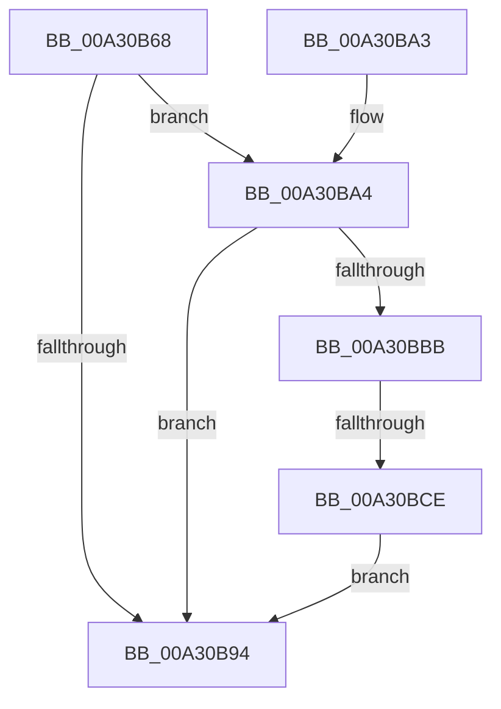

# MiCheckShadowStackOverflow

- RVA: `0x00A30B68`–`0x00A30BD5` (길이 `109` bytes)
- VA: `0x0000000140A30B68`
- 실행 섹션: `PAGE`
- PDB 이름 있음: `예`; PDB Function 태그: `예`
- unwind 정보 RVA: `0x000AD090`
- 디코드: `32`개 명령, `109/109` bytes 표시
- 미해석 바이트: `0` (있으면 어셈블리에 `.byte`로 보존)

> 이 문서는 커널 이미지의 기계어와 PDB 기호를 분석해 생성했습니다. 4번과 5번은 함수 원형과 자료형을 바이너리 사용 방식에서 추정한 C 해석이며 원본 소스 복구 결과는 아닙니다.

## 1. Dependencies

- 직접 호출 지점: **2**; 고유 호출 대상: **2**
- 직접 호출자로 확인된 함수: **1**
- RIP 상대 이미지 참조: **1**

### Outgoing calls
- `0x00A30BAE` → [MiObtainReferencedVadEx](../../text/31/MiObtainReferencedVadEx_function_00316690.md) (function, `0x00316690`)
- `0x00A30BCE` → [MiUnlockAndDereferenceVadShared](../../text/2A/MiUnlockAndDereferenceVadShared_function_002AEF10.md) (function, `0x002AEF10`)

### Direct callers
- [MiCheckForUserStackOverflow](MiCheckForUserStackOverflow_function_00A30854.md) at `0x00A308C0`

### Static image references
- `0x00A30B84` → RVA `0x00FC6A88` (`ALMOSTRO`; read)

## 2. Other-region calls and transfers

- 다른 실행 섹션으로 향하는 call: **2**
  - `0x00A30BAE` → [MiObtainReferencedVadEx](../../text/31/MiObtainReferencedVadEx_function_00316690.md) (`PAGE` → `.text`)
  - `0x00A30BCE` → [MiUnlockAndDereferenceVadShared](../../text/2A/MiUnlockAndDereferenceVadShared_function_002AEF10.md) (`PAGE` → `.text`)
- call이 아닌 외부 분기/꼬리 이동: **1**
  - `0x00A30BC8` → [sub_00B39A5E](../B3/Unknown_function_00B39A5E.md) (`tail-transfer`)

## 3. Assembly (complete function range)

```asm
00A30B68  48 89 5C 24 08                  mov qword ptr [rsp + 8], rbx
00A30B6D  55                              push rbp
00A30B6E  56                              push rsi
00A30B6F  57                              push rdi
00A30B70  48 83 EC 30                     sub rsp, 0x30
00A30B74  83 64 24 58 00                  and dword ptr [rsp + 0x58], 0
00A30B79  33 DB                           xor ebx, ebx
00A30B7B  C7 02 FD 00 00 C0               mov dword ptr [rdx], 0xc00000fd
00A30B81  48 8B F2                        mov rsi, rdx
00A30B84  48 F7 05 F9 5E 59 00 00 00 00 01  test qword ptr [rip + 0x595ef9], 0x1000000
00A30B8F  48 8B E9                        mov rbp, rcx
00A30B92  75 10                           jne 0x140a30ba4
00A30B94  8B C3                           mov eax, ebx
00A30B96  48 8B 5C 24 50                  mov rbx, qword ptr [rsp + 0x50]
00A30B9B  48 83 C4 30                     add rsp, 0x30
00A30B9F  5F                              pop rdi
00A30BA0  5E                              pop rsi
00A30BA1  5D                              pop rbp
00A30BA2  C3                              ret
00A30BA3  CC                              int3
00A30BA4  4C 8D 44 24 58                  lea r8, [rsp + 0x58]
00A30BA9  BA 02 00 00 00                  mov edx, 2
00A30BAE  E8 DD 5A 8E FF                  call 0x140316690
00A30BB3  48 8B C8                        mov rcx, rax
00A30BB6  48 85 C0                        test rax, rax
00A30BB9  74 D9                           je 0x140a30b94
00A30BBB  8B 40 30                        mov eax, dword ptr [rax + 0x30]
00A30BBE  25 00 00 20 14                  and eax, 0x14200000
00A30BC3  3D 00 00 20 10                  cmp eax, 0x10200000
00A30BC8  0F 84 90 8E 10 00               je 0x140b39a5e
00A30BCE  E8 3D E3 87 FF                  call 0x1402aef10
00A30BD3  EB BF                           jmp 0x140a30b94
```

## 4. C-style interpretation (structured pseudocode)

```c
__int64 __fastcall MiCheckShadowStackOverflow(__int64 a1, __int64 a2)
{
    __int64 result;
    __int64 v_rbx;
    __int64 v_rsp;
    unsigned int v_stack_p10;
    unsigned __int64 v_stack_p58;
    unsigned __int64 v_stack_p8;

    v_stack_p8 = v_rbx;
    v_rsp = (v_rsp) - (48);
    v_rbx = 0;
    *(unsigned int *)(a2) = 0xC00000FDULL;
    if (((*(unsigned __int64 *)(v_rip + 5857017)) & (0x1000000ULL)) != 0) goto loc_00A30BA4;
loc_00A30B94:
    v_rsp = (v_rsp) + (48);
    return 0;
loc_00A30BA4:
    result = MiObtainReferencedVadEx(a1, 2, v_stack_p58, a4);
    if (result == 0) goto loc_00A30B94;
    result = (unsigned int)(((unsigned int)(*(unsigned int *)(result + 48))) & (0x14200000ULL));
    result = MiUnlockAndDereferenceVadShared(result, 2, v_stack_p58, a4);
    goto loc_00A30B94;
}
```

## 5. (Beta) C Style

```c
int64_t MiCheckShadowStackOverflow(int64_t Arg1, void *Arg2)
{
    uint8_t *arg2 = (uint8_t *)Arg2;

    int64_t result;
    int64_t local_rbx;
    int64_t local_rsp;
    uint32_t v_stack_p10;
    uint64_t v_stack_p58;
    uint64_t v_stack_p8;

    v_stack_p8 = local_rbx;
    local_rsp = (local_rsp) - (48);
    local_rbx = 0;
    *(uint32_t *)(arg2) = 0xC00000FDULL;
    if (((*(uint64_t *)(v_rip + 0x595EF9)) & (0x1000000ULL)) != 0) goto loc_00A30BA4;
loc_00A30B94:
    local_rsp = (local_rsp) + (48);
    return 0;
loc_00A30BA4:
    result = MiObtainReferencedVadEx(Arg1, 2, v_stack_p58, a4);
    if (result == 0) goto loc_00A30B94;
    result = (uint32_t)(((uint32_t)(*(uint32_t *)(result + 0x30))) & (0x14200000ULL));
    result = MiUnlockAndDereferenceVadShared(result, 2, v_stack_p58, a4);
    goto loc_00A30B94;
}
```

### 관측된 메모리 오프셋

구조체 형식이 확인되지 않은 접근은 인자 기준의 오프셋으로만 기록했습니다.

| 기준 인자 | 오프셋 표현 | 폭 (bit) | 접근 |
|---|---:|---:|---|
| `Arg2` | `+ 0x0` | `32` | `W` |

## 6. Execution-region graph

[열기: 2D/3D 그래프와 함수 탐색 컨트롤 패널](../../../control-panel.html?section=page&rva=0x00A30B68&view=graph)

- 2D 그래프는 위에서 아래로 흐르고, 3D 그래프는 빈 공간을 드래그해 회전합니다. Shift+드래그는 이동, 휠은 확대·축소, 함수 노드 선택은 대상 보고서 이동입니다.

### Static fallback


