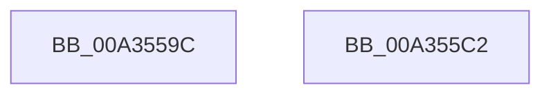

# MiGetImageExtensionBaseAddress

- RVA: `0x00A3559C`–`0x00A355C3` (길이 `39` bytes)
- VA: `0x0000000140A3559C`
- 실행 섹션: `PAGE`
- PDB 이름 있음: `예`; PDB Function 태그: `아니요`
- unwind 정보 RVA: `0x000DB714`
- 디코드: `13`개 명령, `39/39` bytes 표시
- 미해석 바이트: `0` (있으면 어셈블리에 `.byte`로 보존)

> 이 문서는 커널 이미지의 기계어와 PDB 기호를 분석해 생성했습니다. 4번과 5번은 함수 원형과 자료형을 바이너리 사용 방식에서 추정한 C 해석이며 원본 소스 복구 결과는 아닙니다.

## 1. Dependencies

- 직접 호출 지점: **0**; 고유 호출 대상: **0**
- 직접 호출자로 확인된 함수: **4**
- RIP 상대 이미지 참조: **0**

### Outgoing calls
- 직접 디코드된 call 명령이 없습니다.

### Direct callers
- [MiMapImageScpCfgPages](../../text/29/MiMapImageScpCfgPages_function_00294FA4.md) at `0x00295077`
- [sub_002C3A4B](../../text/2C/Unknown_function_002C3A4B.md) at `0x002C3A5A`
- [MiQueryImageExtensionInformation](../../text/4E/MiQueryImageExtensionInformation_function_004EE3C8.md) at `0x004EE507`
- [MiQueryImageExtensionInformationOld](../../text/68/MiQueryImageExtensionInformationOld_function_00687384.md) at `0x00687470`

### Static image references
- 디코드된 RIP-relative 메모리 참조가 없습니다.

## 2. Other-region calls and transfers

- 다른 실행 섹션으로 향하는 call: **0**
- 별도 외부 분기/꼬리 이동을 확인하지 못했습니다.

## 3. Assembly (complete function range)

```asm
00A3559C  8B 51 18                        mov edx, dword ptr [rcx + 0x18]
00A3559F  0F B6 41 20                     movzx eax, byte ptr [rcx + 0x20]
00A355A3  48 8B 49 48                     mov rcx, qword ptr [rcx + 0x48]
00A355A7  48 C1 E0 20                     shl rax, 0x20
00A355AB  48 0B C2                        or rax, rdx
00A355AE  48 C1 E0 0C                     shl rax, 0xc
00A355B2  48 8B 11                        mov rdx, qword ptr [rcx]
00A355B5  48 8B 0A                        mov rcx, qword ptr [rdx]
00A355B8  8B 49 08                        mov ecx, dword ptr [rcx + 8]
00A355BB  C1 E1 0C                        shl ecx, 0xc
00A355BE  48 03 C1                        add rax, rcx
00A355C1  C3                              ret
00A355C2  CC                              int3
```

## 4. C-style interpretation (structured pseudocode)

```c
__int64 __fastcall MiGetImageExtensionBaseAddress(__int64 a1)
{
    __int64 result;

    result = (*(unsigned __int8 *)(a1 + 32)) << (32);
    result = (result) | ((unsigned int)(*(unsigned int *)(a1 + 24)));
    result = (result) << (12);
    a1 = (unsigned int)(((unsigned int)(*(unsigned int *)(*(unsigned __int64 *)(*(unsigned __int64 *)(*(unsigned __int64 *)(a1 + 72))) + 8))) << (12));
    result = (result) + (a1);
    return result;
}
```

## 5. (Beta) C Style

```c
int64_t MiGetImageExtensionBaseAddress(void *Arg1)
{
    uint8_t *arg1 = (uint8_t *)Arg1;

    int64_t result;

    result = (*(uint8_t *)(arg1 + 0x20)) << (32);
    result = (result) | ((uint32_t)(*(uint32_t *)(arg1 + 0x18)));
    result = (result) << (12);
    Arg1 = (uint32_t)(((uint32_t)(*(uint32_t *)(*(uint64_t *)(*(uint64_t *)(*(uint64_t *)(arg1 + 0x48))) + 0x8))) << (12));
    result = (result) + (Arg1);
    return result;
}
```

### 관측된 메모리 오프셋

구조체 형식이 확인되지 않은 접근은 인자 기준의 오프셋으로만 기록했습니다.

| 기준 인자 | 오프셋 표현 | 폭 (bit) | 접근 |
|---|---:|---:|---|
| `Arg1` | `+ 0x18` | `32` | `R` |
| `Arg1` | `+ 0x20` | `8` | `R` |
| `Arg1` | `+ 0x48` | `64` | `R` |

## 6. Execution-region graph

[열기: 2D/3D 그래프와 함수 탐색 컨트롤 패널](../../../control-panel.html?section=page&rva=0x00A3559C&view=graph)

- 2D 그래프는 위에서 아래로 흐르고, 3D 그래프는 빈 공간을 드래그해 회전합니다. Shift+드래그는 이동, 휠은 확대·축소, 함수 노드 선택은 대상 보고서 이동입니다.

### Static fallback


