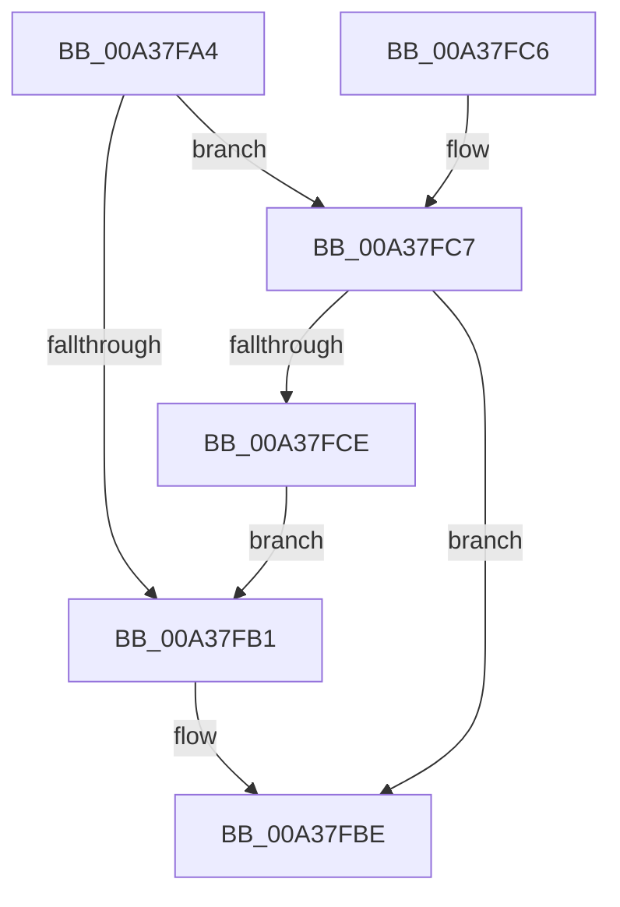

# MiMapCacheExceptionFilter

- RVA: `0x00A37FA4`–`0x00A37FD4` (길이 `48` bytes)
- VA: `0x0000000140A37FA4`
- 실행 섹션: `PAGE`
- PDB 이름 있음: `예`; PDB Function 태그: `아니요`
- unwind 정보 RVA: `0x000DB714`
- 디코드: `15`개 명령, `48/48` bytes 표시
- 미해석 바이트: `0` (있으면 어셈블리에 `.byte`로 보존)

> 이 문서는 커널 이미지의 기계어와 PDB 기호를 분석해 생성했습니다. 4번과 5번은 함수 원형과 자료형을 바이너리 사용 방식에서 추정한 C 해석이며 원본 소스 복구 결과는 아닙니다.

## 1. Dependencies

- 직접 호출 지점: **0**; 고유 호출 대상: **0**
- 직접 호출자로 확인된 함수: **2**
- RIP 상대 이미지 참조: **0**

### Outgoing calls
- 직접 디코드된 call 명령이 없습니다.

### Direct callers
- [MiMakePageAvoidRead$filt$0](../../text/6D/MiMakePageAvoidRead_filt_0_function_006D1E5D.md) at `0x006D1E74`
- [MmCopyToCachedPage$filt$0](../../text/6D/MmCopyToCachedPage_filt_0_function_006D2188.md) at `0x006D2198`

### Static image references
- 디코드된 RIP-relative 메모리 참조가 없습니다.

## 2. Other-region calls and transfers

- 다른 실행 섹션으로 향하는 call: **0**
- 별도 외부 분기/꼬리 이동을 확인하지 못했습니다.

## 3. Assembly (complete function range)

```asm
00A37FA4  4C 8B 02                        mov r8, qword ptr [rdx]
00A37FA7  41 8B 00                        mov eax, dword ptr [r8]
00A37FAA  3D 06 00 00 C0                  cmp eax, 0xc0000006
00A37FAF  74 16                           je 0x140a37fc7
00A37FB1  3D 05 00 00 C0                  cmp eax, 0xc0000005
00A37FB6  BA E8 00 00 C0                  mov edx, 0xc00000e8
00A37FBB  0F 44 C2                        cmove eax, edx
00A37FBE  89 01                           mov dword ptr [rcx], eax
00A37FC0  B8 01 00 00 00                  mov eax, 1
00A37FC5  C3                              ret
00A37FC6  CC                              int3
00A37FC7  41 83 78 18 03                  cmp dword ptr [r8 + 0x18], 3
00A37FCC  72 F0                           jb 0x140a37fbe
00A37FCE  41 8B 40 30                     mov eax, dword ptr [r8 + 0x30]
00A37FD2  EB DD                           jmp 0x140a37fb1
```

## 4. C-style interpretation (structured pseudocode)

```c
__int64 __fastcall MiMapCacheExceptionFilter(__int64 a1, __int64 a2)
{
    __int64 result;

    if (((unsigned int)((unsigned int)(*(unsigned int *)(*(unsigned __int64 *)(a2))))) == 0xC0000006ULL) goto loc_00A37FC7;
loc_00A37FB1:
    result = (unsigned int)(*(unsigned int *)(*(unsigned __int64 *)(a2)));
    if (((unsigned int)((unsigned int)(*(unsigned int *)(*(unsigned __int64 *)(a2))))) == 0xC0000005ULL) { result = (unsigned int)((unsigned int)(0xC00000E8ULL)); }
loc_00A37FBE:
    *(unsigned int *)(a1) = (unsigned int)(result);
    return 1;
loc_00A37FC7:
    if ((*(unsigned int *)(*(unsigned __int64 *)(a2) + 24)) < 3) goto loc_00A37FBE;
    goto loc_00A37FB1;
}
```

## 5. (Beta) C Style

```c
int64_t MiMapCacheExceptionFilter(void *Arg1, void *Arg2)
{
    uint8_t *arg1 = (uint8_t *)Arg1;
    uint8_t *arg2 = (uint8_t *)Arg2;

    int64_t result;

    if (((uint32_t)((uint32_t)(*(uint32_t *)(*(uint64_t *)(arg2))))) == 0xC0000006ULL) goto loc_00A37FC7;
loc_00A37FB1:
    result = (uint32_t)(*(uint32_t *)(*(uint64_t *)(arg2)));
    if (((uint32_t)((uint32_t)(*(uint32_t *)(*(uint64_t *)(arg2))))) == 0xC0000005ULL) { result = (uint32_t)((uint32_t)(0xC00000E8ULL)); }
loc_00A37FBE:
    *(uint32_t *)(arg1) = (uint32_t)(result);
    return 1;
loc_00A37FC7:
    if ((*(uint32_t *)(*(uint64_t *)(arg2) + 0x18)) < 3) goto loc_00A37FBE;
    goto loc_00A37FB1;
}
```

### 관측된 메모리 오프셋

구조체 형식이 확인되지 않은 접근은 인자 기준의 오프셋으로만 기록했습니다.

| 기준 인자 | 오프셋 표현 | 폭 (bit) | 접근 |
|---|---:|---:|---|
| `Arg1` | `+ 0x0` | `32` | `W` |
| `Arg2` | `+ 0x0` | `64` | `R` |

## 6. Execution-region graph

[열기: 2D/3D 그래프와 함수 탐색 컨트롤 패널](../../../control-panel.html?section=page&rva=0x00A37FA4&view=graph)

- 2D 그래프는 위에서 아래로 흐르고, 3D 그래프는 빈 공간을 드래그해 회전합니다. Shift+드래그는 이동, 휠은 확대·축소, 함수 노드 선택은 대상 보고서 이동입니다.

### Static fallback


