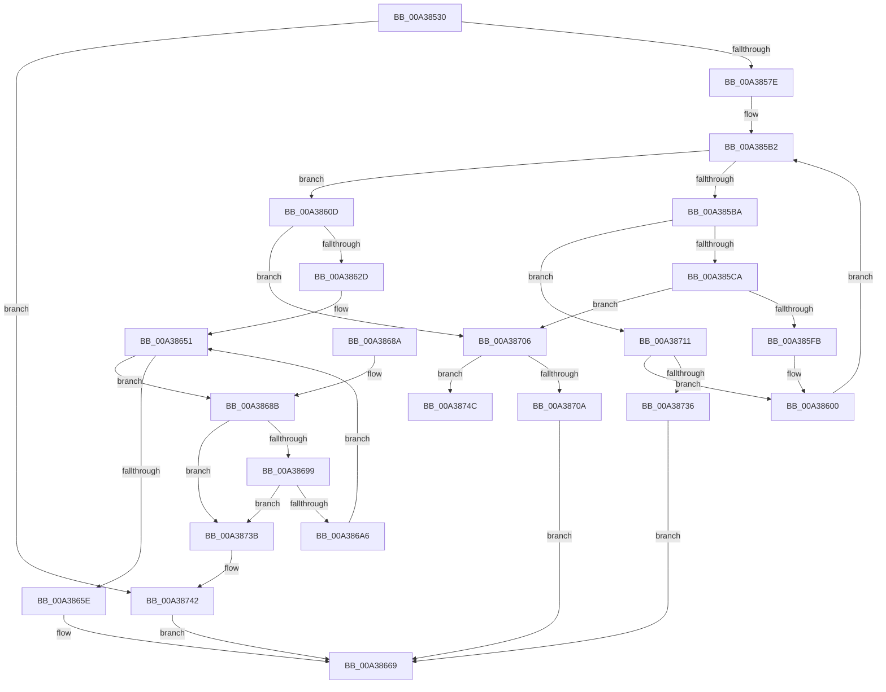

# MiRotateToFrameBufferNoCopy

- RVA: `0x00A38530`–`0x00A38757` (길이 `551` bytes)
- VA: `0x0000000140A38530`
- 실행 섹션: `PAGE`
- PDB 이름 있음: `예`; PDB Function 태그: `예`
- unwind 정보 RVA: `0x000ADD3C`
- 디코드: `149`개 명령, `551/551` bytes 표시
- 미해석 바이트: `0` (있으면 어셈블리에 `.byte`로 보존)

> 이 문서는 커널 이미지의 기계어와 PDB 기호를 분석해 생성했습니다. 4번과 5번은 함수 원형과 자료형을 바이너리 사용 방식에서 추정한 C 해석이며 원본 소스 복구 결과는 아닙니다.

## 1. Dependencies

- 직접 호출 지점: **10**; 고유 호출 대상: **10**
- 직접 호출자로 확인된 함수: **1**
- RIP 상대 이미지 참조: **0**

### Outgoing calls
- `0x00A3859C` → [MiGetVadCacheAttribute](../../text/4A/MiGetVadCacheAttribute_function_004AF624.md) (function, `0x004AF624`)
- `0x00A385BD` → [MiIsPfn](../../text/46/MiIsPfn_function_00462450.md) (function, `0x00462450`)
- `0x00A385CD` → [MiSanitizePage](../../text/47/MiSanitizePage_function_00471BF0.md) (function, `0x00471BF0`)
- `0x00A385EC` → [MiReferenceIoPages](../../text/23/MiReferenceIoPages_function_0023C804.md) (function, `0x0023C804`)
- `0x00A3861E` → [MiObtainRotateProtectionRanges](../../text/4A/MiObtainRotateProtectionRanges_function_004A4768.md) (function, `0x004A4768`)
- `0x00A38648` → [MiDeleteRotateAndStopFaults](../../text/2A/MiDeleteRotateAndStopFaults_function_002A9540.md) (function, `0x002A9540`)
- `0x00A38662` → [MiRotateComplete](../../text/4B/MiRotateComplete_function_004B0588.md) (function, `0x004B0588`)
- `0x00A386EE` → [MiMapLockedPagesInUserSpaceHelper](../../text/2A/MiMapLockedPagesInUserSpaceHelper_function_002ADFE0.md) (function, `0x002ADFE0`)
- `0x00A386F8` → [ExFreePoolWithTag](../../poolcode/B8/ExFreePoolWithTag_function_00B82870.md) (function, `0x00B82870`)
- `0x00A38729` → [MiLegitimatePageForDriversToMap](../../text/23/MiLegitimatePageForDriversToMap_function_0023ECE0.md) (function, `0x0023ECE0`)

### Direct callers
- [MmRotatePhysicalView](MmRotatePhysicalView_function_00A37FE0.md) at `0x00A38176`

### Static image references
- 디코드된 RIP-relative 메모리 참조가 없습니다.

## 2. Other-region calls and transfers

- 다른 실행 섹션으로 향하는 call: **10**
  - `0x00A3859C` → [MiGetVadCacheAttribute](../../text/4A/MiGetVadCacheAttribute_function_004AF624.md) (`PAGE` → `.text`)
  - `0x00A385BD` → [MiIsPfn](../../text/46/MiIsPfn_function_00462450.md) (`PAGE` → `.text`)
  - `0x00A385CD` → [MiSanitizePage](../../text/47/MiSanitizePage_function_00471BF0.md) (`PAGE` → `.text`)
  - `0x00A385EC` → [MiReferenceIoPages](../../text/23/MiReferenceIoPages_function_0023C804.md) (`PAGE` → `.text`)
  - `0x00A3861E` → [MiObtainRotateProtectionRanges](../../text/4A/MiObtainRotateProtectionRanges_function_004A4768.md) (`PAGE` → `.text`)
  - `0x00A38648` → [MiDeleteRotateAndStopFaults](../../text/2A/MiDeleteRotateAndStopFaults_function_002A9540.md) (`PAGE` → `.text`)
  - `0x00A38662` → [MiRotateComplete](../../text/4B/MiRotateComplete_function_004B0588.md) (`PAGE` → `.text`)
  - `0x00A386EE` → [MiMapLockedPagesInUserSpaceHelper](../../text/2A/MiMapLockedPagesInUserSpaceHelper_function_002ADFE0.md) (`PAGE` → `.text`)
  - `0x00A386F8` → [ExFreePoolWithTag](../../poolcode/B8/ExFreePoolWithTag_function_00B82870.md) (`PAGE` → `POOLCODE`)
  - `0x00A38729` → [MiLegitimatePageForDriversToMap](../../text/23/MiLegitimatePageForDriversToMap_function_0023ECE0.md) (`PAGE` → `.text`)
- call이 아닌 외부 분기/꼬리 이동: **1**
  - `0x00A38752` → [sub_00B3A200](../B3/Unknown_function_00B3A200.md) (`tail-transfer`)

## 3. Assembly (complete function range)

```asm
00A38530  48 8B C4                        mov rax, rsp
00A38533  48 89 58 08                     mov qword ptr [rax + 8], rbx
00A38537  48 89 70 10                     mov qword ptr [rax + 0x10], rsi
00A3853B  48 89 78 18                     mov qword ptr [rax + 0x18], rdi
00A3853F  4C 89 48 20                     mov qword ptr [rax + 0x20], r9
00A38543  55                              push rbp
00A38544  41 54                           push r12
00A38546  41 55                           push r13
00A38548  41 56                           push r14
00A3854A  41 57                           push r15
00A3854C  48 8B EC                        mov rbp, rsp
00A3854F  48 81 EC 80 00 00 00            sub rsp, 0x80
00A38556  33 C0                           xor eax, eax
00A38558  4C 8B E1                        mov r12, rcx
00A3855B  48 89 45 F0                     mov qword ptr [rbp - 0x10], rax
00A3855F  B9 FF FF FF FF                  mov ecx, 0xffffffff
00A38564  49 8B C1                        mov rax, r9
00A38567  0F 57 C0                        xorps xmm0, xmm0
00A3856A  48 C1 E0 0C                     shl rax, 0xc
00A3856E  4C 8B EA                        mov r13, rdx
00A38571  0F 11 45 E0                     movups xmmword ptr [rbp - 0x20], xmm0
00A38575  48 3B C1                        cmp rax, rcx
00A38578  0F 87 C4 01 00 00               ja 0x140a38742
00A3857E  48 8D 4D D0                     lea rcx, [rbp - 0x30]
00A38582  48 89 4D D8                     mov qword ptr [rbp - 0x28], rcx
00A38586  4C 8D 52 FF                     lea r10, [rdx - 1]
00A3858A  48 8D 4D D0                     lea rcx, [rbp - 0x30]
00A3858E  4C 03 D0                        add r10, rax
00A38591  48 89 4D D0                     mov qword ptr [rbp - 0x30], rcx
00A38595  49 8B CC                        mov rcx, r12
00A38598  4C 89 55 C8                     mov qword ptr [rbp - 0x38], r10
00A3859C  E8 83 70 A7 FF                  call 0x1404af624
00A385A1  33 DB                           xor ebx, ebx
00A385A3  89 45 C0                        mov dword ptr [rbp - 0x40], eax
00A385A6  49 8D 70 30                     lea rsi, [r8 + 0x30]
00A385AA  45 33 FF                        xor r15d, r15d
00A385AD  4C 8B F6                        mov r14, rsi
00A385B0  8B F8                           mov edi, eax
00A385B2  41 8B CF                        mov ecx, r15d
00A385B5  49 3B C9                        cmp rcx, r9
00A385B8  73 53                           jae 0x140a3860d
00A385BA  49 8B 0E                        mov rcx, qword ptr [r14]
00A385BD  E8 8E 9E A2 FF                  call 0x140462450
00A385C2  85 C0                           test eax, eax
00A385C4  0F 85 47 01 00 00               jne 0x140a38711
00A385CA  49 8B 0E                        mov rcx, qword ptr [r14]
00A385CD  E8 1E 96 A3 FF                  call 0x140471bf0
00A385D2  48 83 64 24 28 00               and qword ptr [rsp + 0x28], 0
00A385D8  B9 01 00 00 00                  mov ecx, 1
00A385DD  48 83 64 24 20 00               and qword ptr [rsp + 0x20], 0
00A385E3  44 8B C1                        mov r8d, ecx
00A385E6  44 8B CF                        mov r9d, edi
00A385E9  48 8B D0                        mov rdx, rax
00A385EC  E8 13 42 80 FF                  call 0x14023c804
00A385F1  8B F8                           mov edi, eax
00A385F3  85 C0                           test eax, eax
00A385F5  0F 88 0B 01 00 00               js 0x140a38706
00A385FB  8B 7D C0                        mov edi, dword ptr [rbp - 0x40]
00A385FE  FF C3                           inc ebx
00A38600  4C 8B 4D 48                     mov r9, qword ptr [rbp + 0x48]
00A38604  41 FF C7                        inc r15d
00A38607  49 83 C6 08                     add r14, 8
00A3860B  EB A5                           jmp 0x140a385b2
00A3860D  4C 8B 75 C8                     mov r14, qword ptr [rbp - 0x38]
00A38611  4C 8D 4D D0                     lea r9, [rbp - 0x30]
00A38615  4D 8B C6                        mov r8, r14
00A38618  49 8B D5                        mov rdx, r13
00A3861B  49 8B CC                        mov rcx, r12
00A3861E  E8 45 C1 A6 FF                  call 0x1404a4768
00A38623  8B F8                           mov edi, eax
00A38625  85 C0                           test eax, eax
00A38627  0F 88 D9 00 00 00               js 0x140a38706
00A3862D  4C 89 65 E8                     mov qword ptr [rbp - 0x18], r12
00A38631  4C 8D 45 E0                     lea r8, [rbp - 0x20]
00A38635  65 48 8B 04 25 88 01 00 00      mov rax, qword ptr gs:[0x188]
00A3863E  49 8B D6                        mov rdx, r14
00A38641  49 8B CD                        mov rcx, r13
00A38644  48 89 45 F0                     mov qword ptr [rbp - 0x10], rax
00A38648  E8 F3 0E 87 FF                  call 0x1402a9540
00A3864D  44 8B 75 C0                     mov r14d, dword ptr [rbp - 0x40]
00A38651  48 8B 7D D0                     mov rdi, qword ptr [rbp - 0x30]
00A38655  48 8D 45 D0                     lea rax, [rbp - 0x30]
00A38659  48 3B F8                        cmp rdi, rax
00A3865C  75 2D                           jne 0x140a3868b
00A3865E  48 8D 4D E0                     lea rcx, [rbp - 0x20]
00A38662  E8 21 7F A7 FF                  call 0x1404b0588
00A38667  33 C0                           xor eax, eax
00A38669  4C 8D 9C 24 80 00 00 00         lea r11, [rsp + 0x80]
00A38671  49 8B 5B 30                     mov rbx, qword ptr [r11 + 0x30]
00A38675  49 8B 73 38                     mov rsi, qword ptr [r11 + 0x38]
00A38679  49 8B 7B 40                     mov rdi, qword ptr [r11 + 0x40]
00A3867D  49 8B E3                        mov rsp, r11
00A38680  41 5F                           pop r15
00A38682  41 5E                           pop r14
00A38684  41 5D                           pop r13
00A38686  41 5C                           pop r12
00A38688  5D                              pop rbp
00A38689  C3                              ret
00A3868A  CC                              int3
00A3868B  48 8D 45 D0                     lea rax, [rbp - 0x30]
00A3868F  48 39 47 08                     cmp qword ptr [rdi + 8], rax
00A38693  0F 85 A2 00 00 00               jne 0x140a3873b
00A38699  48 8B 07                        mov rax, qword ptr [rdi]
00A3869C  48 39 78 08                     cmp qword ptr [rax + 8], rdi
00A386A0  0F 85 95 00 00 00               jne 0x140a3873b
00A386A6  48 89 45 D0                     mov qword ptr [rbp - 0x30], rax
00A386AA  48 8D 4D D0                     lea rcx, [rbp - 0x30]
00A386AE  48 89 48 08                     mov qword ptr [rax + 8], rcx
00A386B2  BA 10 00 00 80                  mov edx, 0x80000010
00A386B7  48 8B 4F 10                     mov rcx, qword ptr [rdi + 0x10]
00A386BB  41 B8 10 00 00 00               mov r8d, 0x10
00A386C1  48 8B 5F 18                     mov rbx, qword ptr [rdi + 0x18]
00A386C5  45 8B CE                        mov r9d, r14d
00A386C8  8B 47 20                        mov eax, dword ptr [rdi + 0x20]
00A386CB  48 2B D9                        sub rbx, rcx
00A386CE  48 C1 EB 0C                     shr rbx, 0xc
00A386D2  24 07                           and al, 7
00A386D4  3C 01                           cmp al, 1
00A386D6  41 0F 45 D0                     cmovne edx, r8d
00A386DA  45 33 C0                        xor r8d, r8d
00A386DD  89 54 24 30                     mov dword ptr [rsp + 0x30], edx
00A386E1  48 8B D6                        mov rdx, rsi
00A386E4  4C 89 64 24 28                  mov qword ptr [rsp + 0x28], r12
00A386E9  48 89 5C 24 20                  mov qword ptr [rsp + 0x20], rbx
00A386EE  E8 ED 58 87 FF                  call 0x1402adfe0
00A386F3  33 D2                           xor edx, edx
00A386F5  48 8B CF                        mov rcx, rdi
00A386F8  E8 73 A1 14 00                  call 0x140b82870
00A386FD  48 8D 34 DE                     lea rsi, [rsi + rbx*8]
00A38701  E9 4B FF FF FF                  jmp 0x140a38651
00A38706  85 DB                           test ebx, ebx
00A38708  75 42                           jne 0x140a3874c
00A3870A  8B C7                           mov eax, edi
00A3870C  E9 58 FF FF FF                  jmp 0x140a38669
00A38711  49 8B 06                        mov rax, qword ptr [r14]
00A38714  48 8D 0C 40                     lea rcx, [rax + rax*2]
00A38718  48 C1 E1 04                     shl rcx, 4
00A3871C  48 B8 00 00 00 00 00 DE FF FF   movabs rax, 0xffffde0000000000
00A38726  48 03 C8                        add rcx, rax
00A38729  E8 B2 65 80 FF                  call 0x14023ece0
00A3872E  85 C0                           test eax, eax
00A38730  0F 89 CA FE FF FF               jns 0x140a38600
00A38736  E9 2E FF FF FF                  jmp 0x140a38669
00A3873B  B9 03 00 00 00                  mov ecx, 3
00A38740  CD 29                           int 0x29
00A38742  B8 06 02 00 C0                  mov eax, 0xc0000206
00A38747  E9 1D FF FF FF                  jmp 0x140a38669
00A3874C  41 BE FF FF FF FF               mov r14d, 0xffffffff
00A38752  E9 A9 1A 10 00                  jmp 0x140b3a200
```

## 4. C-style interpretation (structured pseudocode)

```c
__int64 __fastcall MiRotateToFrameBufferNoCopy(__int64 a1, __int64 a2, __int64 a3, __int64 a4)
{
    __int64 result;
    __int64 v_r10;
    __int64 v_r14;
    __int64 v_r15;
    __int64 v_rbx;
    __int64 v_rsp;
    unsigned __int64 v_stack_m28;
    unsigned __int64 v_stack_m38;
    unsigned __int64 v_stack_m40;
    unsigned __int64 v_stack_m48;
    unsigned __int64 v_stack_m50;
    unsigned __int64 v_stack_m58;
    unsigned __int64 v_stack_m60;
    unsigned int v_stack_m68;
    unsigned __int64 v_stack_m80;
    unsigned __int64 v_stack_m88;
    unsigned __int64 v_stack_p20;

    *(unsigned __int64 *)(v_rsp + 8) = v_rbx;
    *(unsigned __int64 *)(v_rsp + 16) = v_rsi;
    *(unsigned __int64 *)(v_rsp + 24) = v_rdi;
    *(unsigned __int64 *)(v_rsp + 32) = a4;
    v_rsp = (v_rsp) - (128);
    result = 0;
    v_stack_m38 = 0;
    result = (a4) << (12);
    v_stack_m48 = v_xmm0;
    if (result > ((unsigned int)(0xFFFFFFFFULL))) goto loc_00A38742;
    v_stack_m50 = v_stack_m58;
    v_r10 = (a2 - 1) + (result);
    v_stack_m58 = v_stack_m58;
    v_stack_m60 = v_r10;
    result = MiGetVadCacheAttribute(a1, a2, a3, a4);
    v_rbx = 0;
    v_stack_m68 = (unsigned int)(result);
    v_r15 = 0;
loc_00A385B2:
    if (0 >= a4) goto loc_00A3860D;
    result = MiIsPfn(*(unsigned __int64 *)(a3 + 48), a2, a3, a4);
    if ((unsigned int)(result) != 0) goto loc_00A38711;
    result = MiSanitizePage(*(unsigned __int64 *)(a3 + 48), a2, a3, a4);
    result = MiReferenceIoPages(1, result, 1, (unsigned int)((unsigned int)((unsigned int)((unsigned int)(result)))));
    if (sign_flag) goto loc_00A38706;
    v_rbx = (unsigned int)((v_rbx) + 1);
loc_00A38600:
    v_r15 = (unsigned int)((v_r15) + 1);
    v_r14 = (a3 + 48) + (8);
    goto loc_00A385B2;
loc_00A3860D:
    result = MiObtainRotateProtectionRanges(a1, a2, v_stack_m60, v_stack_m58);
    if (sign_flag) goto loc_00A38706;
    v_stack_m40 = a1;
    v_stack_m38 = *(unsigned __int64 *)(gs_base + (0 + 392));
    result = MiDeleteRotateAndStopFaults(a2, v_stack_m60, v_stack_m48, v_stack_m58);
loc_00A38651:
    if (v_stack_m58 != v_stack_m58) goto loc_00A3868B;
    result = MiRotateComplete(v_stack_m48, v_stack_m60, v_stack_m48, v_stack_m58);
    result = 0;
loc_00A38669:
    return result;
loc_00A3868B:
    if ((*(unsigned __int64 *)(*(unsigned __int64 *)(v_stack_m28 + 64) + 8)) != v_stack_m58) goto loc_00A3873B;
    if ((*(unsigned __int64 *)(*(unsigned __int64 *)(*(unsigned __int64 *)(v_stack_m28 + 64)) + 8)) != (*(unsigned __int64 *)(v_stack_m28 + 64))) goto loc_00A3873B;
    v_stack_m58 = *(unsigned __int64 *)(*(unsigned __int64 *)(v_stack_m28 + 64));
    *(unsigned __int64 *)(*(unsigned __int64 *)(*(unsigned __int64 *)(v_stack_m28 + 64)) + 8) = v_stack_m58;
    v_rbx = (*(unsigned __int64 *)(*(unsigned __int64 *)(v_stack_m28 + 64) + 24)) - (*(unsigned __int64 *)(*(unsigned __int64 *)(v_stack_m28 + 64) + 16));
    v_rbx = (v_rbx) >> (12);
    result = (unsigned __int8)(((unsigned int)(*(unsigned int *)(*(unsigned __int64 *)(v_stack_m28 + 64) + 32))) & (7));
    a2 = (unsigned int)(0x80000010ULL);
    if (((unsigned __int8)(result)) != 1) { a2 = 16; }
    a3 = 0;
    v_stack_m50 = (unsigned int)(a2);
    v_stack_m58 = a1;
    v_stack_m60 = v_rbx;
    result = MiMapLockedPagesInUserSpaceHelper(*(unsigned __int64 *)(*(unsigned __int64 *)(v_stack_m28 + 64) + 16), *(unsigned __int64 *)(v_stack_m28 + 56), a3, (unsigned int)((unsigned int)((unsigned int)(v_stack_m68))));
    a2 = 0;
    result = ExFreePoolWithTag(*(unsigned __int64 *)(v_stack_m28 + 64), a2, a3, (unsigned int)((unsigned int)((unsigned int)(v_stack_m68))));
    goto loc_00A38651;
loc_00A38706:
    if ((unsigned int)(v_rbx) != 0) goto loc_00A3874C;
    goto loc_00A38669;
loc_00A38711:
    a1 = (*(unsigned __int64 *)((unsigned int)(v_stack_m68)) + *(unsigned __int64 *)((unsigned int)(v_stack_m68)) * 2) << (4);
    a1 = (a1) + (*(unsigned __int64 *)((unsigned int)(v_stack_m68)));
    result = MiLegitimatePageForDriversToMap(a1, a2, a3, (unsigned int)((unsigned int)((unsigned int)(v_stack_m68))));
    if (!sign_flag) goto loc_00A38600;
    goto loc_00A38669;
loc_00A3873B:
loc_00A38742:
    goto loc_00A38669;
loc_00A3874C:
}
```

## 5. (Beta) C Style

```c
int64_t MiRotateToFrameBufferNoCopy(int64_t Arg1, void *Arg2, int64_t Arg3, int64_t Arg4)
{
    uint8_t *arg2 = (uint8_t *)Arg2;

    int64_t result;
    int64_t local_r10;
    int64_t local_r14;
    int64_t local_r15;
    int64_t local_rbx;
    int64_t local_rsp;
    uint64_t v_stack_m28;
    uint64_t v_stack_m38;
    uint64_t v_stack_m40;
    uint64_t v_stack_m48;
    uint64_t v_stack_m50;
    uint64_t v_stack_m58;
    uint64_t v_stack_m60;
    uint32_t v_stack_m68;
    uint64_t v_stack_m80;
    uint64_t v_stack_m88;
    uint64_t v_stack_p20;

    *(uint64_t *)(local_rsp + 0x8) = local_rbx;
    *(uint64_t *)(local_rsp + 0x10) = local_rsi;
    *(uint64_t *)(local_rsp + 0x18) = local_rdi;
    *(uint64_t *)(local_rsp + 0x20) = Arg4;
    local_rsp = (local_rsp) - (128);
    result = 0;
    v_stack_m38 = 0;
    result = (Arg4) << (12);
    v_stack_m48 = v_xmm0;
    if (result > ((uint32_t)(0xFFFFFFFFULL))) goto loc_00A38742;
    v_stack_m50 = v_stack_m58;
    local_r10 = (Arg2 - 1) + (result);
    v_stack_m58 = v_stack_m58;
    v_stack_m60 = local_r10;
    result = MiGetVadCacheAttribute(Arg1, Arg2, Arg3, Arg4);
    local_rbx = 0;
    v_stack_m68 = (uint32_t)(result);
    local_r15 = 0;
loc_00A385B2:
    if (0 >= Arg4) goto loc_00A3860D;
    result = MiIsPfn(*(uint64_t *)(Arg3 + 0x30), Arg2, Arg3, Arg4);
    if ((uint32_t)(result) != 0) goto loc_00A38711;
    result = MiSanitizePage(*(uint64_t *)(Arg3 + 0x30), Arg2, Arg3, Arg4);
    result = MiReferenceIoPages(1, result, 1, (uint32_t)((uint32_t)((uint32_t)((uint32_t)(result)))));
    if (sign_flag) goto loc_00A38706;
    local_rbx = (uint32_t)((local_rbx) + 1);
loc_00A38600:
    local_r15 = (uint32_t)((local_r15) + 1);
    local_r14 = (Arg3 + 48) + (8);
    goto loc_00A385B2;
loc_00A3860D:
    result = MiObtainRotateProtectionRanges(Arg1, Arg2, v_stack_m60, v_stack_m58);
    if (sign_flag) goto loc_00A38706;
    v_stack_m40 = Arg1;
    v_stack_m38 = *(uint64_t *)(gs_base + (0 + 0x188));
    result = MiDeleteRotateAndStopFaults(Arg2, v_stack_m60, v_stack_m48, v_stack_m58);
loc_00A38651:
    if (v_stack_m58 != v_stack_m58) goto loc_00A3868B;
    result = MiRotateComplete(v_stack_m48, v_stack_m60, v_stack_m48, v_stack_m58);
    result = 0;
loc_00A38669:
    return result;
loc_00A3868B:
    if ((*(uint64_t *)(*(uint64_t *)(v_stack_m28 + 0x40) + 0x8)) != v_stack_m58) goto loc_00A3873B;
    if ((*(uint64_t *)(*(uint64_t *)(*(uint64_t *)(v_stack_m28 + 0x40)) + 0x8)) != (*(uint64_t *)(v_stack_m28 + 0x40))) goto loc_00A3873B;
    v_stack_m58 = *(uint64_t *)(*(uint64_t *)(v_stack_m28 + 0x40));
    *(uint64_t *)(*(uint64_t *)(*(uint64_t *)(v_stack_m28 + 0x40)) + 0x8) = v_stack_m58;
    local_rbx = (*(uint64_t *)(*(uint64_t *)(v_stack_m28 + 0x40) + 0x18)) - (*(uint64_t *)(*(uint64_t *)(v_stack_m28 + 0x40) + 0x10));
    local_rbx = (local_rbx) >> (12);
    result = (uint8_t)(((uint32_t)(*(uint32_t *)(*(uint64_t *)(v_stack_m28 + 0x40) + 0x20))) & (7));
    Arg2 = (uint32_t)(0x80000010ULL);
    if (((uint8_t)(result)) != 1) { Arg2 = 16; }
    Arg3 = 0;
    v_stack_m50 = (uint32_t)(Arg2);
    v_stack_m58 = Arg1;
    v_stack_m60 = local_rbx;
    result = MiMapLockedPagesInUserSpaceHelper(*(uint64_t *)(*(uint64_t *)(v_stack_m28 + 0x40) + 0x10), *(uint64_t *)(v_stack_m28 + 0x38), Arg3, (uint32_t)((uint32_t)((uint32_t)(v_stack_m68))));
    Arg2 = 0;
    result = ExFreePoolWithTag(*(uint64_t *)(v_stack_m28 + 0x40), Arg2, Arg3, (uint32_t)((uint32_t)((uint32_t)(v_stack_m68))));
    goto loc_00A38651;
loc_00A38706:
    if ((uint32_t)(local_rbx) != 0) goto loc_00A3874C;
    goto loc_00A38669;
loc_00A38711:
    Arg1 = (*(uint64_t *)((uint32_t)(v_stack_m68)) + *(uint64_t *)((uint32_t)(v_stack_m68)) * 2) << (4);
    Arg1 = (Arg1) + (*(uint64_t *)((uint32_t)(v_stack_m68)));
    result = MiLegitimatePageForDriversToMap(Arg1, Arg2, Arg3, (uint32_t)((uint32_t)((uint32_t)(v_stack_m68))));
    if (!sign_flag) goto loc_00A38600;
    goto loc_00A38669;
loc_00A3873B:
loc_00A38742:
    goto loc_00A38669;
loc_00A3874C:
}
```

### 관측된 메모리 오프셋

구조체 형식이 확인되지 않은 접근은 인자 기준의 오프셋으로만 기록했습니다.

| 기준 인자 | 오프셋 표현 | 폭 (bit) | 접근 |
|---|---:|---:|---|
| `Arg2` | `- 0x1` | `64` | `R` |

## 6. Execution-region graph

[열기: 2D/3D 그래프와 함수 탐색 컨트롤 패널](../../../control-panel.html?section=page&rva=0x00A38530&view=graph)

- 2D 그래프는 위에서 아래로 흐르고, 3D 그래프는 빈 공간을 드래그해 회전합니다. Shift+드래그는 이동, 휠은 확대·축소, 함수 노드 선택은 대상 보고서 이동입니다.

### Static fallback


