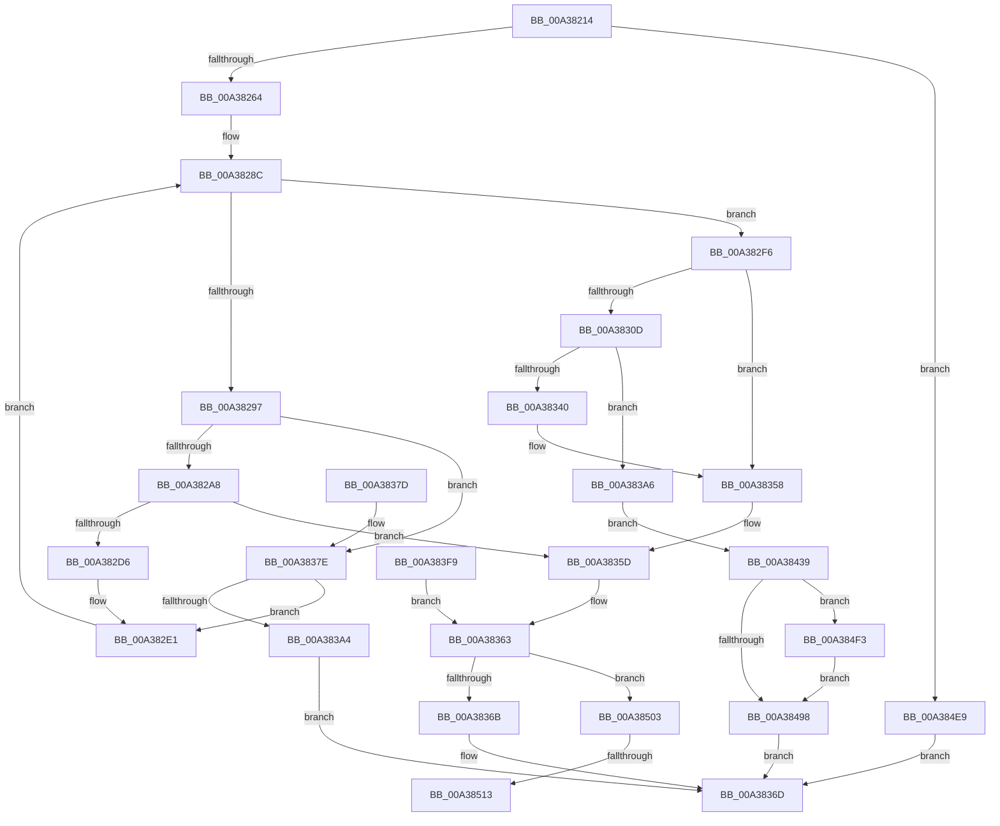

# MiRotateToFrameBuffer

- RVA: `0x00A38214`–`0x00A38529` (길이 `789` bytes)
- VA: `0x0000000140A38214`
- 실행 섹션: `PAGE`
- PDB 이름 있음: `예`; PDB Function 태그: `예`
- unwind 정보 RVA: `0x000ADCFC`
- 디코드: `200`개 명령, `789/789` bytes 표시
- 미해석 바이트: `0` (있으면 어셈블리에 `.byte`로 보존)

> 이 문서는 커널 이미지의 기계어와 PDB 기호를 분석해 생성했습니다. 4번과 5번은 함수 원형과 자료형을 바이너리 사용 방식에서 추정한 C 해석이며 원본 소스 복구 결과는 아닙니다.

## 1. Dependencies

- 직접 호출 지점: **21**; 고유 호출 대상: **18**
- 직접 호출자로 확인된 함수: **1**
- RIP 상대 이미지 참조: **0**

### Outgoing calls
- `0x00A38267` → [MiGetVadCacheAttribute](../../text/4A/MiGetVadCacheAttribute_function_004AF624.md) (function, `0x004AF624`)
- `0x00A3829B` → [MiIsPfn](../../text/46/MiIsPfn_function_00462450.md) (function, `0x00462450`)
- `0x00A382AC` → [MiSanitizePage](../../text/47/MiSanitizePage_function_00471BF0.md) (function, `0x00471BF0`)
- `0x00A382C7` → [MiReferenceIoPages](../../text/23/MiReferenceIoPages_function_0023C804.md) (function, `0x0023C804`)
- `0x00A38304` → [MiChargeCommit](../../text/28/MiChargeCommit_function_00286EB0.md) (function, `0x00286EB0`)
- `0x00A3831B` → [MmSizeOfMdl](../../text/46/MmSizeOfMdl_function_00460A10.md) (function, `0x00460A10`)
- `0x00A3832E` → [MiAllocatePool](../../text/35/MiAllocatePool_function_0035B540.md) (function, `0x0035B540`)
- `0x00A38353` → [MiReturnCommit](../../text/24/MiReturnCommit_function_00248410.md) (function, `0x00248410`)
- `0x00A38397` → [MiLegitimatePageForDriversToMap](../../text/23/MiLegitimatePageForDriversToMap_function_0023ECE0.md) (function, `0x0023ECE0`)
- `0x00A383F2` → [MmProbeAndLockPages](../../text/23/MmProbeAndLockPages_function_0023B990.md) (function, `0x0023B990`)
- `0x00A3840E` → [MiReturnCommit](../../text/24/MiReturnCommit_function_00248410.md) (function, `0x00248410`)
- `0x00A3841A` → [ExFreePoolWithTag](../../poolcode/B8/ExFreePoolWithTag_function_00B82870.md) (function, `0x00B82870`)
- `0x00A38463` → [MiDeleteRotateAndStopFaults](../../text/2A/MiDeleteRotateAndStopFaults_function_002A9540.md) (function, `0x002A9540`)
- `0x00A3848F` → [guard_dispatch_icall](../../text/6B/guard_dispatch_icall_function_006BAAD0.md) (function, `0x006BAAD0`)
- `0x00A384C1` → [MiMapLockedPagesInUserSpaceHelper](../../text/2A/MiMapLockedPagesInUserSpaceHelper_function_002ADFE0.md) (function, `0x002ADFE0`)
- `0x00A384CB` → [MiRotateComplete](../../text/4B/MiRotateComplete_function_004B0588.md) (function, `0x004B0588`)
- `0x00A384D3` → [MmUnlockPages](../../text/29/MmUnlockPages_function_0029EEE0.md) (function, `0x0029EEE0`)
- `0x00A384DD` → [ExFreePoolWithTag](../../poolcode/B8/ExFreePoolWithTag_function_00B82870.md) (function, `0x00B82870`)
- `0x00A384FC` → [MiSlowRotateCopy](../../text/67/MiSlowRotateCopy_function_0067E2B0.md) (function, `0x0067E2B0`)
- `0x00A38506` → [MiIsPfn](../../text/46/MiIsPfn_function_00462450.md) (function, `0x00462450`)
- `0x00A3851C` → [MiDereferenceIoPages](../../text/2A/MiDereferenceIoPages_function_002AB1B0.md) (function, `0x002AB1B0`)

### Direct callers
- [MmRotatePhysicalView](MmRotatePhysicalView_function_00A37FE0.md) at `0x00A380EF`

### Static image references
- 디코드된 RIP-relative 메모리 참조가 없습니다.

## 2. Other-region calls and transfers

- 다른 실행 섹션으로 향하는 call: **21**
  - `0x00A38267` → [MiGetVadCacheAttribute](../../text/4A/MiGetVadCacheAttribute_function_004AF624.md) (`PAGE` → `.text`)
  - `0x00A3829B` → [MiIsPfn](../../text/46/MiIsPfn_function_00462450.md) (`PAGE` → `.text`)
  - `0x00A382AC` → [MiSanitizePage](../../text/47/MiSanitizePage_function_00471BF0.md) (`PAGE` → `.text`)
  - `0x00A382C7` → [MiReferenceIoPages](../../text/23/MiReferenceIoPages_function_0023C804.md) (`PAGE` → `.text`)
  - `0x00A38304` → [MiChargeCommit](../../text/28/MiChargeCommit_function_00286EB0.md) (`PAGE` → `.text`)
  - `0x00A3831B` → [MmSizeOfMdl](../../text/46/MmSizeOfMdl_function_00460A10.md) (`PAGE` → `.text`)
  - `0x00A3832E` → [MiAllocatePool](../../text/35/MiAllocatePool_function_0035B540.md) (`PAGE` → `.text`)
  - `0x00A38353` → [MiReturnCommit](../../text/24/MiReturnCommit_function_00248410.md) (`PAGE` → `.text`)
  - `0x00A38397` → [MiLegitimatePageForDriversToMap](../../text/23/MiLegitimatePageForDriversToMap_function_0023ECE0.md) (`PAGE` → `.text`)
  - `0x00A383F2` → [MmProbeAndLockPages](../../text/23/MmProbeAndLockPages_function_0023B990.md) (`PAGE` → `.text`)
  - `0x00A3840E` → [MiReturnCommit](../../text/24/MiReturnCommit_function_00248410.md) (`PAGE` → `.text`)
  - `0x00A3841A` → [ExFreePoolWithTag](../../poolcode/B8/ExFreePoolWithTag_function_00B82870.md) (`PAGE` → `POOLCODE`)
  - `0x00A38463` → [MiDeleteRotateAndStopFaults](../../text/2A/MiDeleteRotateAndStopFaults_function_002A9540.md) (`PAGE` → `.text`)
  - `0x00A3848F` → [guard_dispatch_icall](../../text/6B/guard_dispatch_icall_function_006BAAD0.md) (`PAGE` → `.text`)
  - `0x00A384C1` → [MiMapLockedPagesInUserSpaceHelper](../../text/2A/MiMapLockedPagesInUserSpaceHelper_function_002ADFE0.md) (`PAGE` → `.text`)
  - `0x00A384CB` → [MiRotateComplete](../../text/4B/MiRotateComplete_function_004B0588.md) (`PAGE` → `.text`)
  - `0x00A384D3` → [MmUnlockPages](../../text/29/MmUnlockPages_function_0029EEE0.md) (`PAGE` → `.text`)
  - `0x00A384DD` → [ExFreePoolWithTag](../../poolcode/B8/ExFreePoolWithTag_function_00B82870.md) (`PAGE` → `POOLCODE`)
  - `0x00A384FC` → [MiSlowRotateCopy](../../text/67/MiSlowRotateCopy_function_0067E2B0.md) (`PAGE` → `.text`)
  - `0x00A38506` → [MiIsPfn](../../text/46/MiIsPfn_function_00462450.md) (`PAGE` → `.text`)
  - `0x00A3851C` → [MiDereferenceIoPages](../../text/2A/MiDereferenceIoPages_function_002AB1B0.md) (`PAGE` → `.text`)
- call이 아닌 외부 분기/꼬리 이동: **2**
  - `0x00A3850D` → [sub_00B3A1F6](../B3/Unknown_function_00B3A1F6.md) (`tail-transfer`)
  - `0x00A38524` → [sub_00B3A1F6](../B3/Unknown_function_00B3A1F6.md) (`tail-transfer`)

## 3. Assembly (complete function range)

```asm
00A38214  4C 8B DC                        mov r11, rsp
00A38217  4D 89 4B 20                     mov qword ptr [r11 + 0x20], r9
00A3821B  4D 89 43 18                     mov qword ptr [r11 + 0x18], r8
00A3821F  49 89 53 10                     mov qword ptr [r11 + 0x10], rdx
00A38223  49 89 4B 08                     mov qword ptr [r11 + 8], rcx
00A38227  53                              push rbx
00A38228  56                              push rsi
00A38229  57                              push rdi
00A3822A  41 54                           push r12
00A3822C  41 55                           push r13
00A3822E  41 56                           push r14
00A38230  41 57                           push r15
00A38232  48 83 EC 70                     sub rsp, 0x70
00A38236  4D 8B D1                        mov r10, r9
00A38239  0F 57 C0                        xorps xmm0, xmm0
00A3823C  33 C0                           xor eax, eax
00A3823E  0F 11 44 24 58                  movups xmmword ptr [rsp + 0x58], xmm0
00A38243  49 89 43 C0                     mov qword ptr [r11 - 0x40], rax
00A38247  4C 8B 8C 24 D0 00 00 00         mov r9, qword ptr [rsp + 0xd0]
00A3824F  4D 8B E1                        mov r12, r9
00A38252  49 C1 E4 0C                     shl r12, 0xc
00A38256  B8 FF FF FF FF                  mov eax, 0xffffffff
00A3825B  4C 3B E0                        cmp r12, rax
00A3825E  0F 87 85 02 00 00               ja 0x140a384e9
00A38264  48 8B CA                        mov rcx, rdx
00A38267  E8 B8 73 A7 FF                  call 0x1404af624
00A3826C  8B D8                           mov ebx, eax
00A3826E  89 44 24 48                     mov dword ptr [rsp + 0x48], eax
00A38272  33 FF                           xor edi, edi
00A38274  8B F7                           mov esi, edi
00A38276  89 7C 24 4C                     mov dword ptr [rsp + 0x4c], edi
00A3827A  4D 8D 72 30                     lea r14, [r10 + 0x30]
00A3827E  4C 89 74 24 50                  mov qword ptr [rsp + 0x50], r14
00A38283  4D 8B EE                        mov r13, r14
00A38286  8B C7                           mov eax, edi
00A38288  44 8D 7F 01                     lea r15d, [rdi + 1]
00A3828C  89 44 24 40                     mov dword ptr [rsp + 0x40], eax
00A38290  8B C8                           mov ecx, eax
00A38292  49 3B C9                        cmp rcx, r9
00A38295  73 5F                           jae 0x140a382f6
00A38297  49 8B 4D 00                     mov rcx, qword ptr [r13]
00A3829B  E8 B0 A1 A2 FF                  call 0x140462450
00A382A0  85 C0                           test eax, eax
00A382A2  0F 85 D6 00 00 00               jne 0x140a3837e
00A382A8  49 8B 4D 00                     mov rcx, qword ptr [r13]
00A382AC  E8 3F 99 A3 FF                  call 0x140471bf0
00A382B1  48 89 7C 24 28                  mov qword ptr [rsp + 0x28], rdi
00A382B6  48 89 7C 24 20                  mov qword ptr [rsp + 0x20], rdi
00A382BB  44 8B CB                        mov r9d, ebx
00A382BE  4D 8B C7                        mov r8, r15
00A382C1  48 8B D0                        mov rdx, rax
00A382C4  41 8B CF                        mov ecx, r15d
00A382C7  E8 38 45 80 FF                  call 0x14023c804
00A382CC  8B D8                           mov ebx, eax
00A382CE  85 C0                           test eax, eax
00A382D0  0F 88 87 00 00 00               js 0x140a3835d
00A382D6  41 03 F7                        add esi, r15d
00A382D9  89 74 24 4C                     mov dword ptr [rsp + 0x4c], esi
00A382DD  8B 5C 24 48                     mov ebx, dword ptr [rsp + 0x48]
00A382E1  8B 44 24 40                     mov eax, dword ptr [rsp + 0x40]
00A382E5  41 03 C7                        add eax, r15d
00A382E8  49 83 C5 08                     add r13, 8
00A382EC  4C 8B 8C 24 D0 00 00 00         mov r9, qword ptr [rsp + 0xd0]
00A382F4  EB 96                           jmp 0x140a3828c
00A382F6  45 33 C0                        xor r8d, r8d
00A382F9  49 8B D1                        mov rdx, r9
00A382FC  48 8B 8C 24 B0 00 00 00         mov rcx, qword ptr [rsp + 0xb0]
00A38304  E8 A7 EB 84 FF                  call 0x140286eb0
00A38309  85 C0                           test eax, eax
00A3830B  74 4B                           je 0x140a38358
00A3830D  49 8B D4                        mov rdx, r12
00A38310  4C 8B AC 24 C0 00 00 00         mov r13, qword ptr [rsp + 0xc0]
00A38318  49 8B CD                        mov rcx, r13
00A3831B  E8 F0 86 A2 FF                  call 0x140460a10
00A38320  41 B8 49 6E 66 6F               mov r8d, 0x6f666e49
00A38326  48 8B D0                        mov rdx, rax
00A38329  B9 40 00 00 00                  mov ecx, 0x40
00A3832E  E8 0D 32 92 FF                  call 0x14035b540
00A38333  48 8B D8                        mov rbx, rax
00A38336  48 89 44 24 40                  mov qword ptr [rsp + 0x40], rax
00A3833B  48 85 C0                        test rax, rax
00A3833E  75 66                           jne 0x140a383a6
00A38340  45 33 C0                        xor r8d, r8d
00A38343  48 8B 94 24 D0 00 00 00         mov rdx, qword ptr [rsp + 0xd0]
00A3834B  48 8B 8C 24 B0 00 00 00         mov rcx, qword ptr [rsp + 0xb0]
00A38353  E8 B8 00 81 FF                  call 0x140248410
00A38358  BB 9A 00 00 C0                  mov ebx, 0xc000009a
00A3835D  41 BC FF FF FF FF               mov r12d, 0xffffffff
00A38363  85 F6                           test esi, esi
00A38365  0F 85 98 01 00 00               jne 0x140a38503
00A3836B  8B C3                           mov eax, ebx
00A3836D  48 83 C4 70                     add rsp, 0x70
00A38371  41 5F                           pop r15
00A38373  41 5E                           pop r14
00A38375  41 5D                           pop r13
00A38377  41 5C                           pop r12
00A38379  5F                              pop rdi
00A3837A  5E                              pop rsi
00A3837B  5B                              pop rbx
00A3837C  C3                              ret
00A3837D  CC                              int3
00A3837E  49 8B 45 00                     mov rax, qword ptr [r13]
00A38382  48 8D 0C 40                     lea rcx, [rax + rax*2]
00A38386  48 C1 E1 04                     shl rcx, 4
00A3838A  48 B8 00 00 00 00 00 DE FF FF   movabs rax, 0xffffde0000000000
00A38394  48 03 C8                        add rcx, rax
00A38397  E8 44 69 80 FF                  call 0x14023ece0
00A3839C  85 C0                           test eax, eax
00A3839E  0F 89 3D FF FF FF               jns 0x140a382e1
00A383A4  EB C7                           jmp 0x140a3836d
00A383A6  48 89 38                        mov qword ptr [rax], rdi
00A383A9  45 8B C5                        mov r8d, r13d
00A383AC  41 8B C8                        mov ecx, r8d
00A383AF  BA FF 0F 00 00                  mov edx, 0xfff
00A383B4  48 23 CA                        and rcx, rdx
00A383B7  48 03 CA                        add rcx, rdx
00A383BA  49 03 CC                        add rcx, r12
00A383BD  48 C1 E9 0C                     shr rcx, 0xc
00A383C1  66 83 C1 06                     add cx, 6
00A383C5  66 C1 E1 03                     shl cx, 3
00A383C9  66 89 48 08                     mov word ptr [rax + 8], cx
00A383CD  66 89 78 0A                     mov word ptr [rax + 0xa], di
00A383D1  49 8B C5                        mov rax, r13
00A383D4  48 25 00 F0 FF FF               and rax, 0xfffffffffffff000
00A383DA  48 89 43 20                     mov qword ptr [rbx + 0x20], rax
00A383DE  44 23 C2                        and r8d, edx
00A383E1  44 89 43 2C                     mov dword ptr [rbx + 0x2c], r8d
00A383E5  44 89 63 28                     mov dword ptr [rbx + 0x28], r12d
00A383E9  45 33 C0                        xor r8d, r8d
00A383EC  41 8A D7                        mov dl, r15b
00A383EF  48 8B CB                        mov rcx, rbx
00A383F2  E8 99 35 80 FF                  call 0x14023b990
00A383F7  EB 40                           jmp 0x140a38439
00A383F9  8B D8                           mov ebx, eax
00A383FB  45 33 C0                        xor r8d, r8d
00A383FE  48 8B 94 24 D0 00 00 00         mov rdx, qword ptr [rsp + 0xd0]
00A38406  48 8B 8C 24 B0 00 00 00         mov rcx, qword ptr [rsp + 0xb0]
00A3840E  E8 FD FF 80 FF                  call 0x140248410
00A38413  33 D2                           xor edx, edx
00A38415  48 8B 4C 24 40                  mov rcx, qword ptr [rsp + 0x40]
00A3841A  E8 51 A4 14 00                  call 0x140b82870
00A3841F  41 BC FF FF FF FF               mov r12d, 0xffffffff
00A38425  41 BF 01 00 00 00               mov r15d, 1
00A3842B  8B 74 24 4C                     mov esi, dword ptr [rsp + 0x4c]
00A3842F  4C 8B 74 24 50                  mov r14, qword ptr [rsp + 0x50]
00A38434  E9 2A FF FF FF                  jmp 0x140a38363
00A38439  48 8B B4 24 B8 00 00 00         mov rsi, qword ptr [rsp + 0xb8]
00A38441  48 89 74 24 60                  mov qword ptr [rsp + 0x60], rsi
00A38446  65 48 8B 04 25 88 01 00 00      mov rax, qword ptr gs:[0x188]
00A3844F  48 89 44 24 68                  mov qword ptr [rsp + 0x68], rax
00A38454  4C 8D 44 24 58                  lea r8, [rsp + 0x58]
00A38459  49 8D 55 FF                     lea rdx, [r13 - 1]
00A3845D  49 03 D4                        add rdx, r12
00A38460  49 8B CD                        mov rcx, r13
00A38463  E8 D8 10 87 FF                  call 0x1402a9540
00A38468  B8 00 20 00 00                  mov eax, 0x2000
00A3846D  66 09 43 0A                     or word ptr [rbx + 0xa], ax
00A38471  4C 8B 84 24 E0 00 00 00         mov r8, qword ptr [rsp + 0xe0]
00A38479  48 8B D3                        mov rdx, rbx
00A3847C  4C 8B BC 24 C8 00 00 00         mov r15, qword ptr [rsp + 0xc8]
00A38484  49 8B CF                        mov rcx, r15
00A38487  48 8B 84 24 D8 00 00 00         mov rax, qword ptr [rsp + 0xd8]
00A3848F  E8 3C 26 C8 FF                  call 0x1406baad0
00A38494  85 C0                           test eax, eax
00A38496  78 5B                           js 0x140a384f3
00A38498  4C 8D 43 30                     lea r8, [rbx + 0x30]
00A3849C  C7 44 24 30 10 00 00 00         mov dword ptr [rsp + 0x30], 0x10
00A384A4  48 89 74 24 28                  mov qword ptr [rsp + 0x28], rsi
00A384A9  48 8B 84 24 D0 00 00 00         mov rax, qword ptr [rsp + 0xd0]
00A384B1  48 89 44 24 20                  mov qword ptr [rsp + 0x20], rax
00A384B6  44 8B 4C 24 48                  mov r9d, dword ptr [rsp + 0x48]
00A384BB  49 8B D6                        mov rdx, r14
00A384BE  49 8B CD                        mov rcx, r13
00A384C1  E8 1A 5B 87 FF                  call 0x1402adfe0
00A384C6  48 8D 4C 24 58                  lea rcx, [rsp + 0x58]
00A384CB  E8 B8 80 A7 FF                  call 0x1404b0588
00A384D0  48 8B CB                        mov rcx, rbx
00A384D3  E8 08 6A 86 FF                  call 0x14029eee0
00A384D8  33 D2                           xor edx, edx
00A384DA  48 8B CB                        mov rcx, rbx
00A384DD  E8 8E A3 14 00                  call 0x140b82870
00A384E2  33 C0                           xor eax, eax
00A384E4  E9 84 FE FF FF                  jmp 0x140a3836d
00A384E9  B8 06 02 00 C0                  mov eax, 0xc0000206
00A384EE  E9 7A FE FF FF                  jmp 0x140a3836d
00A384F3  4C 8B C6                        mov r8, rsi
00A384F6  48 8B D3                        mov rdx, rbx
00A384F9  49 8B CF                        mov rcx, r15
00A384FC  E8 AF 5D C4 FF                  call 0x14067e2b0
00A38501  EB 95                           jmp 0x140a38498
00A38503  49 8B 0E                        mov rcx, qword ptr [r14]
00A38506  E8 45 9F A2 FF                  call 0x140462450
00A3850B  85 C0                           test eax, eax
00A3850D  0F 85 E3 1C 10 00               jne 0x140b3a1f6
00A38513  4D 8B C7                        mov r8, r15
00A38516  49 8B 16                        mov rdx, qword ptr [r14]
00A38519  41 8B CF                        mov ecx, r15d
00A3851C  E8 8F 2C 87 FF                  call 0x1402ab1b0
00A38521  41 03 F4                        add esi, r12d
00A38524  E9 CD 1C 10 00                  jmp 0x140b3a1f6
```

## 4. C-style interpretation (structured pseudocode)

```c
__int64 __fastcall MiRotateToFrameBuffer(__int64 a1, __int64 a2, __int64 a3, __int64 a4, __int64 a5, __int64 a6, __int64 a7)
{
    __int64 result;
    __int64 v_r12;
    __int64 v_r13;
    __int64 v_rdi;
    __int64 v_rsi;
    __int64 v_rsp;
    unsigned __int64 v_stack_m50;
    unsigned __int64 v_stack_m58;
    unsigned int v_stack_m5C;
    unsigned int v_stack_m60;
    unsigned int v_stack_m68;
    unsigned __int64 v_stack_m80;
    unsigned __int64 v_stack_m88;
    unsigned __int64 v_stack_p18;
    unsigned __int64 v_stack_p20;
    unsigned __int64 v_stack_p28;
    unsigned int v_stack_p30;
    unsigned __int64 v_stack_p40;
    unsigned int v_stack_p48;
    unsigned int v_stack_p4C;
    unsigned __int64 v_stack_p50;
    unsigned __int64 v_stack_p58;
    unsigned __int64 v_stack_p60;
    unsigned __int64 v_stack_p68;
    unsigned __int64 v_stack_p8;
    unsigned __int64 v_stack_pB0;
    unsigned __int64 v_stack_pB8;
    unsigned __int64 v_stack_pC8;
    unsigned __int64 v_stack_pD0;

    *(unsigned __int64 *)(v_rsp + 32) = a4;
    *(unsigned __int64 *)(v_rsp + 24) = a3;
    *(unsigned __int64 *)(v_rsp + 16) = a2;
    *(unsigned __int64 *)(v_rsp + 8) = a1;
    v_rsp = (v_rsp) - (112);
    result = 0;
    v_stack_m50 = v_xmm0;
    *(unsigned __int64 *)(v_rsp - 64) = 0;
    v_r12 = (a5) << (12);
    if (v_r12 > ((unsigned int)(0xFFFFFFFFULL))) goto loc_00A384E9;
    result = MiGetVadCacheAttribute(a2, a2, a3, a5);
    v_stack_m60 = (unsigned int)(result);
    v_rdi = 0;
    v_stack_m5C = 0;
    v_stack_m58 = a4 + 48;
loc_00A3828C:
    v_stack_m68 = 0;
    if (0 >= a5) goto loc_00A382F6;
    result = MiIsPfn(*(unsigned __int64 *)(a4 + 48), a2, a3, a5);
    if ((unsigned int)(result) != 0) goto loc_00A3837E;
    result = MiSanitizePage(*(unsigned __int64 *)(a4 + 48), a2, a3, a5);
    v_stack_m80 = 0;
    v_stack_m88 = 0;
    result = MiReferenceIoPages((unsigned int)((unsigned int)(v_rdi + 1)), result, v_rdi + 1, (unsigned int)((unsigned int)((unsigned int)((unsigned int)(result)))));
    if (sign_flag) goto loc_00A3835D;
    v_rsi = (unsigned int)((0) + ((unsigned int)(v_rdi + 1)));
    v_stack_m5C = (unsigned int)(v_rsi);
loc_00A382E1:
    result = (unsigned int)(((unsigned int)(v_stack_m68)) + ((unsigned int)(v_rdi + 1)));
    v_r13 = (a4 + 48) + (8);
    goto loc_00A3828C;
loc_00A382F6:
    a3 = 0;
    result = MiChargeCommit(v_stack_p8, a5, a3, a5);
    if ((unsigned int)(result) == 0) goto loc_00A38358;
    result = MmSizeOfMdl(v_stack_p18, v_r12, a3, a5);
    result = MiAllocatePool(64, result, (unsigned int)(0x6F666E49ULL), a5);
    v_stack_m68 = result;
    if (result != 0) goto loc_00A383A6;
    a3 = 0;
    result = MiReturnCommit(v_stack_p8, a5, a3, a5);
loc_00A38358:
loc_00A3835D:
loc_00A38363:
    if ((unsigned int)(v_rsi) != 0) goto loc_00A38503;
loc_00A3836D:
    v_rsp = (v_rsp) + (112);
    return (unsigned int)((unsigned int)((unsigned int)(0xC000009AULL)));
loc_00A3837E:
    a1 = (*(unsigned __int64 *)(v_stack_p18) + *(unsigned __int64 *)(v_stack_p18) * 2) << (4);
    a1 = (a1) + (*(unsigned __int64 *)(v_stack_p18));
    result = MiLegitimatePageForDriversToMap(a1, a5, a3, a5);
    if (!sign_flag) goto loc_00A382E1;
    goto loc_00A3836D;
loc_00A383A6:
    *(unsigned __int64 *)(result) = 0;
    a1 = ((unsigned int)((unsigned int)((unsigned int)((unsigned int)(v_stack_p18))))) & ((unsigned int)(0xFFFULL));
    a1 = (a1) + ((unsigned int)(0xFFFULL));
    a1 = (a1) + ((unsigned int)(0xFFFFFFFFULL));
    a1 = (a1) >> (12);
    a1 = (unsigned __int16)((a1) + (6));
    a1 = (unsigned __int16)((a1) << (3));
    *(unsigned __int16 *)(result + 8) = (unsigned __int16)(a1);
    *(unsigned __int16 *)(result + 10) = 0;
    result = (v_stack_p18) & (0xFFFFFFFFFFFFF000ULL);
    *(unsigned __int64 *)((unsigned int)(0xC000009AULL) + 32) = result;
    a3 = (unsigned int)(((unsigned int)((unsigned int)(v_stack_p18))) & ((unsigned int)((unsigned int)(0xFFFULL))));
    *(unsigned int *)((unsigned int)(0xC000009AULL) + 44) = (unsigned int)(a3);
    *(unsigned int *)((unsigned int)(0xC000009AULL) + 40) = (unsigned int)((unsigned int)(0xFFFFFFFFULL));
    a3 = 0;
    result = MmProbeAndLockPages((unsigned int)(0xC000009AULL), (unsigned __int8)(v_rdi + 1), a3, a5);
    goto loc_00A38439;
loc_00A38439:
    v_stack_p60 = v_stack_pB8;
    v_stack_p68 = *(unsigned __int64 *)(gs_base + (0 + 392));
    a2 = (v_stack_p18 - 1) + ((unsigned int)(0xFFFFFFFFULL));
    result = MiDeleteRotateAndStopFaults(v_stack_p18, a2, v_stack_p58, a5);
    result = guard_dispatch_icall(v_stack_pC8, (unsigned int)(0xC000009AULL), a7, a5);
    if (sign_flag) goto loc_00A384F3;
loc_00A38498:
    v_stack_p30 = 16;
    v_stack_p28 = v_stack_pB8;
    v_stack_p20 = a5;
    result = MiMapLockedPagesInUserSpaceHelper(v_stack_p18, a4 + 48, (unsigned int)(0xC000009AULL) + 48, (unsigned int)(v_stack_p48));
    result = MiRotateComplete(v_stack_p58, a4 + 48, (unsigned int)(0xC000009AULL) + 48, (unsigned int)(v_stack_p48));
    result = MmUnlockPages((unsigned int)(0xC000009AULL), a4 + 48, (unsigned int)(0xC000009AULL) + 48, (unsigned int)(v_stack_p48));
    a2 = 0;
    result = ExFreePoolWithTag((unsigned int)(0xC000009AULL), a2, (unsigned int)(0xC000009AULL) + 48, (unsigned int)(v_stack_p48));
    result = 0;
    goto loc_00A3836D;
loc_00A384E9:
    goto loc_00A3836D;
loc_00A384F3:
    result = MiSlowRotateCopy(v_stack_pC8, (unsigned int)(0xC000009AULL), v_stack_pB8, (unsigned int)(v_stack_p48));
    goto loc_00A38498;
loc_00A38503:
    result = MiIsPfn(*(unsigned __int64 *)(a4 + 48), (unsigned int)(0xC000009AULL), v_stack_pB8, (unsigned int)(v_stack_p48));
    result = MiDereferenceIoPages((unsigned int)((unsigned int)(v_stack_pC8)), *(unsigned __int64 *)(a4 + 48), v_stack_pC8, (unsigned int)(v_stack_p48));
    v_rsi = (unsigned int)((v_stack_pB8) + ((unsigned int)((unsigned int)(0xFFFFFFFFULL))));
}
```

## 5. (Beta) C Style

```c
int64_t MiRotateToFrameBuffer(int64_t Arg1, int64_t Arg2, int64_t Arg3, int64_t Arg4, int64_t Arg5, int64_t Arg6, int64_t Arg7)
{
    int64_t result;
    int64_t local_r12;
    int64_t local_r13;
    int64_t local_rdi;
    int64_t local_rsi;
    int64_t local_rsp;
    uint64_t v_stack_m50;
    uint64_t v_stack_m58;
    uint32_t v_stack_m5C;
    uint32_t v_stack_m60;
    uint32_t v_stack_m68;
    uint64_t v_stack_m80;
    uint64_t v_stack_m88;
    uint64_t v_stack_p18;
    uint64_t v_stack_p20;
    uint64_t v_stack_p28;
    uint32_t v_stack_p30;
    uint64_t v_stack_p40;
    uint32_t v_stack_p48;
    uint32_t v_stack_p4C;
    uint64_t v_stack_p50;
    uint64_t v_stack_p58;
    uint64_t v_stack_p60;
    uint64_t v_stack_p68;
    uint64_t v_stack_p8;
    uint64_t v_stack_pB0;
    uint64_t v_stack_pB8;
    uint64_t v_stack_pC8;
    uint64_t v_stack_pD0;

    *(uint64_t *)(local_rsp + 0x20) = Arg4;
    *(uint64_t *)(local_rsp + 0x18) = Arg3;
    *(uint64_t *)(local_rsp + 0x10) = Arg2;
    *(uint64_t *)(local_rsp + 0x8) = Arg1;
    local_rsp = (local_rsp) - (112);
    result = 0;
    v_stack_m50 = v_xmm0;
    *(uint64_t *)(local_rsp - 0x40) = 0;
    local_r12 = (Arg5) << (12);
    if (local_r12 > ((uint32_t)(0xFFFFFFFFULL))) goto loc_00A384E9;
    result = MiGetVadCacheAttribute(Arg2, Arg2, Arg3, Arg5);
    v_stack_m60 = (uint32_t)(result);
    local_rdi = 0;
    v_stack_m5C = 0;
    v_stack_m58 = Arg4 + 48;
loc_00A3828C:
    v_stack_m68 = 0;
    if (0 >= Arg5) goto loc_00A382F6;
    result = MiIsPfn(*(uint64_t *)(Arg4 + 0x30), Arg2, Arg3, Arg5);
    if ((uint32_t)(result) != 0) goto loc_00A3837E;
    result = MiSanitizePage(*(uint64_t *)(Arg4 + 0x30), Arg2, Arg3, Arg5);
    v_stack_m80 = 0;
    v_stack_m88 = 0;
    result = MiReferenceIoPages((uint32_t)((uint32_t)(local_rdi + 1)), result, local_rdi + 1, (uint32_t)((uint32_t)((uint32_t)((uint32_t)(result)))));
    if (sign_flag) goto loc_00A3835D;
    local_rsi = (uint32_t)((0) + ((uint32_t)(local_rdi + 1)));
    v_stack_m5C = (uint32_t)(local_rsi);
loc_00A382E1:
    result = (uint32_t)(((uint32_t)(v_stack_m68)) + ((uint32_t)(local_rdi + 1)));
    local_r13 = (Arg4 + 48) + (8);
    goto loc_00A3828C;
loc_00A382F6:
    Arg3 = 0;
    result = MiChargeCommit(v_stack_p8, Arg5, Arg3, Arg5);
    if ((uint32_t)(result) == 0) goto loc_00A38358;
    result = MmSizeOfMdl(v_stack_p18, local_r12, Arg3, Arg5);
    result = MiAllocatePool(64, result, (uint32_t)(0x6F666E49ULL), Arg5);
    v_stack_m68 = result;
    if (result != 0) goto loc_00A383A6;
    Arg3 = 0;
    result = MiReturnCommit(v_stack_p8, Arg5, Arg3, Arg5);
loc_00A38358:
loc_00A3835D:
loc_00A38363:
    if ((uint32_t)(local_rsi) != 0) goto loc_00A38503;
loc_00A3836D:
    local_rsp = (local_rsp) + (112);
    return (uint32_t)((uint32_t)((uint32_t)(0xC000009AULL)));
loc_00A3837E:
    Arg1 = (*(uint64_t *)(v_stack_p18) + *(uint64_t *)(v_stack_p18) * 2) << (4);
    Arg1 = (Arg1) + (*(uint64_t *)(v_stack_p18));
    result = MiLegitimatePageForDriversToMap(Arg1, Arg5, Arg3, Arg5);
    if (!sign_flag) goto loc_00A382E1;
    goto loc_00A3836D;
loc_00A383A6:
    *(uint64_t *)(result) = 0;
    Arg1 = ((uint32_t)((uint32_t)((uint32_t)((uint32_t)(v_stack_p18))))) & ((uint32_t)(0xFFFULL));
    Arg1 = (Arg1) + ((uint32_t)(0xFFFULL));
    Arg1 = (Arg1) + ((uint32_t)(0xFFFFFFFFULL));
    Arg1 = (Arg1) >> (12);
    Arg1 = (uint16_t)((Arg1) + (6));
    Arg1 = (uint16_t)((Arg1) << (3));
    *(uint16_t *)(result + 0x8) = (uint16_t)(Arg1);
    *(uint16_t *)(result + 0xA) = 0;
    result = (v_stack_p18) & (0xFFFFFFFFFFFFF000ULL);
    *(uint64_t *)((uint32_t)(0xC000009AULL) + 0x20) = result;
    Arg3 = (uint32_t)(((uint32_t)((uint32_t)(v_stack_p18))) & ((uint32_t)((uint32_t)(0xFFFULL))));
    *(uint32_t *)((uint32_t)(0xC000009AULL) + 0x2C) = (uint32_t)(Arg3);
    *(uint32_t *)((uint32_t)(0xC000009AULL) + 0x28) = (uint32_t)((uint32_t)(0xFFFFFFFFULL));
    Arg3 = 0;
    result = MmProbeAndLockPages((uint32_t)(0xC000009AULL), (uint8_t)(local_rdi + 1), Arg3, Arg5);
    goto loc_00A38439;
loc_00A38439:
    v_stack_p60 = v_stack_pB8;
    v_stack_p68 = *(uint64_t *)(gs_base + (0 + 0x188));
    Arg2 = (v_stack_p18 - 1) + ((uint32_t)(0xFFFFFFFFULL));
    result = MiDeleteRotateAndStopFaults(v_stack_p18, Arg2, v_stack_p58, Arg5);
    result = guard_dispatch_icall(v_stack_pC8, (uint32_t)(0xC000009AULL), Arg7, Arg5);
    if (sign_flag) goto loc_00A384F3;
loc_00A38498:
    v_stack_p30 = 16;
    v_stack_p28 = v_stack_pB8;
    v_stack_p20 = Arg5;
    result = MiMapLockedPagesInUserSpaceHelper(v_stack_p18, Arg4 + 48, (uint32_t)(0xC000009AULL) + 48, (uint32_t)(v_stack_p48));
    result = MiRotateComplete(v_stack_p58, Arg4 + 48, (uint32_t)(0xC000009AULL) + 48, (uint32_t)(v_stack_p48));
    result = MmUnlockPages((uint32_t)(0xC000009AULL), Arg4 + 48, (uint32_t)(0xC000009AULL) + 48, (uint32_t)(v_stack_p48));
    Arg2 = 0;
    result = ExFreePoolWithTag((uint32_t)(0xC000009AULL), Arg2, (uint32_t)(0xC000009AULL) + 48, (uint32_t)(v_stack_p48));
    result = 0;
    goto loc_00A3836D;
loc_00A384E9:
    goto loc_00A3836D;
loc_00A384F3:
    result = MiSlowRotateCopy(v_stack_pC8, (uint32_t)(0xC000009AULL), v_stack_pB8, (uint32_t)(v_stack_p48));
    goto loc_00A38498;
loc_00A38503:
    result = MiIsPfn(*(uint64_t *)(Arg4 + 0x30), (uint32_t)(0xC000009AULL), v_stack_pB8, (uint32_t)(v_stack_p48));
    result = MiDereferenceIoPages((uint32_t)((uint32_t)(v_stack_pC8)), *(uint64_t *)(Arg4 + 0x30), v_stack_pC8, (uint32_t)(v_stack_p48));
    local_rsi = (uint32_t)((v_stack_pB8) + ((uint32_t)((uint32_t)(0xFFFFFFFFULL))));
}
```

## 6. Execution-region graph

[열기: 2D/3D 그래프와 함수 탐색 컨트롤 패널](../../../control-panel.html?section=page&rva=0x00A38214&view=graph)

- 2D 그래프는 위에서 아래로 흐르고, 3D 그래프는 빈 공간을 드래그해 회전합니다. Shift+드래그는 이동, 휠은 확대·축소, 함수 노드 선택은 대상 보고서 이동입니다.

### Static fallback


