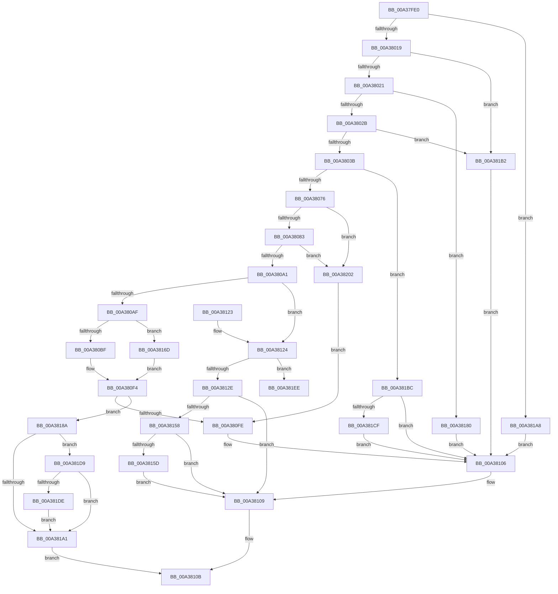

# MmRotatePhysicalView

- RVA: `0x00A37FE0`–`0x00A3820C` (길이 `556` bytes)
- VA: `0x0000000140A37FE0`
- 실행 섹션: `PAGE`
- PDB 이름 있음: `예`; PDB Function 태그: `예`
- unwind 정보 RVA: `0x000ADCD0`
- 디코드: `142`개 명령, `556/556` bytes 표시
- 미해석 바이트: `0` (있으면 어셈블리에 `.byte`로 보존)

> 이 문서는 커널 이미지의 기계어와 PDB 기호를 분석해 생성했습니다. 4번과 5번은 함수 원형과 자료형을 바이너리 사용 방식에서 추정한 C 해석이며 원본 소스 복구 결과는 아닙니다.

## 1. Dependencies

- 직접 호출 지점: **11**; 고유 호출 대상: **8**
- 직접 호출자로 확인된 함수: **0**
- RIP 상대 이미지 참조: **1**

### Outgoing calls
- `0x00A3804B` → [MiGetProcessPartition](../../text/44/MiGetProcessPartition_function_00443B10.md) (function, `0x00443B10`)
- `0x00A38065` → [MiObtainReferencedVadEx](../../text/31/MiObtainReferencedVadEx_function_00316690.md) (function, `0x00316690`)
- `0x00A380A4` → [MiGetVadCacheAttribute](../../text/4A/MiGetVadCacheAttribute_function_004AF624.md) (function, `0x004AF624`)
- `0x00A380EF` → [MiRotateToFrameBuffer](MiRotateToFrameBuffer_function_00A38214.md) (function, `0x00A38214`)
- `0x00A38101` → [MiUnlockAndDereferenceVad](../../text/31/MiUnlockAndDereferenceVad_function_00316E60.md) (function, `0x00316E60`)
- `0x00A3813A` → [MiReplaceRotateWithDemandZeroNoCopy](../../text/2A/MiReplaceRotateWithDemandZeroNoCopy_function_002AAB04.md) (function, `0x002AAB04`)
- `0x00A38144` → [MiUnlockAndDereferenceVad](../../text/31/MiUnlockAndDereferenceVad_function_00316E60.md) (function, `0x00316E60`)
- `0x00A38166` → [MiLogVirtualRotateEvent](../7F/MiLogVirtualRotateEvent_function_007FE704.md) (function, `0x007FE704`)
- `0x00A38176` → [MiRotateToFrameBufferNoCopy](MiRotateToFrameBufferNoCopy_function_00A38530.md) (function, `0x00A38530`)
- `0x00A3818D` → [MiUnlockAndDereferenceVad](../../text/31/MiUnlockAndDereferenceVad_function_00316E60.md) (function, `0x00316E60`)
- `0x00A381E7` → [MiLogVirtualRotateEvent](../7F/MiLogVirtualRotateEvent_function_007FE704.md) (function, `0x007FE704`)

### Direct callers
- 이 함수 시작 RVA로 연결되는 직접 call은 확인되지 않았습니다. 간접 호출은 완전히 역산할 수 없습니다.

### Static image references
- `0x00A3814C` → RVA `0x00FC6B04` (`ALMOSTRO`; read)

## 2. Other-region calls and transfers

- 다른 실행 섹션으로 향하는 call: **7**
  - `0x00A3804B` → [MiGetProcessPartition](../../text/44/MiGetProcessPartition_function_00443B10.md) (`PAGE` → `.text`)
  - `0x00A38065` → [MiObtainReferencedVadEx](../../text/31/MiObtainReferencedVadEx_function_00316690.md) (`PAGE` → `.text`)
  - `0x00A380A4` → [MiGetVadCacheAttribute](../../text/4A/MiGetVadCacheAttribute_function_004AF624.md) (`PAGE` → `.text`)
  - `0x00A38101` → [MiUnlockAndDereferenceVad](../../text/31/MiUnlockAndDereferenceVad_function_00316E60.md) (`PAGE` → `.text`)
  - `0x00A3813A` → [MiReplaceRotateWithDemandZeroNoCopy](../../text/2A/MiReplaceRotateWithDemandZeroNoCopy_function_002AAB04.md) (`PAGE` → `.text`)
  - `0x00A38144` → [MiUnlockAndDereferenceVad](../../text/31/MiUnlockAndDereferenceVad_function_00316E60.md) (`PAGE` → `.text`)
  - `0x00A3818D` → [MiUnlockAndDereferenceVad](../../text/31/MiUnlockAndDereferenceVad_function_00316E60.md) (`PAGE` → `.text`)
- call이 아닌 외부 분기/꼬리 이동: **1**
  - `0x00A381FD` → [sub_00B3A19A](../B3/Unknown_function_00B3A19A.md) (`tail-transfer`)

## 3. Assembly (complete function range)

```asm
00A37FE0  48 8B C4                        mov rax, rsp
00A37FE3  48 89 58 18                     mov qword ptr [rax + 0x18], rbx
00A37FE7  55                              push rbp
00A37FE8  56                              push rsi
00A37FE9  57                              push rdi
00A37FEA  41 54                           push r12
00A37FEC  41 55                           push r13
00A37FEE  41 56                           push r14
00A37FF0  41 57                           push r15
00A37FF2  48 83 EC 40                     sub rsp, 0x40
00A37FF6  83 60 08 00                     and dword ptr [rax + 8], 0
00A37FFA  45 33 E4                        xor r12d, r12d
00A37FFD  48 8B 3A                        mov rdi, qword ptr [rdx]
00A38000  B8 FF 0F 00 00                  mov eax, 0xfff
00A38005  45 8B F1                        mov r14d, r9d
00A38008  4D 8B E8                        mov r13, r8
00A3800B  4C 8B FA                        mov r15, rdx
00A3800E  48 8B F1                        mov rsi, rcx
00A38011  85 C8                           test eax, ecx
00A38013  0F 85 8F 01 00 00               jne 0x140a381a8
00A38019  85 F8                           test eax, edi
00A3801B  0F 85 91 01 00 00               jne 0x140a381b2
00A38021  41 83 F9 04                     cmp r9d, 4
00A38025  0F 8D 55 01 00 00               jge 0x140a38180
00A3802B  48 8D 59 FF                     lea rbx, [rcx - 1]
00A3802F  48 03 DF                        add rbx, rdi
00A38032  48 3B D9                        cmp rbx, rcx
00A38035  0F 86 77 01 00 00               jbe 0x140a381b2
00A3803B  65 48 8B 0C 25 88 01 00 00      mov rcx, qword ptr gs:[0x188]
00A38044  48 8B 89 B8 00 00 00            mov rcx, qword ptr [rcx + 0xb8]
00A3804B  E8 C0 BA A0 FF                  call 0x140443b10
00A38050  33 D2                           xor edx, edx
00A38052  48 89 84 24 88 00 00 00         mov qword ptr [rsp + 0x88], rax
00A3805A  4C 8D 84 24 80 00 00 00         lea r8, [rsp + 0x80]
00A38062  48 8B CE                        mov rcx, rsi
00A38065  E8 26 E6 8D FF                  call 0x140316690
00A3806A  48 8B E8                        mov rbp, rax
00A3806D  48 85 C0                        test rax, rax
00A38070  0F 84 46 01 00 00               je 0x140a381bc
00A38076  8B 40 30                        mov eax, dword ptr [rax + 0x30]
00A38079  24 70                           and al, 0x70
00A3807B  3C 40                           cmp al, 0x40
00A3807D  0F 85 7F 01 00 00               jne 0x140a38202
00A38083  8B 45 1C                        mov eax, dword ptr [rbp + 0x1c]
00A38086  0F B6 4D 21                     movzx ecx, byte ptr [rbp + 0x21]
00A3808A  48 C1 E1 20                     shl rcx, 0x20
00A3808E  48 0B C8                        or rcx, rax
00A38091  48 8B C3                        mov rax, rbx
00A38094  48 C1 E8 0C                     shr rax, 0xc
00A38098  48 3B C8                        cmp rcx, rax
00A3809B  0F 82 61 01 00 00               jb 0x140a38202
00A380A1  48 8B CD                        mov rcx, rbp
00A380A4  E8 7B 75 A7 FF                  call 0x1404af624
00A380A9  41 83 FE 01                     cmp r14d, 1
00A380AD  7F 75                           jg 0x140a38124
00A380AF  4C 8B CF                        mov r9, rdi
00A380B2  49 C1 E9 0C                     shr r9, 0xc
00A380B6  45 85 F6                        test r14d, r14d
00A380B9  0F 85 AE 00 00 00               jne 0x140a3816d
00A380BF  48 8B 84 24 A8 00 00 00         mov rax, qword ptr [rsp + 0xa8]
00A380C7  4C 8B C6                        mov r8, rsi
00A380CA  48 8B 8C 24 88 00 00 00         mov rcx, qword ptr [rsp + 0x88]
00A380D2  48 8B D5                        mov rdx, rbp
00A380D5  48 89 44 24 30                  mov qword ptr [rsp + 0x30], rax
00A380DA  48 8B 84 24 A0 00 00 00         mov rax, qword ptr [rsp + 0xa0]
00A380E2  48 89 44 24 28                  mov qword ptr [rsp + 0x28], rax
00A380E7  4C 89 4C 24 20                  mov qword ptr [rsp + 0x20], r9
00A380EC  4D 8B CD                        mov r9, r13
00A380EF  E8 20 01 00 00                  call 0x140a38214
00A380F4  8B D8                           mov ebx, eax
00A380F6  85 C0                           test eax, eax
00A380F8  0F 89 8C 00 00 00               jns 0x140a3818a
00A380FE  48 8B CD                        mov rcx, rbp
00A38101  E8 5A ED 8D FF                  call 0x140316e60
00A38106  4D 89 27                        mov qword ptr [r15], r12
00A38109  8B C3                           mov eax, ebx
00A3810B  48 8B 9C 24 90 00 00 00         mov rbx, qword ptr [rsp + 0x90]
00A38113  48 83 C4 40                     add rsp, 0x40
00A38117  41 5F                           pop r15
00A38119  41 5E                           pop r14
00A3811B  41 5D                           pop r13
00A3811D  41 5C                           pop r12
00A3811F  5F                              pop rdi
00A38120  5E                              pop rsi
00A38121  5D                              pop rbp
00A38122  C3                              ret
00A38123  CC                              int3
00A38124  41 83 FE 03                     cmp r14d, 3
00A38128  0F 85 C0 00 00 00               jne 0x140a381ee
00A3812E  44 8B C8                        mov r9d, eax
00A38131  4C 8B C3                        mov r8, rbx
00A38134  48 8B D6                        mov rdx, rsi
00A38137  48 8B CD                        mov rcx, rbp
00A3813A  E8 C5 29 87 FF                  call 0x1402aab04
00A3813F  48 8B CD                        mov rcx, rbp
00A38142  8B D8                           mov ebx, eax
00A38144  E8 17 ED 8D FF                  call 0x140316e60
00A38149  49 89 3F                        mov qword ptr [r15], rdi
00A3814C  F7 05 AE E9 58 00 00 80 00 00   test dword ptr [rip + 0x58e9ae], 0x8000
00A38156  74 B1                           je 0x140a38109
00A38158  48 85 FF                        test rdi, rdi
00A3815B  74 AC                           je 0x140a38109
00A3815D  45 8B C6                        mov r8d, r14d
00A38160  48 8B D7                        mov rdx, rdi
00A38163  48 8B CE                        mov rcx, rsi
00A38166  E8 99 65 DC FF                  call 0x1407fe704
00A3816B  EB 9C                           jmp 0x140a38109
00A3816D  4D 8B C5                        mov r8, r13
00A38170  48 8B D6                        mov rdx, rsi
00A38173  48 8B CD                        mov rcx, rbp
00A38176  E8 B5 03 00 00                  call 0x140a38530
00A3817B  E9 74 FF FF FF                  jmp 0x140a380f4
00A38180  BB F1 00 00 C0                  mov ebx, 0xc00000f1
00A38185  E9 7C FF FF FF                  jmp 0x140a38106
00A3818A  48 8B CD                        mov rcx, rbp
00A3818D  E8 CE EC 8D FF                  call 0x140316e60
00A38192  49 89 3F                        mov qword ptr [r15], rdi
00A38195  F7 05 65 E9 58 00 00 80 00 00   test dword ptr [rip + 0x58e965], 0x8000
00A3819F  75 38                           jne 0x140a381d9
00A381A1  33 C0                           xor eax, eax
00A381A3  E9 63 FF FF FF                  jmp 0x140a3810b
00A381A8  BB EF 00 00 C0                  mov ebx, 0xc00000ef
00A381AD  E9 54 FF FF FF                  jmp 0x140a38106
00A381B2  BB F0 00 00 C0                  mov ebx, 0xc00000f0
00A381B7  E9 4A FF FF FF                  jmp 0x140a38106
00A381BC  8B 9C 24 80 00 00 00            mov ebx, dword ptr [rsp + 0x80]
00A381C3  81 FB A0 00 00 C0               cmp ebx, 0xc00000a0
00A381C9  0F 85 37 FF FF FF               jne 0x140a38106
00A381CF  BB 05 00 00 C0                  mov ebx, 0xc0000005
00A381D4  E9 2D FF FF FF                  jmp 0x140a38106
00A381D9  48 85 FF                        test rdi, rdi
00A381DC  74 C3                           je 0x140a381a1
00A381DE  45 8B C6                        mov r8d, r14d
00A381E1  48 8B D7                        mov rdx, rdi
00A381E4  48 8B CE                        mov rcx, rsi
00A381E7  E8 18 65 DC FF                  call 0x1407fe704
00A381EC  EB B3                           jmp 0x140a381a1
00A381EE  4C 8B B4 24 A8 00 00 00         mov r14, qword ptr [rsp + 0xa8]
00A381F6  8B 9C 24 80 00 00 00            mov ebx, dword ptr [rsp + 0x80]
00A381FD  E9 98 1F 10 00                  jmp 0x140b3a19a
00A38202  BB 18 00 00 C0                  mov ebx, 0xc0000018
00A38207  E9 F2 FE FF FF                  jmp 0x140a380fe
```

## 4. C-style interpretation (structured pseudocode)

```c
__int64 __fastcall MmRotatePhysicalView(__int64 a1, __int64 a2, __int64 a3, int a4, __int64 a5, __int64 a6)
{
    __int64 result;
    __int64 v_r12;
    __int64 v_rbx;
    __int64 v_rsp;
    unsigned __int64 v_stack_m48;
    unsigned __int64 v_stack_m50;
    unsigned __int64 v_stack_m58;
    unsigned __int64 v_stack_p10;
    unsigned __int64 v_stack_p18;
    unsigned __int64 v_stack_p8;
    unsigned int v_stack_p80;

    *(unsigned __int64 *)(v_rsp + 24) = v_rbx;
    v_rsp = (v_rsp) - (64);
    v_r12 = 0;
    if ((((unsigned int)((unsigned int)(0xFFFULL))) & ((unsigned int)(a1))) != 0) goto loc_00A381A8;
    if ((((unsigned int)((unsigned int)(0xFFFULL))) & ((unsigned int)(*(unsigned __int64 *)(a2)))) != 0) goto loc_00A381B2;
    if (a4 >= 4) goto loc_00A38180;
    v_rbx = (a1 - 1) + (*(unsigned __int64 *)(a2));
    if (v_rbx <= a1) goto loc_00A381B2;
    result = MiGetProcessPartition(*(unsigned __int64 *)(*(unsigned __int64 *)(gs_base + (0 + 392)) + 184), a2, a3, a4);
    a2 = 0;
    v_stack_p10 = result;
    result = MiObtainReferencedVadEx(a1, a2, v_stack_p8, a4);
    if (result == 0) goto loc_00A381BC;
    result = (unsigned __int8)(((unsigned int)(*(unsigned int *)(result + 48))) & (112));
    if (((unsigned __int8)(result)) != 64) goto loc_00A38202;
    a1 = (*(unsigned __int8 *)(result + 33)) << (32);
    a1 = (a1) | ((unsigned int)(*(unsigned int *)(result + 28)));
    result = (v_rbx) >> (12);
    if (a1 < result) goto loc_00A38202;
    result = MiGetVadCacheAttribute(result, a2, v_stack_p8, a4);
    if (((unsigned int)((unsigned int)(a4))) > 1) goto loc_00A38124;
    a4 = (*(unsigned __int64 *)(a2)) >> (12);
    if ((unsigned int)((unsigned int)(a4)) != 0) goto loc_00A3816D;
    v_stack_m48 = a6;
    v_stack_m50 = a5;
    v_stack_m58 = a4;
    result = MiRotateToFrameBuffer(v_stack_p10, result, a1, a3);
loc_00A380F4:
    if (!sign_flag) goto loc_00A3818A;
loc_00A380FE:
    result = MiUnlockAndDereferenceVad(result, result, a1, a3);
loc_00A38106:
    *(unsigned __int64 *)(a2) = 0;
loc_00A38109:
loc_00A3810B:
    v_rsp = (v_rsp) + (64);
    return (unsigned int)((unsigned int)((unsigned int)((unsigned int)(result))));
loc_00A38124:
    if (((unsigned int)((unsigned int)(a4))) != 3) goto loc_00A381EE;
    result = MiReplaceRotateWithDemandZeroNoCopy(result, a1, v_stack_p18, (unsigned int)((unsigned int)((unsigned int)((unsigned int)((unsigned int)((unsigned int)(result)))))));
    result = MiUnlockAndDereferenceVad(result, a1, v_stack_p18, (unsigned int)((unsigned int)((unsigned int)((unsigned int)((unsigned int)((unsigned int)(result)))))));
    *(unsigned __int64 *)(a2) = *(unsigned __int64 *)(a2);
    if (((*(unsigned int *)(v_rip + 5826990)) & (0x8000ULL)) == 0) goto loc_00A38109;
    if (*(unsigned __int64 *)(a2) == 0) goto loc_00A38109;
    result = MiLogVirtualRotateEvent(a1, *(unsigned __int64 *)(a2), (unsigned int)((unsigned int)((unsigned int)(a4))), (unsigned int)((unsigned int)((unsigned int)((unsigned int)((unsigned int)((unsigned int)(result)))))));
    goto loc_00A38109;
loc_00A3816D:
    result = MiRotateToFrameBufferNoCopy(result, a1, a3, (unsigned int)((unsigned int)((unsigned int)((unsigned int)((unsigned int)((unsigned int)(result)))))));
    goto loc_00A380F4;
loc_00A38180:
    goto loc_00A38106;
loc_00A3818A:
    result = MiUnlockAndDereferenceVad(result, a1, a3, (unsigned int)((unsigned int)((unsigned int)((unsigned int)((unsigned int)((unsigned int)(result)))))));
    *(unsigned __int64 *)(a2) = *(unsigned __int64 *)(a2);
    if (((*(unsigned int *)(v_rip + 5826917)) & (0x8000ULL)) != 0) goto loc_00A381D9;
loc_00A381A1:
    result = 0;
    goto loc_00A3810B;
loc_00A381A8:
    goto loc_00A38106;
loc_00A381B2:
    goto loc_00A38106;
loc_00A381BC:
    if (((unsigned int)((unsigned int)(v_stack_p80))) != 0xC00000A0ULL) goto loc_00A38106;
    goto loc_00A38106;
loc_00A381D9:
    if (*(unsigned __int64 *)(a2) == 0) goto loc_00A381A1;
    result = MiLogVirtualRotateEvent(a1, *(unsigned __int64 *)(a2), (unsigned int)((unsigned int)((unsigned int)(a4))), (unsigned int)((unsigned int)((unsigned int)((unsigned int)((unsigned int)((unsigned int)(result)))))));
    goto loc_00A381A1;
loc_00A381EE:
loc_00A38202:
    goto loc_00A380FE;
}
```

## 5. (Beta) C Style

```c
int64_t MmRotatePhysicalView(void *Arg1, void *Arg2, int64_t Arg3, int32_t Arg4, int64_t Arg5, int64_t Arg6)
{
    uint8_t *arg1 = (uint8_t *)Arg1;
    uint8_t *arg2 = (uint8_t *)Arg2;

    int64_t result;
    int64_t local_r12;
    int64_t local_rbx;
    int64_t local_rsp;
    uint64_t v_stack_m48;
    uint64_t v_stack_m50;
    uint64_t v_stack_m58;
    uint64_t v_stack_p10;
    uint64_t v_stack_p18;
    uint64_t v_stack_p8;
    uint32_t v_stack_p80;

    *(uint64_t *)(local_rsp + 0x18) = local_rbx;
    local_rsp = (local_rsp) - (64);
    local_r12 = 0;
    if ((((uint32_t)((uint32_t)(0xFFFULL))) & ((uint32_t)(Arg1))) != 0) goto loc_00A381A8;
    if ((((uint32_t)((uint32_t)(0xFFFULL))) & ((uint32_t)(*(uint64_t *)(arg2)))) != 0) goto loc_00A381B2;
    if (Arg4 >= 4) goto loc_00A38180;
    local_rbx = (Arg1 - 1) + (*(uint64_t *)(arg2));
    if (local_rbx <= Arg1) goto loc_00A381B2;
    result = MiGetProcessPartition(*(uint64_t *)(*(uint64_t *)(gs_base + (0 + 0x188)) + 0xB8), Arg2, Arg3, Arg4);
    Arg2 = 0;
    v_stack_p10 = result;
    result = MiObtainReferencedVadEx(Arg1, Arg2, v_stack_p8, Arg4);
    if (result == 0) goto loc_00A381BC;
    result = (uint8_t)(((uint32_t)(*(uint32_t *)(result + 0x30))) & (112));
    if (((uint8_t)(result)) != 64) goto loc_00A38202;
    Arg1 = (*(uint8_t *)(result + 0x21)) << (32);
    Arg1 = (Arg1) | ((uint32_t)(*(uint32_t *)(result + 0x1C)));
    result = (local_rbx) >> (12);
    if (Arg1 < result) goto loc_00A38202;
    result = MiGetVadCacheAttribute(result, Arg2, v_stack_p8, Arg4);
    if (((uint32_t)((uint32_t)(Arg4))) > 1) goto loc_00A38124;
    Arg4 = (*(uint64_t *)(arg2)) >> (12);
    if ((uint32_t)((uint32_t)(Arg4)) != 0) goto loc_00A3816D;
    v_stack_m48 = Arg6;
    v_stack_m50 = Arg5;
    v_stack_m58 = Arg4;
    result = MiRotateToFrameBuffer(v_stack_p10, result, Arg1, Arg3);
loc_00A380F4:
    if (!sign_flag) goto loc_00A3818A;
loc_00A380FE:
    result = MiUnlockAndDereferenceVad(result, result, Arg1, Arg3);
loc_00A38106:
    *(uint64_t *)(arg2) = 0;
loc_00A38109:
loc_00A3810B:
    local_rsp = (local_rsp) + (64);
    return (uint32_t)((uint32_t)((uint32_t)((uint32_t)(result))));
loc_00A38124:
    if (((uint32_t)((uint32_t)(Arg4))) != 3) goto loc_00A381EE;
    result = MiReplaceRotateWithDemandZeroNoCopy(result, Arg1, v_stack_p18, (uint32_t)((uint32_t)((uint32_t)((uint32_t)((uint32_t)((uint32_t)(result)))))));
    result = MiUnlockAndDereferenceVad(result, Arg1, v_stack_p18, (uint32_t)((uint32_t)((uint32_t)((uint32_t)((uint32_t)((uint32_t)(result)))))));
    *(uint64_t *)(arg2) = *(uint64_t *)(arg2);
    if (((*(uint32_t *)(v_rip + 0x58E9AE)) & (0x8000ULL)) == 0) goto loc_00A38109;
    if (*(uint64_t *)(arg2) == 0) goto loc_00A38109;
    result = MiLogVirtualRotateEvent(Arg1, *(uint64_t *)(arg2), (uint32_t)((uint32_t)((uint32_t)(Arg4))), (uint32_t)((uint32_t)((uint32_t)((uint32_t)((uint32_t)((uint32_t)(result)))))));
    goto loc_00A38109;
loc_00A3816D:
    result = MiRotateToFrameBufferNoCopy(result, Arg1, Arg3, (uint32_t)((uint32_t)((uint32_t)((uint32_t)((uint32_t)((uint32_t)(result)))))));
    goto loc_00A380F4;
loc_00A38180:
    goto loc_00A38106;
loc_00A3818A:
    result = MiUnlockAndDereferenceVad(result, Arg1, Arg3, (uint32_t)((uint32_t)((uint32_t)((uint32_t)((uint32_t)((uint32_t)(result)))))));
    *(uint64_t *)(arg2) = *(uint64_t *)(arg2);
    if (((*(uint32_t *)(v_rip + 0x58E965)) & (0x8000ULL)) != 0) goto loc_00A381D9;
loc_00A381A1:
    result = 0;
    goto loc_00A3810B;
loc_00A381A8:
    goto loc_00A38106;
loc_00A381B2:
    goto loc_00A38106;
loc_00A381BC:
    if (((uint32_t)((uint32_t)(v_stack_p80))) != 0xC00000A0ULL) goto loc_00A38106;
    goto loc_00A38106;
loc_00A381D9:
    if (*(uint64_t *)(arg2) == 0) goto loc_00A381A1;
    result = MiLogVirtualRotateEvent(Arg1, *(uint64_t *)(arg2), (uint32_t)((uint32_t)((uint32_t)(Arg4))), (uint32_t)((uint32_t)((uint32_t)((uint32_t)((uint32_t)((uint32_t)(result)))))));
    goto loc_00A381A1;
loc_00A381EE:
loc_00A38202:
    goto loc_00A380FE;
}
```

### 관측된 메모리 오프셋

구조체 형식이 확인되지 않은 접근은 인자 기준의 오프셋으로만 기록했습니다.

| 기준 인자 | 오프셋 표현 | 폭 (bit) | 접근 |
|---|---:|---:|---|
| `Arg1` | `- 0x1` | `64` | `R` |
| `Arg2` | `+ 0x0` | `64` | `R` |
| `Arg2` | `+ 0x0` | `64` | `W` |

## 6. Execution-region graph

[열기: 2D/3D 그래프와 함수 탐색 컨트롤 패널](../../../control-panel.html?section=page&rva=0x00A37FE0&view=graph)

- 2D 그래프는 위에서 아래로 흐르고, 3D 그래프는 빈 공간을 드래그해 회전합니다. Shift+드래그는 이동, 휠은 확대·축소, 함수 노드 선택은 대상 보고서 이동입니다.

### Static fallback


