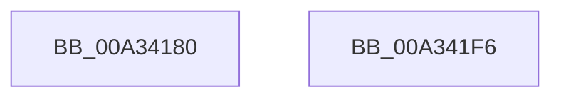

# NtAcceptConnectPort

- RVA: `0x00A34180`–`0x00A341F7` (길이 `119` bytes)
- VA: `0x0000000140A34180`
- 실행 섹션: `PAGE`
- PDB 이름 있음: `예`; PDB Function 태그: `아니요`
- unwind 정보 RVA: `0x000AD5F0`
- 디코드: `30`개 명령, `119/119` bytes 표시
- 미해석 바이트: `0` (있으면 어셈블리에 `.byte`로 보존)

> 이 문서는 커널 이미지의 기계어와 PDB 기호를 분석해 생성했습니다. 4번과 5번은 함수 원형과 자료형을 바이너리 사용 방식에서 추정한 C 해석이며 원본 소스 복구 결과는 아닙니다.

## 1. Dependencies

- 직접 호출 지점: **2**; 고유 호출 대상: **2**
- 직접 호출자로 확인된 함수: **0**
- RIP 상대 이미지 참조: **0**

### Outgoing calls
- `0x00A341D4` → [AlpcpAcceptConnectPort](AlpcpAcceptConnectPort_function_00A34290.md) (function, `0x00A34290`)
- `0x00A341DB` → [KeLeaveCriticalRegion](../../text/25/KeLeaveCriticalRegion_function_0025D8B0.md) (function, `0x0025D8B0`)

### Direct callers
- 이 함수 시작 RVA로 연결되는 직접 call은 확인되지 않았습니다. 간접 호출은 완전히 역산할 수 없습니다.

### Static image references
- 디코드된 RIP-relative 메모리 참조가 없습니다.

## 2. Other-region calls and transfers

- 다른 실행 섹션으로 향하는 call: **1**
  - `0x00A341DB` → [KeLeaveCriticalRegion](../../text/25/KeLeaveCriticalRegion_function_0025D8B0.md) (`PAGE` → `.text`)
- 별도 외부 분기/꼬리 이동을 확인하지 못했습니다.

## 3. Assembly (complete function range)

```asm
00A34180  4C 8B DC                        mov r11, rsp
00A34183  53                              push rbx
00A34184  48 83 EC 60                     sub rsp, 0x60
00A34188  65 48 8B 04 25 88 01 00 00      mov rax, qword ptr gs:[0x188]
00A34191  C6 44 24 58 01                  mov byte ptr [rsp + 0x58], 1
00A34196  66 FF 88 E4 01 00 00            dec word ptr [rax + 0x1e4]
00A3419D  90                              nop
00A3419E  48 8B 84 24 98 00 00 00         mov rax, qword ptr [rsp + 0x98]
00A341A6  49 89 43 E8                     mov qword ptr [r11 - 0x18], rax
00A341AA  48 8B 84 24 90 00 00 00         mov rax, qword ptr [rsp + 0x90]
00A341B2  49 89 43 E0                     mov qword ptr [r11 - 0x20], rax
00A341B6  45 88 4B D8                     mov byte ptr [r11 - 0x28], r9b
00A341BA  45 33 C9                        xor r9d, r9d
00A341BD  49 83 63 D0 00                  and qword ptr [r11 - 0x30], 0
00A341C2  4D 89 43 C8                     mov qword ptr [r11 - 0x38], r8
00A341C6  45 33 C0                        xor r8d, r8d
00A341C9  49 89 53 C0                     mov qword ptr [r11 - 0x40], rdx
00A341CD  33 D2                           xor edx, edx
00A341CF  49 83 63 B8 00                  and qword ptr [r11 - 0x48], 0
00A341D4  E8 B7 00 00 00                  call 0x140a34290
00A341D9  8B D8                           mov ebx, eax
00A341DB  E8 D0 96 82 FF                  call 0x14025d8b0
00A341E0  B8 0B 00 00 C0                  mov eax, 0xc000000b
00A341E5  81 FB 03 07 00 C0               cmp ebx, 0xc0000703
00A341EB  0F 44 D8                        cmove ebx, eax
00A341EE  8B C3                           mov eax, ebx
00A341F0  48 83 C4 60                     add rsp, 0x60
00A341F4  5B                              pop rbx
00A341F5  C3                              ret
00A341F6  CC                              int3
```

## 4. C-style interpretation (structured pseudocode)

```c
__int64 __fastcall NtAcceptConnectPort(__int64 a1, __int64 a2, __int64 a3, int a4, __int64 a5, __int64 a6)
{
    __int64 result;
    __int64 v_rbx;
    __int64 v_rsp;
    unsigned __int8 v_stack_m10;

    v_rsp = (v_rsp) - (96);
    v_stack_m10 = 1;
    *(unsigned __int64 *)(v_rsp - 24) = a6;
    *(unsigned __int64 *)(v_rsp - 32) = a5;
    *(unsigned __int8 *)(v_rsp - 40) = (unsigned __int8)(a4);
    a4 = 0;
    *(unsigned __int64 *)(v_rsp - 56) = a3;
    a3 = 0;
    *(unsigned __int64 *)(v_rsp - 64) = a2;
    a2 = 0;
    result = AlpcpAcceptConnectPort(a1, a2, a3, a4);
    result = KeLeaveCriticalRegion(a1, a2, a3, a4);
    v_rbx = (unsigned int)((unsigned int)(result));
    if (((unsigned int)((unsigned int)((unsigned int)(result)))) == 0xC0000703ULL) { v_rbx = (unsigned int)((unsigned int)(0xC000000BULL)); }
    v_rsp = (v_rsp) + (96);
    return (unsigned int)((unsigned int)(v_rbx));
}
```

## 5. (Beta) C Style

```c
int64_t NtAcceptConnectPort(int64_t Arg1, int64_t Arg2, int64_t Arg3, int32_t Arg4, int64_t Arg5, int64_t Arg6)
{
    int64_t result;
    int64_t local_rbx;
    int64_t local_rsp;
    uint8_t v_stack_m10;

    local_rsp = (local_rsp) - (96);
    v_stack_m10 = 1;
    *(uint64_t *)(local_rsp - 0x18) = Arg6;
    *(uint64_t *)(local_rsp - 0x20) = Arg5;
    *(uint8_t *)(local_rsp - 0x28) = (uint8_t)(Arg4);
    Arg4 = 0;
    *(uint64_t *)(local_rsp - 0x38) = Arg3;
    Arg3 = 0;
    *(uint64_t *)(local_rsp - 0x40) = Arg2;
    Arg2 = 0;
    result = AlpcpAcceptConnectPort(Arg1, Arg2, Arg3, Arg4);
    result = KeLeaveCriticalRegion(Arg1, Arg2, Arg3, Arg4);
    local_rbx = (uint32_t)((uint32_t)(result));
    if (((uint32_t)((uint32_t)((uint32_t)(result)))) == 0xC0000703ULL) { local_rbx = (uint32_t)((uint32_t)(0xC000000BULL)); }
    local_rsp = (local_rsp) + (96);
    return (uint32_t)((uint32_t)(local_rbx));
}
```

## 6. Execution-region graph

[열기: 2D/3D 그래프와 함수 탐색 컨트롤 패널](../../../control-panel.html?section=page&rva=0x00A34180&view=graph)

- 2D 그래프는 위에서 아래로 흐르고, 3D 그래프는 빈 공간을 드래그해 회전합니다. Shift+드래그는 이동, 휠은 확대·축소, 함수 노드 선택은 대상 보고서 이동입니다.

### Static fallback


