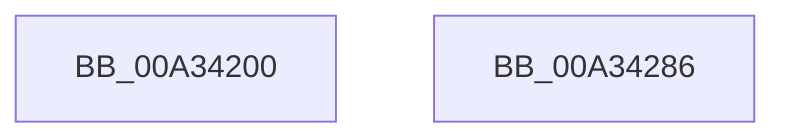

# NtAlpcAcceptConnectPort

- RVA: `0x00A34200`–`0x00A34287` (길이 `135` bytes)
- VA: `0x0000000140A34200`
- 실행 섹션: `PAGE`
- PDB 이름 있음: `예`; PDB Function 태그: `아니요`
- unwind 정보 RVA: `0x000AD5F0`
- 디코드: `32`개 명령, `135/135` bytes 표시
- 미해석 바이트: `0` (있으면 어셈블리에 `.byte`로 보존)

> 이 문서는 커널 이미지의 기계어와 PDB 기호를 분석해 생성했습니다. 4번과 5번은 함수 원형과 자료형을 바이너리 사용 방식에서 추정한 C 해석이며 원본 소스 복구 결과는 아닙니다.

## 1. Dependencies

- 직접 호출 지점: **2**; 고유 호출 대상: **2**
- 직접 호출자로 확인된 함수: **0**
- RIP 상대 이미지 참조: **0**

### Outgoing calls
- `0x00A34272` → [AlpcpAcceptConnectPort](AlpcpAcceptConnectPort_function_00A34290.md) (function, `0x00A34290`)
- `0x00A34279` → [KeLeaveCriticalRegion](../../text/25/KeLeaveCriticalRegion_function_0025D8B0.md) (function, `0x0025D8B0`)

### Direct callers
- 이 함수 시작 RVA로 연결되는 직접 call은 확인되지 않았습니다. 간접 호출은 완전히 역산할 수 없습니다.

### Static image references
- 디코드된 RIP-relative 메모리 참조가 없습니다.

## 2. Other-region calls and transfers

- 다른 실행 섹션으로 향하는 call: **1**
  - `0x00A34279` → [KeLeaveCriticalRegion](../../text/25/KeLeaveCriticalRegion_function_0025D8B0.md) (`PAGE` → `.text`)
- 별도 외부 분기/꼬리 이동을 확인하지 못했습니다.

## 3. Assembly (complete function range)

```asm
00A34200  4C 8B DC                        mov r11, rsp
00A34203  53                              push rbx
00A34204  48 83 EC 60                     sub rsp, 0x60
00A34208  65 48 8B 04 25 88 01 00 00      mov rax, qword ptr gs:[0x188]
00A34211  45 8B D0                        mov r10d, r8d
00A34214  41 81 E2 00 00 00 C0            and r10d, 0xc0000000
00A3421B  4C 8B C2                        mov r8, rdx
00A3421E  41 8B D2                        mov edx, r10d
00A34221  66 FF 88 E4 01 00 00            dec word ptr [rax + 0x1e4]
00A34228  33 C0                           xor eax, eax
00A3422A  88 44 24 58                     mov byte ptr [rsp + 0x58], al
00A3422E  90                              nop
00A3422F  49 89 43 E8                     mov qword ptr [r11 - 0x18], rax
00A34233  49 89 43 E0                     mov qword ptr [r11 - 0x20], rax
00A34237  8A 84 24 B0 00 00 00            mov al, byte ptr [rsp + 0xb0]
00A3423E  88 44 24 40                     mov byte ptr [rsp + 0x40], al
00A34242  48 8B 84 24 A8 00 00 00         mov rax, qword ptr [rsp + 0xa8]
00A3424A  49 89 43 D0                     mov qword ptr [r11 - 0x30], rax
00A3424E  48 8B 84 24 A0 00 00 00         mov rax, qword ptr [rsp + 0xa0]
00A34256  49 89 43 C8                     mov qword ptr [r11 - 0x38], rax
00A3425A  48 8B 84 24 98 00 00 00         mov rax, qword ptr [rsp + 0x98]
00A34262  49 89 43 C0                     mov qword ptr [r11 - 0x40], rax
00A34266  48 8B 84 24 90 00 00 00         mov rax, qword ptr [rsp + 0x90]
00A3426E  49 89 43 B8                     mov qword ptr [r11 - 0x48], rax
00A34272  E8 19 00 00 00                  call 0x140a34290
00A34277  8B D8                           mov ebx, eax
00A34279  E8 32 96 82 FF                  call 0x14025d8b0
00A3427E  8B C3                           mov eax, ebx
00A34280  48 83 C4 60                     add rsp, 0x60
00A34284  5B                              pop rbx
00A34285  C3                              ret
00A34286  CC                              int3
```

## 4. C-style interpretation (structured pseudocode)

```c
__int64 __fastcall NtAlpcAcceptConnectPort(__int64 a1, __int64 a2, int a3, __int64 a4, __int64 a5, __int64 a6, __int64 a7, __int64 a8, unsigned __int8 a9)
{
    __int64 result;
    __int64 v_r10;
    __int64 v_rsp;
    unsigned __int8 v_stack_m10;
    unsigned __int8 v_stack_m28;

    v_rsp = (v_rsp) - (96);
    v_r10 = (unsigned int)(((unsigned int)(a3)) & (0xC0000000ULL));
    result = 0;
    v_stack_m10 = 0;
    *(unsigned __int64 *)(v_rsp - 24) = 0;
    *(unsigned __int64 *)(v_rsp - 32) = 0;
    v_stack_m28 = a9;
    *(unsigned __int64 *)(v_rsp - 48) = a8;
    *(unsigned __int64 *)(v_rsp - 56) = a7;
    *(unsigned __int64 *)(v_rsp - 64) = a6;
    *(unsigned __int64 *)(v_rsp - 72) = a5;
    result = AlpcpAcceptConnectPort(a1, (unsigned int)((unsigned int)(v_r10)), a2, a4);
    result = KeLeaveCriticalRegion(a1, (unsigned int)((unsigned int)(v_r10)), a2, a4);
    v_rsp = (v_rsp) + (96);
    return (unsigned int)((unsigned int)((unsigned int)((unsigned int)(result))));
}
```

## 5. (Beta) C Style

```c
int64_t NtAlpcAcceptConnectPort(int64_t Arg1, int64_t Arg2, int32_t Arg3, int64_t Arg4, int64_t Arg5, int64_t Arg6, int64_t Arg7, int64_t Arg8, uint8_t Arg9)
{
    int64_t result;
    int64_t local_r10;
    int64_t local_rsp;
    uint8_t v_stack_m10;
    uint8_t v_stack_m28;

    local_rsp = (local_rsp) - (96);
    local_r10 = (uint32_t)(((uint32_t)(Arg3)) & (0xC0000000ULL));
    result = 0;
    v_stack_m10 = 0;
    *(uint64_t *)(local_rsp - 0x18) = 0;
    *(uint64_t *)(local_rsp - 0x20) = 0;
    v_stack_m28 = Arg9;
    *(uint64_t *)(local_rsp - 0x30) = Arg8;
    *(uint64_t *)(local_rsp - 0x38) = Arg7;
    *(uint64_t *)(local_rsp - 0x40) = Arg6;
    *(uint64_t *)(local_rsp - 0x48) = Arg5;
    result = AlpcpAcceptConnectPort(Arg1, (uint32_t)((uint32_t)(local_r10)), Arg2, Arg4);
    result = KeLeaveCriticalRegion(Arg1, (uint32_t)((uint32_t)(local_r10)), Arg2, Arg4);
    local_rsp = (local_rsp) + (96);
    return (uint32_t)((uint32_t)((uint32_t)((uint32_t)(result))));
}
```

## 6. Execution-region graph

[열기: 2D/3D 그래프와 함수 탐색 컨트롤 패널](../../../control-panel.html?section=page&rva=0x00A34200&view=graph)

- 2D 그래프는 위에서 아래로 흐르고, 3D 그래프는 빈 공간을 드래그해 회전합니다. Shift+드래그는 이동, 휠은 확대·축소, 함수 노드 선택은 대상 보고서 이동입니다.

### Static fallback


