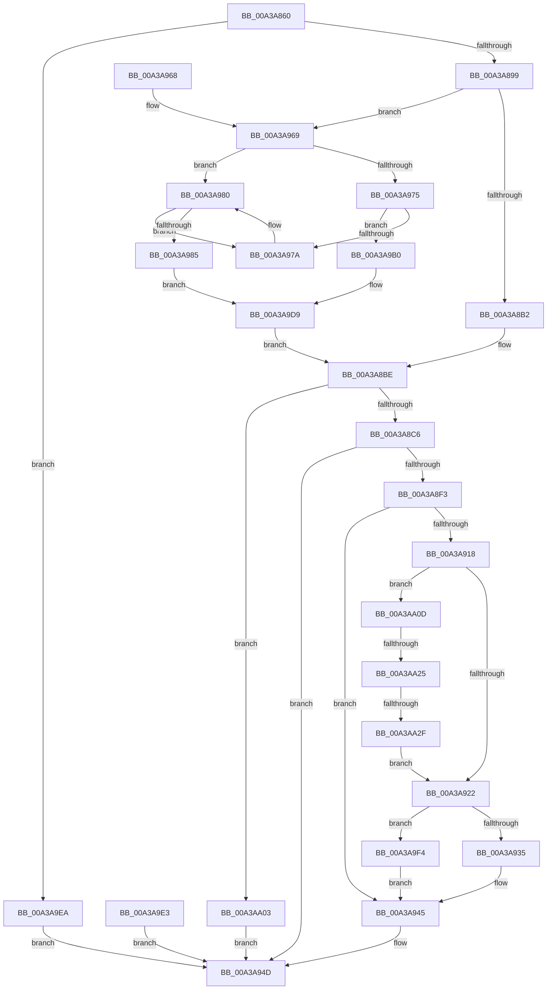

# NtAlpcCancelMessage

- RVA: `0x00A3A860`–`0x00A3AA34` (길이 `468` bytes)
- VA: `0x0000000140A3A860`
- 실행 섹션: `PAGE`
- PDB 이름 있음: `예`; PDB Function 태그: `예`
- unwind 정보 RVA: `0x000AE154`
- 디코드: `116`개 명령, `468/468` bytes 표시
- 미해석 바이트: `0` (있으면 어셈블리에 `.byte`로 보존)

> 이 문서는 커널 이미지의 기계어와 PDB 기호를 분석해 생성했습니다. 4번과 5번은 함수 원형과 자료형을 바이너리 사용 방식에서 추정한 C 해석이며 원본 소스 복구 결과는 아닙니다.

## 1. Dependencies

- 직접 호출 지점: **7**; 고유 호출 대상: **7**
- 직접 호출자로 확인된 함수: **1**
- RIP 상대 이미지 참조: **1**

### Outgoing calls
- `0x00A3A8E8` → [ObReferenceObjectByHandle](../86/ObReferenceObjectByHandle_function_00868DB0.md) (function, `0x00868DB0`)
- `0x00A3A90D` → [AlpcpLookupMessage](../89/AlpcpLookupMessage_function_00895A40.md) (function, `0x00895A40`)
- `0x00A3A93E` → [AlpcpCancelMessage](../89/AlpcpCancelMessage_function_00894120.md) (function, `0x00894120`)
- `0x00A3A948` → [ObfDereferenceObject](../../text/2F/ObfDereferenceObject_function_002F9350.md) (function, `0x002F9350`)
- `0x00A3A94D` → [KeLeaveCriticalRegion](../../text/25/KeLeaveCriticalRegion_function_0025D8B0.md) (function, `0x0025D8B0`)
- `0x00A3A97A` → [ExRaiseDatatypeMisalignment](../89/ExRaiseDatatypeMisalignment_function_00899FD0.md) (function, `0x00899FD0`)
- `0x00A3A9F4` → [AlpcpUnlockMessage](../89/AlpcpUnlockMessage_function_00897AE0.md) (function, `0x00897AE0`)

### Direct callers
- [SepRmCommandServerThread](../A6/SepRmCommandServerThread_function_00A6A8D0.md) at `0x00A6AB2F`
- [SepRmCommandServerThread](../A6/SepRmCommandServerThread_function_00A6A8D0.md) at `0x00A6AB44`

### Static image references
- `0x00A3A8C6` → RVA `0x00FC6C18` (`ALMOSTRO`; read)

## 2. Other-region calls and transfers

- 다른 실행 섹션으로 향하는 call: **2**
  - `0x00A3A948` → [ObfDereferenceObject](../../text/2F/ObfDereferenceObject_function_002F9350.md) (`PAGE` → `.text`)
  - `0x00A3A94D` → [KeLeaveCriticalRegion](../../text/25/KeLeaveCriticalRegion_function_0025D8B0.md) (`PAGE` → `.text`)
- call이 아닌 외부 분기/꼬리 이동: **2**
  - `0x00A3AA1F` → [sub_00B3A304](../B3/Unknown_function_00B3A304.md) (`tail-transfer`)
  - `0x00A3AA29` → [sub_00B3A304 + 0xA](../B3/Unknown_function_00B3A304.md) (`tail-transfer`)

## 3. Assembly (complete function range)

```asm
00A3A860  48 8B C4                        mov rax, rsp
00A3A863  48 89 58 08                     mov qword ptr [rax + 8], rbx
00A3A867  48 89 70 10                     mov qword ptr [rax + 0x10], rsi
00A3A86B  57                              push rdi
00A3A86C  41 56                           push r14
00A3A86E  41 57                           push r15
00A3A870  48 83 EC 50                     sub rsp, 0x50
00A3A874  44 8B F2                        mov r14d, edx
00A3A877  48 83 60 20 00                  and qword ptr [rax + 0x20], 0
00A3A87C  65 48 8B 04 25 88 01 00 00      mov rax, qword ptr gs:[0x188]
00A3A885  66 FF 88 E4 01 00 00            dec word ptr [rax + 0x1e4]
00A3A88C  90                              nop
00A3A88D  F7 C2 F0 FF FF FF               test edx, 0xfffffff0
00A3A893  0F 85 51 01 00 00               jne 0x140a3a9ea
00A3A899  65 48 8B 04 25 88 01 00 00      mov rax, qword ptr gs:[0x188]
00A3A8A2  44 8A 88 32 02 00 00            mov r9b, byte ptr [rax + 0x232]
00A3A8A9  45 84 C9                        test r9b, r9b
00A3A8AC  0F 85 B7 00 00 00               jne 0x140a3a969
00A3A8B2  41 8B 78 14                     mov edi, dword ptr [r8 + 0x14]
00A3A8B6  45 8B 78 18                     mov r15d, dword ptr [r8 + 0x18]
00A3A8BA  49 8B 70 08                     mov rsi, qword ptr [r8 + 8]
00A3A8BE  85 FF                           test edi, edi
00A3A8C0  0F 84 3D 01 00 00               je 0x140a3aa03
00A3A8C6  4C 8B 05 4B C3 58 00            mov r8, qword ptr [rip + 0x58c34b]
00A3A8CD  48 83 64 24 38 00               and qword ptr [rsp + 0x38], 0
00A3A8D3  48 83 64 24 28 00               and qword ptr [rsp + 0x28], 0
00A3A8D9  48 8D 44 24 38                  lea rax, [rsp + 0x38]
00A3A8DE  48 89 44 24 20                  mov qword ptr [rsp + 0x20], rax
00A3A8E3  BA 01 00 00 00                  mov edx, 1
00A3A8E8  E8 C3 E4 E2 FF                  call 0x140868db0
00A3A8ED  8B D8                           mov ebx, eax
00A3A8EF  85 C0                           test eax, eax
00A3A8F1  78 5A                           js 0x140a3a94d
00A3A8F3  48 8D 84 24 88 00 00 00         lea rax, [rsp + 0x88]
00A3A8FB  48 89 44 24 20                  mov qword ptr [rsp + 0x20], rax
00A3A900  45 8B C7                        mov r8d, r15d
00A3A903  8B D7                           mov edx, edi
00A3A905  48 8B 7C 24 38                  mov rdi, qword ptr [rsp + 0x38]
00A3A90A  48 8B CF                        mov rcx, rdi
00A3A90D  E8 2E B1 E5 FF                  call 0x140895a40
00A3A912  8B D8                           mov ebx, eax
00A3A914  85 C0                           test eax, eax
00A3A916  78 2D                           js 0x140a3a945
00A3A918  41 F6 C6 08                     test r14b, 8
00A3A91C  0F 85 EB 00 00 00               jne 0x140a3aa0d
00A3A922  48 8B 8C 24 88 00 00 00         mov rcx, qword ptr [rsp + 0x88]
00A3A92A  8B 41 28                        mov eax, dword ptr [rcx + 0x28]
00A3A92D  84 C0                           test al, al
00A3A92F  0F 88 BF 00 00 00               js 0x140a3a9f4
00A3A935  45 8B C6                        mov r8d, r14d
00A3A938  48 8B D1                        mov rdx, rcx
00A3A93B  48 8B CF                        mov rcx, rdi
00A3A93E  E8 DD 97 E5 FF                  call 0x140894120
00A3A943  8B D8                           mov ebx, eax
00A3A945  48 8B CF                        mov rcx, rdi
00A3A948  E8 03 EA 8B FF                  call 0x1402f9350
00A3A94D  E8 5E 2F 82 FF                  call 0x14025d8b0
00A3A952  8B C3                           mov eax, ebx
00A3A954  48 8B 5C 24 70                  mov rbx, qword ptr [rsp + 0x70]
00A3A959  48 8B 74 24 78                  mov rsi, qword ptr [rsp + 0x78]
00A3A95E  48 83 C4 50                     add rsp, 0x50
00A3A962  41 5F                           pop r15
00A3A964  41 5E                           pop r14
00A3A966  5F                              pop rdi
00A3A967  C3                              ret
00A3A968  CC                              int3
00A3A969  49 8B C0                        mov rax, r8
00A3A96C  83 E0 03                        and eax, 3
00A3A96F  41 F6 C6 04                     test r14b, 4
00A3A973  74 0B                           je 0x140a3a980
00A3A975  48 85 C0                        test rax, rax
00A3A978  74 36                           je 0x140a3a9b0
00A3A97A  E8 51 F6 E5 FF                  call 0x140899fd0
00A3A97F  CC                              int3
00A3A980  48 85 C0                        test rax, rax
00A3A983  75 F5                           jne 0x140a3a97a
00A3A985  48 B8 00 00 FF FF FF 7F 00 00   movabs rax, 0x7fffffff0000
00A3A98F  4C 3B C0                        cmp r8, rax
00A3A992  49 0F 42 C0                     cmovb rax, r8
00A3A996  90                              nop
00A3A997  8A 00                           mov al, byte ptr [rax]
00A3A999  41 8B 78 14                     mov edi, dword ptr [r8 + 0x14]
00A3A99D  89 7C 24 30                     mov dword ptr [rsp + 0x30], edi
00A3A9A1  45 8B 78 18                     mov r15d, dword ptr [r8 + 0x18]
00A3A9A5  44 89 7C 24 34                  mov dword ptr [rsp + 0x34], r15d
00A3A9AA  49 8B 70 08                     mov rsi, qword ptr [r8 + 8]
00A3A9AE  EB 29                           jmp 0x140a3a9d9
00A3A9B0  48 B8 00 00 FF FF FF 7F 00 00   movabs rax, 0x7fffffff0000
00A3A9BA  4C 3B C0                        cmp r8, rax
00A3A9BD  49 0F 42 C0                     cmovb rax, r8
00A3A9C1  90                              nop
00A3A9C2  8A 00                           mov al, byte ptr [rax]
00A3A9C4  41 8B 78 0C                     mov edi, dword ptr [r8 + 0xc]
00A3A9C8  89 7C 24 30                     mov dword ptr [rsp + 0x30], edi
00A3A9CC  45 8B 78 10                     mov r15d, dword ptr [r8 + 0x10]
00A3A9D0  44 89 7C 24 34                  mov dword ptr [rsp + 0x34], r15d
00A3A9D5  41 8B 70 04                     mov esi, dword ptr [r8 + 4]
00A3A9D9  48 89 74 24 40                  mov qword ptr [rsp + 0x40], rsi
00A3A9DE  E9 DB FE FF FF                  jmp 0x140a3a8be
00A3A9E3  8B D8                           mov ebx, eax
00A3A9E5  E9 63 FF FF FF                  jmp 0x140a3a94d
00A3A9EA  BB 0D 00 00 C0                  mov ebx, 0xc000000d
00A3A9EF  E9 59 FF FF FF                  jmp 0x140a3a94d
00A3A9F4  E8 E7 D0 E5 FF                  call 0x140897ae0
00A3A9F9  BB 03 07 00 C0                  mov ebx, 0xc0000703
00A3A9FE  E9 42 FF FF FF                  jmp 0x140a3a945
00A3AA03  BB 09 01 00 C0                  mov ebx, 0xc0000109
00A3AA08  E9 40 FF FF FF                  jmp 0x140a3a94d
00A3AA0D  8B 87 A0 01 00 00               mov eax, dword ptr [rdi + 0x1a0]
00A3AA13  24 06                           and al, 6
00A3AA15  3C 04                           cmp al, 4
00A3AA17  48 8B 84 24 88 00 00 00         mov rax, qword ptr [rsp + 0x88]
00A3AA1F  0F 85 DF F8 0F 00               jne 0x140b3a304
00A3AA25  48 3B 70 68                     cmp rsi, qword ptr [rax + 0x68]
00A3AA29  0F 85 DF F8 0F 00               jne 0x140b3a30e
00A3AA2F  E9 EE FE FF FF                  jmp 0x140a3a922
```

## 4. C-style interpretation (structured pseudocode)

```c
__int64 __fastcall NtAlpcCancelMessage(__int64 a1, int a2, __int64 a3)
{
    __int64 result;
    __int64 v_rsp;
    unsigned __int64 v_stack_m30;
    unsigned __int64 v_stack_m40;
    unsigned __int64 v_stack_m48;
    unsigned __int64 v_stack_p10;
    unsigned __int64 v_stack_p20;
    unsigned int v_stack_p30;
    unsigned int v_stack_p34;
    unsigned __int64 v_stack_p40;
    unsigned __int64 v_stack_p8;
    unsigned __int64 v_stack_p88;

    *(unsigned __int64 *)(v_rsp + 8) = v_rbx;
    *(unsigned __int64 *)(v_rsp + 16) = v_rsi;
    v_rsp = (v_rsp) - (80);
    if (((a2) & (0xFFFFFFF0ULL)) != 0) goto loc_00A3A9EA;
    if ((unsigned __int8)(*(unsigned __int8 *)(*(unsigned __int64 *)(gs_base + (0 + 392)) + 562)) != 0) goto loc_00A3A969;
loc_00A3A8BE:
    if ((unsigned int)((unsigned int)(*(unsigned int *)(a3 + 20))) == 0) goto loc_00A3AA03;
    v_stack_m48 = v_stack_m30;
    result = ObReferenceObjectByHandle(a1, 1, *(unsigned __int64 *)(v_rip + 5817163), *(unsigned __int8 *)(*(unsigned __int64 *)(gs_base + (0 + 392)) + 562));
    if (sign_flag) goto loc_00A3A94D;
    v_stack_m48 = v_stack_p20;
    result = AlpcpLookupMessage(v_stack_m30, (unsigned int)((unsigned int)((unsigned int)(*(unsigned int *)(a3 + 20)))), (unsigned int)((unsigned int)((unsigned int)(*(unsigned int *)(a3 + 24)))), *(unsigned __int8 *)(*(unsigned __int64 *)(gs_base + (0 + 392)) + 562));
    if (sign_flag) goto loc_00A3A945;
    if ((((unsigned __int8)((unsigned int)(a2))) & (8)) != 0) goto loc_00A3AA0D;
loc_00A3A922:
    if (sign_flag) goto loc_00A3A9F4;
    result = AlpcpCancelMessage(v_stack_m30, v_stack_p20, (unsigned int)((unsigned int)((unsigned int)(a2))), *(unsigned __int8 *)(*(unsigned __int64 *)(gs_base + (0 + 392)) + 562));
loc_00A3A945:
    result = ObfDereferenceObject(v_stack_m30, v_stack_p20, (unsigned int)((unsigned int)((unsigned int)(a2))), *(unsigned __int8 *)(*(unsigned __int64 *)(gs_base + (0 + 392)) + 562));
loc_00A3A94D:
    result = KeLeaveCriticalRegion(v_stack_m30, v_stack_p20, (unsigned int)((unsigned int)((unsigned int)(a2))), *(unsigned __int8 *)(*(unsigned __int64 *)(gs_base + (0 + 392)) + 562));
    v_rsp = (v_rsp) + (80);
    return (unsigned int)((unsigned int)((unsigned int)((unsigned int)(result))));
loc_00A3A969:
    result = (unsigned int)(((unsigned int)((unsigned int)((unsigned int)(a2)))) & (3));
    if ((((unsigned __int8)((unsigned int)(a2))) & (4)) == 0) goto loc_00A3A980;
    if (result == 0) goto loc_00A3A9B0;
loc_00A3A97A:
    result = ExRaiseDatatypeMisalignment(v_stack_m30, v_stack_p20, (unsigned int)((unsigned int)((unsigned int)(a2))), *(unsigned __int8 *)(*(unsigned __int64 *)(gs_base + (0 + 392)) + 562));
loc_00A3A980:
    if (result != 0) goto loc_00A3A97A;
    if (((unsigned int)((unsigned int)((unsigned int)(a2)))) < result) { result = (unsigned int)((unsigned int)((unsigned int)(a2))); }
    v_stack_p30 = (unsigned int)((unsigned int)(*(unsigned int *)((unsigned int)((unsigned int)((unsigned int)(a2))) + 20)));
    v_stack_p34 = (unsigned int)((unsigned int)(*(unsigned int *)((unsigned int)((unsigned int)((unsigned int)(a2))) + 24)));
    goto loc_00A3A9D9;
loc_00A3A9B0:
    result = *(unsigned __int8 *)(result);
    if (((unsigned int)((unsigned int)((unsigned int)(a2)))) < (*(unsigned __int8 *)(result))) { result = (unsigned int)((unsigned int)((unsigned int)(a2))); }
    v_stack_p30 = (unsigned int)((unsigned int)(*(unsigned int *)((unsigned int)((unsigned int)((unsigned int)(a2))) + 12)));
    v_stack_p34 = (unsigned int)((unsigned int)(*(unsigned int *)((unsigned int)((unsigned int)((unsigned int)(a2))) + 16)));
loc_00A3A9D9:
    v_stack_p40 = (unsigned int)(*(unsigned int *)((unsigned int)((unsigned int)((unsigned int)(a2))) + 4));
    goto loc_00A3A8BE;
loc_00A3A9EA:
    goto loc_00A3A94D;
loc_00A3A9F4:
    result = AlpcpUnlockMessage(v_stack_m30, v_stack_p20, (unsigned int)((unsigned int)((unsigned int)(a2))), *(unsigned __int8 *)(*(unsigned __int64 *)(gs_base + (0 + 392)) + 562));
    goto loc_00A3A945;
loc_00A3AA03:
    goto loc_00A3A94D;
loc_00A3AA0D:
    result = (unsigned __int8)(((unsigned int)(*(unsigned int *)((unsigned int)(*(unsigned int *)((unsigned int)((unsigned int)((unsigned int)(a2))) + 12)) + 416))) & (6));
    goto loc_00A3A922;
}
```

## 5. (Beta) C Style

```c
int64_t NtAlpcCancelMessage(int64_t Arg1, int32_t Arg2, void *Arg3)
{
    uint8_t *arg3 = (uint8_t *)Arg3;

    int64_t result;
    int64_t local_rsp;
    uint64_t v_stack_m30;
    uint64_t v_stack_m40;
    uint64_t v_stack_m48;
    uint64_t v_stack_p10;
    uint64_t v_stack_p20;
    uint32_t v_stack_p30;
    uint32_t v_stack_p34;
    uint64_t v_stack_p40;
    uint64_t v_stack_p8;
    uint64_t v_stack_p88;

    *(uint64_t *)(local_rsp + 0x8) = local_rbx;
    *(uint64_t *)(local_rsp + 0x10) = local_rsi;
    local_rsp = (local_rsp) - (80);
    if (((Arg2) & (0xFFFFFFF0ULL)) != 0) goto loc_00A3A9EA;
    if ((uint8_t)(*(uint8_t *)(*(uint64_t *)(gs_base + (0 + 0x188)) + 0x232)) != 0) goto loc_00A3A969;
loc_00A3A8BE:
    if ((uint32_t)((uint32_t)(*(uint32_t *)(arg3 + 0x14))) == 0) goto loc_00A3AA03;
    v_stack_m48 = v_stack_m30;
    result = ObReferenceObjectByHandle(Arg1, 1, *(uint64_t *)(v_rip + 0x58C34B), *(uint8_t *)(*(uint64_t *)(gs_base + (0 + 0x188)) + 0x232));
    if (sign_flag) goto loc_00A3A94D;
    v_stack_m48 = v_stack_p20;
    result = AlpcpLookupMessage(v_stack_m30, (uint32_t)((uint32_t)((uint32_t)(*(uint32_t *)(arg3 + 0x14)))), (uint32_t)((uint32_t)((uint32_t)(*(uint32_t *)(arg3 + 0x18)))), *(uint8_t *)(*(uint64_t *)(gs_base + (0 + 0x188)) + 0x232));
    if (sign_flag) goto loc_00A3A945;
    if ((((uint8_t)((uint32_t)(Arg2))) & (8)) != 0) goto loc_00A3AA0D;
loc_00A3A922:
    if (sign_flag) goto loc_00A3A9F4;
    result = AlpcpCancelMessage(v_stack_m30, v_stack_p20, (uint32_t)((uint32_t)((uint32_t)(Arg2))), *(uint8_t *)(*(uint64_t *)(gs_base + (0 + 0x188)) + 0x232));
loc_00A3A945:
    result = ObfDereferenceObject(v_stack_m30, v_stack_p20, (uint32_t)((uint32_t)((uint32_t)(Arg2))), *(uint8_t *)(*(uint64_t *)(gs_base + (0 + 0x188)) + 0x232));
loc_00A3A94D:
    result = KeLeaveCriticalRegion(v_stack_m30, v_stack_p20, (uint32_t)((uint32_t)((uint32_t)(Arg2))), *(uint8_t *)(*(uint64_t *)(gs_base + (0 + 0x188)) + 0x232));
    local_rsp = (local_rsp) + (80);
    return (uint32_t)((uint32_t)((uint32_t)((uint32_t)(result))));
loc_00A3A969:
    result = (uint32_t)(((uint32_t)((uint32_t)((uint32_t)(Arg2)))) & (3));
    if ((((uint8_t)((uint32_t)(Arg2))) & (4)) == 0) goto loc_00A3A980;
    if (result == 0) goto loc_00A3A9B0;
loc_00A3A97A:
    result = ExRaiseDatatypeMisalignment(v_stack_m30, v_stack_p20, (uint32_t)((uint32_t)((uint32_t)(Arg2))), *(uint8_t *)(*(uint64_t *)(gs_base + (0 + 0x188)) + 0x232));
loc_00A3A980:
    if (result != 0) goto loc_00A3A97A;
    if (((uint32_t)((uint32_t)((uint32_t)(Arg2)))) < result) { result = (uint32_t)((uint32_t)((uint32_t)(Arg2))); }
    v_stack_p30 = (uint32_t)((uint32_t)(*(uint32_t *)((uint32_t)((uint32_t)((uint32_t)(Arg2))) + 0x14)));
    v_stack_p34 = (uint32_t)((uint32_t)(*(uint32_t *)((uint32_t)((uint32_t)((uint32_t)(Arg2))) + 0x18)));
    goto loc_00A3A9D9;
loc_00A3A9B0:
    result = *(uint8_t *)(result);
    if (((uint32_t)((uint32_t)((uint32_t)(Arg2)))) < (*(uint8_t *)(result))) { result = (uint32_t)((uint32_t)((uint32_t)(Arg2))); }
    v_stack_p30 = (uint32_t)((uint32_t)(*(uint32_t *)((uint32_t)((uint32_t)((uint32_t)(Arg2))) + 0xC)));
    v_stack_p34 = (uint32_t)((uint32_t)(*(uint32_t *)((uint32_t)((uint32_t)((uint32_t)(Arg2))) + 0x10)));
loc_00A3A9D9:
    v_stack_p40 = (uint32_t)(*(uint32_t *)((uint32_t)((uint32_t)((uint32_t)(Arg2))) + 0x4));
    goto loc_00A3A8BE;
loc_00A3A9EA:
    goto loc_00A3A94D;
loc_00A3A9F4:
    result = AlpcpUnlockMessage(v_stack_m30, v_stack_p20, (uint32_t)((uint32_t)((uint32_t)(Arg2))), *(uint8_t *)(*(uint64_t *)(gs_base + (0 + 0x188)) + 0x232));
    goto loc_00A3A945;
loc_00A3AA03:
    goto loc_00A3A94D;
loc_00A3AA0D:
    result = (uint8_t)(((uint32_t)(*(uint32_t *)((uint32_t)(*(uint32_t *)((uint32_t)((uint32_t)((uint32_t)(Arg2))) + 0xC)) + 0x1A0))) & (6));
    goto loc_00A3A922;
}
```

### 관측된 메모리 오프셋

구조체 형식이 확인되지 않은 접근은 인자 기준의 오프셋으로만 기록했습니다.

| 기준 인자 | 오프셋 표현 | 폭 (bit) | 접근 |
|---|---:|---:|---|
| `Arg3` | `+ 0x8` | `64` | `R` |
| `Arg3` | `+ 0x14` | `32` | `R` |
| `Arg3` | `+ 0x18` | `32` | `R` |

## 6. Execution-region graph

[열기: 2D/3D 그래프와 함수 탐색 컨트롤 패널](../../../control-panel.html?section=page&rva=0x00A3A860&view=graph)

- 2D 그래프는 위에서 아래로 흐르고, 3D 그래프는 빈 공간을 드래그해 회전합니다. Shift+드래그는 이동, 휠은 확대·축소, 함수 노드 선택은 대상 보고서 이동입니다.

### Static fallback


